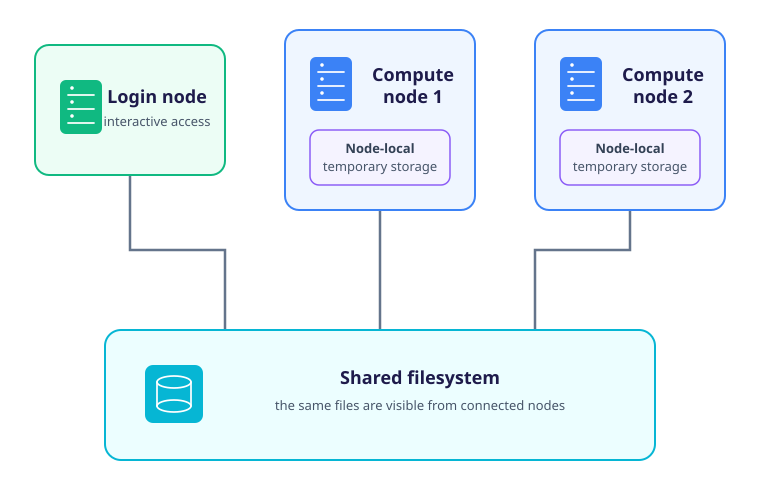

After connecting to a cluster, your remote shell normally starts in your home directory.
That directory is only one part of the storage available to you.
An HPC service may provide several filesystems for different purposes with different capacities, performance characteristics, access controls etc.

Choosing where to work can therefore involve some amount of decision making.
The location must be visible to the nodes that run the application, suitable for the way the application accesses data and able to retain the data for as long as it is needed.

This section uses a small number of shell commands to inspect storage.
[The Bash Shell](technology_and_tooling/bash_shell) introduces filesystem navigation and file manipulation in more detail.

## Paths, Filesystems and Storage Spaces

A *path* identifies a file or directory within the filesystem namespace presented by the operating system.
The command `pwd` prints the path of your current working directory:

```bash
remote$ pwd
```

Your home directory is also recorded in the `HOME` environment variable and abbreviated by `~` in the shell:

```bash
remote$ printf '%s\n' "$HOME"
```

Several paths can reside on different underlying filesystems even though they appear in one directory hierarchy.
The operating system makes a filesystem available at a path called a *mount point*.
Filesystems mounted on a login node need not all be mounted on every compute node.

Use `df` with a path to identify the filesystem containing it and view that filesystem's overall capacity:

```bash
remote$ df -h "$HOME"
```

The `-h` option expresses sizes using readable units such as GiB or TiB.
The `Filesystem` and `Mounted on` columns identify the underlying filesystem and its mount point, while the remaining columns report its used and available capacity.
Running `df -h .` reports the filesystem containing the current working directory, which is useful after moving between storage spaces.

:::callout{variant="warning"}

## Storage Nomeclature

Names such as *home*, *work*, *project* and *scratch* are common, but they do not define a portable policy.
A path called `scratch` might persist for months on one cluster and be deleted when a job ends on another.
Similarly, a home directory may be backed up yet unavailable on compute nodes, or visible everywhere but protected only by filesystem redundancy.

Environment variables such as `WORK`, `DATA`, `SCRATCH` or `PROJECTDIR` are also site-defined and may not exist on another cluster.
Consult documentation for the service rather than guessing their purpose from their names.

:::

## Common Storage Roles

Although their names vary, storage spaces commonly fulfil the following roles:

| Storage role | Common uses | Questions to resolve locally |
| --- | --- | --- |
| Personal or home storage | Shell configuration, source code, job scripts and small working files | Is it backed up, what is its quota, and is it visible on compute nodes? |
| Project or work storage | Active datasets, shared project files, application inputs and job outputs | Who can access it, is it backed up, and how long should active data remain there? |
| Shared temporary or scratch storage | Large intermediate files and data needed by processes on several nodes | When is it purged, what quota applies, and must results be copied elsewhere before a job ends? |
| Node-local temporary storage | High-rate temporary input and output used by processes on one compute node | How is its path provided, is it shared between job steps, and when is it deleted? |
| Archive or long-term storage | Data retained after active computation has finished | How is it accessed, what does retrieval cost in time, and what preservation policy applies? |

No single storage space is best for every part of a workflow.
Source code and small scripts benefit from reliable personal storage, active datasets must be visible to compute nodes, and reproducible intermediate files may belong on temporary high-performance storage.
Irreplaceable results require a separately managed, durable copy regardless of where they were produced.

## Shared and Node-Local Storage

A *shared filesystem* can be mounted by several nodes so that they can access the same files, usually through the same paths.
This is how a job submitted from a login node can often read an input file when it later starts on a compute node.
The set of shared filesystems is a property of the particular cluster, so visibility must still be checked in its documentation.

*Node-local storage* is attached to, or reserved on, one compute node.
It can avoid some traffic to a shared filesystem and may suit temporary files that are repeatedly accessed by processes on that node.
Other nodes cannot normally see those files, and the service may remove them as soon as the job ends.



For a single-node job, an application can copy input to node-local storage, perform its calculation there and copy the required results back to shared storage before finishing.
For a multi-node job, node-local storage on one node cannot act as a shared exchange area for processes on the other nodes.
Applications using several nodes therefore need shared storage or explicit communication to move data between them.

:::callout{variant="note"}

## Storage Provided to a Job

Some services create temporary directories only after a scheduled job begins and expose their paths through environment variables.
Do not invent these paths in advance or assume that a variable used on another cluster has the same meaning.
[Running Jobs with Slurm](high_performance_computing/hpc_intro/04_scheduler) will show where commands execute once a job receives compute resources.

:::

## Capacity, Quotas and File Counts

The free capacity reported by `df` normally describes the filesystem as a whole and does not by itself establish how much space your account may use.
On a shared service, an individual user or project is usually limited by a *quota* that may be much smaller than the remaining filesystem capacity.
Quotas may apply to stored bytes, the number of files and directories, or both.

:::callout{variant="warning"}

## Free Space Is Not Your Allowance

A filesystem showing several terabytes free does not imply that your account may consume them.
Quota-reporting commands vary between services and parallel filesystem implementations, and some services report quotas through an account portal rather than the shell.
Use the documented quota tool and check whether the limit belongs to you individually or is shared across a project.

:::

The `du` command estimates the space occupied beneath a directory:

```bash
remote$ du -sh path/to/directory
```

Unlike `df`, `du` traverses the directory tree and accounts for the files it finds.
That traversal can be slow and can generate substantial metadata traffic when applied to a large project directory or millions of files, so use the service's quota and accounting tools for large-scale checks.

File-count limits matter even when the total data volume is modest.
A workflow that creates millions of small files can exhaust its file quota and perform poorly because every file must be located, opened and described by filesystem metadata.
Where an application permits it, storing related data in fewer larger files or packaging completed collections can reduce that overhead.

## Backup, Retention and Responsibility

Storage resilience and backup solve different problems.
A resilient filesystem may continue operating after a disk fails, but it does not necessarily recover a file that a user deletes, overwrites or corrupts.
Snapshots may permit short-term recovery without constituting a durable backup, and temporary filesystems may deliberately purge old data.

For every storage space you intend to use, determine:

1. Whether the data is backed up and whether individual files can be restored.
1. Whether snapshots exist and how long they are retained.
1. Whether files are deleted after a job, after a period of inactivity or when an allocation ends.
1. Whether the storage is approved for the sensitivity and classification of the data.
1. Where the authoritative copy of irreplaceable inputs and results will be kept.

:::callout{variant="warning"}

## Keep Another Copy of Irreplaceable Data

Do not keep the only copy of important research data on working or scratch storage.
The absence of an automatic purge policy does not mean that the data is backed up or retained beyond the lifetime of the service.

[Transferring Files](high_performance_computing/hpc_intro/06_transferring_files) covers tools for moving data, while [Using Shared Resources Responsibly](high_performance_computing/hpc_intro/09_responsibility) considers backup and end-of-project planning.

:::

## Prepare a Working Directory

The remaining sections of this course need a directory in which job scripts, small inputs and output files can be stored.
Choose a storage space that is visible from the compute nodes, persists for the duration of the course and is intended for active computational work.
A home directory may be appropriate on a small teaching cluster, while another service may require jobs to run from project or work storage.

::::challenge{id=choose-storage title="Choose and Prepare a Working Directory"}

Use the cluster documentation to record the storage spaces available to your account.
For each one, identify its path or environment variable, visibility from login and compute nodes, quota, backup policy, retention policy and intended use.

Choose the space best suited to the small scripts and output files created during this course.
Replace the example value below with the path you selected, then create and enter the working directory:

```bash
remote$ COURSE_STORAGE=/replace/this/with/your/chosen/path
remote$ mkdir -p "$COURSE_STORAGE/hpc-intro"
remote$ cd "$COURSE_STORAGE/hpc-intro"
remote$ pwd
remote$ df -h .
```

Create and remove a small file to confirm that the directory is writable:

```bash
remote$ printf 'storage check\n' > storage-check.txt
remote$ ls -l storage-check.txt
remote$ rm storage-check.txt
```

:::solution

There is no universal correct path.
A suitable result is a directory that the service documents as visible to compute jobs, durable for the length of the course and appropriate for active work.
The chosen space must also have sufficient quota, but the free capacity shown by `df` does not establish that quota.

The successful creation and removal of `storage-check.txt` confirms that the directory is currently writable from the login node.
Compute-node visibility follows from the service documentation and can be confirmed after the next section submits the first scheduled job.

Keep the path reported by `pwd` because the following exercises will use this working directory.

:::
::::

The next section, [Running Jobs with Slurm](high_performance_computing/hpc_intro/04_scheduler), will create and submit a job script from this directory.
