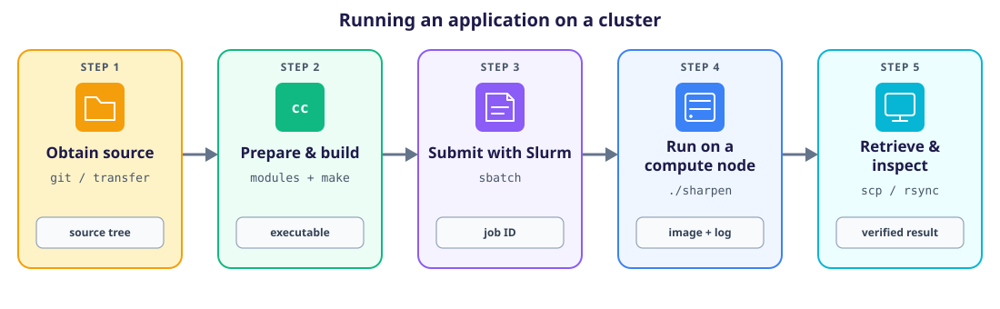
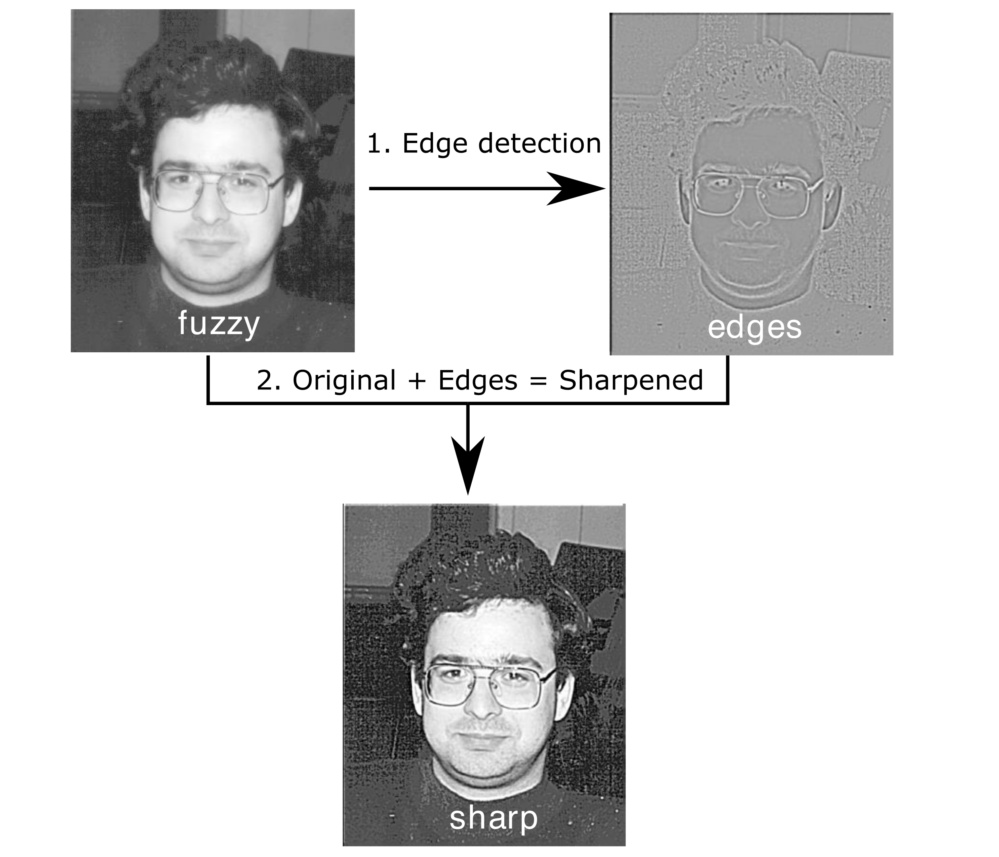

This practical combines preceding lessons on how to access and interact with a HPC cluster into one complete workflow: obtain an application's source code, prepare its software environment, compile it, submit it through Slurm, inspect the completed job and retrieve its result.

This is a sequence of operations that is representative of standard HPC usage.



## The Application

The application is a serial C program that sharpens a greyscale image.
It reads `fuzzy.pgm`, applies a 17 by 17 Laplacian-of-Gaussian filter to emphasise edges and writes the result to `sharpened.pgm`.

For each output pixel, the program performs the same weighted calculation over a neighbourhood of input pixels.
This repeated work makes a useful example of a computational application but a serial implementation could carry out the work on 1 logical core.



The source repository also contains MPI, OpenMP and Fortran implementations that you may encounter in sections on using those tools in [parallel-programming material](high_performance_computing/hpc_parallel_intro).
This practical uses only `sharpen/C-SER`.

## Obtain the Source Code

Return to, or otherwise create a working directory ([see Storage on an HPC Cluster](high_performance_computing/hpc_intro/03_cluster)).
If the cluster permits access to GitHub from the documented node, you can directly clone the exercise repository and enter the "C-SER" directory:

```bash
remote$ cd /remote/path/to/hpc-intro
remote$ git clone https://github.com/UNIVERSE-HPC/foundation-exercises.git
remote$ cd foundation-exercises/sharpen/C-SER
remote$ ls
```

The directory should contain the C source and header files, a `Makefile`, the input image `fuzzy.pgm` and a bundled `sharpen.slurm` script:

```output
Makefile  cio.c  dosharpen.c  filter.c  fuzzy.pgm  sharpen.c  sharpen.h  sharpen.slurm  utilities.c  utilities.h
```

:::callout{variant="note"}

## When the Cluster Cannot Reach GitHub

Outbound network access may differ between login and compute nodes.
If the documented cluster environment cannot reach GitHub, clone the repository on your local computer and transfer it using one of the methods described in [Transferring Data](high_performance_computing/hpc_intro/06_transferring_files):

```bash
local$ git clone https://github.com/UNIVERSE-HPC/foundation-exercises.git
local$ rsync -aP foundation-exercises/ username@login.example.ac.uk:/remote/path/to/hpc-intro/foundation-exercises/
```

After the transfer, enter the same `foundation-exercises/sharpen/C-SER` directory on the cluster.

:::

:::callout{variant="warning"}

## Do Not Submit the Bundled Script Unchanged

The repository's `sharpen.slurm` file contains account, partition, module and launcher settings which were written for a particular system.
Use it only as source material to create your own version of the script from which matches the requirements of your cluster.

:::

## Prepare the Build Environment

Compiling source code produces an executable for a particular software and hardware environment.
Use the type of node and compiler environment recommended by the cluster rather than assuming that a login node and a compute node are interchangeable.

:::callout{variant="note"}

## Build Where the Service Directs You

[Oxford ARC](https://arc-user-guide.readthedocs.io/en/latest/job-scheduling.html) directs users to build software on an interactive compute node because its login nodes have a different operating system and processor architecture.
Other services may provide a compiler environment on their login or dedicated build nodes.

If an interactive allocation is required, use the procedure from [Running Jobs with Slurm](high_performance_computing/hpc_intro/04_scheduler) before continuing.

:::

Check whether `make` and a C compiler are available in the build environment, then inspect the loaded modules:

```bash
remote$ command -v make
remote$ command -v cc
remote$ module list
```

The Makefile uses `cc`, a conventional name that may select a system c compiler or a c compiler wrapper configured by the cluster.
Do not replace it with a particular compiler merely because its name differs from one used elsewhere.

If either command is unavailable, use the process found in [Using Software Modules](high_performance_computing/hpc_intro/05_modules) and the cluster documentation to find and load an appropriate build environment.
It might be useful to record any module commands you run because the resulting executable may require the same runtime libraries to execute during the batch job.

## Build the Application

If necessary, remove any products from an earlier build, then use `make` to compile the source:

```bash
remote$ make clean
remote$ make
```

Read any warnings emitted by the compiler, but don't worry too much if there are no errors that cause `make` to stop without producing the executable.
The scheduled test in the next step provides the meaningful check that the resulting program can run successfully.

Don't test the computational workload on a shared login node.

## Run and Retrieve the Result

::::challenge{id=run-image-sharpening title="Run and Retrieve the Image-Sharpening Application"}

Starting in the directory containing `sharpen` and `fuzzy.pgm`, using what you have learned in previous sections create a Slurm batch script that:

1. Requests one node, one task, one CPU and no more than two minutes.
1. Includes any additional account, partition or other settings required by the cluster.
1. Recreates any module environment required by the executable.
1. Runs `./sharpen` and records its output in a file containing the job ID.

Submit the job from the application directory and retain its job ID.
Use the queue, accounting record and job log to determine whether it completed successfully.
Remove any `sharpened.pgm` left by an earlier run before submission, then confirm that the job creates a new non-empty output image.

Retrieve `fuzzy.pgm`, `sharpened.pgm` and the job log to your local computer.
Open the two images with a viewer that supports the Portable Greymap format and compare them.

:::solution

The script can follow the structure established in [Running Jobs with Slurm](high_performance_computing/hpc_intro/04_scheduler):

```bash
#!/bin/bash
#SBATCH --job-name=sharpen
#SBATCH --nodes=1
#SBATCH --ntasks=1
#SBATCH --cpus-per-task=1
#SBATCH --time=00:02:00
#SBATCH --output=sharpen-%j.out

# Add any other #SBATCH directives required by your service above this line.

set -euo pipefail

# Recreate any module environment required to run the executable here.

printf 'Compute node: '
hostname
printf 'Loaded modules:\n'
module list

./sharpen
test -s sharpened.pgm
```

The `./sharpen` command runs the serial executable directly.
Save the script as `sharpen-job.sh` in the application directory.

Remove any output image from an earlier attempt, submit the job and inspect it using its ID:

```bash
remote$ rm -f sharpened.pgm
remote$ sbatch sharpen-job.sh
Submitted batch job 12345

remote$ squeue --job=12345
remote$ sacct --jobs=12345 --format=JobID,JobName,State,Elapsed,ExitCode
```

After the accounting record reports `COMPLETED`, inspect the log and generated image:

```bash
remote$ cat sharpen-12345.out
remote$ ls -lh fuzzy.pgm sharpened.pgm
```

The service-specific module list and hostname will vary, but the application output should contain the following stages:

```output
Image sharpening code running in serial
Input file is: fuzzy.pgm
Image size is 564 x 770
Using a filter of size 17 x 17
Reading image file: fuzzy.pgm
... done
Starting calculation ...
... finished
Writing output file: sharpened.pgm
... done
Calculation time was ...
Overall run time was ...
```

The precise timings depend on the compute node and software environment.
A single timing confirms that the program ran; it is not a reliable performance comparison.

From the local computer, create a results directory and copy back the input, output and log:

```bash
local$ mkdir -p sharpen-results
local$ scp username@login.example.ac.uk:/remote/path/to/C-SER/fuzzy.pgm sharpen-results/
local$ scp username@login.example.ac.uk:/remote/path/to/C-SER/sharpened.pgm sharpen-results/
local$ scp username@login.example.ac.uk:/remote/path/to/C-SER/sharpen-12345.out sharpen-results/
```

Replace the hostname, path and job ID with the values from your run.
The sharpened image should emphasise edges and will be slightly smaller because the program removes the border for which the full filter neighbourhood is unavailable.

If `sbatch` rejects the script, revisit the local scheduler requirements collected earlier in the course.
If the job starts but fails, use the accounting state and log to attempt to distinguish a missing input, unavailable runtime environment or application error before fixing the script.

:::
::::

The application has now passed through a complete cluster workflow from source code to a locally inspected result.
[Using Resources Effectively](high_performance_computing/hpc_intro/08_resources) next uses evidence from completed jobs to refine future resource requests.
