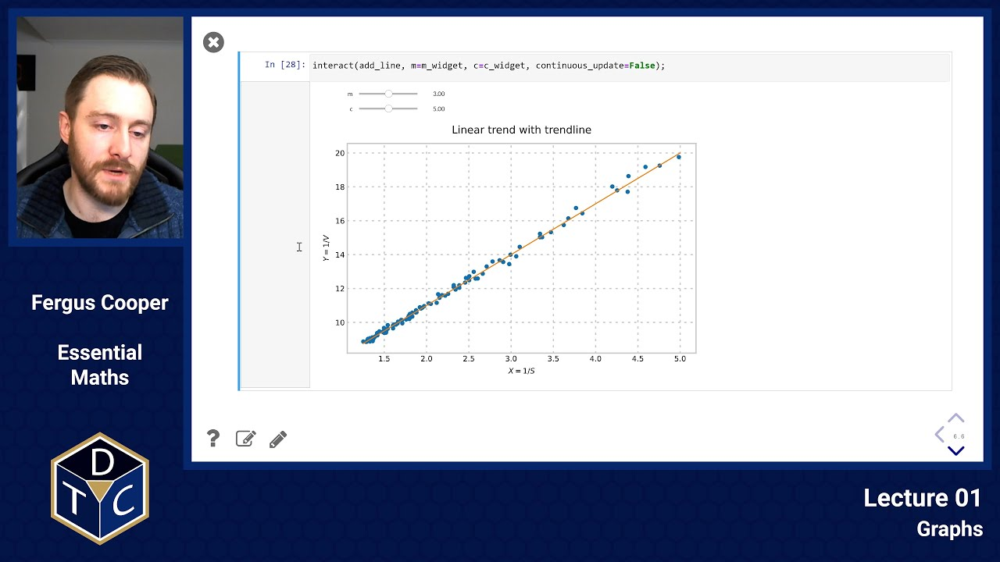
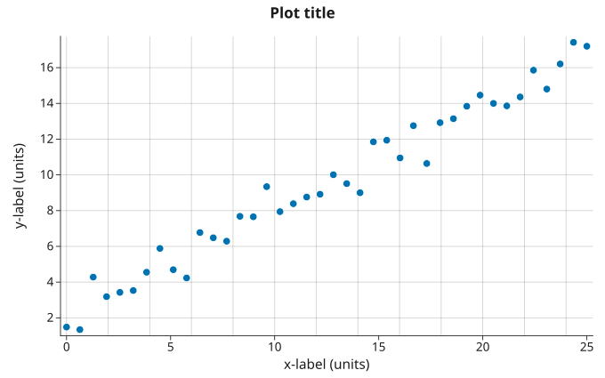
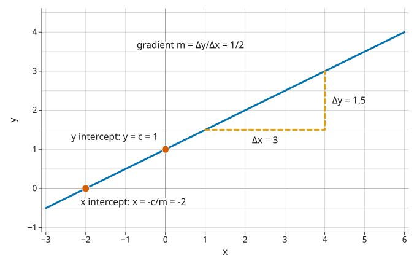
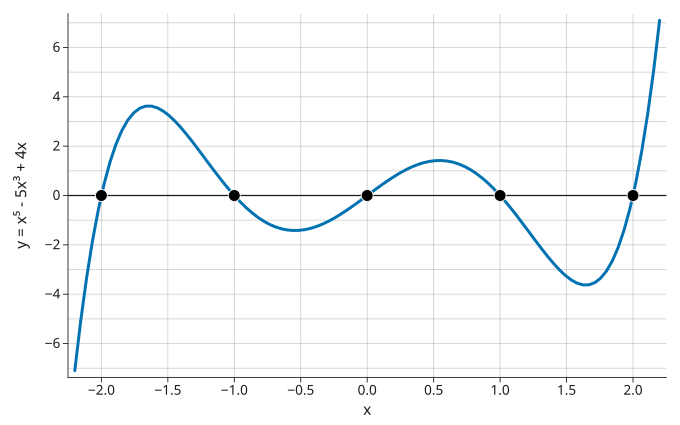
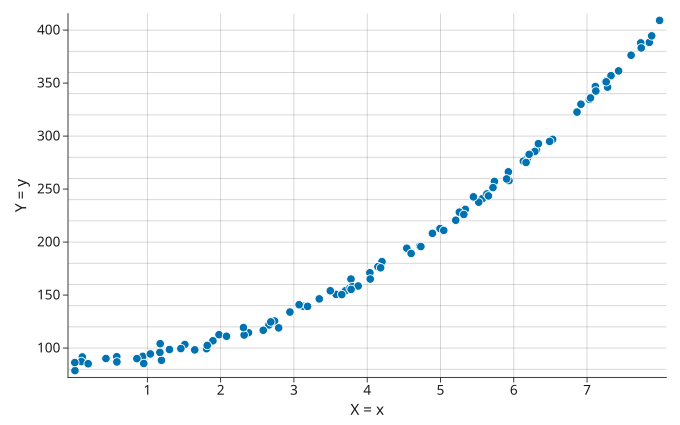
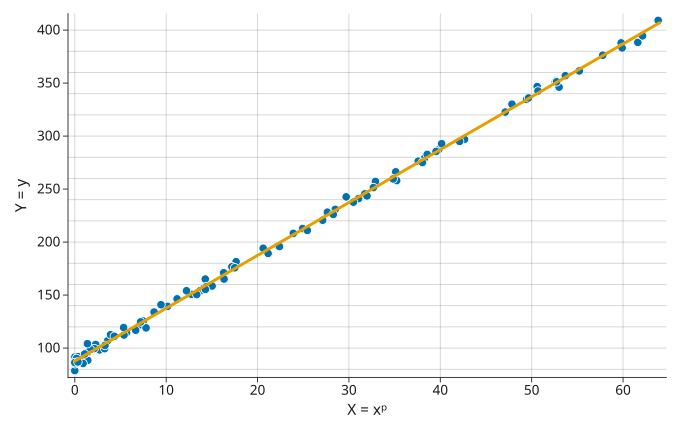
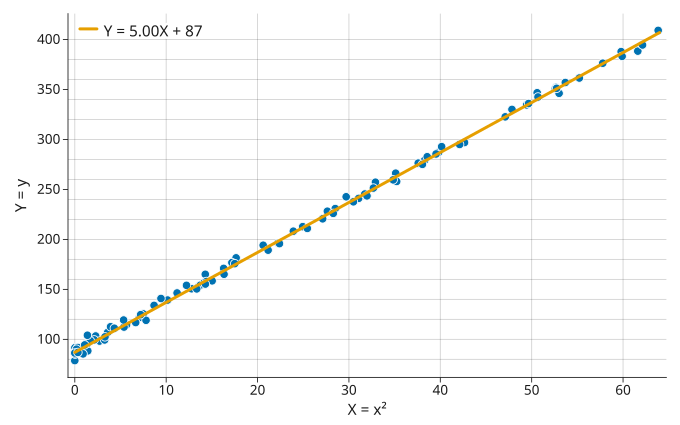
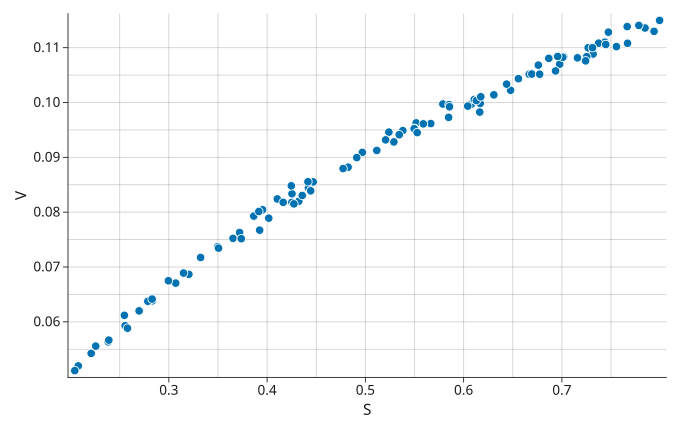
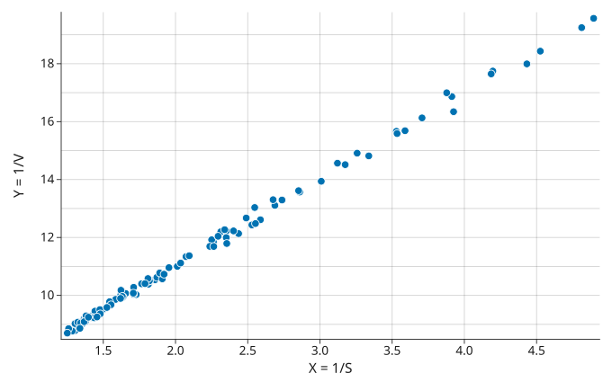
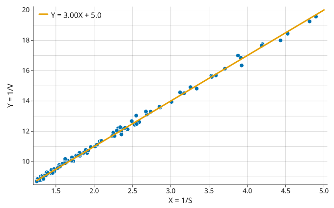

---

## YouTube lecture recording from October 2020

A recording of this lecture from October 2020; the material has changed a little since.

[](https://youtu.be/HIRpQ1caeKk)

---

## Why graphs?

We often want to go between a formula and its graph, in either direction:

- Given a formula, what shape will its graph have?
  This is called _sketching_.
- Given some data, which formula describes them, and what are its parameters?
  We can often answer this by _linearising_ the data.

## Anatomy of a graph

Terminology:

- $Y$ or $y$ is the _dependent_ variable, sometimes called the _ordinate_,
  marked on the vertical axis
- $X$ or $x$ is the _independent_ variable, sometimes called the _abscissa_,
  marked on the horizontal axis
- The dependent variable is said to be graphed _against_ the independent
  variable

Essential features:

- Title
- Axis labels (and units if appropriate)



## Equation of a straight line

Defined by a gradient, $m$, and a $y$-axis intercept, $c$:

$$
y = m x + c
$$

Interpretation:

- The intercept of this line on the $y$ axis is given by $y=c$, since at $x=0$,
  $y = c$

- The gradient of this line (also called its "slope") is given by

  $$
  m = \frac{y_2-y_1}{x_2 - x_1}
  $$

  ("change in $y$ divided by change in $x$")

- The gradient is also known as the _rate of change_ of $y$ with respect to $x$ (more on this when we cover differentiation)

- The intercept of this line on the $x$ axis is given by $x = -c/m$,
  since at $y=0$ we must have $mx=-c$

For example, the line $y = \frac{1}{2}x + 1$ has gradient $m = 1/2$, $y$ intercept $c = 1$ and $x$ intercept $x = -c/m = -2$:



## Sketching graphs

Given a formula, what shape is its graph?
Polynomials are a good place to start.

### Graphs of polynomials

An expression involving higher powers of $x$ is called a _polynomial_ in $x$:

$$
y = a_n x^n + a_{n-1} x^{n-1} + a_{n-2} x^{n-2}+\ldots+a_1 x^1 + a_0x^0
$$

The highest power, $n$, is its _degree_.
The graph of a polynomial of degree $n$ has at most $n-1$ bends (turning points) in it.

### Sketching a polynomial

Consider

$$
y=x^5-5x^3+4x
$$

- To sketch this, we first find where $y=0$. It factorises as

  $$
  y = x(x+1)(x-1)(x+2)(x-2)
  $$

  so $y=0$ at $x = -2, -1, 0, 1, 2$

- For large $|x|$, the $x^5$ term dominates, so $y$ rises to the right and falls to the left

  Here $|x|$ is the _absolute value_ (or _modulus_) of $x$, its size ignoring its sign, so $|-3| = |3| = 3$.
  So "large $|x|$" means $x$ far from zero, in either direction.

- It has degree 5, so it has at most 4 bends, just enough to pass through all five zeros

- Each zero comes from a single factor, so $y$ changes sign there

This is enough to sketch the graph. Plotting it in Python confirms the sketch:



### A checklist for sketching

To sketch the graph of a function:

- Find where it is zero, positive and negative
- Look at which terms dominate as $x\to\pm\infty$
- Look at the limit behaviour as $x$ approaches any points where the function is undefined (e.g. $x\to 0$ for $y=1/x$), which may give an _asymptote_
- Work out how many bends it can have (more on this when we cover differentiation)

Then check your sketch by plotting the function in Python.

## From data to a model

Now for the other direction.
Given some data, which formula describes them, and what are its parameters?

- It is hard to tell by eye whether a curve is quadratic, exponential or something else.
- It is much easier to see whether points lie on a straight line, and a straight line is described by just two numbers, its gradient and intercept.
- If we wish to test visually whether some data fit a particular relationship, we can transform the data to plot something which should be linear if the relationship holds.

### Linearising: the recipe

1. Write down the model, e.g. $y = ax^2 + b$.
2. Rearrange it into the form $Y = mX + c$, where $X$ and $Y$ depend only on the data, and $m$ and $c$ only on the parameters.
   Here $Y = y$, $X = x^2$, $m = a$ and $c = b$.
3. Plot $Y$ against $X$.
   If the points lie on a straight line, the data are consistent with the model.
   If they curve, the model is wrong.
4. Read off the gradient and intercept, and work back to the parameters.

### Example: is this quadratic?

There's a definite curve, and we may suspect the trend is quadratic: $y = ax^2 + b$.



#### Testing the model

If the parabolic relationship holds, plotting $Y=y$ against $X=x^2$ should result in a straight line.
Plotting against $x$ or $x^3$ instead would leave the points on a curve.



#### Gradient and intercept

We next add a trendline through these points which we can use to determine the gradient and intercept.



- We find $(X,Y)$ lie along a straight line with slope 5 and $Y$-intercept 87.

- This means that $Y=5X+87$, so $a = 5$ and $b = 87$.

- So, $y$ and $x$ can be modelled by the polynomial equation $y=5x^2+87$.

### Example: enzyme kinetics

The rate at which a given enzyme can catalyse a reaction can be dependent upon the substrate concentration.
This is often modelled by the _Michaelis-Menten_ equation:

$$
V = \frac{V_{\max}S}{K_m + S}
$$

where $V$ is the rate of the reaction, $S$ is the substrate concentration, $V_{\max}$ is the maximum rate, and $K_m$ is the substrate concentration at which the rate is half its maximum.

First, plot the original data, which are observations of $V$ given varying $S$:



#### Straight-line form

Take the reciprocal of both sides:

$$
\frac{1}{V} = \frac{K_m + S}{V_{\max}S} = \frac{K_m}{V_{\max}}\cdot\frac{1}{S} + \frac{1}{V_{\max}}
$$

- We can derive a straight line graph from the above formula by plotting $Y=1/V$ against $X=1/S$ (this is called the _Lineweaver-Burk_ plot)

- It will have gradient $m = K_m/V_{\max}$ and ordinate intercept $c = 1/V_{\max}$

#### Transformed data

If the Michaelis-Menten model holds, plotting $Y=1/V$ against $X=1/S$ should result in a straight line.



#### Gradient and intercept

We next add a trendline through these points which we can use to determine the gradient and intercept.



- We find $(X,Y)$ lie along a straight line with slope 3 and $Y$-intercept 5.

- This means that $Y=3X+5$, so $V_{\max} = 1/c = 0.2$ and $K_m = m/c = 0.6$.

- So, $V$ and $S$ can be modelled by the equation $V = 0.2S/(0.6+S)$.

### Linearising in practice

- Note, transforming the data also transforms any noise in it. Taking $1/V$ magnifies the errors in small values of $V$, and these points then have the most influence on the trendline.
- In practice, it is usually better to fit the nonlinear model directly, e.g. using `scipy.optimize.curve_fit`.
- Plotting in straight-line form is still a good way to check a model visually, and you will see these plots in many papers (e.g. Lineweaver-Burk, Arrhenius).
- Logarithms, which we cover next, let us do the same for exponentials and power laws.

## Introductory problems

:::callout{variant="tip"}
For more practice, an AI tool can write new problems like the ones below.
Ask it for problems of the same type and difficulty, or for problems set in your own field.
For example, you could ask it to "write five ecology problems on straightening curved data into straight lines, at the level of these ones".
Work them on paper first, then ask the tool to check your answers and to explain any step you are unsure of.
:::

::::challenge{id="01_intro_01" title="Introductory problems 1"}
Sketch the following graphs.
First, use pen & paper, then use Python to check your answers.
The notation after each equation indicates the range of values that the variable can take.

1. $y = 3x+5 \qquad\qquad x\in[0,10]$
1. $y = x^2/2 - 4 \qquad\qquad x\in[-4,4]$
1. $y = \sqrt{x} \qquad\qquad x\in[0,25]$
1. $y = \sin(t) \qquad\qquad t\in[0,2\pi]$
1. $y = \sin(2t) \qquad\qquad t\in[0,2\pi]$
1. $y = 1/x \qquad\qquad x\in[0.1,5]$
1. $y = -1/x^2 \qquad\qquad x\in[0.1,5]$

```python
# hint
import numpy as np
from matplotlib import pyplot as plt

x = np.linspace(0, 10, 100)
y = 3 * x + 5

plt.plot(x, y)
```

:::solution

1. A straight line with gradient 3 and $y$-intercept 5.
   It runs from $(0, 5)$ to $(10, 35)$.
1. A parabola (a "U" shape), symmetric about the $y$ axis, with its minimum at $(0, -4)$.
   It crosses the $x$ axis where $x^2/2 = 4$, so at $x = \pm\sqrt{8} \approx \pm 2.83$, and reaches $y = 4$ at $x = \pm 4$.
1. Starts at $(0, 0)$, rises steeply at first and then flattens out.
   It passes through $(1, 1)$, $(4, 2)$, $(9, 3)$, $(16, 4)$ and $(25, 5)$.
1. One complete wave.
   It is zero at $t = 0$, $\pi$ and $2\pi$, has its maximum of 1 at $t = \pi/2$ and its minimum of $-1$ at $t = 3\pi/2$.
1. Two complete waves, since $\sin(2t)$ oscillates twice as fast as $\sin(t)$.
   It is zero at every multiple of $\pi/2$, has maxima of 1 at $t = \pi/4$ and $5\pi/4$, and minima of $-1$ at $t = 3\pi/4$ and $7\pi/4$.
1. A decreasing curve, from $y = 10$ at $x = 0.1$, through $(1, 1)$, to $y = 0.2$ at $x = 5$.
   As $x \to 0$, $y \to \infty$, and as $x$ grows the curve gets closer and closer to the $x$ axis without ever reaching it.
1. Always negative, rising from $y = -100$ at $x = 0.1$, through $(1, -1)$, to $y = -0.04$ at $x = 5$.
   As $x$ grows the curve approaches the $x$ axis from below.

The hint plots the first graph.
The others follow the same pattern, each in a new figure:

```python
import numpy as np
from matplotlib import pyplot as plt

x = np.linspace(-4, 4, 100)
plt.figure()
plt.plot(x, x**2 / 2 - 4)

x = np.linspace(0, 25, 100)
plt.figure()
plt.plot(x, np.sqrt(x))

t = np.linspace(0, 2 * np.pi, 100)
plt.figure()
plt.plot(t, np.sin(t))
plt.plot(t, np.sin(2 * t))

x = np.linspace(0.1, 5, 100)
plt.figure()
plt.plot(x, 1 / x)

plt.figure()
plt.plot(x, -1 / x**2)
```

:::

::::

::::challenge{id="01_intro_02" title="Introductory problems 2"}
For which values of $x$ are the following functions positive? Negative? Zero?

1. $x^2 - 9$
1. $\sin(x)$
1. $\sin(3x)$
1. $2/x - 1/x^2$

:::solution

1. $x^2 - 9 = (x-3)(x+3)$, so it is zero at $x = \pm 3$, negative for $-3 < x < 3$, and positive for $x < -3$ or $x > 3$.
1. $\sin(x)$ is zero at $x = n\pi$, for any whole number $n$.
   It is positive for $0 < x < \pi$, negative for $\pi < x < 2\pi$, and this pattern repeats every $2\pi$.
1. $\sin(3x)$ has the same pattern, squeezed by a factor of 3.
   It is zero at $x = n\pi/3$, positive for $0 < x < \pi/3$, negative for $\pi/3 < x < 2\pi/3$, and the pattern repeats every $2\pi/3$.
1. Put both terms over a common denominator:

   $$
   \frac{2}{x} - \frac{1}{x^2} = \frac{2x - 1}{x^2}
   $$

   The denominator $x^2$ is positive for every $x \neq 0$, so the sign is the sign of $2x - 1$.
   The function is zero at $x = 1/2$, positive for $x > 1/2$, and negative for $x < 1/2$ (except at $x = 0$, where it is not defined).

:::

::::

::::challenge{id="01_intro_03" title="Introductory problems 3"}
A straight line passes through the points $(1, 3)$ and $(4, 9)$.

1. What is its gradient?
1. Write down its equation in the form $y = mx + c$.
1. Where does it cross the $y$ axis? The $x$ axis?
1. Does the point $(-2, -3)$ lie on the line?

:::solution

1. The gradient is the change in $y$ divided by the change in $x$:

   $$
   m = \frac{9 - 3}{4 - 1} = \frac{6}{3} = 2
   $$

1. The line passes through $(1, 3)$, so $3 = 2 \times 1 + c$, which gives $c = 1$.
   So, the line is $y = 2x + 1$.

1. It crosses the $y$ axis at $y = c = 1$, and the $x$ axis at $x = -c/m = -1/2$.

1. At $x = -2$, the line has $y = 2 \times (-2) + 1 = -3$, so yes, $(-2, -3)$ lies on the line.

:::

::::

::::challenge{id="01_intro_04" title="Introductory problems 4"}
Use the checklist for sketching to sketch the graph of

$$
y = x^3 - x^2 - 6x
$$

Hint: start by factorising.
Then use Python to check your sketch.

:::solution

Take out the common factor $x$, then factorise the quadratic:

$$
y = x(x^2 - x - 6) = x(x - 3)(x + 2)
$$

- **Zeros:** $y = 0$ at $x = -2$, $x = 0$ and $x = 3$.
- **Sign:** checking one point between each pair of zeros, $y$ is negative for $x < -2$, positive for $-2 < x < 0$, negative for $0 < x < 3$, and positive for $x > 3$.
- **Large $|x|$:** the $x^3$ term dominates, so $y \to \infty$ as $x \to \infty$, and $y \to -\infty$ as $x \to -\infty$.
- **Undefined points:** none, as $y$ is a polynomial.
- **Bends:** $y$ has degree 3, so it has at most 2 bends: a peak between $x = -2$ and $x = 0$, and a trough between $x = 0$ and $x = 3$.

```python
import numpy as np
from matplotlib import pyplot as plt

x = np.linspace(-3, 4, 200)
y = x**3 - x**2 - 6 * x

plt.plot(x, y)
plt.axhline(0, color='black', linewidth=0.5)
plt.xlabel('x')
plt.ylabel('y')
```

:::

::::

## Main problems

Text relevant to these problems: Croft and Davison, 5th Edition, Chapters 17 & 18.

::::challenge{id="01_main_01" title="Main problems 1"}
The Lennard-Jones potential energy between two non-polar atoms may be given by the equation:

$$
V(R)=\frac{A}{R^{12}} - \frac{B}{R^6}
$$

where $A$ and $B$ are positive constants, $V(R)$ is the potential energy, measured in Joules, and $R$ is the internuclear distance measured in $\AA$.

1. For which values of $R$ is $V(R)$ positive? Negative? Zero?
1. Sketch a graph (on paper) showing the potential energy between the two atoms as a function of $R$ given that $A=1.6\times 10^{-14}$ and $B = 1.0\times 10^{-17}$ (the values for argon).
1. What is the potential energy between the two atoms at infinite separation?
1. What would happen to the two atoms if they were brought very close together?
1. What is the physical interpretation of the sign of $V(R)$, and of its slope?
1. What are the dimensions ([Length], [Mass], [Time]) and units of the constants $A$ and $B$?
1. Use Python to plot the graph of $V$ versus $R$ for $A=1.6\times 10^{-14}$ and $B = 1.0\times 10^{-17}$. Remember to add relevant axis labels. Plot on the same graph the line of $V = 0$, so you can verify your answers to **1.** and **2.** Choose the limits of your plot with care.

:::solution

$R$ is a distance, so we only need to consider $R > 0$.

1. Put both terms over a common denominator:

   $$
   V(R) = \frac{A - BR^6}{R^{12}}
   $$

   $R^{12}$ is positive, so the sign of $V$ is the sign of $A - BR^6$.
   This means that $V$ is zero at $R = (A/B)^{1/6}$, positive for $R < (A/B)^{1/6}$, and negative for $R > (A/B)^{1/6}$.

1. With $A = 1.6\times 10^{-14}$ and $B = 1.0\times 10^{-17}$, $A/B = 1600$, so $V$ is zero at $R = 1600^{1/6} \approx 3.42\,\AA$.
   The graph comes down steeply from very large values at small $R$, crosses the $R$ axis at $3.42\,\AA$, dips to a shallow minimum just beyond it, then rises slowly back towards zero from below (we find the minimum exactly when we cover differentiation).

1. As $R \to \infty$ both terms tend to zero, so $V \to 0$.

1. As $R \to 0$, the $A/R^{12}$ term dominates and $V \to \infty$.
   It takes more and more energy to push the atoms closer together, so they cannot be brought very close, and if released they would fly apart.

1. The sign of $V$ tells us whether the pair of atoms has more energy (positive) or less energy (negative) than when they are infinitely far apart.
   Where $V$ is negative the atoms are bound, and energy is needed to pull them apart.
   The slope tells us about the force between them.
   Where $V$ decreases as $R$ increases (negative slope) the atoms push each other apart, and where $V$ increases with $R$ (positive slope) they pull each other together.
   The steeper the slope, the stronger the force, and at the minimum, where the slope is zero, there is no force (more on this when we cover differentiation).

1. $V$ is an energy, with dimensions $[\text{Mass}][\text{Length}]^2[\text{Time}]^{-2}$.
   Each term in the formula must have the same dimensions as $V$, so $A$ must have the dimensions of $VR^{12}$ and $B$ those of $VR^6$:

   $$
   [A] = [\text{Mass}][\text{Length}]^{14}[\text{Time}]^{-2}, \qquad [B] = [\text{Mass}][\text{Length}]^{8}[\text{Time}]^{-2}
   $$

   With $V$ in Joules and $R$ in $\AA$, the units of $A$ are J$\,\AA^{12}$ and the units of $B$ are J$\,\AA^6$.

1. A first attempt might plot $R$ from 0 to $10\,\AA$.
   This shows a tall spike at the left and a flat line everywhere else.
   At $R = 0.1\,\AA$, $V$ is about $10^{-2}\,$J, but the dip is only about $10^{-21}\,$J deep, so on this scale it is invisible (and $R = 0$ gives a division by zero).

   The interesting features are near $R = 3.42\,\AA$, so we plot $R$ from 3 to $8\,\AA$.
   Even there, $V$ is much larger at $R = 3\,\AA$ than the depth of the dip, so we also limit the $V$ axis:

   ```python
   import numpy as np
   from matplotlib import pyplot as plt

   A = 1.6e-14
   B = 1.0e-17
   R = np.linspace(3, 8, 200)
   V = A / R**12 - B / R**6

   plt.plot(R, V, label='V(R)')
   plt.plot(R, 0 * R, '--', label='V = 0')
   plt.ylim(-2e-21, 2e-21)
   plt.xlabel('R (Angstrom)')
   plt.ylabel('V (J)')
   plt.legend()
   ```

:::

::::

::::challenge{id="01_main_02" title="Main problems 2"}
How should these equations be rearranged to allow the plotting of a suitable **linear** graph, assuming that the constant parameters $a$ and $b$ are unknown, and we wish to use the graph to find them?
Write down expressions for the gradient, $X$-intercept and $Y$-intercept of each rearranged equation:

1. $y = a/x$
1. $y = b - a \sqrt{x}$
1. $y = b/(1+ax)$

:::solution

1. Plot $Y = y$ against $X = 1/x$.
   Then $Y = aX$, a straight line with gradient $a$ through the origin, so both intercepts are 0.
1. Plot $Y = y$ against $X = \sqrt{x}$.
   Then $Y = -aX + b$, with gradient $-a$, $Y$-intercept $b$ and $X$-intercept $b/a$.
1. Take the reciprocal of both sides:

   $$
   \frac{1}{y} = \frac{1+ax}{b} = \frac{a}{b}x + \frac{1}{b}
   $$

   So, plot $Y = 1/y$ against $X = x$.
   The gradient is $a/b$, the $Y$-intercept is $1/b$ and the $X$-intercept is $-1/a$.

   Another way is to multiply out, $y + axy = b$, so that $y = -a(xy) + b$.
   Plotting $Y = y$ against $X = xy$ then gives gradient $-a$, $Y$-intercept $b$ and $X$-intercept $b/a$.

:::

::::

::::challenge{id="01_main_03" title="Main problems 3"}
The _osmotic pressure_ of a solution of a protein is related to the concentration of that protein by the equation:

$$
Z = RTb
$$

where $Z$ is the osmotic pressure in kPa, $T$ is the temperature in Kelvin, $R$ is the gas constant ($R=8.314\,\text{kPa}\cdot\text{dm}^3\cdot\text{mol}^{-1}\cdot\text{K}^{-1}$) and $b$ is the molarity of the protein (mol. solute per dm$^3$ solution).
Plot a suitable graph to determine, as accurately as possible, the molecular mass (take care with units!) of the protein given the following data taken at room temperature (usually taken as 21$^{\circ}$C):

|                                        |       |       |       |       |       |
| -------------------------------------- | :---: | :---: | :---: | :---: | :---: |
| Protein concentration (in g dm$^{-3}$) |  7.3  | 18.4  | 27.6  | 42.1  | 57.4  |
| Osmotic pressure (in kPa)              | 0.211 | 0.533 | 0.804 | 1.236 | 1.701 |

Hint: compare the function with the equation of a straight line, $y=mx+c$, and think about the relationship between concentration, molar concentration and molecular weight.

Use Python to plot the graph and confirm your pen & paper solution.

:::solution

The molarity is the mass concentration $c$ (in g dm$^{-3}$) divided by the molecular mass $M$ (in g mol$^{-1}$), so $b = c/M$ and

$$
Z = \frac{RT}{M}\,c
$$

This means that plotting $Z$ against $c$ should give a straight line through the origin, with gradient $RT/M$.
So, $M = RT/\text{gradient}$, with $T = 21 + 273.15 = 294.15$ K.

On paper, a line through the first and last points has gradient $(1.701 - 0.211)/(57.4 - 7.3) \approx 0.0297$ kPa dm$^3$ g$^{-1}$, which gives $M \approx 8.314 \times 294.15 / 0.0297 \approx 82{,}000$ g mol$^{-1}$.

In Python, `np.polyfit(c, Z, 1)` fits the best straight line through the points (we meet it properly in the next lecture), and returns the gradient and then the intercept:

```python
import numpy as np
from matplotlib import pyplot as plt

c = np.array([7.3, 18.4, 27.6, 42.1, 57.4])
Z = np.array([0.211, 0.533, 0.804, 1.236, 1.701])

# Fit the best straight line through the points
gradient, intercept = np.polyfit(c, Z, 1)
print('gradient =',gradient)
print('intercept =',intercept)

R = 8.314
T = 21 + 273.15
M = R * T / gradient
print('M =',M)

plt.plot(c, Z, 'o')
plt.plot(c, gradient * c + intercept)
plt.xlabel('Protein concentration (g dm$^{-3}$)')
plt.ylabel('Osmotic pressure (kPa)')
```

```text
gradient = 0.029750478980307013
intercept = -0.012174637638182667
M = 82202.4782061093
```

The intercept is close to zero, as the model predicts, and the molecular mass of the protein is about 82,000 g mol$^{-1}$.
Note, the units work out because $R$ is in kPa dm$^3$ mol$^{-1}$ K$^{-1}$ and the gradient is in kPa dm$^3$ g$^{-1}$, so $RT/\text{gradient}$ is in g mol$^{-1}$.

:::

::::

## Extension problems

::::challenge{id="01_ext_01" title="Extension problems 1"}
The rate at which a given enzyme catalyses a reaction is dependent upon the substrate concentration:

$$
V = \frac{S}{m+cS}
$$

where $V$ is the rate of the reaction, $S$ is the substrate concentration and $m$ and $c$ are _unknown_ constants.

1. How can we transform $V$ and $S$ to derive a straight line graph relating them?
   What will be the gradient and the ordinate intercepts?
1. There is more than one way to do this.
   Show that plotting $S/V$ against $S$ also gives a straight line, and find its gradient and intercepts.

:::solution

1. Take the reciprocal of both sides:

   $$
   \frac{1}{V} = \frac{m + cS}{S} = m\,\frac{1}{S} + c
   $$

   So, plot $Y = 1/V$ against $X = 1/S$.
   The gradient is $m$, the $Y$-intercept is $c$ and the $X$-intercept is $-c/m$.
   This is the Lineweaver-Burk plot from the lecture, with $m = K_m/V_{\max}$ and $c = 1/V_{\max}$.

1. Multiply both sides of the equation in part **1.** by $S$:

   $$
   \frac{S}{V} = m + cS
   $$

   So, plotting $Y = S/V$ against $X = S$ gives a straight line with gradient $c$, $Y$-intercept $m$ and $X$-intercept $-m/c$ (this is called a _Hanes-Woolf_ plot).
   Note, this plot does not take the reciprocal of $S$, so the points at small $S$ usually have less influence on the trendline than they do in the Lineweaver-Burk plot.

:::

::::
