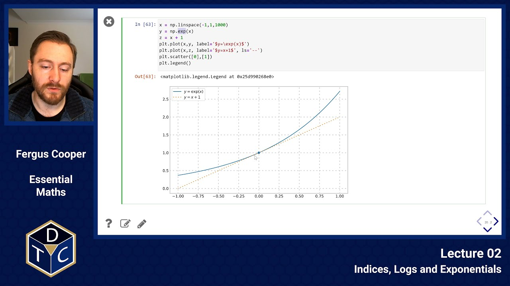
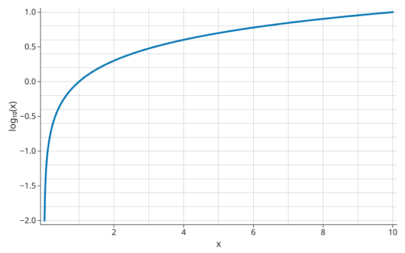
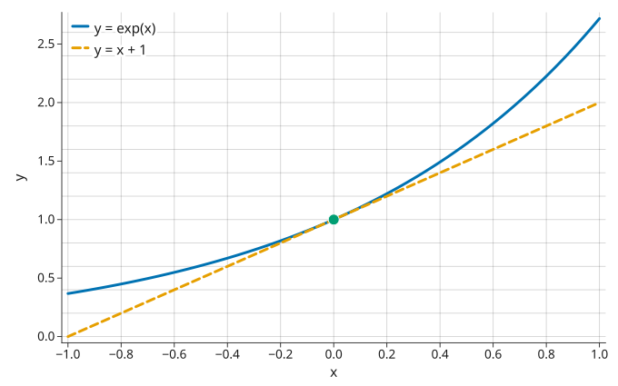
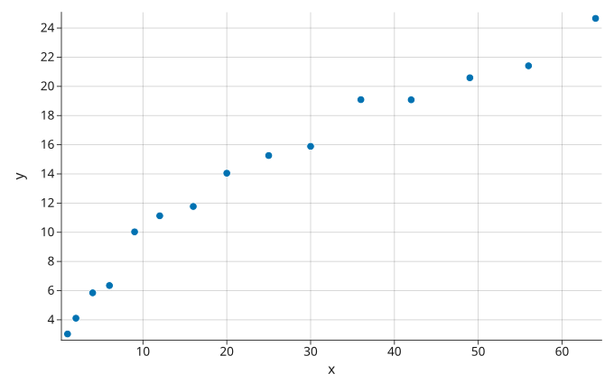
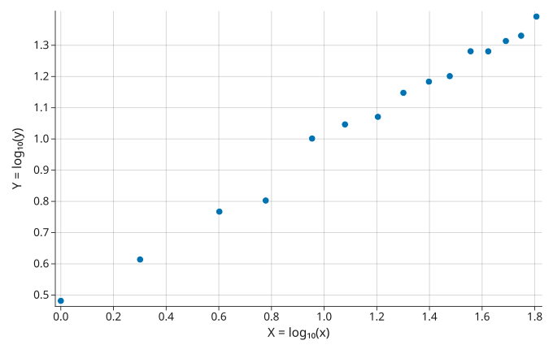

---

## YouTube lecture recording from October 2020

A recording of this lecture from October 2020; the material has changed a little since.

[](https://youtu.be/gbZtu0mAq2I)

---

## Why indices and logs?

- The laws of indices let us simplify and rearrange expressions with powers in them.
  We will need them throughout the course (e.g. when we cover differentiation).
- _Taking the logarithm_ undoes _raising to a power_.
  This means that we can use logarithms to solve for an unknown power, to work with quantities that have a huge dynamic range (e.g. pH), and to turn power laws and exponentials into straight lines.
- We often want to describe growth and decay in biology, and for this we use the exponential function, $e^x$, and its inverse, the natural logarithm.

## Indices

In mathematics, an index refers to the power to which a number (the base) is raised.
The index is usually written as a small number above and to the right of the base.
For example, in the expression $2^3$, $2$ is the base, and $3$ is the index or power.
This expression is read as "2 to the power of 3" or simply "2 cubed", and it equals $2 \times 2 \times 2 = 8$.

### Multiplication of expressions with powers

Let's recap by example:

$$
5^2 = 5 \times 5 = 25,
$$

and

$$
5^3 = 5 \times 5 \times 5 = 125.
$$

Now,

$$
5^5 = 5 \times 5 \times 5 \times 5 \times 5 = 3125
$$

and

$$
25 \times 125 = 3125.
$$

So,

$$
5^5 = 5^2 \times 5^3.
$$

And, by extension:

$$
a^m\times a^n=a^{m+n}.
$$

When we multiply two expressions with powers, we **add** the powers.

### Division of expressions with powers

Again, let's look at an example:

$$
\frac{5^3}{5^2} = \frac{5 \times 5 \times 5}{5 \times 5}
$$

We can cancel both fives on the bottom with two from the top, leaving just $5$, or, $5^1$ left.

Generalising, by extension:

$$
\frac{a^n}{a^m}=a^{n-m}
$$

When we divide two expressions with powers, we **subtract** the powers.

### Powers of expressions with powers

Back to our example:

$$
\left(5^3\right)^4 = 5^3 \times 5^3 \times 5^3 \times 5^3 = 244140625
$$

Using the addition rule from above, the resulting power should be $3 + 3 + 3 + 3 = 12$.
And, sure enough:

$$
5^{12} = 244140625.
$$

So, generalising again:

$$
(a^n)^m=a^{nm}
$$

When we raise an expression containing a power to another power, we **multiply** the powers.

### Negative powers

What happens when we divide indices, but there are more numbers on the bottom of the fraction?

$$
\frac{a^3}{a^5} = \frac{a \times a \times a}{a \times a \times a \times a \times a} = \frac{1}{a \times a} = \frac{1}{a^2}
$$

Using the division rule above, the power should be $3 - 5 = -2$.
And, so:

$$
a^{-2}=\frac{1}{a^2}
$$

and, in general,

$$
a^{-n} =\frac{1}{a^n}
$$

where $n$ is a positive integer.

### Zero index

Similarly,

$$
\frac{a^3}{a^3} = \frac{a \times a \times a}{a \times a \times a} = 1,
$$

and by using the division rule, the power should be $3-3=0$.

Thus, anything to the power of zero equals one, except $0^0$
which is undefined:

$$
a^0=1
$$

### Fractional (rational) indices

For $a>0$:

$$
\begin{aligned}
a^1 &= a^{1/2} \times a^{1/2} &&\text{so}\quad a^{1/2} = \sqrt{a} \\
a^{1/n} &= \sqrt[n]{a} \\
a^{n/m} &= \left(\sqrt[m]{a}\right)^n &&\text{or}\quad \sqrt[m]{a^n} \\
a^{-n/m} &= \frac{1}{\left(\sqrt[m]{a}\right)^n} &&\text{or}\quad \frac{1}{\sqrt[m]{a^n}}
\end{aligned}
$$

For example,

$$
a^{3/4}=\sqrt[4]{a^3} \quad \text{or} \quad \left(\sqrt[4]{a}\right)^3.
$$

In Python:

```python
a = 5.0
a**(3.0/4.0)
```

```text
3.34370152488211
```

```python
(a**3.0)**0.25
```

```text
3.34370152488211
```

```python
(a**0.25)**3.0
```

```text
3.34370152488211
```

i.e. For indices the order in which these mathematical operations are performed does not matter (for $a>0$).

### Different bases, same index

$$
(a\cdot b)^x = a^x\cdot b^x\qquad \text{and}\qquad\left(\frac{a}{b}\right)^x=\frac{a^x}{b^x}
$$

### Two cautionary remarks

1. Powers of sums are **not** pretty: $(a+b)^x \ne a^x + b^x$
2. Powers of differences are **not** pretty: $(a-b)^x \ne a^x - b^x$

A useful formula for products of sums:

$$
(p+q)\cdot(s+t) = ps + pt+qs + qt
$$

Three important consequences:

1. $(a+b)^2=(a+b)(a+b)=a^2+2ab+b^2$
1. $(a-b)^2=(a-b)(a-b)=a^2-2ab+b^2$
1. $(a+b)(a-b)=a^2-b^2$

## Logarithms

1. If $y=a^x$, $x$ is the **power** to which the **base** $a$ must be raised to give
   $y$, OR
2. $x$ is the **logarithm** which, with **base** $a$, gives $y$.

In general we write

$$
x = \log_a y \quad \Leftrightarrow \quad y=a^x.
$$

The base of a logarithm may be any positive number other than 1. Commonly, logarithms either have **base** 10 or **base** $e$.
It is almost always a good idea to explicitly state the base, e.g. $\log_3 9=2$ implies $3^2=9$.
In this course we always write the base, e.g. $\log_{10}$, except for base $e$ (more on this below).

## Getting a feel for logarithms

Here's a graph of $y=\log_{10}x$:



Some physical phenomena use log metrics due to their huge dynamic range:

- volume of sound (decibels)
- pitch (1 octave is doubling of frequency, 2 octaves is quadrupling of
  frequency)
- earthquakes (Richter scale)
- pH ($[H^+]$ ion concentration)

## The laws of logarithms

### Using the same base $a$ for both operations

- _Taking the logarithm_ undoes _raising to a power_:

  $$
  \log_a\,a^r=r
  $$

- _Raising to a power_ undoes _taking the logarithm_:

  $$
  a^{\log_a\,b}=b
  $$

### Multiplication, division and powers

Each law of logarithms comes from a law of indices.
If $b=a^m$ and $c=a^n$, then $\log_a b = m$ and $\log_a c = n$, so:

|                | Indices                     | Logarithms                                      |
| -------------- | --------------------------- | ----------------------------------------------- |
| Multiplication | $a^m\times a^n=a^{m+n}$     | $\log_a (bc) = \log_a b + \log_a c$ (add)       |
| Division       | $a^m/a^n=a^{m-n}$           | $\log_a (b/c) = \log_a b - \log_a c$ (subtract) |
| Powers         | $\left(a^m\right)^r=a^{mr}$ | $\log_a b^r = r \log_a b$ (multiply)            |

This means that the laws of logarithms are the laws of indices written in terms of the powers, with the same (add), (subtract) and (multiply).

### Changing the base of a logarithm

$$
\log_a c = \frac{\log_b c}{\log_b a}
$$

### Special case

If $b$ and $c$ are the same, changing the base reduces to

$$
\log_a b =\frac{\log_b b}{\log_b a}=\frac{1}{\log_b a}
$$

### The log of any number to the base itself is 1

$$
\log_a a =1
$$

### The log of 1 is 0

$$
\log_a 1 = 0 \quad\text{since}\quad a^0=1
$$

### Negative logs

$$
\log_a \frac{1}{x} = \log_a1-\log_ax= 0 - \log_a x =-\log_ax
$$

### Two cautionary remarks about logarithms

1. $\log_a (x + y)$ and $\log_a (x-y)$ cannot be simplified any further, and should be left as they are.

2. Neither can $\log_a\,x \cdot \log_a\,y$ or $\log_a x/\log_a y$. Leave them as they are.

## The exponential function and the real number e

### Definition of the real number $e$

The real number $e$, also known as Euler's number, is that base for which the graph $y=e^x$
passes through the point $(0, 1)$ with gradient exactly equal to $1$.



So for the function (called the **exponential function**):

$$
y=e^x \qquad \text{the gradient at } (0,1) \text{ is } 1 = e^0.
$$

This turns out to be true at **any** point on the curve, i.e. the gradient of $y=e^x$ at any point is equal to the value of $e^x$ there.
This means that the function $y=e^x$ is unchanged when differentiated (more on this when we cover differentiation).

$e$ has been found to arise in many branches of mathematics. It is also used as a **base** for logarithms. e.g.:

$$
y=\log_e10=\ln 10 \quad\text{and}\quad y=\log_ex=\ln x
$$

Logs to base $e$ are called **natural logarithms**.

## Definition of the natural logarithm

The **natural logarithm** of a number is the logarithm of that number taken using the base $e$.
We usually write $\ln(x)$ for $\log_e(x)$. Here are some examples:

- $\ln(e)=\log_e(e)=1$
- $\ln(10)=\log_e(10)$ = "The power I need to raise $e$ to in order to get 10"
- $\ln(10)\approx 2.303$. Which means that $e^{2.303}\approx 10$
- $\ln(\exp(b)) = \ln e^b =\log_e e^b = b$
- $\exp(\ln(b))=e^{\ln(b)}=e^{\log_e b}=b$

Note that the last two examples confirm the property that
the functions "$\exp$" and "$\ln$" are _functional
inverses_ of one another.

## Logarithms in Python

In numpy, `np.log` is the natural logarithm, $\ln$.
For base 10 and base 2 there are `np.log10` and `np.log2`:

```python
import numpy as np
print(np.log(10))
print(np.log10(1000))
print(np.log2(8))
```

```text
2.302585092994046
3.0
3.0
```

For any other base, use the change of base formula, e.g. $\log_3 81 = \ln 81 / \ln 3$:

```python
print(np.log(81)/np.log(3))
```

```text
4.0
```

## Example 1: power laws

Can the data below be fitted to the form: $y=Ax^n$?

| x    | y    |
| ---- | ---- |
| 4.0  | 6.0  |
| 16.0 | 12.0 |
| 25.0 | 15.0 |
| 64.0 | 24.0 |



Take logs of both sides:

$$
\log_{10} y =\log_{10} Ax^n = \log_{10} A + \log_{10} x^n= \log_{10} A + n \log_{10} x
$$

This is the equation of a straight line, $Y=mX+c$, with $Y=\log_{10} y$, $X=\log_{10} x$, $m=n$ and $c=\log_{10} A$.



```python
gradient = (Y[-1] - Y[0])/(X[-1] - X[0])
print('gradient =',gradient)
```

```text
gradient = 0.5
```

Gradient = 0.5 = $n$

Intercept = $0.48 = \log_{10}A$ so $A=3.0$

Data fit curve of the form:

$$
y=3.0\times x^{1/2}
$$

Plotting $\log_{10} y$ against $\log_{10} x$ is the same as plotting $y$ against $x$ on logarithmic axes (called a _log-log_ plot).

## Example 2: exponential growth

We often want to know how quickly a population grows.
Here, a population of bacteria is counted every hour.
Can the data below be fitted to the form: $N=N_0e^{kt}$?

| t (hours) | N    |
| --------- | ---- |
| 0         | 200  |
| 1         | 283  |
| 2         | 400  |
| 3         | 566  |
| 4         | 800  |
| 5         | 1131 |
| 6         | 1600 |

Take the natural log of both sides:

$$
\ln N = \ln N_0e^{kt} = \ln N_0 + \ln e^{kt} = \ln N_0 + kt
$$

This is the equation of a straight line, with $Y=\ln N$, $X=t$, $m=k$ and $c=\ln N_0$.
Only the $N$ axis is on a log scale, so this is called a _semi-log_ plot.

```python
gradient = (Y[-1] - Y[0])/(t[-1] - t[0])
intercept = Y[0]
print('gradient =',gradient)
print('intercept =',intercept)
```

```text
gradient = 0.3465735902799727
intercept = 5.298317366548036
```

Gradient = 0.35 = $k$ (per hour)

Intercept = $5.3 = \ln N_0$ (the first count is at $t=0$) so $N_0 = e^{5.3} \approx 200$

Data fit curve of the form:

$$
N=200\,e^{0.35t}
$$

The population doubles when $e^{kt}=2$, i.e. when $t=\ln 2/k\approx 2$ hours.

## Example 3: pH

1. What is the pH of a 0.011 M solution of HCl?

   $$
   \text{pH} = -\log_{10}[H^+]
   $$

   ```python
   import numpy as np
   pH = -np.log10(0.011)
   print('pH =',pH)
   ```

   ```text
   pH = 1.958607314841775
   ```

2. What is the H$^+$ concentration of a solution of HCl with a pH of 3?

   $$
   \text{pH} = -\log_{10} [H^+] = 3 \quad \text{so} \quad [H^+] = 10^{-3}
   $$

   ```python
   hydrogen = 10**(-3)
   print('[H+] =',hydrogen,'M')
   ```

   ```text
   [H+] = 0.001 M
   ```

## Example 4: simplifying logs

Write an expression for $x$ without using logarithms:

$$
\begin{aligned}
\log_{10}(x) &= \log_{10}(p) + 2 \log_{10}(q) - \log_{10}(k) -3 \\
\log_{10}(x) &= \\
x &=
\end{aligned}
$$

1. Use the laws of logarithms (above) to put all terms on the right hand side
   **within** the logarithm. This means we have to rewrite $3$ as $3\log_{10}(10)$.
1. Raise 10 to the power of each side, which will **undo** the logarithm function.

## Introductory problems

::::challenge{id="02_intro_01" title="Introductory problems 1"}
Simplify:

1. $a^{10}/a^{-3}$
1. $\left(\sqrt{x}\right)^8/x^4$
1. $y^{1/4}/y^{-2/4}$
1. $$
   \frac{10^{-2/3} \times 10^7 \times 10^{-16} \times x^{1/2} \times y^4 \times z^{-1/3}}{10^{-19}\times 10^{43} \times 10^{2/3} \times z^{-1/3} \times y^{1/4} \times x^{5/2}}
   $$

::::

::::challenge{id="02_intro_02" title="Introductory problems 2"}
Evaluate the following expressions without using a calculator:

1. $2^{-4}$
1. $36^{1/2}+64^{2/3}$
1. $\left(1/3\right)^{-2}$
1. $\left(81/9\right)^{3/2}$

::::

::::challenge{id="02_intro_03" title="Introductory problems 3"}
Express the following in logarithmic form:

1. $5^3 = 125$
1. $8^{-1/3} = 1/2$
1. $x^y = 4$

::::

::::challenge{id="02_intro_04" title="Introductory problems 4"}
Evaluate the following expressions without using a calculator:

1. $\log_4\,(64)$
1. $\log_{\pi}\,(1)$
1. $\log_{b}\, (b^a)$
1. $6^{\log_6\,(\pi)}$

::::

::::challenge{id="02_intro_05" title="Introductory problems 5"}
Solve the following equations for $x$:

1. $e^x=4$
1. $e^{-x}=2$

One of your solutions should be exactly $-2$ times the value of your other solution. Why?
::::

::::challenge{id="02_intro_06" title="Introductory problems 6"}
Simplify:

1. $\ln \left(e^3\right)$
1. $\ln \left(1/(2e)\right)$
1. $e^{\ln x^4}$
1. $e^{3+\ln x}$

::::

## Main problems

::::challenge{id="02_main_01" title="Main problems 1"}
In an experiment, the mass, $m$ grams, of a reaction product is measured at various times, $t$ minutes. It is believed that $m$ and $t$ are related by a law of the form:

$$
m=At^n
$$

The results are shown in the table below:

| time (min) |  1  |  2   |  3   |  4  |  5   |  6  |  7   |  8   | 12  |
| ---------: | :-: | :--: | :--: | :-: | :--: | :-: | :--: | :--: | :-: |
|   mass (g) | 0.5 | 0.63 | 0.72 | 0.8 | 0.85 | 0.9 | 0.95 | 0.99 | 1.0 |

1. Confirm this postulate graphically. There is one result that does not conform to this law. Which?
1. Find appropriate values of $A$ and $n$, and in this context, explain the meaning of $n$. What are the units of $A$?
1. Explain, with reasons, whether you would use these results to predict the mass when $t=15$.

::::

::::challenge{id="02_main_02" title="Main problems 2"}
These problems deal with pH:

1. What is the pH of 130ml of a solution containing 4.7mg HCl, assuming that HCl is completely ionised in solution, and its molecular mass is 36.46?
1. What would be the pH if the concentration of HCl were tripled?

::::

::::challenge{id="02_main_03" title="Main problems 3"}
Express in terms of $\log_{10} (a)$, $\log_{10} (b)$, $\log_{10} (c)$ and $\log_{10} (d)$:

1. $\log_{10}\left(b/(ac)\right)$
1. $\log_{10} (a^2 b c^3 d^4)$
1. $\log_{10} \left(\sqrt{cd/(ab)} \right)$

::::

::::challenge{id="02_main_04" title="Main problems 4"}
Simplify:

1. $\log_{10}(8) + \log_{10}(3) - \log_{10}(6)$
1. $\log_{10}\left(x^2-1\right) - \log_{10}\left(x^2+1\right)$
1. $3\log_a(4) + \log_a(5) - 2\log_a(9)$
1. $\log_{10}\left(x^9\right) - \log_{10}\left(x^6\right)$

::::

::::challenge{id="02_main_05" title="Main problems 5"}
This problem gives you a chance to use the identity

$$
\log_a (b) =\frac{1}{\log_b (a)}.
$$

Consider the equation $\log_3(x) + 4\log_x(3) = 5$:

1. Verify that $x=3$ satisfies this equation
1. There is one other value of $x$ that also satisfies this equation. Find it.

::::

::::challenge{id="02_main_06" title="Main problems 6"}
Solve the following equations for $x$:

1. $2\left(2^{2x}\right)- 5\left(2^x\right) + 2 = 0$
1. $3^{2x+1} - 28\left(3^x\right) + 9 = 0$
1. $16 = \log_2 (x)$
1. $\left(2 \sqrt 3 \log_{10}(x)\right)^2 - 7 \log_{10}(x^2) + 2 = 0$

::::

::::challenge{id="02_main_07" title="Main problems 7"}
Write an expression for $x$ or $y$ without using logarithms:

1. $\log_{10}(x) = \log_{10}(3r) - 5 \log_{10}(s) + 3\log_{10}(t) - 3$
1. $\log_{10}(2y) = 5 + 5\log_{10}\left(4^3\right) -15\log_{10}\left(2/x\right) - 6\log_{10}(y)$

::::

::::challenge{id="02_main_08" title="Main problems 8"}
Write $x$ in terms of $y$ for each of the following:

1. $y=2e^{4x}$
1. $\ln y = 3 + 2\ln x$

::::

::::challenge{id="02_main_09" title="Main problems 9"}
Express as a sum or difference of logarithms:

1. $\ln\sqrt{(x-1)/(x+1)}$

::::

::::challenge{id="02_main_10" title="Main problems 10"}
Express as a single logarithm:

1. $1 - \ln 4x$
1. $3\ln x - \frac{1}{2} \ln\left(5-x^2\right)$

::::
