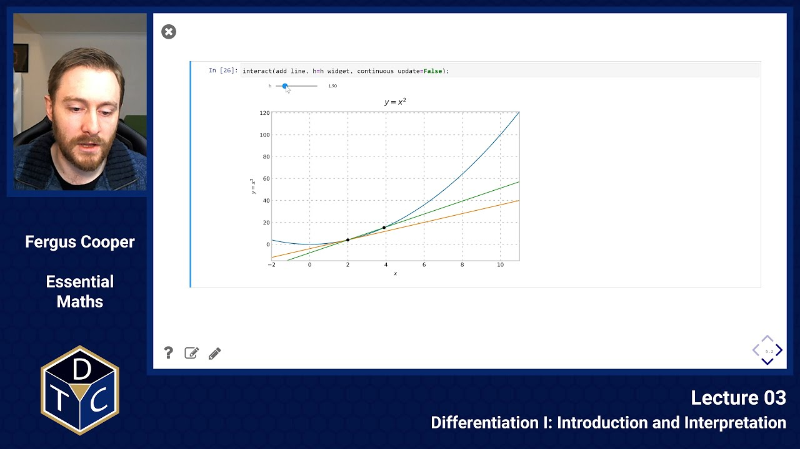
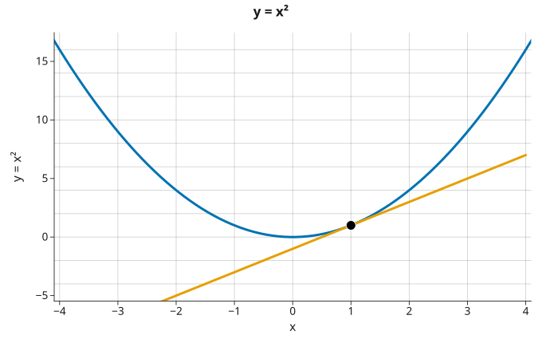
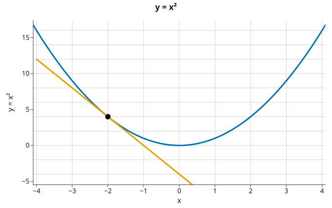
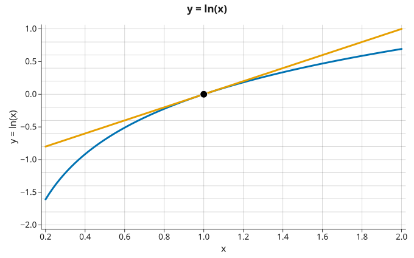
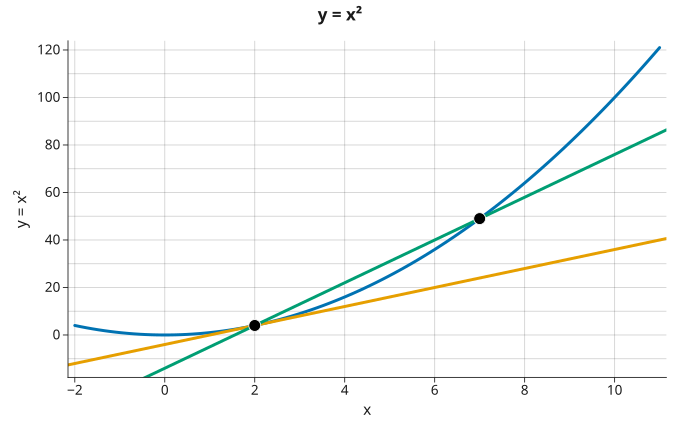
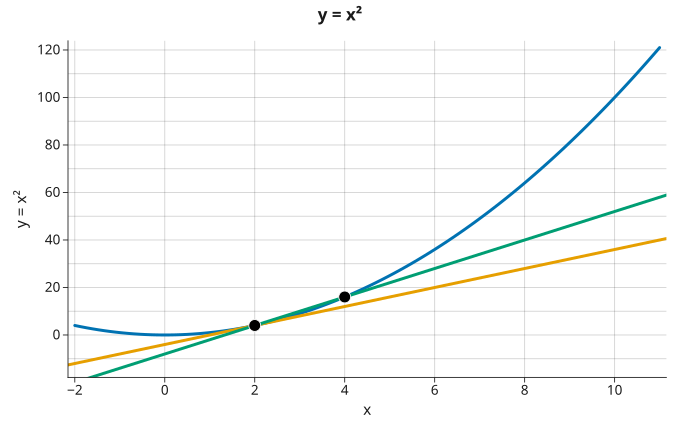
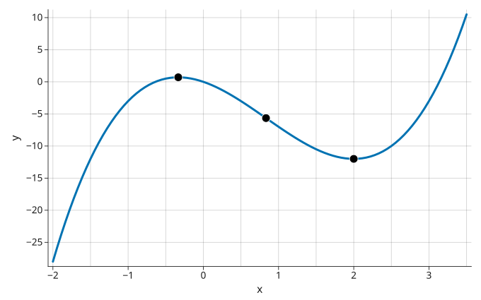
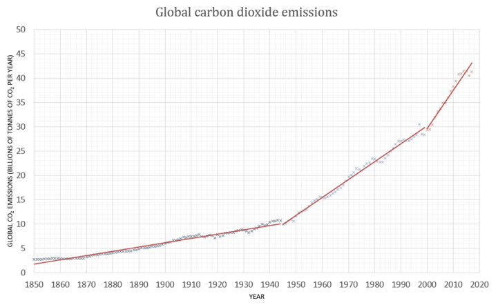

---

## YouTube lecture recording from October 2020

A recording of this lecture from October 2020; the material has changed a little since.

[](https://youtu.be/WRIo01tVEbA)

---

## Why differentiation?

We often want to know about the _rate_ at which one quantity changes over time.
Examples:

1. The rate of disappearance of substrate with time in an enzyme reaction.
1. The rate of decay of a radioactive substance (how long will it have activity above a certain level?)
1. The rate of bacterial cell growth over time.
1. How quickly an epidemic is growing.

Differentiation gives us this rate exactly, as a formula.
Once we have the rate, we can use it to find where a quantity is greatest or smallest (e.g. the time at which the most bacteria are on a plate), and to sketch its graph.

## Gradients

### Defining the gradient

- The **gradient of a curve** at a point $P$ is the slope of the tangent of the curve at that point.
- The **tangent** is the line that "just touches" the curve.
- The gradient is also known as the **rate of change** or **derivative**, and the process of finding the gradient is called **differentiation**.
- The gradient of the curve $y = f(x)$ is denoted in a few different ways, the three most common are:

$$
y', \quad f'(x), \quad \frac{dy}{dx}.
$$

## Example, $y = x^2$

At $x=1$ the gradient is shallow and sloping up to the right:



At $x=-2$ the gradient is steeper, and sloping down to the right:



## Example, $y = \ln(x)$

For this function, the gradient is always sloping up to the right, but gets shallower as $x$ increases:



### Algebraic example

If we want to find $y'(x)$ for $y = x^3 + 2$:

$$
\text{Gradient} = \frac{y_2 - y_1}{x_2-x_1} = \frac{\Delta y}{\Delta x}
$$

Try with

$$
\begin{aligned}
x_1 &= 1.5,\quad 1.9,\quad 1.99,\quad \ldots \\
x_2 &= 2.5,\quad 2.1,\quad 2.01,\quad \ldots
\end{aligned}
$$

We can use Python as a calculator to evaluate these differences, with $x_1 = 2 - h$ and $x_2 = 2 + h$:

```python
for h in [0.5, 0.1, 0.01]:
    x_1 = 2 - h
    x_2 = 2 + h
    y_1 = x_1**3 + 2
    y_2 = x_2**3 + 2
    print(h, (y_2 - y_1)/(x_2 - x_1))
```

```text
0.5 12.25
0.1 12.010000000000003
0.01 12.00009999999997
```

As the difference between $x_1$ and $x_2$ gets smaller, the gradient stabilises.
The value it converges to is the gradient at the midway point of $x_1$ and $x_2$.

## Calculating gradients exactly

$$
\text{Gradient} \approx \frac{\Delta y}{\Delta x} = \frac{f(x+h) - f(x)}{h}
$$

This is called a finite difference approximation to the gradient. The approximation becomes more accurate the smaller $h$ is.

When using the approximation, we denote the changes as $\Delta y/\Delta x$. In the limit as $h$ goes to 0, this becomes the derivative, $dy/dx$:

$$
\frac{dy}{dx} = \lim_{h \to 0} \frac{f(x+h) - f(x)}{h}
$$

In this way, $d/dx$ is an operator, acting on $y$.

Note, the $d$s cannot be cancelled out, as they aren't variables, they denote an infinitely small change.

Notice how, as the finite difference gets smaller and smaller, the approximation to the gradient (the green line) gets closer and closer to the true gradient (the orange line):





### Example

Find the gradient of $y = f(x) = x^3 + 2$.

$$
\begin{aligned}
\frac{f(x+h) - f(x)}{h} &= \frac{(x+h)^3 + 2 - (x^3 + 2)}{h} \\
&= \frac{x^3 + 3x^2 h + 3xh^2 + h^3 + 2 - x^3 - 2}{h} \\
&= \frac{3x^2h + 3xh^2 + h^3}{h} \\
&= 3x^2 + 3xh + h^2
\end{aligned}
$$

Now this is only exactly right when $h \rightarrow 0$. So letting that happen, we have

$$
\frac{dy}{dx} = \lim_{h \to 0} \left(3x^2 + 3xh + h^2\right) = 3x^2
$$

## Derivative of polynomial functions

Using techniques like the one above (which is called differentiation from first principles), one can generalise the connection between powers of $x$ and their derivatives:

If $y = a x^n$, then its **derivative** is

$$
\frac{dy}{dx} = y'(x) = a n x^{n-1}
$$

### Examples to try

1. $y = x^4$
2. $y = 7x^5$
3. $y = x^{-2} = 1/x^2$
4. $y = \sqrt{1/x} = (1/x)^{1/2} = x^{-1/2}$

## Summing and multiplying derivatives

### Summing

$$
(f(x) \pm g(x))' = f'(x) \pm g'(x)
$$

e.g.

$$
y = x^2 + x^3, \quad y' = 2x + 3x^2
$$

### Multiplying (by a scalar)

$$
(a f(x))' = a f'(x)
$$

e.g.

$$
y = 6x^3, \quad y' = 6 \cdot 3x^2 = 18 x^2
$$

**This only works for scalars**.

In most circumstances $(f(x) g(x))' \neq f'(x) g'(x)$ (more on this in the next lecture)

e.g.

$$
y = x\cdot x = x^2, \quad y' \neq 1
$$

## Higher-order derivatives

You can take a derivative of a function multiple times in a row. This is usually denoted either $y''(x)$, $f''(x)$ or $d^2 y/dx^2$ for second-order derivatives (differentiating twice), and similar for higher orders.

e.g.

$$
\begin{aligned}
y &= x^3 \\
y' &= 3x^2 \\
y'' &= \frac{d^2 y}{dx^2} = 6 x
\end{aligned}
$$

## Interpreting derivatives

The sign of the first derivative $f'(x)$ tells us how $f(x)$ is growing

- Positive gradient: If $y' > 0$ then $y$ is **increasing** at $x$
- Negative gradient: If $y' < 0$ then $y$ is **decreasing** at $x$
- Zero gradient: If $y' = 0$ then $y$ is not changing (flat) at $x$

### Stationary points and points of inflection

Stationary points are where $dy/dx = 0$.

1. Local maximum: $dy/dx = 0$ and $d^2y/dx^2 < 0$

1. Local minimum: $dy/dx = 0$ and $d^2y/dx^2 > 0$

1. Inflection: $d^2y/dx^2 = 0$ and $d^2y/dx^2$ changes sign

If $dy/dx = 0$ and $d^2y/dx^2 = 0$, this test does not tell us which it is (e.g. $y = x^3$ and $y = x^4$ at $x = 0$), so look at the sign of $dy/dx$ on either side.

### Example: find the stationary points of $y = 2x^3 - 5x^2 - 4x$

To do this, we need to know both $y'(x)$ and $y''(x)$.

$$
\begin{aligned}
y'(x) &= 6x^2 - 10x - 4 \\
y''(x) &= 12x - 10
\end{aligned}
$$

Stationary points occur when $y'(x) = 0$

$$
\begin{aligned}
6x^2 - 10x - 4 &= 0 \\
(3x + 1)(2x - 4) &= 0 \\
x &= -1/3,\quad 2
\end{aligned}
$$

At $x = -1/3$:

$$
y''(-1/3) = 12 \times -1/3 - 10 = -14 < 0
$$

So this point is a **maximum**.

At $x = 2$

$$
y''(2) = 12 \times 2 - 10 = 14 > 0
$$

So this point is a **minimum**.

Inflection points can only occur where $y''(x) = 0$

$$
\begin{aligned}
y''(x) &= 12x - 10 = 0 \\
x &= \frac{10}{12} = \frac{5}{6}
\end{aligned}
$$

Since $y''(x)$ changes sign at $x = 5/6$, this is an **inflection point**.

**Note**: Points of inflection do not require that $y'(x) = 0$, only that $y''(x) = 0$ and changes sign.

Points of inflection are important in biology as they define conditions where a response (e.g. reaction rate) is most or least sensitive to a change in conditions (e.g. the concentration of a metabolite).

## Sketching: the checklist revisited

To sketch the graph of a function (as in the lecture on graphs):

- Find where it is zero, positive and negative
- Look at which terms dominate as $x\to\pm\infty$
- Look at the limit behaviour as $x$ approaches any points where the function is undefined (e.g. $x\to 0$ for $y=1/x$), which may give an _asymptote_
- Find the turning points and points of inflection, using the first and second derivatives

Then check your sketch by plotting the function in Python.

### Example: sketching $y = 2x^3 - 5x^2 - 4x$

- It factorises as $y = x(2x^2 - 5x - 4)$, so $y = 0$ at $x = 0$ and $x = (5 \pm \sqrt{57})/4$, i.e. $x \approx -0.64$ and $x \approx 3.14$
- For large $|x|$, the $2x^3$ term dominates, so $y$ rises to the right and falls to the left
- It is defined for all $x$, so there are no asymptotes
- From the example above, it has a maximum at $x = -1/3$, a minimum at $x = 2$ and a point of inflection at $x = 5/6$



## Example: bacteria on a plate

The number $n$ (in thousands) of bacteria on an agar plate at time $t$ (in days) is given by the expression:

$$
n = 15.42 + 6t - t^2
$$

1. Find the time at which the greatest number of bacteria are present on the plate.
1. Find the number of bacteria on the plate at this time.

### Solution

To do this we must find the turning points of the function.

1. Find the time at which the greatest number of bacteria are present on the plate

   $$
   \begin{aligned}
   n(t) &= 15.42 + 6t - t^2 \\
   n'(t) &= 6 - 2t \\
   n'(t) &= 0 \quad\implies\quad 6-2t=0\quad\implies\quad t=3
   \end{aligned}
   $$

   To show this is a maximum, we need to check $n''(t)$

   $$
   n''(t) = -2
   $$

   Therefore, $n''(t)<0$, for $t = 3$. This means that a maximum occurs at $t = 3$ days.

1. Find the number of bacteria on the plate at this time

   $$
   n(3) = 15.42 + 6 \times 3 - 3^2 = 24.42
   $$

   The greatest number of bacteria on the plate is **24,420**.

## Example: logistic growth

The growth rate $R$ of a cell colony with $N$ cells at time $t$ can be represented by the equation

$$
R = \frac{d N}{d t} = kN - bN^2
$$

For this example take the constants $k$ and $b$ as $k = 3.8$/hr, and $b = 0.01$/cell/hr. This is called a **logistic** model.

1. What is the equilibrium size of the population?

1. What population size leads to the largest growth rate?

### Solution

1. The equilibrium will occur when the population stops changing, i.e. when $R = 0$. Meaning:

   $$
   \begin{aligned}
   R = 3.8 N - 0.01 N^2 &= 0 \\
   N (3.8 - 0.01 N) &= 0
   \end{aligned}
   $$

   We can disregard the $N = 0$ solution, as it represents population extinction. This means that

   $$
   N = \frac{3.8}{0.01} = 380.
   $$

1. To find the largest growth rate, we want the maximal value of $R(N)$. This means we need to find $R'(N) = 0$.

   $$
   \begin{aligned}
   R(N) &= 3.8 N - 0.01 N^2 \\
   R'(N) &= 3.8 - 0.02 N
   \end{aligned}
   $$

   If $R'(N) = 0$

   $$
   \begin{aligned}
   3.8 - 0.02N &= 0 \\
   N &= 190
   \end{aligned}
   $$

   Since $R''(N) = -0.02 < 0$, we can be sure that this is a maximum.

## Introductory problems

:::callout{variant="tip"}
For more practice, an AI tool can write new problems like the ones below.
Ask it for problems of the same type and difficulty, or for problems set in your own field.
For example, you could ask it to "write five pharmacology problems on maxima and minima, at the level of these ones".
Work them on paper first, then ask the tool to check your answers and to explain any step you are unsure of.
:::

::::challenge{id="03_intro_01" title="Introductory problems 1"}
Use the formula

$$
\frac{dy}{dx}=\lim_{h\rightarrow 0}\left(\frac{f(x+h)-f(x)}{h}\right)
$$

to calculate the derivatives of the functions below.
Check your answers by using the standard rules for differentiation:

1. $y = 3x + 3$
1. $y = 4x^2 - 3x + 2$
1. $y = 2x^3-5$
1. $y=1/x^2\qquad$ (harder)

:::solution

1. $$
   \frac{f(x+h)-f(x)}{h} = \frac{3(x+h)+3-(3x+3)}{h} = \frac{3h}{h} = 3
   $$

   This does not depend on $h$, so $dy/dx = 3$.
   Check: the derivative of $3x$ is $3$ and the derivative of a constant is $0$.

1. $$
   \begin{aligned}
   \frac{f(x+h)-f(x)}{h} &= \frac{4(x+h)^2-3(x+h)+2-(4x^2-3x+2)}{h} \\
   &= \frac{8xh+4h^2-3h}{h} \\
   &= 8x+4h-3
   \end{aligned}
   $$

   As $h\rightarrow 0$, this tends to $dy/dx = 8x-3$.

1. Using $(x+h)^3 = x^3+3x^2h+3xh^2+h^3$,

   $$
   \begin{aligned}
   \frac{f(x+h)-f(x)}{h} &= \frac{2(x^3+3x^2h+3xh^2+h^3)-5-(2x^3-5)}{h} \\
   &= \frac{6x^2h+6xh^2+2h^3}{h} \\
   &= 6x^2+6xh+2h^2
   \end{aligned}
   $$

   As $h\rightarrow 0$, this tends to $dy/dx = 6x^2$.

1. Put the two fractions over a common denominator first:

   $$
   \begin{aligned}
   \frac{f(x+h)-f(x)}{h} &= \frac{1}{h}\left(\frac{1}{(x+h)^2}-\frac{1}{x^2}\right) \\
   &= \frac{1}{h}\left(\frac{x^2-(x+h)^2}{x^2(x+h)^2}\right) \\
   &= \frac{1}{h}\left(\frac{-2xh-h^2}{x^2(x+h)^2}\right) \\
   &= \frac{-2x-h}{x^2(x+h)^2}
   \end{aligned}
   $$

   As $h\rightarrow 0$, this tends to

   $$
   \frac{dy}{dx} = \frac{-2x}{x^4} = -\frac{2}{x^3}
   $$

   Check: $y = x^{-2}$, so $dy/dx = -2x^{-3}$.

:::

::::

::::challenge{id="03_intro_02" title="Introductory problems 2"}
Find the gradient at the given points of the following curves:

1. $y = x^3 - 4 \qquad\text{where}\qquad x = 1$
1. $y = 3x^3 + 4x - 3 \qquad\text{where}\qquad x = -2$

:::solution

1. $dy/dx = 3x^2$, so at $x=1$ the gradient is $3$.
1. $dy/dx = 9x^2+4$, so at $x=-2$ the gradient is $9\times 4+4 = 40$.

:::

::::

::::challenge{id="03_intro_03" title="Introductory problems 3"}
Find the $x$ and $y$ coordinates of the points on the given curves at which the gradient is zero (if any) and find out whether they are maxima, minima or points of inflexion:

1. $y = (x - 3)(x - 4)$
1. $y = x^3 - 4x^2 + 2x - 2$
1. $y = (4x+1)/x$
1. $y = 16 - 2x^3$

:::solution

1. Expand first: $y = x^2-7x+12$, so $dy/dx = 2x-7$, which is zero at $x = 7/2$.
   Then $y = (7/2-3)(7/2-4) = -1/4$.
   Since $d^2y/dx^2 = 2 > 0$, the point $(7/2, -1/4)$ is a minimum.

1. $dy/dx = 3x^2-8x+2$, which is zero when

   $$
   x = \frac{8\pm\sqrt{64-24}}{6} = \frac{4\pm\sqrt{10}}{3}
   $$

   so $x \approx 0.279$ or $x \approx 2.387$.
   Substituting back gives $y = (-110 + 20\sqrt{10})/27 \approx -1.73$ and $y = (-110 - 20\sqrt{10})/27 \approx -6.42$ respectively.
   Next, $d^2y/dx^2 = 6x-8$, which is $-2\sqrt{10} < 0$ at $x = (4-\sqrt{10})/3$ and $2\sqrt{10} > 0$ at $x = (4+\sqrt{10})/3$.
   So $(0.279, -1.73)$ is a maximum and $(2.387, -6.42)$ is a minimum.

1. Write $y = 4 + 1/x = 4 + x^{-1}$, so $dy/dx = -1/x^2$.
   This is never zero, so the curve has no points with zero gradient.

1. $dy/dx = -6x^2$, which is zero only at $x=0$, where $y = 16$.
   Here $d^2y/dx^2 = -12x = 0$, so the second derivative does not tell us the type.
   Look at the gradient either side instead: $-6x^2 < 0$ for every $x \neq 0$, so the curve is decreasing on both sides.
   This means that $(0, 16)$ is a point of inflexion.

:::

::::

## Main problems

::::challenge{id="03_main_01" title="Main problems 1"}
One hour after taking $x\,\text{mg}$ of a drug, the body temperature, $T$, in $^\circ$C of a patient is given by:

$$
T=T_0-0.000625\,x^2(18-x),
$$

where $T_0$ is the initial body temperature.

1. Determine the value of $x$ that produces the greatest drop in body temperature, and the magnitude of that temperature change.
1. Sketch $T$ as a function of the dose.

:::solution

1. Expand first: $T = T_0 - 0.01125x^2 + 0.000625x^3$.
   Then

   $$
   \frac{dT}{dx} = -0.0225x + 0.001875x^2 = 0.001875\,x(x-12)
   $$

   which is zero at $x=0$ and $x=12$.
   Next, $d^2T/dx^2 = -0.0225 + 0.00375x$, which is $0.0225 > 0$ at $x=12$, so $T$ has a minimum there.
   So, the greatest drop in temperature comes from a dose of $12\,\text{mg}$, and the drop is

   $$
   T_0 - T = 0.000625\times 12^2\times(18-12) = 0.54\,^\circ\text{C}
   $$

1. $T$ starts at $T_0$ when $x=0$ (a maximum, since $d^2T/dx^2 = -0.0225 < 0$ there).
   It falls to its minimum, $T_0 - 0.54$, at $x=12$, then rises back to $T_0$ at $x=18$.
   For $x > 18$ the formula gives $T > T_0$, so we should only use the model for doses between 0 and $18\,\text{mg}$.

   ```python
   import numpy as np
   from matplotlib import pyplot as plt

   x = np.linspace(0, 18, 100)
   drop = 0.000625 * x**2 * (18 - x)

   plt.plot(x, -drop)
   plt.xlabel('dose, x (mg)')
   plt.ylabel('change in temperature, T - T0 (C)')
   ```

:::

::::

::::challenge{id="03_main_02" title="Main problems 2"}
The formula for the Lennard Jones potential between two non polar atoms is given in terms of the positive constants $A$ and $B$ and the internuclear distance, $R$, as:

$$
V(R)=\frac{A}{R^{12}} - \frac{B}{R^6}
$$

1. Use this formula to calculate $dV/dR$ as a function of $R$.
1. Show that the potential where the gradient is zero is $V(R)=-B^2/(4A)$.
1. Find mathematically whether this point is a maximum, minimum or point of inflexion.

:::solution

1. Write $V = AR^{-12} - BR^{-6}$, so

   $$
   \frac{dV}{dR} = -12AR^{-13} + 6BR^{-7} = -\frac{12A}{R^{13}} + \frac{6B}{R^7}
   $$

1. Setting $dV/dR = 0$ and multiplying through by $R^{13}$ gives $6BR^6 = 12A$, so $R^6 = 2A/B$.
   Substituting this into $V$, with $R^{12} = (R^6)^2 = 4A^2/B^2$:

   $$
   V = \frac{A}{4A^2/B^2} - \frac{B}{2A/B} = \frac{B^2}{4A} - \frac{B^2}{2A} = -\frac{B^2}{4A}
   $$

1. Differentiate again:

   $$
   \frac{d^2V}{dR^2} = \frac{156A}{R^{14}} - \frac{42B}{R^8} = \frac{1}{R^8}\left(\frac{156A}{R^6} - 42B\right)
   $$

   At the stationary point $R^6 = 2A/B$, so $156A/R^6 = 78B$ and

   $$
   \frac{d^2V}{dR^2} = \frac{78B - 42B}{R^8} = \frac{36B}{R^8} > 0
   $$

   since $B$ is positive.
   Therefore, this point is a minimum.
   This is the separation at which the two atoms are most stable.

:::

::::

::::challenge{id="03_main_03" title="Main problems 3"}
The number $n$ (in thousands) of bacteria on an agar plate at time $t$ days is given by the expression:

$$
n = 21.35 + 1.34t - t^2
$$

1. Draw a graph of the function $n(t)$ between $t=0$ and $t=7$ days. Give one reason why this function might be a reasonable model for the number of bacteria on the plate at time $t$. Are there any values of $t$ for which this is probably _not_ a good model?
1. Calculate the time at which the greatest number of bacteria are present on the plate and show that this must be a maximum number.
1. By finding the roots of the equation for $n$, find the two times at which the value of $n$ is zero and say why only one of these times is physically reasonable. Mark and label the maximum point on your graph together with the point at which the number of bacteria is zero.
1. Find the rates at which the bacteria are growing when $t=0.8$ and $t=3.5$ days.

:::solution

1. Some values to plot:

   | $t$ (days)        |   0   |   1   |   2   |   3   |   4   |  5   |   6   |   7    |
   | ----------------- | :---: | :---: | :---: | :---: | :---: | :--: | :---: | :----: |
   | $n$ (thousands)   | 21.35 | 21.69 | 20.03 | 16.37 | 10.71 | 3.05 | -6.61 | -18.27 |

   The graph is an upside-down parabola.
   It might be a reasonable model because the number rises a little at first, then falls as the bacteria run out of food and die (any sensible reason is fine).
   It is not a good model after about 5.3 days, where it gives a negative number of bacteria.

   ```python
   import numpy as np
   from matplotlib import pyplot as plt

   t = np.linspace(0, 7, 100)
   n = 21.35 + 1.34 * t - t**2

   plt.plot(t, n)
   plt.axhline(0, color='k')
   plt.xlabel('t (days)')
   plt.ylabel('n (thousands)')
   ```

1. $dn/dt = 1.34 - 2t$, which is zero at $t = 0.67$ days.
   Since $d^2n/dt^2 = -2 < 0$, this is a maximum.
   The number of bacteria at this time is $n = 21.35 + 1.34\times 0.67 - 0.67^2 \approx 21.8$ thousand.

1. Solve $-t^2 + 1.34t + 21.35 = 0$ with the quadratic formula:

   $$
   t = \frac{-1.34\pm\sqrt{1.34^2 + 4\times 21.35}}{-2} = \frac{-1.34 \pm 9.34}{-2}
   $$

   so $t \approx 5.34$ or $t \approx -4.00$ days.
   Only $t \approx 5.34$ days is physically reasonable, since the plate was only set up at $t=0$.
   Mark $(0.67, 21.8)$ and $(5.34, 0)$ on the graph.

1. $dn/dt = 1.34 - 2t$, so at $t=0.8$ the rate is $1.34 - 1.6 = -0.26$ thousand bacteria per day, and at $t=3.5$ it is $1.34 - 7 = -5.66$ thousand bacteria per day.
   Both are negative, so the number of bacteria is falling at these times, and much faster at $t=3.5$.

:::

::::

::::challenge{id="03_main_04" title="Main problems 4"}
Being able to change direction rapidly helps fish to avoid predators. We can describe the distance $x$ (in cm) travelled by time $t$ seconds after a stimulus by

$$
x = kt^b,
$$

where for rainbow trout $k=300\,\text{cm}\,\text{s}^{-1.6}$, $b=1.60$, and for green sunfish $k=210\,\text{cm}\,\text{s}^{-1.71}$, $b=1.71$.

1. Compare the distance travelled, and the instantaneous velocity and acceleration for these species at $t=0.1\,$s.
1. Compare the velocities in fish lengths per second, given that the lengths of trout and sunfish are $14.4\,$cm and $8.0\,$cm respectively, commenting on your answer.

:::solution

1. Differentiating $x = kt^b$ once and twice gives the velocity and acceleration:

   $$
   v = \frac{dx}{dt} = kbt^{b-1}, \qquad a = \frac{d^2x}{dt^2} = kb(b-1)t^{b-2}
   $$

   At $t = 0.1\,$s:

   |                                     | trout | sunfish |
   | ----------------------------------- | :---: | :-----: |
   | distance, $x$ (cm)                  | 7.54  |  4.09   |
   | velocity, $v$ (cm s$^{-1}$)         | 121   |   70    |
   | acceleration, $a$ (cm s$^{-2}$)     | 723   |   497   |

   So, at this time the trout has gone further, and is moving and accelerating faster, than the sunfish.

1. Dividing by body length, the trout moves at $120.6/14.4 \approx 8.4$ lengths per second and the sunfish at $70.0/8.0 \approx 8.8$ lengths per second.
   In other words, for its size the smaller sunfish is slightly faster.
   This may be a fairer comparison, since a larger fish needs to travel further to get clear of a predator.

:::

::::

::::challenge{id="03_main_05" title="Main problems 5"}
A researcher measured the concentration $c$ of a protein _in vitro_ and obtained the readings below:

| time (min) |   0   |  1   |  2   |  3   |  4   |  5   |  6   |
| ---------: | :---: | :--: | :--: | :--: | :--: | :--: | :--: |
|     c (mM) | 11.91 | 7.06 | 4.40 | 2.57 | 1.81 | 1.03 | 0.72 |

She suspected that the protein is degraded at a rate proportional to its concentration, so that

$$
c = c_0 e^{-kt}
$$

where $c_0$ and $k$ are positive constants.

1. Use a suitable transformation to draw a straight-line graph of the data, in order to test her hypothesis.
1. Find the maximum rate of decay and the time at which this occurs.
1. Find the concentration of protein remaining after 10 minutes.

:::solution

1. Take the natural log of both sides:

   $$
   \ln c = \ln c_0 + \ln e^{-kt} = \ln c_0 - kt
   $$

   This is the equation of a straight line, with $Y = \ln c$, $X = t$, gradient $-k$ and intercept $\ln c_0$.
   So we plot $\ln c$ against $t$.
   The points lie close to a straight line, so the data are consistent with her hypothesis.
   As in lecture 2, we fit the best straight line through the points:

   ```python
   import numpy as np
   t = np.array([0, 1, 2, 3, 4, 5, 6])
   c = np.array([11.91, 7.06, 4.40, 2.57, 1.81, 1.03, 0.72])
   # Fit the best straight line through the points
   gradient, intercept = np.polyfit(t, np.log(c), 1)
   print('gradient =', gradient)
   print('intercept =', intercept)
   ```

   ```text
   gradient = -0.46984634089969396
   intercept = 2.431212659163502
   ```

   Gradient $\approx -0.47 = -k$, so $k \approx 0.47$ per minute.

   Intercept $\approx 2.43 = \ln c_0$, so $c_0 = e^{2.43} \approx 11.4\,$mM.

   So, $c \approx 11.4\,e^{-0.47t}$.

1. The protein is degraded at a rate proportional to its concentration, $kc$.
   This is largest when $c$ is largest, which is at the start, $t = 0$.
   The maximum rate of decay is $kc_0 \approx 0.47 \times 11.4 \approx 5.3\,$mM per minute.

1. $c(10) \approx 11.4\,e^{-0.47\times 10} \approx 0.10\,$mM.

:::

::::

## Extension problems

::::challenge{id="03_ext_01" title="Extension problems 1"}
Find the values of $x$ for which the following functions have stationary values and using your results, sketch a graph of each function.
You will need the fact that the derivative of $e^x$ is $e^x$ (more on this in the next lecture).

1. $y = 2e^x - x$
1. $y = e^x - 2x - 1$

Use Python to check your results.

:::solution

1. $dy/dx = 2e^x - 1$, which is zero when $e^x = 1/2$, so $x = \ln(1/2) = -\ln 2 \approx -0.69$.
   There, $y = 2\times\frac{1}{2} + \ln 2 = 1 + \ln 2 \approx 1.69$.
   Since $d^2y/dx^2 = 2e^x > 0$ for every $x$, this is a minimum.
   The curve crosses the $y$ axis at $(0, 2)$.
   For large negative $x$, $e^x \rightarrow 0$, so the curve approaches the line $y = -x$, and for large positive $x$ it grows like $2e^x$.

1. $dy/dx = e^x - 2$, which is zero when $e^x = 2$, so $x = \ln 2 \approx 0.69$.
   There, $y = 2 - 2\ln 2 - 1 = 1 - 2\ln 2 \approx -0.39$.
   Since $d^2y/dx^2 = e^x > 0$, this is a minimum.
   The curve passes through the origin, since $y = 1 - 0 - 1 = 0$ at $x=0$.
   For large negative $x$ the curve approaches the line $y = -2x-1$.

   ```python
   import numpy as np
   from matplotlib import pyplot as plt

   x = np.linspace(-3, 2, 100)

   plt.plot(x, 2 * np.exp(x) - x, label='y = 2e^x - x')
   plt.plot(x, np.exp(x) - 2 * x - 1, label='y = e^x - 2x - 1')
   plt.axhline(0, color='k')
   plt.xlabel('x')
   plt.ylabel('y')
   plt.legend()
   ```

:::

::::

::::challenge{id="03_ext_02" title="Extension problems 2"}
The graph shows the rate of CO$_2$ emissions per year since 1850, with three fitted lines in red.



A climate scientist thinks that a quadratic curve could be a better fit to the data, with the x-axis as years since 1850, and the y-axis as the rate of CO$_2$ emissions per year. The curve would have the equation

$$
y = Ax^{2} + Bx + C
$$

1. By using the points $(10,3), (106,14), (166,42)$ taken from the best fit lines, evaluate the coefficients $A$, $B$, and $C$ in this model.
1. Find the minimum of this quadratic curve. Use this to assess the suitability of the quadratic model as a fit for the data.

:::solution

1. Each point gives one equation:

   $$
   \begin{aligned}
   100A + 10B + C &= 3 \\
   11236A + 106B + C &= 14 \\
   27556A + 166B + C &= 42
   \end{aligned}
   $$

   Subtracting the first equation from the second, and the second from the third, removes $C$:

   $$
   \begin{aligned}
   11136A + 96B &= 11 \\
   16320A + 60B &= 28
   \end{aligned}
   $$

   Multiplying the first of these by 5 and the second by 8 gives $55680A + 480B = 55$ and $130560A + 480B = 224$.
   Subtracting, $74880A = 169$, so $A = 13/5760 \approx 0.00226$.
   Substituting back gives $B = -53/360 \approx -0.147$ and $C = 1223/288 \approx 4.25$.

1. $dy/dx = 2Ax + B$, which is zero at

   $$
   x = -\frac{B}{2A} = \frac{53/360}{13/2880} = \frac{424}{13} \approx 32.6
   $$

   Since $d^2y/dx^2 = 2A > 0$, this is a minimum, with $y \approx 1.85$.
   So, the model has a minimum in about 1883, and says that emissions fell from about 4.2 billion tonnes per year in 1850 to 1.85 in 1883.
   The data show emissions rising steadily over this time, so the quadratic model is not a good fit for the early data.

:::

::::

::::challenge{id="03_ext_03" title="Extension problems 3"}
A protein degrades according to the formula

$$
p(t) = \frac{1}{2kt + \frac{1}{P_0}}
$$

where $p$ is the protein concentration, $P_0$ is the initial concentration, $k$ is a constant, and $t$ is time.

Show that $dp/dt = -2kp^2$.
How does this differ from a protein that is degraded at a rate proportional to $p$?

:::solution

Write $p = \left(2kt + 1/P_0\right)^{-1}$ and use the rule for differentiating a power, treating the bracket as one quantity (this is the chain rule, which we cover in the next lecture):

$$
\frac{dp}{dt} = -\left(2kt + \frac{1}{P_0}\right)^{-2}\times 2k = -2k\left(\frac{1}{2kt + 1/P_0}\right)^2 = -2kp^2
$$

So, the protein is degraded at a rate proportional to the _square_ of its concentration.
If the rate were proportional to $p$, doubling the concentration would double the rate of degradation.
Here, doubling the concentration makes it four times as fast.
This means that the protein is degraded quickly when there is a lot of it, but very slowly once there is little left.

:::

::::

::::challenge{id="03_ext_04" title="Extension problems 4"}

From first principles (as in the first question on this sheet) prove the formulas for differentiation of sums, differences and scalar multiples.

:::solution

Let $f$ and $g$ be functions of $x$, and $a$ a constant.

For a sum, regroup the terms of the difference quotient:

$$
\begin{aligned}
&\frac{\big(f(x+h)+g(x+h)\big)-\big(f(x)+g(x)\big)}{h} \\
&\qquad = \frac{f(x+h)-f(x)}{h} + \frac{g(x+h)-g(x)}{h}
\end{aligned}
$$

As $h\rightarrow 0$, the two terms on the right tend to $f'(x)$ and $g'(x)$, so the derivative of $f+g$ is $f'+g'$.

For a difference, the same steps give

$$
\begin{aligned}
&\frac{\big(f(x+h)-g(x+h)\big)-\big(f(x)-g(x)\big)}{h} \\
&\qquad = \frac{f(x+h)-f(x)}{h} - \frac{g(x+h)-g(x)}{h}
\end{aligned}
$$

which tends to $f'(x)-g'(x)$.

For a scalar multiple, take the constant outside:

$$
\frac{af(x+h)-af(x)}{h} = a\,\frac{f(x+h)-f(x)}{h}
$$

which tends to $af'(x)$.

:::

::::
