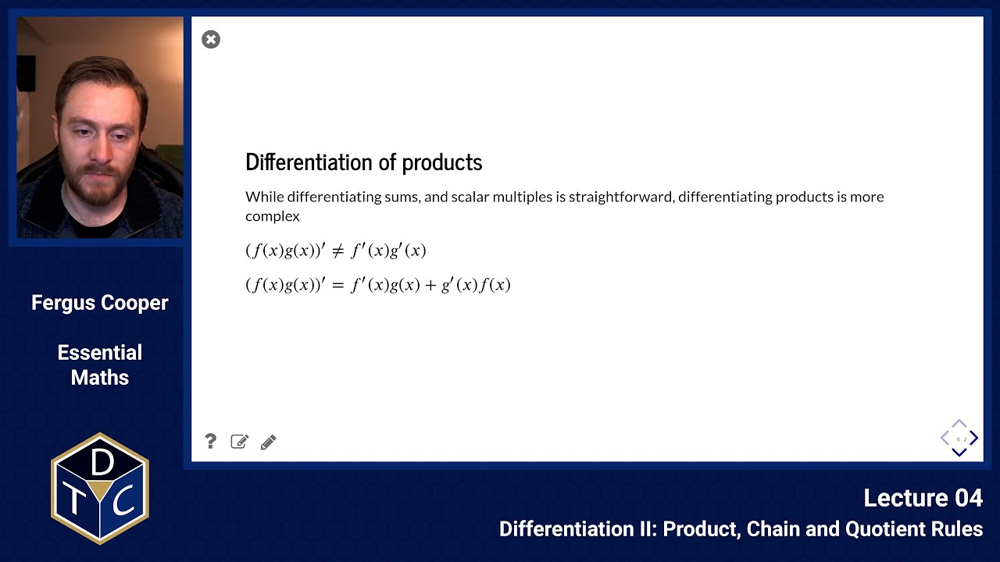
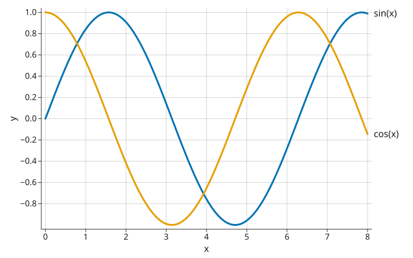

---

## YouTube lecture recording from October 2020

A recording of this lecture from October 2020; the material has changed a little since.

[](https://youtu.be/s3A-20YCAwE)

---

## Why these rules?

In the last lecture we found the derivative of $ax^n$.

Most functions we meet are built from simpler ones, by multiplying them, dividing them, or putting one inside another (e.g. $\sqrt{1+x^2}$).
In this lecture we find a rule for each of these, so that we can differentiate any function built from the standard ones.

We also use the derivative to approximate a function close to a point we know.

## Standard derivatives

It's useful to know the derivatives of all the standard functions, and some basic rules.

$$
\begin{aligned}
\frac{d}{dx} (x^n) &= n x^{n-1} \\
\frac{d}{dx} (\sin x) &= \cos x \\
\frac{d}{dx} (\cos x) &= -\sin x \\
\frac{d}{dx} (e^x) &= e^x \\
\frac{d}{dx} (\ln x) &= \frac{1}{x}
\end{aligned}
$$

For $\sin$ and $\cos$, $x$ must be in radians. We show the derivative of $\ln x$ later in this lecture.

To understand the derivative of sin and cos, consider their graphs, and when they are changing positively (increasing), negatively (decreasing) or not at all (no rate of change).



## Differentiation of sums and scalar multiples

$$
\begin{aligned}
(f(x) \pm g(x))' &= f'(x) \pm g'(x) \\
(a f(x))' &= a f'(x)
\end{aligned}
$$

## Differentiation of products

While differentiating sums, and scalar multiples is straightforward, differentiating products is more complex

$$
\begin{aligned}
(f(x) g(x) )' &\neq f'(x) g'(x) \\
(f(x) g(x) )' &= f'(x) g(x) + g'(x) f(x)
\end{aligned}
$$

### Example

To illustrate that this works, consider $y = (2x^3 - 1)(3x^3 + 2x)$

If we expand this out, we have that $y = 6x^6 + 4x^4 - 3x^3 - 2x$

From this, clearly, $y' = 36 x^5 + 16x^3 - 9 x^2 - 2$

To use the product rule, instead we say $y = f \times g$, where $f = 2x^3 - 1$, and $g = 3x^3 + 2x$. Therefore

$$
\begin{aligned}
f'(x) &= 6x^2 \\
g'(x) &= 9x^2 + 2 \\
y' &= f'g + g'f = 6x^2 (3x^3 + 2x) + (9x^2 + 2)(2x^3 - 1) \\
y' &= 18x^5 + 12x^3 + 18x^5 + 4x^3 - 9x^2 - 2 = 36x^5 + 16x^3 - 9x^2 - 2
\end{aligned}
$$

So both rules produce the same result. While for simple examples the product rule requires more work, as functions get more complex it saves a lot of time.

## Differentiating a function of a function: the chain rule

One of the most useful rules is differentiating a function that has another function inside it $y = f(g(x))$. For this we use the chain rule:

$$
\begin{aligned}
y &= f(g(x)) \\
y'(x) &= f'(g(x))\, g'(x) = \frac{df}{dg} \frac{dg}{dx}
\end{aligned}
$$

### Example 1: $y = (5x^2 + 2)^4$

We can write this as $y = g^4$, where $g = 5x^2 + 2$. Given this, we have that

$$
\begin{aligned}
\frac{dy}{dg} &= 4g^3 = 4(5x^2 + 2)^3 \\
\frac{dg}{dx} &= 10x
\end{aligned}
$$

This means that

$$
\frac{dy}{dx} = \frac{dy}{dg} \frac{dg}{dx} = 4 (5x^2 + 2)^3 10 x = 40 x (5x^2 + 2)^3
$$

This extends to any number of nested functions, meaning

$$
\frac{d}{dx}\,a(b(c(x))) = \frac{da}{db} \frac{d}{dx}\,b(c(x)) = \frac{da}{db} \frac{db}{dc}\frac{dc}{dx}
$$

## Differentiating the ratio of two functions: the quotient rule

If $y(x) = f(x)/g(x)$, then by using the product and chain rules on $f(x)\,(g(x))^{-1}$, we can show that

$$
y'(x) = \frac{f'g - g'f}{g^2}
$$

### Example

$$
y = \frac{3x-1}{4x + 2}
$$

$$
\begin{aligned}
f &= 3x - 1, \quad f' = 3 \\
g &= 4x + 2, \quad g' = 4 \\
y' &= \frac{f'g - g'f}{g^2} = \frac{3(4x+2) - 4(3x-1)}{(4x+2)^2} \\
y' &= \frac{12x + 6 - 12 x + 4}{(4x+2)^2} = \frac{10}{(4x+2)^2}
\end{aligned}
$$

## Differentiating inverse functions

For any function $y = f(x)$, with a well defined inverse $f^{-1}(x)$ (not to be confused with $(f(x))^{-1}$), we have by definition that

$$
x = f^{-1}(f(x)) = f^{-1}(y).
$$

This means that we can apply the chain rule

$$
\frac{d}{dx}(x) = \frac{d}{dx}(f^{-1}(y)) = \frac{d}{dy}(f^{-1}(y)) \frac{dy}{dx}
$$

But since $d(x)/dx = 1$

$$
\frac{d}{dy}(f^{-1}(y)) = \frac{1}{\frac{dy}{dx}} \qquad \text{(where } dy/dx \neq 0\text{)}
$$

(This is an example of _implicit differentiation_, where we differentiate both sides of an equation relating $x$ and $y$.)

### Example: $y = \ln(x)$

If $y = \ln(x)$, this means that $f^{-1}(y) = e^y = x$

Since $e^y$ is unchanged when differentiated, $\frac{d}{dy}(f^{-1}(y)) = e^y$. This means that

$$
\frac{d}{dx}(\ln(x)) = \frac{1}{\frac{d}{dy}(f^{-1}(y))} = \frac{1}{e^y}
$$

But since $y = \ln(x)$:

$$
\frac{d}{dx}(\ln(x)) = \frac{1}{e^{\ln(x)}} = \frac{1}{x}
$$

## Linear approximation and the derivative

By definition, the derivative of a function $f(x)$ is

$$
f'(x) = \lim_{h \rightarrow 0} \frac{f(x+h) - f(x)}{h}
$$

This means that for small $h$, this expression approximates the derivative. By rearranging this, we have

$$
f(x + h) \approx f(x) + h f'(x)
$$

In other words, $f(x+h)$ can be approximated by starting at $f(x)$ and moving a horizontal distance $h$ along the tangent, whose gradient is $f'(x)$.

### Example

Estimate $\sqrt{5218}$

To do this, we first need an $f(x)$ that is easy to calculate, and close to 5218. For this we can take that $70^2 = 4900$.

To calculate the approximation, we need $f'(x)$, where $f(x) = \sqrt{x}$.

$$
f'(x) = \frac{1}{2 \sqrt{x}}
$$

Since 5218 = 4900 + 318, we can set $x = 4900$ and $h = 318$.

Using the approximation, we have:

$$
\begin{aligned}
f(5218) &\approx f(4900) + 318 \times f'(4900) \\
f(5218) &\approx 70 + 318 \times \frac{1}{140} \approx 72.27
\end{aligned}
$$

$\sqrt{5218} = 72.2357252$ - not a bad approximation!

## Example: differentiating using SymPy

In Python, there is a special package for calculating derivatives symbolically, called SymPy.

This can quickly and easily calculate derivatives (as well as do all sorts of other analytic calculations).

```python
import sympy as sp

x = sp.symbols('x') # This creates a variable x, which is symbolically represented as the string x.

# Calculate the derivative of x^2
sp.diff(x**2, x)
```

$$
2 x
$$

```python
sp.diff(sp.cos(x), x)
```

$$
- \sin{\left(x \right)}
$$

```python
f = (x+1)**3 * sp.cos(x**2 - 5)
sp.diff(f,x)
```

$$
- 2 x \left(x + 1\right)^{3} \sin{\left(x^{2} - 5 \right)} + 3 \left(x + 1\right)^{2} \cos{\left(x^{2} - 5 \right)}
$$

```python
f = (x+1)**3 * (x-2)**2 * (x**2 + 4*x + 1)**4
sp.diff(f, x)
```

$$
\begin{aligned}
&\left(x - 2\right)^{2} \left(x + 1\right)^{3} \left(8 x + 16\right) \left(x^{2} + 4 x + 1\right)^{3} \\
&+ 3 \left(x - 2\right)^{2} \left(x + 1\right)^{2} \left(x^{2} + 4 x + 1\right)^{4} \\
&+ \left(x + 1\right)^{3} \left(2 x - 4\right) \left(x^{2} + 4 x + 1\right)^{4}
\end{aligned}
$$

```python
sp.expand(sp.diff(f, x)) # expand out in polynomial form
```

$$
\begin{aligned}
&13 x^{12} + 180 x^{11} + 869 x^{10} + 1250 x^{9} - 2934 x^{8} - 11504 x^{7} - 9142 x^{6} \\
&+ 10092 x^{5} + 23185 x^{4} + 17068 x^{3} + 6081 x^{2} + 1058 x + 72
\end{aligned}
$$

### SymPy documentation

You can look at the documentation for SymPy to see many other possibilities (e.g. we will use SymPy to do symbolic integration later on in this course)

- <https://docs.sympy.org/latest/index.html>

Try out SymPy to verify your pen & paper answers to the problem sheets.

## Introductory problems

:::callout{variant="tip"}
For more practice, an AI tool can write new problems like the ones below.
Ask it for problems of the same type and difficulty, or for problems set in your own field.
For example, you could ask it to "write five neuroscience problems on the chain rule, at the level of these ones".
Work them on paper first, then ask the tool to check your answers and to explain any step you are unsure of.
:::

::::challenge{id="04_intro_01" title="Introductory problems 1"}
Differentiate the following functions, using the stated rules where indicated:

1. Product rule: $y=(3x+4x^2)(8+3x^2)$
1. Product rule: $y=(5x^2-12)(4x^{-1} +2)$
1. Product rule: $y=x\,\cos x$
1. Product rule: $y=(3\sqrt{x} + 4x^3)\sin x$
1. Chain rule: $y=(6x+2)^4$
1. Chain rule: $y=(5x^3+10)^{1/2}$
1. Any rules: $y=\sqrt{1/(1-3x)}$
1. Any rules: $y=(3x+1)\sqrt{5x^2-x}$

:::solution

1. With $u = 3x+4x^2$ and $v = 8+3x^2$:

   $$
   \frac{dy}{dx} = (3+8x)(8+3x^2) + (3x+4x^2)(6x) = 48x^3+27x^2+64x+24
   $$

1. With $u = 5x^2-12$ and $v = 4x^{-1}+2$:

   $$
   \frac{dy}{dx} = 10x(4x^{-1}+2) + (5x^2-12)(-4x^{-2}) = 40 + 20x - 20 + 48x^{-2} = 20 + 20x + \frac{48}{x^2}
   $$

1. $$
   \frac{dy}{dx} = 1\times\cos x + x\times(-\sin x) = \cos x - x\sin x
   $$

1. $$
   \frac{dy}{dx} = \left(\frac{3}{2}x^{-1/2} + 12x^2\right)\sin x + \left(3\sqrt{x}+4x^3\right)\cos x
   $$

1. With $u = 6x+2$, $y = u^4$:

   $$
   \frac{dy}{dx} = 4(6x+2)^3\times 6 = 24(6x+2)^3
   $$

1. With $u = 5x^3+10$, $y = u^{1/2}$:

   $$
   \frac{dy}{dx} = \frac{1}{2}(5x^3+10)^{-1/2}\times 15x^2 = \frac{15x^2}{2\sqrt{5x^3+10}}
   $$

1. Write $y = (1-3x)^{-1/2}$.
   Then

   $$
   \frac{dy}{dx} = -\frac{1}{2}(1-3x)^{-3/2}\times(-3) = \frac{3}{2(1-3x)^{3/2}}
   $$

1. Use the product rule, with the chain rule for the square root:

   $$
   \begin{aligned}
   \frac{dy}{dx} &= 3\sqrt{5x^2-x} + (3x+1)\frac{10x-1}{2\sqrt{5x^2-x}} \\
   &= \frac{6(5x^2-x) + (3x+1)(10x-1)}{2\sqrt{5x^2-x}} \\
   &= \frac{60x^2+x-1}{2\sqrt{5x^2-x}}
   \end{aligned}
   $$

:::

::::

::::challenge{id="04_intro_02" title="Introductory problems 2"}
Differentiate the following trigonometric functions with respect to $x$:

1. $3\sin(x) + 5\cos(x)$
1. $\cos(3-2x)$
1. $\sqrt{\sin(x)}$
1. $\cos(x)/(4x)$

:::solution

1. $3\cos(x) - 5\sin(x)$

1. With $u = 3-2x$, the chain rule gives

   $$
   \frac{d}{dx}\cos(3-2x) = -\sin(3-2x)\times(-2) = 2\sin(3-2x)
   $$

1. With $u = \sin(x)$, $y = u^{1/2}$:

   $$
   \frac{dy}{dx} = \frac{1}{2}(\sin x)^{-1/2}\cos x = \frac{\cos x}{2\sqrt{\sin x}}
   $$

1. Using the quotient rule with $u = \cos x$ and $v = 4x$:

   $$
   \frac{dy}{dx} = \frac{4x(-\sin x) - 4\cos x}{(4x)^2} = -\frac{x\sin x + \cos x}{4x^2}
   $$

:::

::::

## Main problems

::::challenge{id="04_main_01" title="Main problems 1"}
Let $y=x^2$.

1. Find the **exact** value of $y$ when $x=2.1$.
1. Now **estimate** the value of $y$ when $x=2.1$ by using the linear approximation formula

   $$
   f(x_1+h)\approx f(x_1)+hf'(x_1)
   $$

   and letting $x_1=2.0$ and $h=0.1$.

1. Compare your estimate to the true value. Which is bigger? What is there about the shape of the graph of $y=x^2$ that accounts for this?
1. Repeat parts **1.** and **2.** for $x=2.01$.
1. Calculate the absolute error in each estimate. How does this error change with the value of $h$?

:::solution

1. $y = 2.1^2 = 4.41$

1. Here $f(x) = x^2$ and $f'(x) = 2x$, so

   $$
   f(2.1) \approx f(2.0) + 0.1\times f'(2.0) = 4 + 0.1\times 4 = 4.4
   $$

1. The true value, 4.41, is bigger than the estimate.
   The graph of $y=x^2$ curves upwards (its gradient increases), so it lies above its tangent line, and the linear approximation follows the tangent.

1. The exact value is $2.01^2 = 4.0401$, and the estimate is $4 + 0.01\times 4 = 4.04$.

1. The errors are $4.41 - 4.4 = 0.01$ for $h = 0.1$, and $4.0401 - 4.04 = 0.0001$ for $h = 0.01$.
   Dividing $h$ by 10 divides the error by 100, so the error is proportional to $h^2$.
   In fact, $(2+h)^2 = 4 + 4h + h^2$, so the error is exactly $h^2$.

:::

::::

::::challenge{id="04_main_02" title="Main problems 2"}
The energy, $E$, carried by a photon of wavelength $\lambda$ is given by

$$
E=\frac{hc}{\lambda}
$$

where $h$ is Planck's constant ($h=6.63\times 10^{-34}\,\text{Js}$) and $c$ is the speed of light ($c=3 \times 10^8\,\text{ms}^{-1}$).

1. Calculate the energy carried by a photon of wavelength $500\,\text{nm}$.
1. Sketch a graph to show how E varies with $\lambda$.
1. Derive an expression for $dE/d\lambda$, and calculate the slope of your graph when $\lambda=500\,\text{nm}$.
1. Hence, or otherwise, estimate the difference in energy between a photon of wavelength $500\,\text{nm}$ and one of wavelength $505\,\text{nm}$.

:::solution

1. First convert the wavelength to metres: $500\,\text{nm} = 500\times 10^{-9}\,\text{m}$.
   Then

   $$
   E = \frac{6.63\times 10^{-34}\times 3\times 10^8}{500\times 10^{-9}} \approx 3.98\times 10^{-19}\,\text{J}
   $$

1. $E$ is inversely proportional to $\lambda$, so the graph has the shape of $y = 1/x$ for positive $x$.
   $E$ is large for small wavelengths, and decreases towards zero as $\lambda$ increases, without ever reaching it.

   ```python
   import numpy as np
   from matplotlib import pyplot as plt

   h = 6.63e-34
   c = 3e8
   wavelength = np.linspace(100e-9, 1000e-9, 100)

   plt.plot(wavelength * 1e9, h * c / wavelength)
   plt.xlabel('wavelength (nm)')
   plt.ylabel('E (J)')
   ```

1. Write $E = hc\lambda^{-1}$, so

   $$
   \frac{dE}{d\lambda} = -hc\lambda^{-2} = -\frac{hc}{\lambda^2}
   $$

   At $\lambda = 500\times 10^{-9}\,\text{m}$ this is

   $$
   \frac{dE}{d\lambda} = -\frac{6.63\times 10^{-34}\times 3\times 10^8}{\left(500\times 10^{-9}\right)^2} \approx -7.96\times 10^{-13}\,\text{J}\,\text{m}^{-1}
   $$

1. Using the linear approximation, with a change in wavelength of $\Delta\lambda = 5\times 10^{-9}\,\text{m}$:

   $$
   \Delta E \approx \Delta\lambda\,\frac{dE}{d\lambda} = 5\times 10^{-9}\times\left(-7.96\times 10^{-13}\right) \approx -3.98\times 10^{-21}\,\text{J}
   $$

   So, the photon of wavelength $505\,\text{nm}$ carries about $4\times 10^{-21}\,\text{J}$ less energy, about 1% less.

:::

::::

::::challenge{id="04_main_03" title="Main problems 3"}
On February 10, 1990, the water level in Boston harbour was given by:

$$
y=5 + 4.9 \cos\left(\frac{\pi}{6} t\right)
$$

where $t$ is the number of hours since midnight and $y$ is measured in feet.

1. Sketch y.
1. Find $dy/dt$. What does it represent, in terms of water level?
1. For $0\le t \le 24$, when is $dy/dt$ zero? Explain what it means for $dy/dt$ to be zero.

:::solution

1. The graph is a cosine curve about the line $y = 5$, with amplitude 4.9, so the water level varies between 0.1 and 9.9 feet.
   Its period is the time $T$ with $\frac{\pi}{6}T = 2\pi$, so $T = 12$ hours.
   It starts at its highest, 9.9 feet, at midnight.

   ```python
   import numpy as np
   from matplotlib import pyplot as plt

   t = np.linspace(0, 24, 200)
   y = 5 + 4.9 * np.cos(np.pi * t / 6)

   plt.plot(t, y)
   plt.xlabel('t (hours since midnight)')
   plt.ylabel('water level, y (feet)')
   ```

1. Using the chain rule,

   $$
   \frac{dy}{dt} = -4.9\times\frac{\pi}{6}\sin\left(\frac{\pi}{6}t\right) \approx -2.57\sin\left(\frac{\pi}{6}t\right)
   $$

   This is the rate at which the water level is rising, in feet per hour (it is falling when $dy/dt$ is negative).

1. $dy/dt = 0$ when $\sin(\pi t/6) = 0$, which is when $\pi t/6$ is a whole multiple of $\pi$.
   So, $t = 0, 6, 12, 18$ and $24$ hours.
   At these times the water level is momentarily neither rising nor falling.
   It is high tide (9.9 feet) at $t = 0, 12$ and $24$, and low tide (0.1 feet) at $t = 6$ and $18$.

:::

::::

::::challenge{id="04_main_04" title="Main problems 4"}
In laminar flow of blood through a cylindrical artery, the resistance $R$ is inversely proportional to the fourth power of the radius $r$.

Use a linear approximation to show that if $r$ is decreased by 2%, $R$ will increase by approximately 8%.

:::solution

Write $R = kr^{-4}$, where $k$ is a constant.
Then

$$
\frac{dR}{dr} = -4kr^{-5} = -\frac{4R}{r}
$$

Decreasing $r$ by 2% means a change of $\Delta r = -0.02r$.
By the linear approximation,

$$
\Delta R \approx \Delta r\,\frac{dR}{dr} = (-0.02r)\times\left(-\frac{4R}{r}\right) = 0.08R
$$

So, $R$ increases by approximately 8%.
(The exact increase is $1/0.98^4 - 1 \approx 8.4\%$.)

:::

::::

::::challenge{id="04_main_05" title="Main problems 5"}
Imagine an ocean basin with an inlet on one side.
We can model the salinity of the water as a function of the distance from the ocean inlet.

Let $s$ be the water salinity, and $x$ is the distance from the inlet. Then

$$
s = \frac{s_{0}\alpha X}{\alpha X - x}
$$

where $s_{0}$ is the initial salinity at the inlet, $X$ is the width of the basin, and $\alpha$ is a constant.

Prove that the rate of increase of salinity with distance from the inlet is given by

$$
\frac{ds}{dx} = \frac{s}{\alpha X - x}
$$

:::solution

Write $s = s_0\alpha X(\alpha X - x)^{-1}$, where $s_0\alpha X$ is a constant.
By the chain rule,

$$
\frac{ds}{dx} = s_0\alpha X\times(-1)(\alpha X - x)^{-2}\times(-1) = \frac{s_0\alpha X}{(\alpha X - x)^2}
$$

Splitting this into two factors,

$$
\frac{ds}{dx} = \frac{s_0\alpha X}{\alpha X - x}\times\frac{1}{\alpha X - x} = \frac{s}{\alpha X - x}
$$

:::

::::

::::challenge{id="04_main_06" title="Main problems 6"}

The sine and cosine functions can be written in the form of the following infinite series:

$$
\begin{aligned}
\sin x &= x - \frac{x^3}{3!} + \frac{x^5}{5!} - \frac{x^7}{7!} + \ldots \\
\cos x &= 1 - \frac{x^2}{2!} + \frac{x^4}{4!} - \frac{x^6}{6!} + \ldots
\end{aligned}
$$

Here $n!$ (read "$n$ factorial") is the product of the whole numbers from $n$ down to 1, so for example $3! = 3 \times 2 \times 1 = 6$.

Differentiate these series term by term to verify the standard expressions for the derivatives of $\sin x$ and $\cos x$.

:::solution

The key step is that $n! = n\times(n-1)!$, so

$$
\frac{d}{dx}\left(\frac{x^n}{n!}\right) = \frac{nx^{n-1}}{n!} = \frac{x^{n-1}}{(n-1)!}
$$

In other words, differentiating each term lowers both the power and the factorial by one.
For $\sin x$:

$$
\frac{d}{dx}\sin x = 1 - \frac{x^2}{2!} + \frac{x^4}{4!} - \frac{x^6}{6!} + \ldots = \cos x
$$

For $\cos x$, the constant term 1 differentiates to 0:

$$
\frac{d}{dx}\cos x = -\frac{x}{1!} + \frac{x^3}{3!} - \frac{x^5}{5!} + \ldots = -\left(x - \frac{x^3}{3!} + \frac{x^5}{5!} - \ldots\right) = -\sin x
$$

:::

::::

## Extension problems

::::challenge{id="04_ext_01" title="Extension problems 1"}
The focal length of the lens of the eye, $f(t)$, can be controlled so that an object at distance $u(t)$ in front of the eye can be brought to perfect focus on the retina at a constant $v = 1.8\,\text{cm}$ behind the lens.

A fly is moving towards the eye at a speed of $0.7\,\text{ms}^{-1}$.

Assuming that the optics of the eye lens obeys the thin lens formula

$$
\frac{1}{f(t)}=\frac{1}{u(t)}+\frac{1}{v},
$$

find the rate of change of focal length required to keep the fly in perfect focus at a distance of $3\,\text{m}$.

Note: consider carefully what you are differentiating with respect to, and the physical interpretation of the mathematics.

:::solution

Both $f$ and $u$ change with time, while $v$ is constant.
Differentiate both sides of the thin lens formula with respect to $t$, using the chain rule:

$$
-\frac{1}{f^2}\frac{df}{dt} = -\frac{1}{u^2}\frac{du}{dt} \qquad\text{so}\qquad \frac{df}{dt} = \frac{f^2}{u^2}\frac{du}{dt}
$$

Work in metres, so $v = 0.018\,$m.
The fly is moving towards the eye, so $u$ is decreasing and $du/dt = -0.7\,\text{m}\,\text{s}^{-1}$.
At $u = 3\,$m,

$$
\frac{1}{f} = \frac{1}{3} + \frac{1}{0.018} \approx 55.9 \qquad\text{so}\qquad f \approx 0.0179\,\text{m}
$$

Therefore,

$$
\frac{df}{dt} = \frac{0.0179^2}{3^2}\times(-0.7) \approx -2.5\times 10^{-5}\,\text{m}\,\text{s}^{-1}
$$

So, the focal length must decrease at about $0.025\,\text{mm}$ per second.

:::

::::

::::challenge{id="04_ext_02" title="Extension problems 2"}
A contaminated lake is treated with a bactericide.

The rate of change of harmful bacteria $t$ days after treatment is given by

$$
\frac{dN}{dt} = -\frac{2000t}{1+t^2}
$$

where $N(t)$ is the number of bacteria in $1\,\text{ml}$ of water.

1. State with a reason whether the count of bacteria increases or decreases during the period $0\leq t \leq 10$.
1. Find the minimum value of $dN/dt$ during this period.

:::solution

1. For $0 < t \leq 10$, the numerator $2000t$ and the denominator $1+t^2$ are both positive, so $dN/dt < 0$.
   Therefore, the count of bacteria decreases throughout this period.

1. To find where $dN/dt$ is smallest, differentiate it again, using the quotient rule:

   $$
   \frac{d^2N}{dt^2} = -\frac{2000(1+t^2) - 2000t\times 2t}{(1+t^2)^2} = -\frac{2000(1-t^2)}{(1+t^2)^2}
   $$

   This is zero at $t = 1$ (we ignore $t=-1$).
   It is negative for $t < 1$ and positive for $t > 1$, so $dN/dt$ has a minimum at $t=1$, where

   $$
   \frac{dN}{dt} = -\frac{2000}{2} = -1000
   $$

   For comparison, $dN/dt = 0$ at $t = 0$ and $dN/dt \approx -198$ at $t = 10$.
   So, the minimum value is $-1000$ bacteria per ml per day, one day after treatment, which is when the bacteria are dying fastest.

:::

::::

::::challenge{id="04_ext_03" title="Extension problems 3"}
Consider a population of lions $L(t)$ and zebra $Z(t)$ interacting over time $t$.
One type of model for this situation is

$$
\frac{dZ}{dt} = aZ - bZL \qquad \text{and} \qquad \frac{dL}{dt} = -cL + dZL,
$$

where $a$, $b$, $c$ and $d$ are positive constants.

1. What values of $dZ/dt$ and $dL/dt$ correspond to unchanging populations?
1. How would the statement 'zebra go extinct' be represented mathematically?
1. For parameters $a=0.05$, $b=0.001$, $c=0.05$, and $d=0.00001$, find all population pairs $(Z,L)$ that yield unchanging populations. Can both species survive together?

:::solution

1. The populations are unchanging when both rates of change are zero: $dZ/dt = 0$ and $dL/dt = 0$.

1. $Z = 0$, or, if the zebra die out gradually, $Z(t)\rightarrow 0$ as $t\rightarrow\infty$.
   Note, if $Z = 0$ then $dL/dt = -cL$, so the lions then decline too.

1. Factorise the two equations:

   $$
   \frac{dZ}{dt} = Z(a - bL) = 0 \qquad\text{and}\qquad \frac{dL}{dt} = L(dZ - c) = 0
   $$

   The first is zero when $Z = 0$ or $L = a/b$, and the second when $L = 0$ or $Z = c/d$.
   Both are zero in two cases:

   - $Z = 0$ and $L = 0$, where there are no animals at all
   - $Z = c/d = 0.05/0.00001 = 5000$ and $L = a/b = 0.05/0.001 = 50$

   (If $Z = 0$ but $L \neq 0$, then $dL/dt = -cL \neq 0$, so this is not a solution, and similarly for $L = 0$ but $Z \neq 0$.)
   So, yes: with 5000 zebra and 50 lions, both populations stay the same, so the two species can survive together.
   What happens to populations that start elsewhere needs the phase plane methods we cover later in the course.

:::

::::
