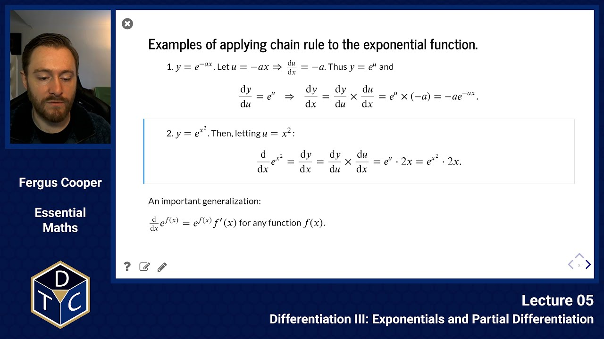

---

## YouTube lecture recording from October 2020

A recording of this lecture from October 2020; the material has changed a little since.

[](https://youtu.be/zIgJF-4xu90)

---

## Exponentials and partial differentiation

## Examples of applying chain rule to the exponential function

1. $y=e^{-ax}$

   Let $u=-ax$, so $du/dx=-a$. Thus $y=e^u$ and

   $$
   \frac{dy}{du}=e^u \quad\Rightarrow\quad \frac{dy}{dx}=\frac{dy}{du}\times\frac{du}{dx}=e^u\times(-a)=-ae^{-ax}.
   $$

1. $y = e^{x^2}$

   Then, letting $u = x^2$:

   $$
   \frac{d}{dx}e^{x^2}=\frac{dy}{dx}=\frac{dy}{du}\times\frac{du}{dx}=e^u\cdot 2x = e^{x^2}\cdot 2x.
   $$

So an important generalization is:

$$
\frac{d}{dx}e^{f(x)}=e^{f(x)}f'(x)
$$

for any function $f(x)$.

## Example with the natural logarithm

1. $y=\ln(a-x)^2=2\ln(a-x)=2\ln u$.

   Let $u=(a-x)$:

   $$
   \Rightarrow \frac{du}{dx}=-1 \quad\text{and}\quad \frac{dy}{du}=\frac{2}{u} \quad\text{Thus}\quad \frac{dy}{dx}=\frac{2}{u}\times (-1)=\frac{-2}{a-x}
   $$

This also generalises:

$$
\frac{d}{dx}\ln(f(x)) = \frac{f'(x)}{f(x)}
$$

## The derivative of $a^x$

By the properties of logarithms and indices we have

$$
a^x = \left(e^{\ln a}\right)^x=e^{\left(x\cdot\ln a\right)}.
$$

Thus, as we saw above we have:

$$
\frac{d}{dx}a^x = \frac{d}{dx}e^{\left(x\cdot\ln a\right)} = e^{\left(x\cdot\ln a\right)}\frac{d}{dx}\left(x\cdot\ln a\right) =a^x\cdot\ln a
$$

Similarly, in general:

$$
\frac{d}{dx}a^{f(x)} = a^{f(x)}\cdot \ln a\cdot f'(x)
$$

### Sympy example

Let's try and use Sympy to demonstrate this:

```python
import sympy as sp
x, a = sp.symbols('x a') # declare the variables x and a
f = sp.Function('f')     # declare a function dependent on another variable
sp.diff(a**f(x),x)       # write the expression we wish to evaluate
```

$$
a^{f{\left(x \right)}} \log{\left(a \right)} \frac{d}{d x} f{\left(x \right)}
$$

## The derivative of $\log_a x$

Recall the conversion formula $\log_a x = \ln x/\ln a$ and note that $\ln a$ is a constant.
Thus:

$$
\begin{aligned}
\frac{d}{dx}\log_a x &= \frac{d}{dx}\left(\frac{1}{\ln a}\cdot\ln x\right) \\
&= \left(\frac{1}{\ln a}\right)\cdot\frac{d}{dx}\ln x \\
&= \left(\frac{1}{\ln a}\right)\cdot\frac{1}{x} \\
&= \frac{1}{x\cdot\ln a}
\end{aligned}
$$

In general:

$$
\frac{d}{dx}\log_a f(x) = \frac{f'(x)}{f(x)(\ln a)}
$$

### Sympy example

Again, let's use SymPy to demonstrate this:

```python
x, a = sp.symbols('x a')  # declare the variables x and a
f = sp.Function('f')      # declare a function dependent on another variable
sp.diff(sp.log(f(x),a),x) # write the expression we wish to evaluate
```

$$
\frac{\frac{d}{d x} f{\left(x \right)}}{f{\left(x \right)} \log{\left(a \right)}}
$$

## Further examples

1. Product rule: let $y = x^2\,e^x$. Then:

   $$
   \frac{dy}{dx}=\frac{d}{dx}x^2e^x=\frac{d}{dx}x^2\cdot e^x+x^2\cdot\frac{d}{dx}e^x = (2x + x^2)e^x
   $$

1. Quotient rule: let $y = e^x/x$. Then:

   $$
   \frac{dy}{dx}=\frac{\frac{d}{dx}e^x\cdot x - e^x\cdot \frac{d}{dx}x}{x^2}=\frac{e^x\cdot x - e^x\cdot 1}{x^2}=\frac{x - 1}{x^2}e^x
   $$

1. Chain rule: $y = e^{x^2}$. Then, letting $f(x) = x^2$:

   $$
   \frac{d}{dx}e^{x^2} = e^{f(x)}f'(x) = e^{x^2}\cdot 2x
   $$

1. $y=\ln (x^2 + 1)$. Then, letting $f(x) = x^2+1$:

   $$
   \frac{d}{dx}\ln(x^2+1) = \frac{f'(x)}{f(x)} = \frac{2x}{x^2+1}
   $$

1. $$
   \frac{d}{dx}2^{x^3}=2^{x^3}\cdot\ln 2\cdot 3x^2
   $$

1. $$
   \frac{d}{dx}10^{x^2+1}=10^{x^2+1}\cdot\ln 10\cdot 2x
   $$

1. $$
   \frac{d}{dx}\log_{10}(7x+5)=\frac{7}{(7x+5)\cdot \ln10}
   $$

1. $$
   \frac{d}{dx}\log_2(3^x+x^4)=\frac{3^x\cdot\ln3 + 4x^3}{\ln 2\cdot(3^x+x^4)}
   $$

## Functions of several variables: partial differentiation

**Definition:** Given a function $z=f(x,y)$ of two variables $x$ and $y$, the **partial derivative of $z$ with respect to $x$** is the function obtained by differentiating $f(x,y)$ with respect to $x$, holding $y$ constant.

We denote this using $\partial$ (the "curly" delta, sometimes pronounced "del") as shown below:

$$
\frac{\partial z}{\partial x}=\frac{\partial}{\partial x}f(x,y) = f_x(x,y)
$$

## Example 1

$$
f(x,y)=z=x^2-2y^2
$$

$$
f_x=\frac{\partial z}{\partial x}=2x\qquad\text{and}\qquad f_y=\frac{\partial z}{\partial y}=-4y
$$

## Example 2

Let $z=3x^2y+5xy^2$. Then the partial derivative of $z$ with respect to $x$, holding $y$ fixed, is:

$$
\begin{aligned}
\frac{\partial z}{\partial x}&=\frac{\partial}{\partial x}\,\left(3x^2y+5xy^2\right) \\
&=3y\cdot 2x + 5y^2\cdot 1 \\
&=6xy+5y^2
\end{aligned}
$$

while the partial of $z$ with respect to $y$ holding $x$ fixed is:

$$
\begin{aligned}
\frac{\partial z}{\partial y}&=\frac{\partial}{\partial y}\,\left(3x^2y+5xy^2\right) \\
&=3x^2\cdot 1 + 5x\cdot 2y = 3x^2+10xy
\end{aligned}
$$

### Sympy example

In the previous slide we had:

$$
\frac{\partial}{\partial x}\,\left(3x^2y+5xy^2\right) = 6xy+5y^2
$$

Let's redo this in Sympy:

```python
x, y = sp.symbols('x y')
sp.diff(3*x**2*y + 5*x*y**2,x)
```

$$
6 x y + 5 y^{2}
$$

## Higher-order partial derivatives

Given $z = f(x,y)$ there are now four distinct possibilities for the
second-order partial derivatives.

1. With respect to $x$ twice:

   $$
   \frac{\partial}{\partial x}\left(\frac{\partial z}{\partial x}\right) =\frac{\partial^2z}{\partial x^2} =z_{xx}
   $$

1. With respect to $y$ twice:

   $$
   \frac{\partial}{\partial y}\left(\frac{\partial z}{\partial y}\right) =\frac{\partial^2z}{\partial y^2} =z_{yy}
   $$

1. First with respect to $x$, then with respect to $y$:

   $$
   \frac{\partial}{\partial y}\left(\frac{\partial z}{\partial x}\right) =\frac{\partial^2z}{\partial y\partial x} =z_{xy}
   $$

1. First with respect to $y$, then with respect to $x$:

   $$
   \frac{\partial}{\partial x}\left(\frac{\partial z}{\partial y}\right) =\frac{\partial^2z}{\partial x\partial y} =z_{yx}
   $$

## Example: LaPlace's equation for equilibrium temperature distribution on a copper plate

Let $T(x,y)$ give the temperature at the point $(x,y)$.

According to a result of the French mathematician Pierre LaPlace (1749 - 1827), at every point $(x,y)$ the second-order partials of $T$ must satisfy the equation:

$$
T_{xx} + T_{yy} = 0
$$

We can verify that the function $T(x,y)=y^2-x^2$ satisfies LaPlace's equation:

First with respect to $x$:

$$
T_x(x,y)=0-2x=-2x\qquad\text{so}\qquad T_{xx}(x,y)=-2
$$

Then with respect to $y$:

$$
T_y(x,y)=2y-0=2y\qquad\text{so}\qquad T_{yy}(x,y)=2
$$

Finally:

$$
T_{xx}(x,y)+T_{yy}(x,y) = 2 + (-2) = 0
$$

which proves the result.

The function $z=x^2y - xy^2$ does _not_ satisfy LaPlace's equation (and so cannot be a model for thermal equilibrium).

First note that

$$
\begin{aligned}
z_x &= 2xy - y^2 \\
z_{xx} &= 2y
\end{aligned}
$$

and that

$$
\begin{aligned}
z_y &= x^2 - 2xy \\
z_{yy} &= -2x
\end{aligned}
$$

Therefore:

$$
z_{xx}+z_{yy}=2y-2x\ne 0
$$

We can also verify this in Sympy like so:

```python
T1 = y**2 - x**2
sp.diff(T1, x, x) + sp.diff(T1, y, y)
```

$$
0
$$

and for the second function:

```python
T2 = x**2*y - x*y**2
sp.diff(T2, x, x) + sp.diff(T2, y, y)
```

$$
- 2 x + 2 y
$$

## A note on the mixed partials $f_{xy}$ and $f_{yx}$

If all of the partials of $f(x,y)$ exist, then $f_{xy}=f_{yx}$ for all $(x,y)$.

### Example

Let $z = x^2y^3+3x^2-2y^4$. Then $z_x=2xy^3+6x$ and $z_y = 3x^2y^2-8y^3$.

Taking the partial of $z_x$ with respect to $y$ we get

$$
z_{xy}=\frac{\partial}{\partial y}\left(2xy^3+6x\right)=6xy^2
$$

Taking the partial of $z_y$ with respect to $x$ we get the same thing:

$$
z_{yx}=\frac{\partial}{\partial x}\left(3x^2y^2-8y^3\right)=6xy^2
$$

So the operators $\partial/\partial x$ and $\partial/\partial y$ are **commutative**:

$$
\text{i.e.} \qquad \frac{\partial}{\partial x}\left(\frac{\partial z}{\partial y}\right) = \frac{\partial}{\partial y}\left(\frac{\partial z}{\partial x}\right)
$$

## Introductory problems

::::challenge{id="05_intro_01" title="Introductory problems 1"}
Differentiate the following functions with respect to $x$, using the stated rules where indicated:

1. Product rule: $\sqrt{x}\,e^x$
1. Product rule: $3x^2 \log(x)$
1. Chain rule: $e^{-4x^3}$
1. Chain rule: $\ln \sqrt{x^{3/2}/6}$
1. Chain rule: $10^{x^2}$
1. Any rules: $\ln x/(5x-7)$
1. Any rules: $e^x/(2x^3-1)$
1. Any rules: $\log_2\left(x\cos(x)\right)$

::::

::::challenge{id="05_intro_02" title="Introductory problems 2"}
If $y=e^{-ax}$, show that

$$
2\frac{d^2y}{dx^2}+a\frac{dy}{dx}-a^2y=0.
$$

::::

::::challenge{id="05_intro_03" title="Introductory problems 3"}
If $y=e^{-x}\sin(x)$, show that

$$
\frac{d^2y}{dx^2} + 2\frac{dy}{dx} + 2y = 0.
$$

::::

## Main problems

::::challenge{id="05_main_01" title="Main problems 1"}
The power, $W$, that a certain machine develops is given by the formula

$$
W=EI-RI^2
$$

where $I$ is the current and $E$ and $R$ are positive constants.

Find the maximum value of $W$ as $I$ varies.
::::

::::challenge{id="05_main_02" title="Main problems 2"}
Environmental health officers monitoring an outbreak of food poisoning after a wedding banquet were able to model the time course of the recovery of the guests using the equation:

$$
r = \frac{100t}{1+t}
$$

where $t$ represents the number of days since infection and $r$ is the percentage of guests who no longer display symptoms.
Determine an expression for the rate of recovery.
::::

::::challenge{id="05_main_03" title="Main problems 3"}
An experiment called 'the reptilian drag race' looks at how agamid lizards accelerate from a standing start.

The distance $x$ travelled in time $t$ on a horizontal surface has been modelled as

$$
x = v_{\text{max}} \left(t + \frac{e^{-kt}}{k} - \frac{1}{k}\right),
$$

where $v_{\text{max}}$ is the maximum velocity, and $k$ is a rate constant.

1. Find expressions for the velocity $v$ and acceleration $a$ as functions of time.
1. For $v_{\text{max}} = 3\,$m$\,$s$^{-1}$ and $k=10\,$s$^{-1}$, sketch $x$, $v$ and $a/10$ on the same axes for $0\leq t\leq 1\,$s.

::::

::::challenge{id="05_main_04" title="Main problems 4"}
The distance $x$ that a particular organism travels over time from its starting location is modelled by the equation

$$
x(t) = t^2 e^{k(1-t)},
$$

where $k$ is a positive constant and $0\leq t\leq 1\,$s.

1. Sketch $x$ over time for $k=1/2$ and $k=3$.
1. Calculate an expression for the organism's velocity as a function of time.
1. What is the largest value of $k$ such that the organism never starts moving back towards where it started?

::::

::::challenge{id="05_main_05" title="Main problems 5"}
The function

$$
S = S_{\text{max}}(1- e^{-t/\tau})
$$

is used to describe sediment thickness accumulating in an extensional basin through time.
What is the sedimentation rate?
::::

## Extension problems

::::challenge{id="05_ext_01" title="Extension problems 1"}
Let

$$
z = \frac{2}{3}x^3 - \frac{3}{4}x^2y + \frac{2}{5}y^3.
$$

1. Find $z_x$ and $z_y$
1. Find $z_{xx}$ and $z_{yy}$
1. Show that $z_{xy} = z_{yx}$

::::

::::challenge{id="05_ext_02" title="Extension problems 2"}
Show that $f_{xy}=f_{yx}$ for the following functions:

1. $f(x,y) = x^2 - xy + y^3$
1. $f(x,y) = e^y\,\ln(2x-y)$
1. $f(x,y) = 2\,x\,y\,e^{2xy}$
1. $f(x,y) = x\,\sin(y)$

::::

::::challenge{id="05_ext_03" title="Extension problems 3"}
The body mass index, $B$, is used as a parameter to classify people as underweight, normal, overweight and obese.
It is defined as their weight in kg, $w$, divided by the square of their height in meters, $h$.

1. Sketch a graph of $B$ against $w$ for a person who is 1.7m tall.
1. Find the rate of change of $B$ with weight of this person.
1. Sketch a graph of $B$ against $h$ for a child whose weight is constant at 35 kg.
1. Find the rate of change of $B$ with height $h$ of this child.
1. Show that

   $$
   \frac{\partial^2 B}{\partial h \partial w}=\frac{\partial^2 B}{\partial w \partial h}.
   $$

::::

::::challenge{id="05_ext_04" title="Extension problems 4"}
A light wave or a sound wave propagated through time and space can be represented in a simplified form by:

$$
y=A\sin\left(2\pi\left(\frac{x}{\lambda}+\omega t\right)\right)
$$

where $A$ is the amplitude, $\lambda$ is the wavelength and $\omega$ is the frequency of the wave.
$x$ and $t$ are position and time respectively.

An understanding of this function is essential for many problems such as sound, light microscopy, phase microscopy and X-ray diffraction.

1. Draw a graph of $y$ as a function of $x$ assuming $t=0$.
1. Draw a graph of $y$ as a function of $t$ assuming $x=0$.
1. At what values of $x$ and $t$ does the function repeat itself?
1. Find the rate at which $y$ changes at an arbitrary fixed position.
1. Show that $y_{xt} = y_{tx}$.

::::
