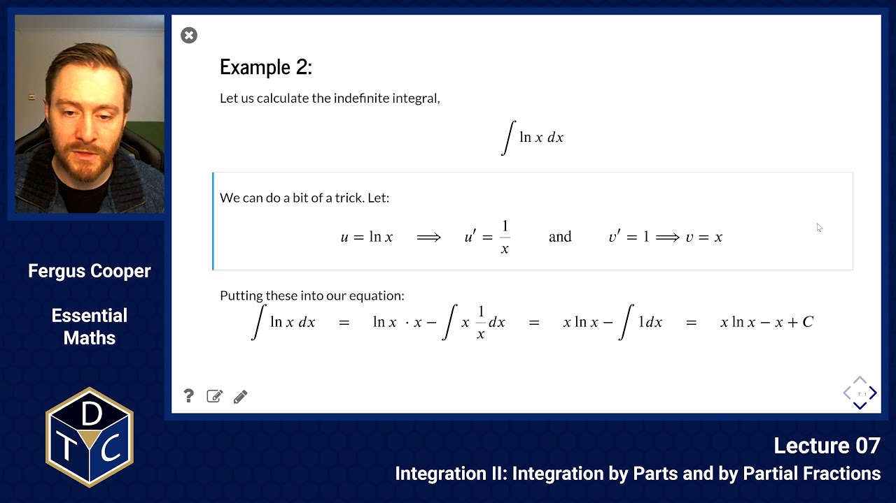

---

## YouTube lecture recording from October 2020

A recording of this lecture from October 2020; the material has changed a little since.

[](https://youtu.be/-9uaN3ZSwi0)

---

## Why more methods?

Not every function can be integrated by reversing a standard derivative, or by substitution.

In this lecture we add two more methods: _integration by parts_, which reverses the product rule, and _partial fractions_, which splits a fraction into simpler ones.

We will need both when we solve differential equations.

## Integration reverses the process of differentiation

### In general

$$
\frac{d(a\, x^{n+1})}{dx}=(n+1)a\, x^n \qquad\Rightarrow\qquad \int_{x_1}^{x_2} a\, x^n\,dx = \Big[\frac{a}{n+1}\, x^{n+1}\Big]_{x_1}^{x_2} \qquad (n\neq -1)
$$

### Reminder, method 1: integration by substitution

This method can be thought of as an integral version of the chain rule.
Suppose we wish to integrate:

$$
\begin{aligned}
I &=\int f(g(x))\,dx= \int f(u)\,dx \\
I &=\int f(u)\frac{dx}{du}\,du
\end{aligned}
$$

## Integration method 2: integration by parts

Recall that:

$$
\frac{d}{dx}f(x)\,g(x)=f(x)\,g'(x)+ g(x)\,f'(x)
$$

Integrate and rearrange to get:

$$
\int\limits_a^b f(x)\,g'(x)\,dx=\Big[f(x)\,g(x)\Big]_a^b-\int\limits_a^b g(x)\,f'(x)\,dx
$$

This is known as the formula for **'integrating by parts'** and can also be written:

$$
\int\limits_a^b u\,\frac{dv}{dx}\,dx = \Big[uv\Big]^b_a-\int\limits_a^b v\,\frac{du}{dx}\,dx
$$

or

$$
\int\limits_a^b u\,v'\,dx = \Big[uv\Big]^b_a-\int\limits_a^b v\,u'\,dx
$$

with $f(x) \equiv u$ and $g(x) \equiv v$.

### Integration by parts: example 1

$$
\int\limits_a^b x\,\sqrt{(x+1)}\,dx=\int\limits_a^b x\,(x+1)^{1/2}\,dx
$$

Choose

$$
u=x\qquad\text{and}\qquad v'=\sqrt{(x+1)}
$$

so that:

$$
u'=1\qquad\text{and}\qquad v=\frac{2}{3}(x+1)^{3/2}.
$$

Then:

$$
\begin{aligned}
\int\limits_a^b x\,\sqrt{(x+1)}\,dx &=\Big[x\,\frac{2}{3}(x+1)^{3/2}\Big]_a^b - \int\limits_a^b 1 \times \frac{2}{3}(x+1)^{3/2}\,dx \\
&=\Big[\frac{2}{3}\,x\,(x+1)^{3/2}\Big]_a^b- \Big[\frac{2}{3}\cdot \frac{2}{5}(x+1)^{5/2}\Big]_a^b
\end{aligned}
$$

If we had chosen the other option for $u$ and $v'$ we would have got:

$$
\Big[(x+1)^{1/2}\,\frac{x^2}{2}\Big]_a^b - \int\limits_a^b \frac{1}{2}\,\frac{1}{\sqrt{(x+1)}}\,\frac{x^2}{2}\,dx
$$

The second term is **worse** than the integral we started with!
It's important to choose $u$ and $v$ carefully.
This comes with practice.

### Integration by parts: example 2

Let us calculate the indefinite integral,

$$
\int \ln x\,dx
$$

We can do a bit of a trick. Let:

$$
u=\ln x \quad\Longrightarrow\quad u'=\frac{1}{x}\qquad\text{and}\qquad v'=1\quad\Longrightarrow\quad v=x
$$

Putting these into our equation:

$$
\begin{aligned}
\int \ln x\,dx &= \ln x \cdot x - \int x\,\frac{1}{x}\,dx \\
&= x \ln x - \int 1\, dx = x \ln x - x + C
\end{aligned}
$$

We can also check this calculation using SymPy:

```python
import sympy as sp
x = sp.symbols('x')
sp.integrate(sp.log(x),x)
```

$$
x \log{\left(x \right)} - x
$$

(SymPy writes $\log$ for the natural logarithm, $\ln$.)

### Integration by parts: example 3

$$
\int\limits^{\infty}_0 x^3\,e^{-x}\,dx
$$

Using the formula:

$$
\Big(\int u\, v'\, dx = [u\, v]-\int v\, u'\, dx\Big)
$$

Choose

$$
u=x^3\qquad\text{and}\qquad v'=e^{-x} \qquad\text{so that}\qquad u'=3x^2\qquad\text{and}\qquad v=-e^{-x}
$$

Then:

$$
\int\limits^{\infty}_0 x^3\,e^{-x}\,dx=-\Big[x^3\,e^{-x}\Big]^{\infty}_0 +\int\limits^{\infty}_0 3x^2\,e^{-x}\,dx
$$

Now apply integration by parts to the right-hand side:

Choose

$$
u=3x^2\qquad\text{and}\qquad v'=e^{-x} \qquad\text{so that}\qquad u'=6x\qquad\text{and}\qquad v=-e^{-x}
$$

Then:

$$
\int\limits^{\infty}_0 3x^2\,e^{-x}\,dx=-\Big[3x^2\,e^{-x}\Big]^{\infty}_0 +\int\limits^{\infty}_0 6x\,e^{-x}\,dx
$$

And, once more:

Choose

$$
u=6x\qquad\text{and}\qquad v'=e^{-x} \qquad\text{so that}\qquad u'=6\qquad\text{and}\qquad v=-e^{-x}
$$

Then:

$$
\begin{aligned}
\int\limits^{\infty}_0 6x\,e^{-x}\,dx &=-\Big[6x\,e^{-x}\Big]^{\infty}_0 +\int\limits^{\infty}_0 6\,e^{-x}\,dx \\
\Longrightarrow \int\limits^{\infty}_0 6\,e^{-x}\,dx &= -\Big[6\,e^{-x}\Big]^{\infty}_0=0+6e^0=6
\end{aligned}
$$

(Since $e^{-x}\to 0$ as $x\to\infty$, and $e^0=1$)

The other terms are all zero, because $x^3e^{-x}$, $3x^2e^{-x}$ and $6x\,e^{-x}$ all tend to $0$ as $x\to\infty$ ($e^{-x}$ shrinks faster than any power of $x$ grows), and all are $0$ at $x=0$:

$$
\begin{aligned}
-\Big[x^3\,e^{-x}\Big]^{\infty}_0 &= 0 - 0 = 0 \\
-\Big[3x^2\,e^{-x}\Big]^{\infty}_0 &= 0 - 0 = 0 \\
-\Big[6x\,e^{-x}\Big]^{\infty}_0 &= 0 - 0 = 0
\end{aligned}
$$

So, to answer our original question:

$$
\int\limits^{\infty}_0 x^3\,e^{-x}\,dx=6
$$

Let's also check it with SymPy:

```python
sp.integrate(x**3 * sp.exp(-x),(x,0,sp.oo))
```

$$
6
$$

This result actually generalises:

$$
\int\limits^{\infty}_0 x^n\,e^{-x}\,dx=n! \qquad \text{for } n = 0, 1, 2, \ldots
$$

### Integration by parts: example 4, trigonometry

Recall that:

$$
\begin{aligned}
\frac{d}{dx}(\sin x) &=\cos x \\
\frac{d}{dx}(\cos x) &=-\sin x
\end{aligned}
$$

Let's try and calculate the following integral:

$$
\int\limits^b_a \cos x\,e^{-x}\,dx = I
$$

Choose

$$
u=\cos x\qquad\text{and}\qquad v'=e^{-x} \qquad\text{so that}\qquad u'=-\sin x\qquad\text{and}\qquad v=-e^{-x}
$$

Then:

$$
I =\Big[-\cos x\, e^{-x}\Big]^b_a -\int\limits^b_a (-)\sin x\,(-)e^{-x}\,dx
$$

Next, choose

$$
u=\sin x\qquad\text{and}\qquad v'=e^{-x} \qquad\text{so that}\qquad u'=\cos x\qquad\text{and}\qquad v=-e^{-x}
$$

Then:

$$
I =\Big[-\cos x\, e^{-x}\Big]^b_a - \Big[\sin x\,(-)e^{-x}\Big]^b_a + \int\limits^b_a \cos x\,(-)e^{-x}\,dx
$$

The last term is the integral we started with:

$$
\Longrightarrow \quad 2\int\limits^b_a \cos x\,e^{-x}\,dx = \Big[\sin x\, e^{-x}\Big]^b_a - \Big[\cos x\, e^{-x}\Big]^b_a
$$

## Integration method 3: partial fractions

If we want to calculate the integral below, none of the previous rules allow us to make much progress.

$$
\int \frac{dx}{(2x+1)(x-5)}
$$

But, in this case, we can try splitting the denominator up into two fractions that we can deal with:

$$
\text{Let}\qquad \frac{1}{(2x+1)(x-5)}=\frac{A}{(2x+1)} + \frac{B}{(x-5)}
$$

If we multiply both sides by $(2x+1)(x-5)$, we get:

$$
A(x-5)+B(2x+1)=1 \qquad\text{so}\qquad Ax-5A+2Bx+B=1
$$

We can then equate coefficients of $x$:

$$
A+2B=0 \qquad\text{thus}\qquad A=-2B \qquad \text{(A)}
$$

Equate the constant terms (coefficients of $x^0$):

$$
-5A+B=1 \qquad\text{so from (A):}\qquad 10B+B=1, \quad B=\frac{1}{11}, \quad A=-\frac{2}{11}
$$

Thus:

$$
\int \frac{dx}{(2x+1)(x-5)}=-\int \frac{2\, dx}{11(2x+1)} + \int \frac{dx}{11(x-5)}
$$

Now use method of substitution on the first fraction:

$$
u=2x+1
$$

so $du/dx=2$ and $dx/du=1/2$

And on the second fraction:

$$
w=x-5
$$

so $dw/dx=1$ and $dx/dw=1$

$$
\begin{aligned}
-\int \frac{2\, du}{2 \times 11 \times u} + \int \frac{dw}{11w} &= -\frac{\ln |u|}{11} + \frac{\ln |w|}{11} \\
&=-\frac{\ln |2x+1|}{11} + \frac{\ln |x-5|}{11} + C
\end{aligned}
$$

SymPy can also solve integrals requiring partial fractions:

```python
sp.integrate(1/((2*x + 1)*(x - 5)),x)
```

$$
\frac{\log{\left(x - 5 \right)}}{11} - \frac{\log{\left(x + \frac{1}{2} \right)}}{11}
$$

This answer seems different because of the arbitrary constant of integration.

## Introductory problems

::::challenge{id="07_intro_01" title="Introductory problems 1"}
By using suitable substitutions, evaluate the following integrals:

1. $\int x^2(x^3+4)^2\,dx$
1. $\int e^{-x}(5-4e^{-x})\,dx$
1. $\int (1+x)\sqrt{(4x^2+8x+3)}\,dx$
1. $\int 3x e^{(x^2+1)}\,dx$

::::

::::challenge{id="07_intro_02" title="Introductory problems 2"}
Find the indefinite integrals, with respect to $x$, of the following functions:

1. $x\,e^{3bx}$
1. $x^3\,e^{-3x}$
1. $x \cos (x)$
1. $e^{bx} \sin(x)$

::::

::::challenge{id="07_intro_03" title="Introductory problems 3"}
Sketch the curve $y=(x-2)(x-5)$ and calculate by integration the area between the curve and the $x$-axis, bounded by $x=2$ and $x=5$.
::::

## Main problems

::::challenge{id="07_main_01" title="Main problems 1"}
Evaluate the following indefinite and definite integrals:

1. $\int 6/(7-x)^3\,dx$
1. $\int 13x^3(9-x^4)^5\,dx$
1. $\int_2^5 5\ln(x)\,dx$
1. $\int x^x\,(1 + \ln(x))\,dx$

::::

::::challenge{id="07_main_02" title="Main problems 2"}
Suppose the area $A(t)$ (in cm$^2$) of a healing wound changes at a rate

$$
\frac{dA}{dt} = -4t^{-3},
$$

where $t$, measured in days, lies between 1 and 10, and the area is $2\,$cm$^2$ after 1 day.
What will the area of the wound be after 10 days?
::::

::::challenge{id="07_main_03" title="Main problems 3"}
A rocket burns fuel, so its mass decreases over time.

If it burns fuel at a constant rate $\rho\,\text{kg/s}$, and if the exhaust velocity relative to the rocket is a constant $v_e\,\text{m/s}$, then there will be a constant force of magnitude $\rho v_e$ propelling it.

The rocket starts burning fuel at $t=0\,\text{s}$ with total mass of $m_0\,\text{kg}$, and runs out of fuel at a later time $t=t_f\,\text{s}$, with a final mass of $m_f\,\text{kg}$.

1. Newton's second law tells us that the instantaneous acceleration $a$ of the rocket at time $t$ is equal to the force propelling it at that time, divided by its mass at that time.
   Write down an expression for $a$ as a function of $t$.
1. By integrating this expression, show that the rocket's total change in velocity is given by

   $$
   v_e \ln\left(\frac{m_0}{m_f}\right).
   $$

::::

::::challenge{id="07_main_04" title="Main problems 4"}
The flow of water pumped upwards through the xylem of a tree, $F$, is given by:

$$
F = M_0(p+qt)^{3/4},
$$

where $t$ is the tree's age in days, $p$ and $q$ are positive constants, and $M_0p^{3/4}$ is the flow when the tree is planted (i.e. at $t=0$).

Determine the total volume of water pumped up the tree in its tenth year (ignoring leap years) if:

- $p=10$,
- $q=0.01\,$day$^{-1}$, and
- $M_0=0.92\,$l$\,$day$^{-1}$.

::::

## Extension problems

::::challenge{id="07_ext_01" title="Extension problems 1"}
Express

$$
\frac{1}{x(x^2-16)}\quad\text{in the form}\quad\frac{A}{x} + \frac{B}{(x+4)} + \frac{C}{(x-4)}.
$$

Hence calculate

$$
\int\frac{1}{x(x^2-16)}\,dx.
$$

::::

::::challenge{id="07_ext_02" title="Extension problems 2"}
The probability that a molecule of mass $m$ in a gas at temperature $T$ has speed $v$ is given by the Maxwell-Boltzmann distribution:

$$
f(v) = 4 \pi \left(\frac{m}{2\pi k T} \right)^{3/2} v^2 e^{-mv^2/2kT}
$$

where $k$ is Boltzmann's constant. Find the average speed:

$$
\overline {v} =\int_0^{\infty}v\,f(v)\,dv.
$$

::::

::::challenge{id="07_ext_03" title="Extension problems 3"}
Baranov developed expressions for commercial yields of fish in terms of lengths, $L$, of the fish.
His formula gave the total number of fish of length $L$ as $k\,e^{-cL}$, where $c$ and $k$ are constants ($k$ and $c$ are positive).

1. Give a sketch of the graph $f(L)=k\,e^{-cL}$.
   (Something decreasing, concave upward and asymptotic to horizontal axis will do.)
   On your sketch, introduce marks on the horizontal axis that represent lengths $L=1$, $L=2$, $L=3$, $L=4$ and $L=5$.
   Now draw a rectangle on your sketch that represents the number of fish whose lengths are between $L=3$ and $L=4$.
1. Explain how we can represent the total number of fish $N$ as an area.
   Show that this number equals $k/c$.
1. Only fish longer than $L_0$ count as commercial. Hence, assuming that the fish are all similar in shape (i.e. their width and breadth scales with their length) and of equal density $\rho$, show that the weight, $W$, of the commercial fish population is

   $$
   W= \int_{L_0}^{+\infty} a\, k \rho\,L^3 e^{-cL}\,dL,
   $$

   and hence that

   $$
   W=\frac{N\, a\, \rho\, e^{-cL_0}}{c^3} \left((cL_0)^3 +3(cL_0)^2+ 6cL_0 +6\right),
   $$

   where $a$ is a constant.

::::
