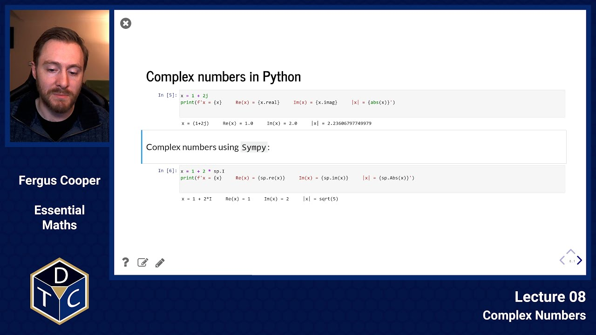
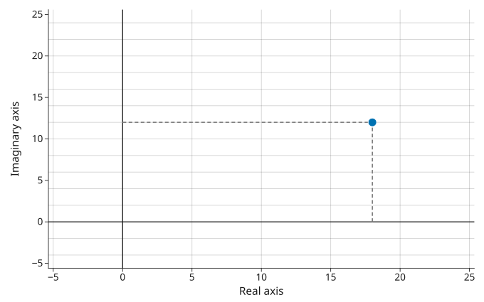
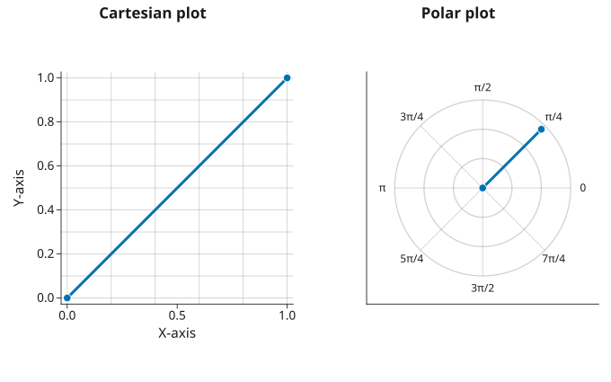

---

## YouTube lecture recording from October 2020

A recording of this lecture from October 2020; the material has changed a little since.

[](https://youtu.be/h8zbbLUnsMM)

---

## Why complex numbers?

Some equations, like $x^2+1=0$, have no solutions among the real numbers.
Complex numbers give every polynomial a full set of roots.

We will meet them again when we study systems of differential equations.
There, complex roots tell us that the system oscillates (e.g. populations of predators and prey that rise and fall in turn).

The link is $e^{i\theta}=\cos\theta+i\sin\theta$, which we show at the end of this lecture.

## Imaginary numbers

**The imaginary number $i$:**

- The polynomial $x^2-1=0$ has two real roots: $1$ and $-1$
- The polynomial $x^2+1=0$ has **no** real roots.

Consider solving:

$$
x^2 = 1\qquad\text{and}\qquad x^2 = -1
$$

We introduce an "imaginary" number $i$ so that there are two solutions to $x^2 = -1$: $i$ and $-i$.
That is, $i$ is a number with the property that $i^2=-1$.

## Complex numbers

The complex numbers are the set of all expressions of the form $a + bi$ where $i^2=-1$ and $a$ and $b$ are real numbers:

$$
\mathbb{C}=\left\{a + bi \mid a,\ b \in\mathbb{R}\right\}
$$

For $z=a+bi\in\mathbb{C}$ we define the _real_ and _imaginary_
parts of $z$ to be $\Re(z) = a$ and $\Im(z)=b$.

The imaginary number $i$ has no home on the real number line.
Instead, we locate it on the **complex plane** at the point $(0,1)$.

- We can represent any complex number $z=a+bi$ as the point $(a,b)$ in the complex plane.
- The coordinates $(a,b)$ are usually called the _Cartesian_ coordinates for $z$.
  (Named after the mathematician and philosopher René Descartes).
- In this plane, the real numbers lie on the horizontal axis.
  We usually refer to the horizontal axis of $\mathbb{C}$ as the **real axis**.

The following plot shows a complex number with a real component of 18 and an imaginary component of 12:



## Complex conjugates

- The complex plane $\mathbb{C}$ contains **all** of the roots of **every** polynomial.

E.g., let's look at a quadratic equation.
Recall the quadratic formula:

$$
ax^2 +bx +c = 0 \iff x= \frac{-b \pm\sqrt{b^2-4ac}}{2a}
$$

Now, let's consider this specific quadratic equation:

$$
x^2-8x+25 = 0
$$

which we can solve using the quadratic formula:

$$
x=\frac{8\pm\sqrt{64-100}}{2}=\frac{8\pm\sqrt{-36}}{2}=\frac{8\pm6i}{2}=4\pm3i
$$

- Note that these two roots are reflections of one another through the
  real axis. They are _conjugates_ of one another.

- In general, let $z=a + bi$. The **conjugate** of $z$ is the complex number
  $\bar{z}=a-bi$.

We can also use SymPy's `solve` method to solve polynomials:

```python
import sympy as sp
x = sp.symbols('x')
sp.solve(x**2 - 8*x + 25)
```

$$
\left[ 4 - 3 i, \  4 + 3 i\right]
$$

## Modulus (size) of a complex number

The distance to a point on the complex plane from 0 is called its **modulus**, and we find this by calculating the hypotenuse of the triangle with base $\Re(z)$ and height $\Im(z)$:

E.g. The modulus of $4\pm3i$ is $\sqrt{3^2+4^2}=\sqrt{9+16}=\sqrt{25}=5$

- In general, the **modulus** of $z=a+bi$ is the real number
  $|z|=\sqrt{a^2+b^2}$.

- The **modulus** is connected to the **conjugate** by means of the formula
  $z\cdot \bar{z}=|z|^2$. Indeed:

$$
\begin{aligned}
z\cdot\bar{z}&=(a+bi)(a-bi)=a^2-(bi)^2=a^2-b^2\cdot i^2\\
&=a^2-b^2(-1)=a^2+b^2=|z|^2
\end{aligned}
$$

## Complex numbers in Python

Note that, in Python, because `i` is often used as an index variable in loops, the language uses `j`, instead, to represent the imaginary unit:

```python
x = 1 + 2j
print(f'x = {x}     Re(x) = {x.real}     Im(x) = {x.imag}     |x| = {abs(x)}')
```

```text
x = (1+2j)     Re(x) = 1.0     Im(x) = 2.0     |x| = 2.23606797749979
```

In SymPy, the imaginary unit is `sp.I`:

```python
x = 1 + 2 * sp.I
print(f'x = {x}     Re(x) = {sp.re(x)}     Im(x) = {sp.im(x)}     |x| = {sp.Abs(x)}')
```

```text
x = 1 + 2*I     Re(x) = 1     Im(x) = 2     |x| = sqrt(5)
```

## Addition and subtraction

Addition and subtraction of complex numbers work as you would expect:

$$
(a+bi)\pm(c+di)=(a\pm c) + (b\pm d)i
$$

and

$$
-(a+bi)=-a-bi
$$

Try adding: $(5+6i)+(1-i)$:

```python
print((5 + 6j) + (1 - 1j))
```

```text
(6+5j)
```

Try subtracting: $(5+6i)-(1-i)$:

```python
print((5 + 6j) - (1 - 1j))
```

```text
(4+7j)
```

## Multiplication

Multiplication is not quite so convenient in Cartesian coordinates:

$$
\begin{aligned}
(a+bi)(c+di)&=ac + adi + bci + bidi \\
&= ac + adi + bci -bd \\
&= (ac-bd)+(ad+bc)i
\end{aligned}
$$

Try multiplying: $(5+6i)(1-i)$:

```python
print((5 + 6j) * (1 - 1j))
```

```text
(11+1j)
```

## Division

Division is even more awkward in Cartesian coordinates: we have to multiply the numerator and the denominator by the complex conjugate of the denominator.

$$
\begin{aligned}
\frac{a+bi}{c+di}&=\frac{(a+bi)(c-di)}{(c+di)(c-di)}\\
&=\frac{(ac+bd)+(bc-ad)i}{c^2+d^2}=\left(\frac{ac+bd}{c^2+d^2}\right)+ \left(\frac{bc-ad}{c^2+d^2}\right)i
\end{aligned}
$$

Try dividing:

$$
\frac{-4+7i}{2+3i}
$$

```python
print(sp.simplify((-4 + 7*sp.I) / (2 + 3*sp.I)))
```

```text
1 + 2*I
```

## Polar coordinates

It is often convenient to represent the complex number $z = a + bi$ in terms of its polar coordinates $\langle r,\theta\rangle$.

- The angle $\theta$ is called the _argument_ of $z$.

- The real number $r=|z|$ is sometimes denoted mod$(z)$.



## Connection between Cartesian and polar

Let $z=x+iy$.
If we are given the polar coordinates of $z$ and want to express the Cartesian coordinates use

$$
\begin{gathered}
x=r\cos\theta\\
y=r\sin\theta\\
z=r\cos\theta + ri\sin\theta=r(\cos\theta + i\sin\theta)
\end{gathered}
$$

If we are given the Cartesian coordinates and want to find the polar coordinates, use:

$$
r=\text{mod}(z)=|z|=\sqrt{x^2+y^2}
$$

$$
\theta=\text{arg}(z)=
\begin{cases}\pi/2, & \text{if } x=0,y>0 \\
-\pi/2, & \text{if } x=0,y<0 \\
\arctan\left(\frac{y}{x}\right), & \text{if } x>0\\
\arctan\left(\frac{y}{x}\right)+\pi, & \text{if } x<0, y\geq 0\\
\arctan\left(\frac{y}{x}\right)-\pi, & \text{if } x<0, y<0
\end{cases}
$$

Note: all of the fuss about the value of $\theta$ in the formula above is to make sure that $z$ gets into the proper quadrant.
Beware of the sign of this tangent: it depends on which quadrant you are in.

The positive $x$ axis is defined as having $\theta=0$ and positive $\theta$ goes in an anticlockwise sense around the $x-y$ plane.

## Some examples

### Example 1

Find the Cartesian coordinates for the complex number $z$ with polar coordinates $r=2$ and $\theta=\pi/6$.

$$
\begin{aligned}
\Re(z)&=x=r\cos\theta=2\cos(\pi/6)=2\left(\frac{\sqrt{3}}{2}\right)=\sqrt{3}\\
\Im(z)&=y=r\sin\theta=2\sin(\pi/6)=2\left(\frac{1}{2}\right)=1
\end{aligned}
$$

Therefore, $z = \sqrt{3} + i$.

```python
import cmath
import numpy as np
print(cmath.rect(2, np.pi/6))
```

```text
(1.7320508075688774+0.9999999999999999j)
```

### Example 2

Find the polar coordinates for the complex number $z= -3+4i$.

$$
\begin{aligned}
|z|=r &= \sqrt{(-3)^2+4^2}=\sqrt{25}=5 \\
\text{arg}(z)=\theta=\arctan\left(\frac{y}{x}\right) &= \arctan(-4/3)+\pi = -0.93+\pi \approx 2.21 \text{ radians}\approx 127^\circ
\end{aligned}
$$

```python
print(cmath.polar(-3 + 4j))
```

```text
(5.0, 2.214297435588181)
```

### Example 3

Find the polar coordinates for the complex number $z= -2i$.

$$
\begin{aligned}
\text{mod}(z)&=r = |z|=2\\
\text{arg}(z)&=\theta=-\frac{\pi}{2}
\end{aligned}
$$

```python
print(cmath.polar(-2j))
```

```text
(2.0, -1.5707963267948966)
```

## Multiplication in polar coordinates

First a reminder of three useful and important identities:

$$
\begin{aligned}
\cos^2\theta + \sin^2\theta &= 1 \\
\cos(\theta_1+\theta_2)&=\cos\theta_1\cos \theta_2 - \sin\theta_1\sin\theta_2 \\
\sin(\theta_1+\theta_2)&=\sin\theta_1\cos \theta_2 + \sin\theta_2\cos\theta_1
\end{aligned}
$$

Now, let $z_1=r_1\cos\theta_1+ir_1\sin\theta_1$ and $z_2=r_2\cos\theta_2+ir_2\sin\theta_2$.

We first compute the real part of the product $z_1\cdot z_2$:

$$
\begin{aligned}
\Re(z_1\cdot z_2) &= r_1\cos\theta_1\cdot r_2\cos\theta_2 - r_1\sin\theta_1\cdot r_2\sin\theta_2\\
&=r_1r_2(\cos\theta_1\cos\theta_2 - \sin\theta_1\sin\theta_2)\\
&=r_1r_2\cos(\theta_1 + \theta_2)
\end{aligned}
$$

Note that for the real part the moduli have been multiplied and the arguments added.

Now we compute the imaginary part of $z_1\cdot z_2$:

$$
\begin{aligned}
\Im(z_1\cdot z_2) &= r_1\sin\theta_1\cdot r_2\cos\theta_2 + r_2\sin\theta_2\cdot r_1\cos\theta_1\\
&=r_1r_2(\sin\theta_1\cos\theta_2 + \sin\theta_2\cos\theta_1)\\
&=r_1r_2\sin(\theta_1 + \theta_2)
\end{aligned}
$$

For the imaginary part too, the moduli multiply while the arguments add.

This gives a relatively compact and highly geometric result for the product:

$$
z_1\cdot z_2 = r_1r_2(\cos(\theta_1 + \theta_2)+i\sin(\theta_1 + \theta_2))
$$

It is **multiplicative** in the modulus and **additive** in the argument:

$$
\begin{aligned}
|z_1z_2|&= |z_1|\cdot |z_2|\\
\arg(z_1z_2)&=\arg (z_1)+ \arg( z_2) \qquad \text{(up to a multiple of } 2\pi\text{)}
\end{aligned}
$$

This means that when we multiply by $z$, we are **rotating** through the angle $\arg(z)$ and **radially stretching** by a factor of $|z|$.

## A remarkable connection with $e^{i\theta}$

First, think of $z=\cos\theta + i\sin\theta$ as a function of $\theta$ and differentiate with respect to $\theta$:

$$
\frac{dz}{d\theta}=\frac{d}{d\theta}\left(\cos\theta+i\sin\theta\right)=-\sin\theta+i\cos\theta \qquad \text{(1)}
$$

Next notice that the right-hand side is just the product $iz$:

$$
iz=i(\cos\theta+i\sin\theta)=i\cos\theta+i^2\sin\theta=-\sin\theta+i\cos\theta \qquad \text{(2)}
$$

Thus, from (1) and (2),

$$
\frac{dz}{d\theta}=iz
$$

This is a separable differential equation (which we will cover properly in the remainder of the course):

$$
\int\frac{dz}{iz}=\int d\theta \qquad\Rightarrow\qquad \frac{1}{i}\ln z =\theta +c \qquad\Rightarrow\qquad \ln z =i\theta +ic
$$

In exponential form:

$$
z=e^{i\theta+ic} = e^{i\theta}\,e^{ic} = Ae^{i\theta} \qquad \text{with} \qquad A=e^{ic}
$$

When $\theta=0$, $z=1$, giving $A=1$, so:

$$
z=\cos\theta + i \sin\theta=e^{i\theta} \qquad \text{(3)}
$$

Similarly, we can show that:

$$
z=\cos\theta - i \sin\theta=e^{-i\theta} \qquad \text{(4)}
$$

Adding (3) and (4), and subtracting (3) and (4) gives:

$$
\cos\theta =\frac{e^{i\theta}+ e^{-i\theta}}{2} \qquad\qquad \sin\theta =\frac{e^{i\theta}-e^{-i\theta}}{2i}
$$

This demonstrates that **any complex number** can be written:

$$
z=x+iy=r(\cos\theta + i\sin\theta)=r\,e^{i\theta}
$$

### Several important consequences

1. Any complex number can be written in the polar form $z = re^{i\theta}$ where $r=|z|$ and $\theta=\arg(z)$.

2. The unit circle in $\mathbb{C}$ consists exactly of those complex numbers with
   modulus equal to 1, that is the numbers $e^{i\theta}$.

3. Multiplication on the unit circle $r=1$ can be carried out by adding the
   angles:

   $$
   e^{i\theta_1}\cdot e^{i\theta_2} = e^{i(\theta_1+\theta_2)}
   $$

4. Exponentiation on the unit circle $r=1$ can be done by multiplying the angle by the index (for integer $n$):

   $$
   \left(e^{i\theta}\right)^n = e^{i\theta n}=e^{i(n\theta)}
   $$

5. This result is known as **de Moivre's theorem**. It is usually stated in its Cartesian form, for integer $n$:

   $$
   (\cos\theta + i\sin\theta)^n=\cos(n\theta) + i\sin(n\theta)
   $$

6. Finally, the famous identity by Leonhard Euler

   $$
   e^{\pi i}+1=0
   $$

## Introductory problems

:::callout{variant="tip"}
For more practice, an AI tool can write new problems like the ones below.
Ask it for problems of the same type and difficulty, or for problems set in your own field.
For example, you could ask it to "write five physics problems on complex numbers, at the level of these ones".
Work them on paper first, then ask the tool to check your answers and to explain any step you are unsure of.
:::

::::challenge{id="08_intro_01" title="Introductory problems 1"}
Simplify:

1. $2-2i\quad+\quad 3+i$
1. $4-6i\quad+\quad 19+4i$
1. $(1-i)^2$
1. $(2+i)^2$
1. $(4-3i)/(2+6i)$
1. $(1+2i)/(1-3i)$
1. $(2-i)^{-2} +(2+i)^{-2}$
1. $(5-i)^{-2} -(5+i)^{-2}$

:::solution

Add the real and imaginary parts separately, use $i^2=-1$ when multiplying, and divide by multiplying the numerator and the denominator by the complex conjugate of the denominator.

1. $2-2i + 3+i = 5-i$
1. $4-6i + 19+4i = 23-2i$
1. $(1-i)^2 = 1 - 2i + i^2 = -2i$
1. $(2+i)^2 = 4 + 4i + i^2 = 3+4i$
1. $$
   \frac{4-3i}{2+6i} = \frac{(4-3i)(2-6i)}{(2+6i)(2-6i)} = \frac{8 - 30i + 18i^2}{4 + 36} = \frac{-10-30i}{40} = -\frac{1}{4} - \frac{3}{4}i
   $$

1. $$
   \frac{1+2i}{1-3i} = \frac{(1+2i)(1+3i)}{(1-3i)(1+3i)} = \frac{1 + 5i + 6i^2}{1+9} = \frac{-5+5i}{10} = -\frac{1}{2} + \frac{1}{2}i
   $$

1. Using $(2-i)^2 = 3-4i$ and $(2+i)^2 = 3+4i$:

   $$
   \frac{1}{3-4i} + \frac{1}{3+4i} = \frac{(3+4i) + (3-4i)}{(3-4i)(3+4i)} = \frac{6}{9+16} = \frac{6}{25}
   $$

1. Using $(5-i)^2 = 24-10i$ and $(5+i)^2 = 24+10i$:

   $$
   \frac{1}{24-10i} - \frac{1}{24+10i} = \frac{(24+10i) - (24-10i)}{(24-10i)(24+10i)} = \frac{20i}{576+100} = \frac{5}{169}i
   $$

   Note, in **7.** the two numbers are complex conjugates of each other, so their sum is real, while in **8.** their difference is purely imaginary.

:::

::::

::::challenge{id="08_intro_02" title="Introductory problems 2"}
Find the sum, difference, product and quotient of the complex numbers $z_1=5+3i$ and $z_2=-4+2i$.

:::solution

$$
\begin{aligned}
z_1 + z_2 &= (5-4) + (3+2)i = 1+5i \\
z_1 - z_2 &= (5+4) + (3-2)i = 9+i \\
z_1 z_2 &= (5+3i)(-4+2i) = -20 + 10i - 12i + 6i^2 = -26-2i \\
\frac{z_1}{z_2} &= \frac{(5+3i)(-4-2i)}{(-4+2i)(-4-2i)} = \frac{-20 - 22i - 6i^2}{16+4} = \frac{-14-22i}{20} = -\frac{7}{10} - \frac{11}{10}i
\end{aligned}
$$

:::

::::

## Main problems

::::challenge{id="08_main_01" title="Main problems 1"}
Solve the following equations for $z$:

1. $(7 + i)z - 3i = 6$
1. $(z-i)/(z+i)=2/3$
1. $z^2 + (1+4i)z + (15 + 27 i) = 0$

Hint for **3.**: the quadratic formula needs the square root of $-75-100i$.
To find it, find the real numbers $a$ and $b$ with $(a+bi)^2 = -75-100i$.

:::solution

1. Rearrange, then divide by multiplying by the complex conjugate:

   $$
   z = \frac{6+3i}{7+i} = \frac{(6+3i)(7-i)}{(7+i)(7-i)} = \frac{42 + 15i - 3i^2}{49+1} = \frac{45+15i}{50} = \frac{9}{10} + \frac{3}{10}i
   $$

1. Multiply both sides by $3(z+i)$:

   $$
   3(z-i) = 2(z+i) \quad\Longrightarrow\quad 3z - 3i = 2z + 2i \quad\Longrightarrow\quad z = 5i
   $$

1. The quadratic formula works for complex numbers too:

   $$
   z = \frac{-(1+4i) \pm \sqrt{(1+4i)^2 - 4(15+27i)}}{2}
   $$

   The number under the square root is $(1+4i)^2 - 4(15+27i) = -15 + 8i - 60 - 108i = -75-100i$.
   Following the hint, $(a+bi)^2 = a^2 - b^2 + 2abi$, so we need

   $$
   a^2 - b^2 = -75 \qquad\text{and}\qquad 2ab = -100
   $$

   The second equation gives $b = -50/a$.
   Substituting into the first gives $a^4 + 75a^2 - 2500 = 0$, which is a quadratic in $a^2$ with roots $a^2 = 25$ and $a^2 = -100$.
   Since $a$ is real, $a^2 = 25$, so $a=5$ and $b=-10$ (or $a=-5$ and $b=10$, the same root with the opposite sign).
   So, the square root is $\pm(5-10i)$, and

   $$
   z = \frac{-1-4i + (5-10i)}{2} = 2-7i \qquad\text{or}\qquad z = \frac{-1-4i - (5-10i)}{2} = -3+3i
   $$

   We can check by multiplying out: $(z - (2-7i))(z - (-3+3i)) = z^2 + (1+4i)z + (15+27i)$.

:::

::::

::::challenge{id="08_main_02" title="Main problems 2"}
Represent the complex numbers $z_1= 5-2i$ and $z_2=-2 +4i$ on a sketch/plot of the complex plane (an Argand diagram).

1. Write down $z_1$ and $z_2$ in polar form (either give $r$ and $\theta$ for each, or write them as exponentials).
1. What is the product of $z_1$ and $z_2$?

:::solution

$z_1$ is the point $(5,-2)$, below the real axis on the right, and $z_2$ is the point $(-2,4)$, above the real axis on the left.

```python
from matplotlib import pyplot as plt

z1 = 5 - 2j
z2 = -2 + 4j

for z in [z1, z2]:
    plt.plot([0, z.real], [0, z.imag], marker='o')
plt.axhline(0, color='black', linewidth=0.5)
plt.axvline(0, color='black', linewidth=0.5)
plt.xlabel('Real axis')
plt.ylabel('Imaginary axis')
plt.gca().set_aspect('equal')
```

1. For $z_1$, which is in the fourth quadrant:

   $$
   r_1 = \sqrt{5^2 + 2^2} = \sqrt{29} \approx 5.39, \qquad \theta_1 = \arctan\left(\frac{-2}{5}\right) \approx -0.381
   $$

   For $z_2$, which is in the second quadrant, we add $\pi$ to the arctangent:

   $$
   r_2 = \sqrt{2^2 + 4^2} = \sqrt{20} \approx 4.47, \qquad \theta_2 = \arctan\left(\frac{4}{-2}\right) + \pi \approx -1.107 + \pi \approx 2.034
   $$

   So, $z_1 \approx 5.39\,e^{-0.381i}$ and $z_2 \approx 4.47\,e^{2.034i}$.

1. In Cartesian form:

   $$
   z_1 z_2 = (5-2i)(-2+4i) = -10 + 20i + 4i - 8i^2 = -2+24i
   $$

   In polar form, the moduli multiply and the arguments add:

   $$
   z_1 z_2 = \sqrt{29}\sqrt{20}\,e^{(-0.381 + 2.034)i} \approx 24.1\,e^{1.65i}
   $$

   which is the same number, since $\sqrt{2^2 + 24^2} = \sqrt{580} \approx 24.1$.

:::

::::

::::challenge{id="08_main_03" title="Main problems 3"}
Find the sum, difference, product and quotient of the complex numbers $z_1=5e^{4i}$ and $z_2=3e^{-2i}$.
Can you represent the results on an Argand diagram?

:::solution

The product and quotient are easiest in polar form, where the moduli multiply (or divide) and the arguments add (or subtract):

$$
z_1 z_2 = 15\,e^{2i}, \qquad \frac{z_1}{z_2} = \frac{5}{3}\,e^{6i}
$$

For the sum and difference we need Cartesian form, using $e^{i\theta}=\cos\theta+i\sin\theta$:

$$
\begin{aligned}
z_1 &= 5\cos(4) + 5i\sin(4) \approx -3.268 - 3.784i \\
z_2 &= 3\cos(2) - 3i\sin(2) \approx -1.248 - 2.728i
\end{aligned}
$$

So:

$$
\begin{aligned}
z_1 + z_2 &\approx -4.517 - 6.512i \\
z_1 - z_2 &\approx -2.020 - 1.056i \\
z_1 z_2 &= 15\cos(2) + 15i\sin(2) \approx -6.242 + 13.64i \\
\frac{z_1}{z_2} &= \frac{5}{3}\cos(6) + \frac{5}{3}i\sin(6) \approx 1.600 - 0.466i
\end{aligned}
$$

(An argument of 6 radians is the same as $6 - 2\pi \approx -0.283$ radians, just below the positive real axis.)

```python
import numpy as np
from matplotlib import pyplot as plt

z1 = 5 * np.exp(4j)
z2 = 3 * np.exp(-2j)

for z in [z1, z2, z1 + z2, z1 - z2, z1 * z2, z1 / z2]:
    plt.plot(z.real, z.imag, marker='o')
plt.axhline(0, color='black', linewidth=0.5)
plt.axvline(0, color='black', linewidth=0.5)
plt.xlabel('Real axis')
plt.ylabel('Imaginary axis')
plt.gca().set_aspect('equal')
```

:::

::::

::::challenge{id="08_main_04" title="Main problems 4"}
What are the $(x,y)$ coordinates of the complex number $5e^{4i}$?

:::solution

Using $x = r\cos\theta$ and $y = r\sin\theta$ with $r=5$ and $\theta = 4$:

$$
(x, y) = (5\cos(4), 5\sin(4)) \approx (-3.27, -3.78)
$$

This is in the third quadrant, as we expect, since $\pi < 4 < 3\pi/2$.

:::

::::

::::challenge{id="08_main_05" title="Main problems 5"}
If $z=1+i$, mark on an Argand diagram the four points $A$, $B$, $C$ and $D$ representing $z$, $z^2$, $z^3$ and $z^4$ respectively.

Find by calculation or from your diagram, the moduli and arguments of the complex numbers $z^2-1$ and $z+z^4$.

:::solution

In polar form, $z = 1+i = \sqrt{2}\,e^{i\pi/4}$.
So, each power of $z$ multiplies the modulus by $\sqrt{2}$ and rotates through another $\pi/4$:

$$
\begin{aligned}
z^2 &= 2\,e^{i\pi/2} = 2i \\
z^3 &= 2\sqrt{2}\,e^{3i\pi/4} = -2+2i \\
z^4 &= 4\,e^{i\pi} = -4
\end{aligned}
$$

So, $A$, $B$, $C$ and $D$ are the points $(1,1)$, $(0,2)$, $(-2,2)$ and $(-4,0)$, spiralling outwards anticlockwise.

Then $z^2 - 1 = -1+2i$, which is in the second quadrant:

$$
|z^2-1| = \sqrt{1+4} = \sqrt{5} \approx 2.24, \qquad \arg(z^2-1) = \pi - \arctan(2) \approx 2.03
$$

And $z + z^4 = -3+i$, also in the second quadrant:

$$
|z+z^4| = \sqrt{9+1} = \sqrt{10} \approx 3.16, \qquad \arg(z+z^4) = \pi - \arctan\left(\frac{1}{3}\right) \approx 2.82
$$

:::

::::

::::challenge{id="08_main_06" title="Main problems 6"}
Find the complex numbers represented by the vertices of a square if one vertex represents $3+3i$ and the centre of the square represents $1+2i$.

:::solution

From the centre to the given vertex is $(3+3i) - (1+2i) = 2+i$.
The other vertices are the same distance from the centre, rotated by a right angle each time.
Multiplying by $i$ rotates through $\pi/2$, so the steps from the centre to the other vertices are

$$
(2+i)i = -1+2i, \qquad (2+i)i^2 = -2-i, \qquad (2+i)i^3 = 1-2i
$$

Adding each to the centre $1+2i$ gives the vertices

$$
3+3i, \qquad 4i, \qquad -1+i, \qquad 2
$$

:::

::::

## Extension problems

::::challenge{id="08_ext_01" title="Extension problems 1"}
Use Python's complex numbers to check your answers to Introductory problems 1 and Main problems 1.

:::solution

Python writes $i$ as `j`, so we can type each expression in directly:

```python
print(2 - 2j + 3 + 1j)
print(4 - 6j + 19 + 4j)
print((1 - 1j)**2)
print((2 + 1j)**2)
print((4 - 3j) / (2 + 6j))
print((1 + 2j) / (1 - 3j))
print((2 - 1j)**-2 + (2 + 1j)**-2)
print((5 - 1j)**-2 - (5 + 1j)**-2)
```

```text
(5-1j)
(23-2j)
-2j
(3+4j)
(-0.25-0.75j)
(-0.5+0.49999999999999994j)
(0.24+0j)
0.029585798816568046j
```

These agree with our answers: $6/25 = 0.24$ and $5/169 \approx 0.0296$.
Python works with decimals, so a few answers carry a tiny rounding error, like $0.49999999999999994$ for $1/2$.

To solve the equations in Main problems 1, SymPy keeps the answers exact (it writes $i$ as `I`):

```python
import sympy as sp

z = sp.symbols('z')
print(sp.solve((7 + sp.I) * z - 3 * sp.I - 6, z))
print(sp.solve((z - sp.I) / (z + sp.I) - sp.Rational(2, 3), z))
print(sp.solve(z**2 + (1 + 4 * sp.I) * z + (15 + 27 * sp.I), z))
```

```text
[9/10 + 3*I/10]
[5*I]
[-3 + 3*I, 2 - 7*I]
```

:::

::::
