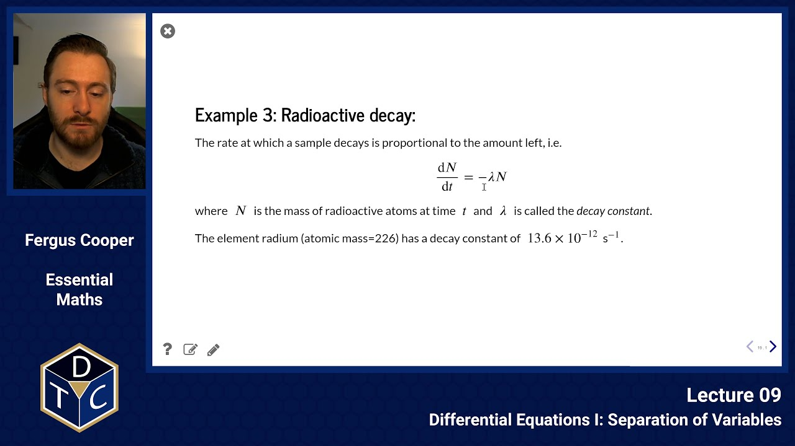
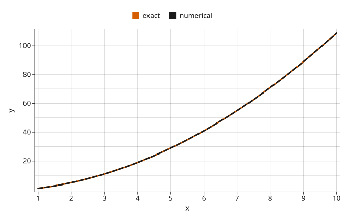
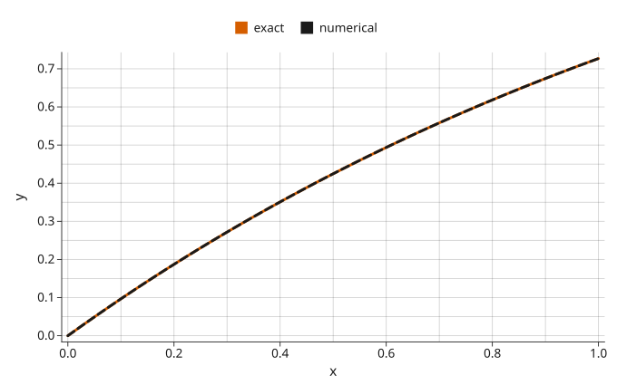
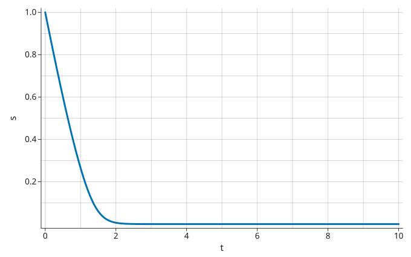
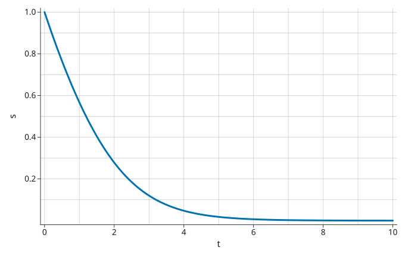
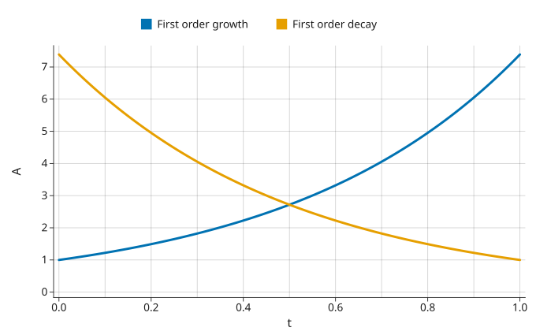

---

## YouTube lecture recording from October 2020

A recording of this lecture from October 2020; the material has changed a little since.

[](https://youtu.be/B8Kh7HzDYK0)

---

## Separation of variables

## What is a differential equation?

If $y$ is a variable that depends on the variable $x$, then a **differential equation in $x$ and $y$** is one that relates $dy/dx$ to $x$, to $y$, or to both.

We write

$$
\frac{dy}{dx}=f(x,y).
$$

## How do we find the solutions to a differential equation?

The simplest differential equations are very similar to integration.

$$
\frac{dy}{dx} = x^3 + 5x^2 + 1
$$

Since all the terms in $y$ (just the derivative in this case) on the left, and all the terms involving $x$ on the right.

$$
dy = (x^3 + 5x^2 + 1)\,dx
$$

Then we integrate both sides

$$
\int dy = \int (x^3 + 5x^2 + 1)\,dx
$$

The general solution to this equation is

$$
y + A = \int x^3 + 5x^2 + 1\,dx = \frac{1}{4}x^4 + \frac{5}{3}x^3 + x + B
$$

where $A$ and $B$ are a arbitrary constants.

If we are given the **initial conditions**, say, $y=0$ when $x=0$ (often written as $y(0)=0$),
we can determine the value for the constants; in this example $A=B$.

---

This approach can be generalised into what is known as the **Separation of Variables Method**.

### Separation of variables: example 1

$$
\frac{dy}{dx} = 2x + c
$$

The equation is already separated, with all terms in $y$ (just the derivative in
this case) on the left, and terms involving $x$ on the right.

We then integrate both sides with respect to $x$:

$$
\begin{aligned}
\int \frac{dy}{dx}\,dx &= \int (2x + c)\, dx \\
y + k_1 &= x^2 + cx + k_2 \\
y &= x^2 + cx + A\qquad\text{with}\qquad A=k_2-k_1
\end{aligned}
$$

#### Initial conditions

$$
y = x^2 + cx + A
$$

If we are told that $y(1) = c$, can we calculate $A$?

We have that

$$
y = x^2 + cx + A\qquad\text{with}\qquad y(1) = c
$$

so:

$$
\begin{aligned}
c &= 1^2 + c\cdot 1 + A \\
A &= -1
\end{aligned}
$$

Is this right? Here's an example of how we can use SciPy's `solve_ivp` function to numerically solve differential equations.
`solve_ivp` expects a function of the independent variable first, then $y$, and returns the solution at the points we ask for with `t_eval`:

```python
import numpy as np
from scipy.integrate import solve_ivp
c = 1.0
A = -1.0
x0 = 1.0
x1 = 10.0
x = np.linspace(x0,x1,100)
y_exact = x**2 + c*x + A

def dydx(x, y):
    return 2*x + c
solution = solve_ivp(dydx, [x0, x1], [c], t_eval=x)
y_numerical = solution.y[0]
```



### Separation of variables: example 2

$$
\frac{dy}{dx} = 5 x^{\frac{3}{2}} y
$$

Separate the variables so that all the terms in $x$ are on one side of the equation and all the terms in $y$ are on the other side:

$$
\frac{1}{y}\frac{dy}{dx} = 5 x^{\frac{3}{2}}
$$

Integrating both sides with respect to $x$:

$$
\int \frac{1}{y}\frac{dy}{dx}\, dx = \int 5x^{\frac{3}{2}}\,dx \quad \Rightarrow\quad \int \frac{1}{y}\,dy = \int 5x^{\frac{3}{2}}\, dx
$$

Now integrate on each side:

$$
\ln y + A = \frac{5x^{\frac{5}{2}}}{5/2} + B = 2x^{\frac{5}{2}} + B
$$

So:

$$
\ln y = 2x^{\frac{5}{2}} + C\quad\text{where}\quad C=B-A
$$

### Separation of variables: example 3

$$
e^x \frac{dy}{dx} = \frac{x}{y}
$$

Rearrange to get:

$$
\int y\,dy = \int x e^{-x}\,dx
$$

Now integrate by parts,

$$
\int uv'\,dx = [uv]-\int u'v\,dx,
$$

with $u=x$ and $v'=e^{-x}$:

$$
\begin{aligned}
\frac{y^2}{2} + c_1 &= -x e^{-x} + \int e^{-x}\,dx \\
&= -x e^{-x} - e^{-x} + c_2 \\
y^2 &= -2 e^{-x}(1+x) + c_3 \\
y &= \pm\sqrt{-2 e^{-x} (1+x) + c_3}
\end{aligned}
$$

Let's check this answer: $y = \pm\sqrt{-2 e^{-x} (1+x) + c_3}$.

Substitute in initial conditions $y(0) = 0$ gives $c_3 = 2$

```python
c3 = 2.0
x0 = 0.0
x1 = 1.0
x = np.linspace(x0,x1,100)

y_exact = np.sqrt(-2*np.exp(-x)*(1 + x) + c3)

def dydx(x, y):
    return np.exp(-x) * x / y

# why 1e-8 instead of zero?
# rtol asks for a more accurate solution than the default
solution = solve_ivp(dydx, [x0, x1], [1e-8], t_eval=x, rtol=1e-8)
y_numerical = solution.y[0]
```



### Real-world example 1: biochemistry

The Michaelis-Menten equation relates the rate of an enzyme reaction to its
substrate concentration, and has the form (if there is a large quantity of
enzyme):

$$
\frac{ds}{dt}=-\frac{V.s}{K+s}
$$

where $s=[S]$ is the substrate concentration, and $V$ and $K$ are constants.
By integration, we will derive expressions relating substrate concentration to time when

1. when $s\gg K$
1. when $s\ll K$

and sketch the graphs of $s$ against $t$ in each case.

#### Case 1

When $s\gg K$, $K$ in the differential equation's denominator can be neglected:

$$
\frac{ds}{dt} \approx -\frac{V.s}{s} = -V
$$

The rate of change in concentration is a constant, so this is a **zeroth order process**.

We can integrate directly to obtain

$$
s = \int -V\,dt = -Vt + c
$$

where $c$ is a constant of integration.

If $s(0)=s_0$, then $c=s_0$.

The graph thus has slope $-V$ and crosses the vertical axis at $s=s_0$.

#### Case 2

When $s\ll K$, $s$ in the differential equation's denominator can be neglected:

$$
\frac{ds}{dt} = -\frac{V.s}{K+s}\quad\text{becomes:}\quad\frac{ds}{dt} = -\frac{V.s}{K}
$$

The rate of change in concentration depends on the concentration, so this is a **first order process**.

$$
\begin{aligned}
\int \frac{1}{s}\,ds &= -\int \frac{V}{K}\,dt \\
\Rightarrow\quad\ln s &= -\frac{V}{K}t + D\qquad\text{D is a constant} \\
\Rightarrow\quad s &= Be^{-Vt/K}\qquad\text{B is a constant}
\end{aligned}
$$

On a graph $s$ crosses the vertical axis at $s=B$ and decreases with time exponentially.

Lets look at this numerically using the original equation:

$$
\frac{ds}{dt}=-\frac{V.s}{K+s}
$$

As $K$ changes in value, we can see how the behaviour of $s$ changes:

K=0.2:



K=1.0:



### Real-world example 2: bacterial growth

Suppose the growth rate of a bacterial colony is proportional to its size,
and that we observe that the colony triples in size after 10 hours.
How long will it take to reach 11 times its original size?

Let $N$ represent the number of bacteria, and suppose there are $N_0$ at time $t=0$.

We are given that when $t=10$ hours, $N=3N_0$, and need to find the time at which $N=11N_0$.
The equation of growth is:

$$
\frac{dN}{dt} = kN
$$

We can solve this to obtain $\ln N = kt + c$. Using the $t=0$ condition, we have that $\ln N_0 = c$, so

$$
\ln\frac{N}{N_0} = kt
$$

We can use the data from $t=10$ to find $k$:

$$
\ln\frac{3N_0}{N_0} = k 10 \qquad\Rightarrow\qquad k=\frac{\ln 3}{10}=0.11\,\text{hr}^{-1}
$$

To find $t$ when $N=11N_0$:

$$
\ln\frac{11N_0}{N_0} = 0.11 t \qquad\Rightarrow\qquad t=\frac{\ln 11}{0.11}=21.8\text{ hours.}
$$

### Real-world example 3: radioactive decay

The rate at which a sample decays is proportional to the amount left, i.e.

$$
\frac{dN}{dt} = -\lambda N
$$

where $N$ is the mass of radioactive atoms at time $t$ and $\lambda$ is called the _decay constant_.

The element radium (atomic mass=226) has a decay constant of $13.6 \times 10^{-12}$ s$^{-1}$.

Solving the differential equation via separation of variables, we obtain the general solution

$$
N = Be^{-\lambda t} \qquad \text{(1)}
$$

Consider an arbitrary initial condition: at $t=t_0$, $N=N_0$. Then:

$$
N_0 = Be^{-\lambda t_0} \qquad\Rightarrow\qquad B = N_0 e^{\lambda t_0}
$$

Substituting in (1) gives the solution

$$
N = N_0 e^{-\lambda(t-t_0)} \qquad \text{(2)}
$$

The **half-life**, $t_{1/2}$, is the time taken for $N$ to reduce by half.

Putting $N=N_0/2$ and $t=t_0+t_{1/2}$ in (2) we get

$$
\begin{aligned}
\ln \frac{N_0}{2N_0} &= -\lambda t_{1/2} \\
t_{1/2} &= \frac{\ln 2}{\lambda} \approx \frac{0.693}{\lambda}
\end{aligned}
$$

Note that this time is **independent** of the initial value $N_0$,

The half-life for radium is thus

$$
t_{1/2}=\frac{\ln2}{13.6\times10^{-12}}=5.10\times10^{10}\,\text{s},
$$

or about 1600 years.

### Real-world example 4: more biochemistry

The power to which the concentration of a species is raised in a rate law
is the **order** of the process/reaction with respect to that species.
A reaction with the rate law

$$
\frac{dX}{dt} = k_2\,[A]\,[B]
$$

is first order in $A$ and first order in $B$.

The **overall order** of a process/reaction is the sum of the orders of all the
components. This rate law is thus second-order overall.

Note that this is **different** from the order of an ODE, which is given by the
highest derivative.
Both zeroth and first order _processes_ are modelled below by _first order
differential equations_.

#### Zeroth order processes

- rate of change is **independent** of concentration, i.e. the rate of change is proportional to concentration raised to power zero

$$
\begin{aligned}
\frac{dA}{dt} &= k \quad \text{(growth)} \\
\frac{dA}{dt} &= -k\quad \text{(decay)}
\end{aligned}
$$

General solutions:

$$
\begin{aligned}
A &= A_0 + k(t-t_0) \\
A &= A_0 - k(t-t_0)
\end{aligned}
$$

#### First order processes

The rate of change depends on the concentration of one species, i.e. the rate of change is proportional to concentration raised to first power.

Half-life is a constant, i.e. it is independent of the amount there at the beginning.

$$
\begin{aligned}
\frac{dA}{dt} &= kA\quad\text{growth} \\
\frac{dA}{dt} &= -kA\quad\text{decay}
\end{aligned}
$$

General solutions:

$$
\begin{aligned}
A &= A_0 e^{k(t-t_0)} \\
A &= A_0 e^{-k(t-t_0)}
\end{aligned}
$$

When $k=2.0$ the two different solutions look like this:



## Introductory problems

:::callout{variant="tip"}
For more practice, an AI tool can write new problems like the ones below.
Ask it for problems of the same type and difficulty, or for problems set in your own field.
For example, you could ask it to "write five microbiology problems on separable differential equations, at the level of these ones".
Work them on paper first, then ask the tool to check your answers and to explain any step you are unsure of.
:::

::::challenge{id="09_intro_01" title="Introductory problems 1"}
Find the general solutions of the following differential equations:

1. $dy/dx = x$
1. $dr/dt = -\sin(\pi t)$
1. $dy/dx = bx^2$
1. $(x-4)\,dy/dx=3y$
1. $u\,du/dv=v+6$
1. $7e^x\,dy/dx=x/y$

Check your answers by differentiating them.

:::solution

In each case, $C$, $A$ and $D$ are arbitrary constants.

1. Integrate both sides with respect to $x$:

   $$
   y = \int x\,dx = \frac{x^2}{2} + C
   $$

1. $$
   r = -\int \sin(\pi t)\,dt = \frac{\cos(\pi t)}{\pi} + C
   $$

1. $$
   y = \int bx^2\,dx = \frac{bx^3}{3} + C
   $$

1. Separate the variables:

   $$
   \int \frac{dy}{y} = \int \frac{3}{x-4}\,dx \quad\Rightarrow\quad \ln|y| = 3\ln|x-4| + D
   $$

   So, $y = A(x-4)^3$, where $A = \pm e^D$.

1. The variables are already separated:

   $$
   \int u\,du = \int (v+6)\,dv \quad\Rightarrow\quad \frac{u^2}{2} = \frac{v^2}{2} + 6v + D
   $$

   So, $u^2 = v^2 + 12v + C$, or $u = \pm\sqrt{v^2 + 12v + C}$.

1. Separate the variables, as in example 3 of the lecture:

   $$
   \int 7y\,dy = \int x e^{-x}\,dx
   $$

   Integrating the right-hand side by parts, with $u = x$ and $v' = e^{-x}$, gives $-xe^{-x} - e^{-x}$, so

   $$
   \frac{7y^2}{2} = -e^{-x}(x+1) + D \quad\Rightarrow\quad y^2 = -\frac{2}{7}e^{-x}(x+1) + C
   $$

:::

::::

::::challenge{id="09_intro_02" title="Introductory problems 2"}
Find the solution to the following differential equations subject to the specified boundary conditions:

1. $dy/dx = 1/x\quad\text{with}\quad y(2)=0$
1. $dy/dx = y\quad\text{with}\quad y(0) = 1$

Use Python's `scipy.integrate.solve_ivp` to verify your solutions

```python
# hint
import numpy as np
from scipy.integrate import solve_ivp
import matplotlib.pyplot as plt

# you need a function that calculates dy/dx
# solve_ivp passes the independent variable (here x) first, then y
def dydx(x, y):
    return 1 / x

y0 = 0  # <-- the y-value of the initial condition
x0 = 2  # <-- the x-value of the initial condition

# the x-values at which to calculate the solution
x = np.linspace(x0, x0 + 10, 1000)

# solve ODE numerically
solution = solve_ivp(dydx, [x[0], x[-1]], [y0], t_eval=x)
y = solution.y[0]

# plot the numerical solution and your hand-calculated
# solution, and check that they agree
```

:::solution

1. Separate the variables and integrate:

   $$
   y = \int \frac{dx}{x} = \ln x + C
   $$

   (We can write $\ln x$ rather than $\ln|x|$, as the solution starts at $x = 2$.)
   $y(2) = 0$ gives $C = -\ln 2$, so

   $$
   y = \ln x - \ln 2 = \ln\frac{x}{2}
   $$

1. Separate the variables:

   $$
   \int \frac{dy}{y} = \int dx \quad\Rightarrow\quad \ln y = x + C \quad\Rightarrow\quad y = Ae^x
   $$

   $y(0) = 1$ gives $A = 1$, so $y = e^x$.

To check with Python, we compare the numerical solution with our solution.
Here we ask `solve_ivp` for more accuracy than the default, with `rtol`:

```python
import numpy as np
from scipy.integrate import solve_ivp
import matplotlib.pyplot as plt


def dydx(x, y):
    return 1 / x


x = np.linspace(2, 12, 1000)
solution = solve_ivp(dydx, [x[0], x[-1]], [0], t_eval=x, rtol=1e-8)
y_exact = np.log(x / 2)
print('largest difference =', np.max(np.abs(solution.y[0] - y_exact)))

plt.plot(x, y_exact, label='exact')
plt.plot(x, solution.y[0], '--', label='numerical')
plt.xlabel('x')
plt.ylabel('y')
plt.legend()
```

```text
largest difference = 2.4351254179766357e-06
```

For **2.**, $e^x$ grows quickly, so we look at the difference relative to the size of $y$:

```python
def dydx(x, y):
    return y


x = np.linspace(0, 5, 1000)
solution = solve_ivp(dydx, [x[0], x[-1]], [1], t_eval=x, rtol=1e-8)
y_exact = np.exp(x)
print('largest relative difference =', np.max(np.abs(solution.y[0] - y_exact) / y_exact))
```

```text
largest relative difference = 2.0386919889137807e-07
```

In both cases the numerical and exact solutions agree closely, and the two curves lie on top of each other.

:::

::::

## Main problems

::::challenge{id="09_main_01" title="Main problems 1"}
The number of bacteria present in a given culture increases at a rate proportional to the number present.
When first observed, the culture contained $n_0$ bacteria, and two hours later it contained $n_1$.

1. Find the number present $t$ hours after observations began.
1. How long did it take for the number of bacteria to triple?
1. Sketch a curve of the solution to the equation that you derive.
1. What assumptions are implicit in this model of bacterial growth?

:::solution

1. Let $n$ be the number of bacteria at time $t$ hours.
   The rate of increase is proportional to $n$, so

   $$
   \frac{dn}{dt} = kn
   $$

   where $k$ is a positive constant.
   Separating the variables, as for bacterial growth in the lecture, gives $n = n_0 e^{kt}$, since $n = n_0$ at $t = 0$.
   At $t = 2$, $n = n_1$, so

   $$
   n_1 = n_0 e^{2k} \quad\Rightarrow\quad k = \frac{1}{2}\ln\frac{n_1}{n_0}
   $$

   So, the number present after $t$ hours is

   $$
   n = n_0 e^{\frac{t}{2}\ln(n_1/n_0)} = n_0\left(\frac{n_1}{n_0}\right)^{t/2}
   $$

1. The number has tripled when $n = 3n_0$, so $e^{kt} = 3$, and

   $$
   t = \frac{\ln 3}{k} = \frac{2\ln 3}{\ln(n_1/n_0)}\text{ hours}
   $$

1. The curve starts at $n = n_0$ when $t = 0$ and grows exponentially, more and more steeply, passing through $n_1$ at $t = 2$:

   ```python
   import numpy as np
   from matplotlib import pyplot as plt

   n0 = 1
   n1 = 2  # for example
   t = np.linspace(0, 10, 200)

   plt.plot(t, n0 * (n1 / n0)**(t / 2))
   plt.xlabel('t (hours)')
   plt.ylabel('n')
   ```

1. The model assumes that every bacterium divides at the same constant rate, whatever the size of the population.
   This means there are unlimited nutrients and space, no bacteria die, and nothing else (such as temperature) changes.
   In practice, growth slows as resources run out, so the model only describes the early stages of growth.

:::

::::

::::challenge{id="09_main_02" title="Main problems 2"}
Solve:

1. $y^2\,dy/dx = 2x/3 \quad\text{with}\quad y(\sqrt{2})=1$
1. $dy/dx = \beta/x \quad\text{with}\quad y(1) = 0$. Find $\beta$ such that $y(e^3)=1.$
1. $dy/dx = a_0 + a_1x + a_2x^2 + a_3x^3 + a_4x^4 \quad\text{with}\quad y(0) = \pi$

:::solution

1. Separate the variables:

   $$
   \int y^2\,dy = \int \frac{2x}{3}\,dx \quad\Rightarrow\quad \frac{y^3}{3} = \frac{x^2}{3} + C \quad\Rightarrow\quad y^3 = x^2 + 3C
   $$

   $y(\sqrt{2}) = 1$ gives $1 = 2 + 3C$, so $3C = -1$, and

   $$
   y = \left(x^2 - 1\right)^{1/3}
   $$

1. Integrate both sides:

   $$
   y = \beta\int\frac{dx}{x} = \beta\ln x + C
   $$

   $y(1) = 0$ gives $C = 0$, so $y = \beta\ln x$.
   Then $y(e^3) = 1$ gives $\beta\ln(e^3) = 3\beta = 1$, so $\beta = 1/3$.

1. Integrate both sides term by term:

   $$
   y = a_0x + \frac{a_1x^2}{2} + \frac{a_2x^3}{3} + \frac{a_3x^4}{4} + \frac{a_4x^5}{5} + C
   $$

   $y(0) = \pi$ gives $C = \pi$, so

   $$
   y = \pi + a_0x + \frac{a_1x^2}{2} + \frac{a_2x^3}{3} + \frac{a_3x^4}{4} + \frac{a_4x^5}{5}
   $$

:::

::::

::::challenge{id="09_main_03" title="Main problems 3"}
In a certain chemical reaction, substance $A$ is transformed into product $P$.
The mass of $A$ at any given time, $t$, is $m_t$, and the rate of transformation of $A$ at time $t$ is proportional to $m_t$.
Given that the original mass of $A$ is 130g, and that 50g has been transformed after 150 seconds:

1. Form and solve the differential equation relating $m_t$ to $t$.
1. Find the mass of $A$ transformed over a 300s period.
1. Sketch a graph of $m_t$ versus $t$.

:::solution

1. $A$ is used up at a rate proportional to $m_t$, so

   $$
   \frac{dm_t}{dt} = -km_t
   $$

   where $k$ is a positive constant.
   Separating the variables gives $m_t = 130e^{-kt}$, since $m_0 = 130\,$g.
   After 150 seconds, 50g has been transformed, so $m_{150} = 80\,$g:

   $$
   80 = 130e^{-150k} \quad\Rightarrow\quad k = \frac{1}{150}\ln\frac{130}{80} \approx 0.00324\,\text{s}^{-1}
   $$

1. After 300 seconds,

   $$
   m_{300} = 130e^{-300k} = 130\left(e^{-150k}\right)^2 = 130\left(\frac{80}{130}\right)^2 = \frac{640}{13} \approx 49.2\,\text{g}
   $$

   So, the mass transformed is $130 - 49.2 \approx 80.8\,$g.
   (The first 150 seconds transforms 50g, but the next 150 seconds only about 30.8g, because there is less $A$ left.)

1. $m_t$ starts at 130g and decays exponentially towards zero, falling quickly at first and then more and more slowly:

   ```python
   import numpy as np
   from matplotlib import pyplot as plt

   k = np.log(130 / 80) / 150
   t = np.linspace(0, 1500, 200)

   plt.plot(t, 130 * np.exp(-k * t))
   plt.xlabel('t (s)')
   plt.ylabel('mass of A (g)')
   ```

:::

::::

::::challenge{id="09_main_04" title="Main problems 4"}
Newton's law of cooling states that the rate of decrease of the temperature of a body is proportional to the amount by which its temperature exceeds the temperature of its surroundings.
If $T_0$ is the initial temperature of a body, $T_s$ is the temperature of its surroundings, and $T$ is the temperature of the body at time $t$:

1. Form a differential equation for Newton's Law of cooling.
1. Show that $T-T_s = (T_0 - T_s) \, e^{-kt}$, where $k$ is a constant, and state the units of the constant $k$.
1. Glycerol is to be added to a protein sample prior to storage.
   The glycerol is heated to $65^{\circ}\text{C}$ to aid accurate pipetting.
   To avoid denaturation of the sample, the glycerol must then be allowed to cool to below $29^{\circ}\text{C}$ before being added to the protein.
   If the ambient temperature is $22^{\circ}\text{C}$, the glycerol cools to $T=59^{\circ}\text{C}$ at time $t=2$ minutes.
   At what time can the glycerol be added to the protein?
1. Using a choice of axes that will allow you easily to predict the temperature of the glycerol, sketch a graph of the anticipated variation of the glycerol temperature with time.
1. Once the glycerol has been added to the protein, will the rate of cooling be described by the same constant $k$? Give reasons for your answer.

:::solution

1. The rate of decrease of $T$ is proportional to $T - T_s$, so

   $$
   \frac{dT}{dt} = -k(T - T_s)
   $$

   where $k$ is a positive constant.

1. Separate the variables ($T_s$ is a constant):

   $$
   \int\frac{dT}{T - T_s} = -\int k\,dt \quad\Rightarrow\quad \ln(T - T_s) = -kt + C
   $$

   At $t = 0$, $T = T_0$, so $C = \ln(T_0 - T_s)$, and

   $$
   \ln\frac{T - T_s}{T_0 - T_s} = -kt \quad\Rightarrow\quad T - T_s = (T_0 - T_s)\,e^{-kt}
   $$

   The exponent $kt$ must have no units, so $k$ has units of $\text{time}^{-1}$, for example $\text{min}^{-1}$.

1. Here $T_0 = 65$, $T_s = 22$ and $T = 59$ at $t = 2$ minutes:

   $$
   59 - 22 = (65 - 22)e^{-2k} \quad\Rightarrow\quad k = \frac{1}{2}\ln\frac{43}{37} \approx 0.0751\,\text{min}^{-1}
   $$

   The glycerol reaches $29^{\circ}$C when

   $$
   29 - 22 = 43e^{-kt} \quad\Rightarrow\quad t = \frac{1}{k}\ln\frac{43}{7} \approx 24.2\,\text{minutes}
   $$

   So, the glycerol can be added after about 24 minutes.

1. Taking logs of the solution gives

   $$
   \ln(T - T_s) = \ln(T_0 - T_s) - kt
   $$

   So, plotting $\ln(T - 22)$ against $t$ gives a straight line, with intercept $\ln 43$ and gradient $-k$.
   We can read off the time for any temperature, or extend the line, by using a ruler:

   ```python
   import numpy as np
   from matplotlib import pyplot as plt

   k = np.log(43 / 37) / 2
   t = np.linspace(0, 30, 100)
   T = 22 + 43 * np.exp(-k * t)

   plt.plot(t, np.log(T - 22))
   plt.xlabel('t (minutes)')
   plt.ylabel('ln(T - 22)')
   ```

1. No.
   The constant $k$ depends on the body that is cooling: its mass, heat capacity and surface area, and the container it is in.
   Once the glycerol is mixed with the protein sample, it is a different body, so it will cool with a different constant.

:::

::::

::::challenge{id="09_main_05" title="Main problems 5"}
The amount of $^{14}\text{C}$ (radioactive carbon-14) in a sample is measured using a Geiger counter, which records each disintegration of an atom.
The rate at which $^{14}\text{C}$ decays is proportional to the amount present.
The half-life of $^{14}\text{C}$ is about 5730 years.
This means that half of the sample will have disintegrated after 5730 years.

In living tissue, $^{14}\text{C}$ disintegrates at a rate of about 13.5 atoms per minute per gram of carbon.
Because living tissue is constantly exchanging carbon with its environment, the proportion of $^{14}\text{C}$ among its carbon atoms remains constant over time.
Once the tissue is no longer living, this constant exchange of carbon ceases and the fraction of $^{14}\text{C}$ among its carbon atoms begins to get smaller.
Consequently, the disintegration rate drops.

In 1977 a charcoal fragment found at Stonehenge on the Salisbury Plain recorded 8.2 disintegrations per minute per gram of carbon: about 60% of that for living tissue.
Assuming that the charcoal was formed during the building of the site, use this information to estimate the date at which Stonehenge was built.

:::solution

Let $N$ be the amount of $^{14}\text{C}$ in the charcoal, $t$ years after it formed.
The rate of decay is proportional to $N$, so, as for radioactive decay in the lecture,

$$
N = N_0e^{-\lambda t} \qquad\text{with}\qquad \lambda = \frac{\ln 2}{t_{1/2}} = \frac{\ln 2}{5730} \approx 1.21\times 10^{-4}\,\text{year}^{-1}
$$

The disintegration rate is $\lambda N$, which is proportional to $N$, so it decays in the same way.
It started at 13.5 per minute per gram, and had fallen to 8.2 by 1977:

$$
8.2 = 13.5\,e^{-\lambda t} \quad\Rightarrow\quad t = \frac{1}{\lambda}\ln\frac{13.5}{8.2} \approx 4120\,\text{years}
$$

So, the charcoal formed about 4120 years before 1977, which is about 2145 BC.

In practice, the amount of $^{14}\text{C}$ in the atmosphere has changed over time, so radiocarbon dates have to be _calibrated_ against samples of known age, such as tree rings.
Calibrated dates put the building of Stonehenge at about 3000 BC.

:::

::::

## Extension problems

::::challenge{id="09_ext_01" title="Extension problems 1"}
The **absorbance** $A$ of a solution is given by the equation:

$$
A=\log_{10}\left(\frac{I_o}{I}\right)
$$

where $I_o$ is the intensity of the light impinging on the solution (incident light) and $I$ is the intensity of the light emerging from it (transmitted light).
The Beer-Lambert law states that

$$
A=\epsilon\cdot c\cdot l
$$

where $\epsilon$ is the molar absorption coefficient of the solute, $c$ is the concentration of the solute and $l$ is the distance that the light has travelled through the solution.

1. The _transmittance_ $T$ is defined as the fraction of incident light transmitted through the solution ($T=I/I_o$).
   Derive an expression relating the transmittance, $T$, of the solution to $\epsilon$, $c$ and $l$.
1. The _attenuation_ $Q$ of the light beam is defined as the difference between the intensities of the incident and the transmitted light ($Q=I_o-I$).
   Derive an expression for the attenuation of the light beam when a beam of light intensity $I_o$ traverses a distance $l$ through a solution of fixed concentration $c$.
   Sketch a graph showing the dependence of $Q$ on $l$ in a solution of fixed concentration.
1. ATP has a molar absorption coefficient of $15.7\times 10^3\,\text{M}^{-1}\text{cm}^{-1}$.
   Calculate the initial rate (in watts/cm) at which light intensity is attenuated when a light beam of intensity 200 watts enters a $10\,\mu\text{M}$ solution of ATP.
   What would happen to this rate if

   1. the concentration of ATP is doubled;
   1. the intensity of the incident light is doubled;
   1. the length of the cell holding the solution is doubled?

:::solution

1. Since $T = I/I_o$, the absorbance is $A = \log_{10}(1/T) = -\log_{10}T$.
   The Beer-Lambert law then gives

   $$
   -\log_{10}T = \epsilon cl \quad\Rightarrow\quad T = 10^{-\epsilon cl}
   $$

1. The transmitted intensity is $I = I_oT = I_o10^{-\epsilon cl}$, so

   $$
   Q = I_o - I = I_o\left(1 - 10^{-\epsilon cl}\right)
   $$

   $Q$ is zero when $l = 0$, rises steeply at first, then levels off towards $I_o$ as $l$ increases, as almost all of the light is absorbed:

   ```python
   import numpy as np
   from matplotlib import pyplot as plt

   I_o = 1
   eps_c = 1  # epsilon times c, for example
   l = np.linspace(0, 3, 200)

   plt.plot(l, I_o * (1 - 10**(-eps_c * l)))
   plt.axhline(I_o, linestyle='--', color='grey')
   plt.xlabel('l')
   plt.ylabel('Q')
   ```

1. The rate at which the intensity is attenuated is $dQ/dl$.
   Using $\frac{d}{dl}a^{-kl} = -k\ln(a)\,a^{-kl}$ (lecture 5),

   $$
   \frac{dQ}{dl} = I_o\,\epsilon c\ln(10)\,10^{-\epsilon cl}
   $$

   The initial rate is at $l = 0$, where $10^{0} = 1$:

   $$
   \left.\frac{dQ}{dl}\right|_{l=0} = I_o\,\epsilon c\ln 10 = 200 \times 15.7\times 10^3 \times 10\times 10^{-6} \times \ln 10 \approx 72.3\,\text{W/cm}
   $$

   (The units of $\epsilon c$ are $\text{M}^{-1}\text{cm}^{-1}\times\text{M} = \text{cm}^{-1}$.)

   1. The initial rate is proportional to $c$, so doubling the concentration doubles it.
   1. The initial rate is proportional to $I_o$, so doubling the incident intensity doubles it.
   1. The initial rate does not depend on the length of the cell, so it does not change (though more light is absorbed in total).

:::

::::
