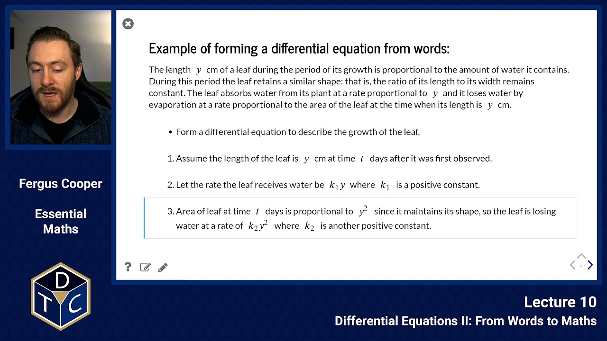
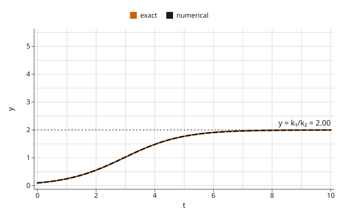
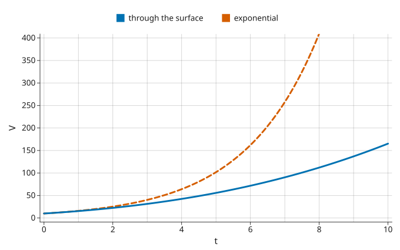

---

## YouTube lecture recording from October 2020

A recording of this lecture from October 2020; the material has changed a little since.

[](https://youtu.be/nU3SVyT3TY0)

---

## From words to maths

## How do we form differential equations from words?

### Example 1: a growing leaf

Let us try to form a differential equation based on the following information:

---

The length $y$ cm of a leaf during the period of its growth is proportional to the amount of water it contains.
During this period the leaf retains a similar shape: that is, the ratio of its length to its width remains constant.
The leaf absorbs water from its plant at a rate proportional to $y$ and it loses water by evaporation at a rate proportional to the area
of the leaf at the time when its length is $y$ cm.

---

1. Assume the length of the leaf is $y$ cm at time $t$ days after it was first observed.

2. Let the rate the leaf receives water be $k_1y$ where $k_1$ is a positive constant.

3. Area of leaf at time $t$ days is proportional to $y^2$ since it maintains its shape, so the leaf is losing water at a rate of $k_2y^2$ where $k_2$ is another positive constant.

The rate of growth is given by $dy/dt$, which is the rate of change of its length.

$$
\frac{dy}{dt}=k_1y-k_2y^2=y(k_1-k_2y)
$$

When $k_1$ and $k_2$ are both equal to $1.0$, the solution looks like:



## Example 2: solid tumour growth

---

An avascular tumour tends to grow in a spherical shape, depending on environmental restrictions.

Assuming that the growth rate of the tumour depends only on the availability of oxygen and nutrients, which enter the tumour solely by diffusing through its surface, derive a model for the change in tumour volume over time.

---

1. Denote the volume of the tumour at time $t$ by $V(t)$, and its radius by $R(t)$.

2. Since the tumour is a sphere, its volume $V$ is proportional to $R^3$ and its surface area to $R^2$, so the surface area is proportional to $V^{2/3}$.

3. The rate at which the tumour acquires nutrients, and hence the rate at which the volume increases, is thus proportional to $V^{2/3}$.

This gives us the equation:

$$
\frac{dV}{dt} = kV^{2/3}
$$

Solve by separation of variables:

$$
\begin{aligned}
\int V^{-2/3}\,dV &= \int k\,dt \\
V &= \left(\frac{kt+c}{3}\right)^3
\end{aligned}
$$

where $c$ is a constant of integration, the value of which will depend upon the initial conditions.

When $k=1$ and $c=10$, the solution looks like:



## Second order differential equations

Let us try to solve the following equation:

$$
\frac{d^2y}{dx^2} = \left(\frac{dy}{dx}\right)^2
$$

We will use the substitution $z = dy/dx$.
This implies that

$$
\frac{dz}{dx} = \frac{d^2y}{dx^2}.
$$

Substituting into the original equation, to eliminate $y$, gives

$$
\frac{dz}{dx} = z^2
$$

This is a separable equation:

$$
\int z^{-2}\,dz = \int dx \qquad\Rightarrow\qquad-\frac{1}{z} = x + A \qquad\Rightarrow\qquad z = -\frac{1}{x+A}
$$

where $A$ is an arbitrary constant.

We can then replace $z$ using the original substitution to obtain a first order differential equation:

$$
\frac{dy}{dx} = -\frac{1}{x+A}
$$

This equation can be solved with a standard integral:

$$
y = -\ln(x+A) + B
$$

Determining the values of $A$ and $B$ can be done in several different ways, depending on the kind of information we have.

---

For example, if we know the following:

- At $x=0$, $dy/dx = -1$ and $y=0$.

  We substitute the first condition into $dy/dx = -1/(x+A)$ to obtain $A=1$.

  Then substitute $A$ and the second condition into the eventual solution
  to find $B=0$.

---

Alternatively, if we instead know that:

- $y(0)=0$ and $y(e-1)=-1$.

  This time both conditions can be substituted into the solution:

  $$
  \begin{aligned}
  y(0)=0 &\Rightarrow 0=B-\ln(A) \Rightarrow B=\ln(A) \\
  y(e-1)=-1 &\Rightarrow -1=\ln(A)-\ln{e-1+A} \Rightarrow A=1
  \end{aligned}
  $$

## More integration tricks

Let us return to, and solve, our leaf example:

$$
\frac{dy}{dt}=k_1y-k_2y^2=y(k_1-k_2y)
$$

This is a separable differential equation:

$$
\int \frac{dy}{y(k_1-k_2y)} =\int dt.
$$

We can split apart the integral on the RHS using **partial fractions** in SymPy using `sp.apart`.

We want

$$
\frac{1}{y(k_1-k_2y)}=\frac{A}{y}+\frac{B}{k_1-k_2y}:
$$

```python
import sympy as sp
y, k1, k2 = sp.symbols('y k_1 k_2')
sp.apart(1 / (y*(k1 - k2*y)),y)
```

$$
- \frac{k_{2}}{k_{1} \left(- k_{1} + k_{2} y\right)} + \frac{1}{k_{1} y}
$$

So $A=1/k_1$ and $B=k_2/k_1$.

$$
\text{Thus,} \qquad \int \frac{dy}{y(k_1-k_2y)}=\int \frac{dy}{k_1y}+\int \frac{k_2}{k_1(k_1-k_2y)}\,dy =\int dt
$$

$$
\text{Thus} \qquad \frac{1}{k_1}\ln y-\frac{k_2}{k_1k_2}\ln(k_1-k_2y)=t + c
$$

We can get $c$ from initial conditions.
Try doing the algebraic manipulation of this to make $y$ the subject of the equation:

$$
y=\frac{k_1\exp (k_1t+d)}{1+ k_2 \exp(k_1t + d)}
$$

where $d$ is a constant.

## Introductory problems

:::callout{variant="tip"}
For more practice, an AI tool can write new problems like the ones below.
Ask it for problems of the same type and difficulty, or for problems set in your own field.
For example, you could ask it to "write five medicine problems on forming differential equations from words, at the level of these ones".
Work them on paper first, then ask the tool to check your answers and to explain any step you are unsure of.
:::

::::challenge{id="10_intro_01" title="Introductory problems 1"}
Find the general solutions of the following differential equations:

1. $dy/dx = x^2 + e^x$
1. $dy/dx = y^2/x$
1. $(1/x)\,dy/dx = e^{4x}$
1. $dy/dx = -2xy$

Check your answers by differentiating them.

:::solution

In each case, $C$ and $A$ are arbitrary constants.

1. Integrate both sides:

   $$
   y = \int\left(x^2 + e^x\right)dx = \frac{x^3}{3} + e^x + C
   $$

1. Separate the variables:

   $$
   \int\frac{dy}{y^2} = \int\frac{dx}{x} \quad\Rightarrow\quad -\frac{1}{y} = \ln|x| + C \quad\Rightarrow\quad y = -\frac{1}{\ln|x| + C}
   $$

   (Dividing by $y^2$ assumes $y \neq 0$: $y = 0$ is also a solution.)

1. Multiply both sides by $x$ and integrate, using integration by parts with $u = x$ and $v' = e^{4x}$:

   $$
   y = \int xe^{4x}\,dx = \frac{xe^{4x}}{4} - \int\frac{e^{4x}}{4}\,dx = \frac{xe^{4x}}{4} - \frac{e^{4x}}{16} + C
   $$

1. Separate the variables:

   $$
   \int\frac{dy}{y} = -\int 2x\,dx \quad\Rightarrow\quad \ln|y| = -x^2 + C \quad\Rightarrow\quad y = Ae^{-x^2}
   $$

:::

::::

## Main problems

::::challenge{id="10_main_01" title="Main problems 1"}
A circular patch of oil on the surface of some water has a radius $r$ metres at time $t$ minutes.
When $t=0$ minutes, $r=1\,$m and when $t=10$ minutes, $r=2\,$m.

1. Predict the value $T$ of $t$ when $r=4\,$m, using a simple model in which the rate of increase of $r$ is taken to be constant.
   Find $T$ for this model.
1. In a more refined model, the rate of increase of $r$ is taken to be proportional to $1/r$.
   Express this statement as a differential equation, and find the general solution.
   Find $T$ for this model.
1. Compare the two models used in **1.** and **2.**, by sketching $r(t)$ on the same figure or plotting using Python.
   Comment on the differences seen during different time intervals.

:::solution

1. If $dr/dt$ is a constant $a$, then $r = at + C$.
   $r(0) = 1$ gives $C = 1$, and $r(10) = 2$ gives $a = 0.1$, so $r = 1 + 0.1t$.
   Then $r = 4$ when $4 = 1 + 0.1T$, so $T = 30$ minutes.

1. The rate of increase is proportional to $1/r$:

   $$
   \frac{dr}{dt} = \frac{k}{r}
   $$

   where $k$ is a positive constant.
   Separate the variables:

   $$
   \int r\,dr = \int k\,dt \quad\Rightarrow\quad \frac{r^2}{2} = kt + C
   $$

   so the general solution is $r = \sqrt{2kt + 2C}$.
   $r(0) = 1$ gives $C = 1/2$, and $r(10) = 2$ gives $2 = 10k + 1/2$, so $k = 3/20$.
   So, $r^2 = 1 + 0.3t$.
   Then $r = 4$ when $16 = 1 + 0.3T$, so $T = 50$ minutes.

1. Both models agree at $t = 0$ and $t = 10$:

   ```python
   import numpy as np
   from matplotlib import pyplot as plt

   t = np.linspace(0, 60, 200)

   plt.plot(t, 1 + 0.1 * t, label='constant rate')
   plt.plot(t, np.sqrt(1 + 0.3 * t), label='rate proportional to 1/r')
   plt.xlabel('t (minutes)')
   plt.ylabel('r (m)')
   plt.legend()
   ```

   Between $t = 0$ and $t = 10$, the second model grows faster, as its rate is largest when $r$ is small.
   After $t = 10$, it grows more and more slowly, and falls behind the constant-rate model, which is why it takes longer to reach 4m.

:::

::::

::::challenge{id="10_main_02" title="Main problems 2"}
A nuclear installation local to Oxford 'lost' 17g of Cobalt-60 between two inspections 6 months apart.
A spokesperson told a newspaper reporter that the loss was due to 'natural radioactive decay' during that period.

If this explanation was correct, what mass of Cobalt was stored on the site?
(The half life of $^{60}$Co = $5.26$ years.)

:::solution

Let $M$ be the mass of Cobalt-60 at the first inspection.
Radioactive decay gives $m = Me^{-\lambda t}$, with

$$
\lambda = \frac{\ln 2}{t_{1/2}} = \frac{\ln 2}{5.26} \approx 0.132\,\text{year}^{-1}
$$

After 6 months, $t = 0.5$ years, and the mass lost is

$$
M - Me^{-0.5\lambda} = M\left(1 - e^{-0.5\lambda}\right) = 17
$$

So,

$$
M = \frac{17}{1 - e^{-0.5\lambda}} \approx \frac{17}{0.0638} \approx 267\,\text{g}
$$

If the explanation was correct, about 267g of Cobalt-60 was stored on the site.

:::

::::

::::challenge{id="10_main_03" title="Main problems 3"}
By making a substitution $z = dy/dx$, solve the equation

$$
\frac{d^2y}{dx^2} = (1-3x^2)\left(\frac{dy}{dx}\right)^2\quad\text{with}\quad y(2) = 0\quad\text{and}\quad y'(2) = 1/6.
$$

Hint: you will need to use partial fractions for part of this question, to break up

$$
\frac{1}{x^3-x} = \frac{-1}{x} + \frac{1/2}{x+1} + \frac{1/2}{x-1}.
$$

:::solution

With $z = dy/dx$, we have $d^2y/dx^2 = dz/dx$, so the equation becomes a first order equation for $z$:

$$
\frac{dz}{dx} = (1-3x^2)z^2
$$

Separate the variables:

$$
\int\frac{dz}{z^2} = \int(1-3x^2)\,dx \quad\Rightarrow\quad -\frac{1}{z} = x - x^3 + C
$$

$y'(2) = 1/6$ means $z = 1/6$ at $x = 2$, so $-6 = 2 - 8 + C$, and $C = 0$.
So,

$$
\frac{dy}{dx} = z = -\frac{1}{x - x^3} = \frac{1}{x^3 - x}
$$

Now integrate, using the partial fractions in the hint:

$$
\begin{aligned}
y &= \int\left(-\frac{1}{x} + \frac{1/2}{x+1} + \frac{1/2}{x-1}\right)dx \\
&= -\ln|x| + \frac{1}{2}\ln|x+1| + \frac{1}{2}\ln|x-1| + D
\end{aligned}
$$

$y(2) = 0$ gives $0 = -\ln 2 + \frac{1}{2}\ln 3 + 0 + D$, so $D = \ln 2 - \frac{1}{2}\ln 3$.
Combining the logs (for $x > 1$, near the starting point $x = 2$):

$$
y = \frac{1}{2}\ln\left(x^2 - 1\right) - \ln x + \ln 2 - \frac{1}{2}\ln 3 = \frac{1}{2}\ln\left(\frac{4\left(x^2-1\right)}{3x^2}\right)
$$

:::

::::

::::challenge{id="10_main_04" title="Main problems 4"}
Suppose a cell contains a chemical (the solute) dissolved in it at a concentration of $c(t)$, and the concentration of the same substance outside the cell is a constant $k$.
By Fick's law, if $c(t)$ and $k$ are unequal, solute moves across the cell wall at a rate proportional to the difference between $c(t)$ and $k$, towards the region of lower concentration.

1. Write down a differential equation which is satisfied by $c(t)$.
1. Solve this differential equation with the initial condition $c(0)=c_0$.
1. Sketch the solutions for $c_0 > k$ and $k > c_0$.
1. Blood glucose concentration is 5.1 mM and the concentration inside the cell is at 0.1 mM.
   If glucose utilisation within the cell is totally inhibited, it takes 1 min for the intracellular concentration to reach 2.6 mM.
   How long would it take for the concentration to reach 5.0 mM?
1. Calculate the amount of glucose (moles) entering the cell to bring the concentration from 0.1 mM to 5 mM assuming the cell is spherical with a diameter of $10\,\mu$m.

:::solution

1. The rate of change of $c$ is proportional to the difference $k - c$, and solute moves towards the lower concentration:

   $$
   \frac{dc}{dt} = \alpha(k - c)
   $$

   where $\alpha$ is a positive constant.
   If $c < k$, then $dc/dt > 0$ and solute moves into the cell; if $c > k$, it moves out.

1. Separate the variables:

   $$
   \int\frac{dc}{k - c} = \int\alpha\,dt \quad\Rightarrow\quad -\ln|k - c| = \alpha t + D \quad\Rightarrow\quad k - c = Be^{-\alpha t}
   $$

   $c(0) = c_0$ gives $B = k - c_0$, so

   $$
   c = k - (k - c_0)\,e^{-\alpha t}
   $$

1. In both cases $c$ starts at $c_0$ and approaches $k$ exponentially.
   If $c_0 > k$, $c$ decreases towards $k$; if $c_0 < k$, $c$ increases towards $k$:

   ```python
   import numpy as np
   from matplotlib import pyplot as plt

   k = 1
   t = np.linspace(0, 5, 200)

   for c0 in [2, 0]:
       plt.plot(t, k - (k - c0) * np.exp(-t), label=f'c0 = {c0}')
   plt.axhline(k, linestyle='--', color='grey')
   plt.xlabel('t')
   plt.ylabel('c')
   plt.legend()
   ```

1. Here $k = 5.1$ and $c_0 = 0.1$, so $c = 5.1 - 5e^{-\alpha t}$.
   At $t = 1$ minute, $c = 2.6$:

   $$
   2.6 = 5.1 - 5e^{-\alpha} \quad\Rightarrow\quad e^{-\alpha} = 0.5 \quad\Rightarrow\quad \alpha = \ln 2\,\text{min}^{-1}
   $$

   The concentration reaches 5.0mM when

   $$
   5.0 = 5.1 - 5e^{-\alpha t} \quad\Rightarrow\quad e^{-\alpha t} = \frac{1}{50} \quad\Rightarrow\quad t = \frac{\ln 50}{\ln 2} \approx 5.6\,\text{minutes}
   $$

1. The volume of the cell, with radius $5\,\mu\text{m} = 5\times 10^{-6}\,$m, is

   $$
   V = \frac{4}{3}\pi\left(5\times 10^{-6}\right)^3 \approx 5.24\times 10^{-16}\,\text{m}^3 = 5.24\times 10^{-13}\,\text{l}
   $$

   The concentration rises by $5.0 - 0.1 = 4.9\,\text{mM} = 4.9\times 10^{-3}\,\text{mol/l}$, so the amount of glucose entering the cell is

   $$
   4.9\times 10^{-3} \times 5.24\times 10^{-13} \approx 2.57\times 10^{-15}\,\text{mol}
   $$

:::

::::

## Extension problems

::::challenge{id="10_ext_01" title="Extension problems 1"}
Consider a simple model of the production and degradation of a protein.
The protein is produced at a constant rate $k_1$, and degraded at a rate proportional to its concentration, with constant $k_2$.

1. Form and solve a differential equation describing the change in protein concentration.
1. What concentration is reached after 'sufficient' time has elapsed?

:::solution

1. Let $s$ be the protein concentration at time $t$, with $s(0) = s_0$.
   It increases at rate $k_1$ and decreases at rate $k_2s$, so

   $$
   \frac{ds}{dt} = k_1 - k_2s
   $$

   Separate the variables:

   $$
   \begin{aligned}
   &\int\frac{ds}{k_1 - k_2s} = \int dt \\
   \quad\Rightarrow\quad &-\frac{1}{k_2}\ln|k_1 - k_2s| = t + C \\
   \quad\Rightarrow\quad &k_1 - k_2s = Be^{-k_2t}
   \end{aligned}
   $$

   $s(0) = s_0$ gives $B = k_1 - k_2s_0$, so

   $$
   s = \frac{k_1}{k_2} + \left(s_0 - \frac{k_1}{k_2}\right)e^{-k_2t}
   $$

1. As $t\to\infty$, $e^{-k_2t}\to 0$, so $s \to k_1/k_2$, whatever the starting concentration.
   At this concentration, production and degradation balance, and $ds/dt = 0$.

:::

::::
