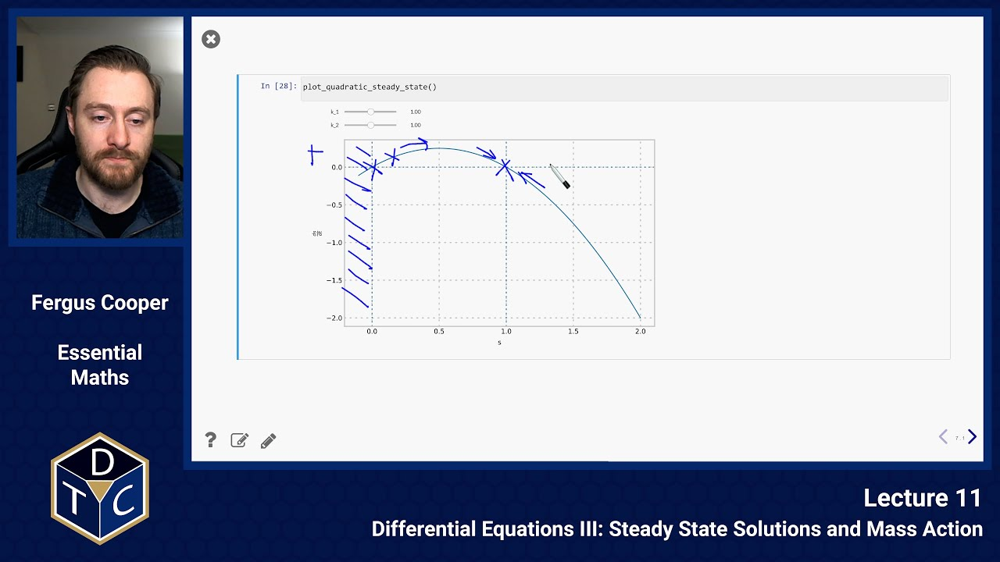
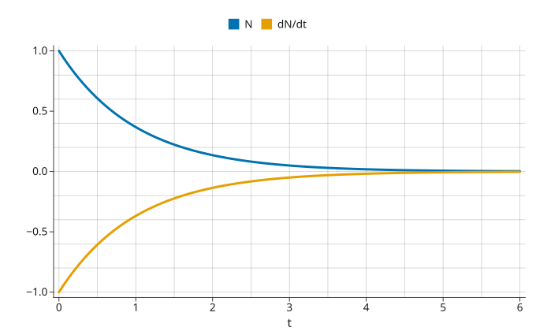
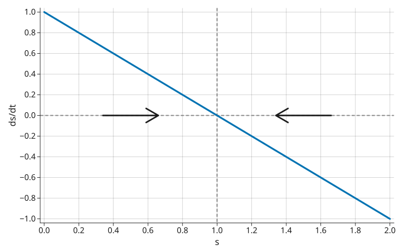
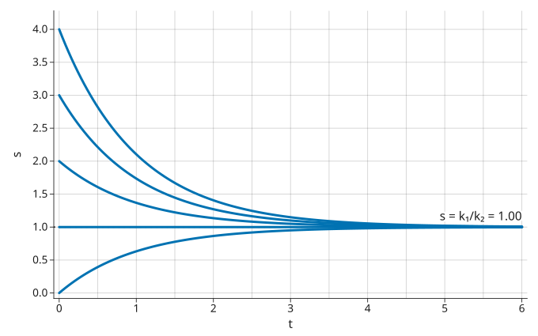
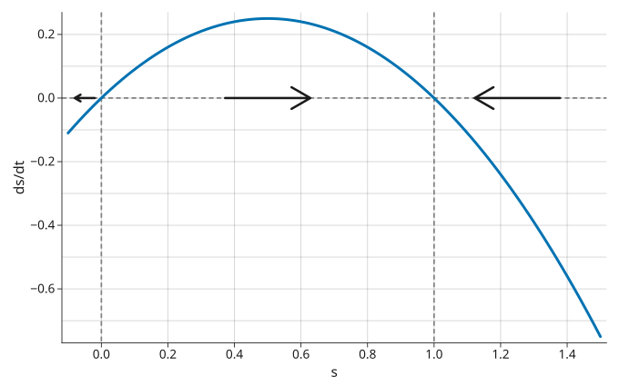
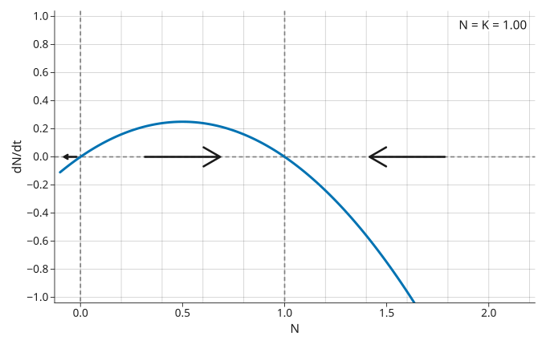
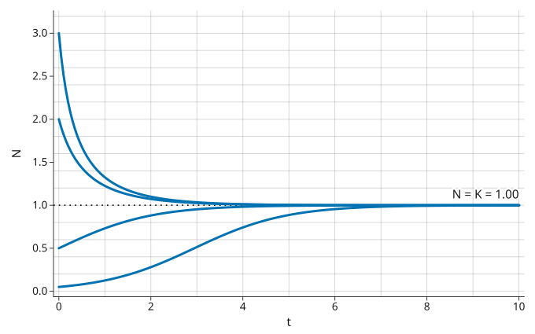

---

## YouTube lecture recording from October 2020

A recording of this lecture from October 2020; the material has changed a little since.

[](https://youtu.be/zAZ-FPnLvCg)

---

## Why steady states?

Often we don't need the full solution of a differential equation: we want to know where the system ends up, and whether it goes back there if something nudges it.

These long-run states are the _steady states_, and we can find them, and decide whether they are stable, without solving the equation.

In this lecture we find the steady states of models from biology and chemistry, written down using the law of mass action, and recap how to solve equations numerically.

## Steady-state solutions

It is often useful to find the **steady state** of a system described by ordinary differential equations.
This occurs when all rates (i.e. derivatives) are zero.

A steady state may be **stable** or **unstable**, depending on whether or not small deviations from the steady state tend to be corrected or amplified.

We can evaluate the stability of a steady state by considering the sign of the derivative nearby.

### Example 1: radioactive decay

Recall the radioactive decay equation

$$
\frac{dN}{dt} = -\lambda N.
$$

We can solve it numerically, as in lecture 9:

```python
import numpy as np
from scipy.integrate import solve_ivp

lam = 1.0
N0 = 1.0
t = np.linspace(0, 6, 100)


def dNdt(t, N):
    return -lam * N


solution = solve_ivp(dNdt, [0, 6], [N0],
                     t_eval=t)
N = solution.y[0]
```

Let us examine a plot of the solution, $N$, and the gradient $dN/dt$ as functions of time:



- Here the steady state occurs when $N=0$, and is 'reached' after infinite time.

- If $N$ moves away from $0$, then $dN/dt = -\lambda N$ has the opposite sign to $N$: negative when $N$ is positive, and positive when $N$ is negative.

- So $N$ always moves back towards $0$, and the steady state is stable.

## Chemical reactions to equations: mass action

Under the [law of mass action](https://en.wikipedia.org/wiki/Law_of_mass_action), we assume that:

- chemical reactions have uniform mixing

- rates are proportional to the product of the concentrations of the reactants

- predator/prey interactions, and epidemics, have similar rules

Let us look at some examples:

1. A and B produce C. The reaction is governed by A meeting B:

   $$
   A+B\underset{k}{\rightarrow} C
   $$

   Then we get the following differential equations:

   $$
   \begin{aligned}
   \frac{d[A]}{dt} &= -k[A][B] \\
   \frac{d[B]}{dt} &= -k[A][B] \\
   \frac{d[C]}{dt} &= k[A][B]
   \end{aligned}
   $$

2. Predation of R by W

   $$
   R+W\underset{k}{\rightarrow} W
   $$

   Gives the following differential equation:

   $$
   \frac{dR}{dt} = -kRW
   $$

3. Constant production (zeroth order)

   $$
   0 \underset{k}{\rightarrow} A
   $$

   Gives the following differential equation:

   $$
   \frac{d[A]}{dt} = k
   $$

4. Degradation/death

   $$
   C \underset{k}{\rightarrow} 0
   $$

   Gives the following differential equation:

   $$
   \frac{d[C]}{dt} = -k[C]
   $$

### Example 2: production and degradation of a protein

Consider a simple model of the production and degradation of a protein, shown by the reaction chain $\overset{v_1}{\rightarrow}S\overset{v_2}{\rightarrow}$ where $v_1$ and $v_2$ are reaction rates, and let $s=[S]$.

We can represent the change in concentration of the protein by

$$
\frac{ds}{dt} = v_1 - v_2
$$

so the steady state occurs when $v_1 = v_2$.

Under mass action, constant production and degradation give $v_1=k_1$ and $v_2=k_2 s$, so the equation is

$$
\frac{ds}{dt} = k_1 - k_2 s.
$$

The steady state is given by $s = k_1/k_2$, and it is stable.
Here is a plot of $ds/dt$ against $s$ for $k_1 = k_2 = 1$, so that the steady state is at $s = 1$:



We can see that it is stable by examining the graph:

- If we move to the left of $s=1$, the gradient is positive, so we move back towards $s=1$

- If we move to the right of $s=1$, the gradient is negative, so we, again, move back towards $s=1$

The arrows on the $s$ axis show which way $s$ moves.

We can solve the differential equation by separation of variables:

$$
\begin{aligned}
\int \frac{1}{k_1 - k_2 s}\,ds &= \int dt \\
-\frac{1}{k_2}\ln|k_1 - k_2 s| &= t + c \\
k_1 - k_2 s &= Ae^{-k_2 t} \\
s(t) &= Be^{-k_2 t} + \frac{k_1}{k_2}
\end{aligned}
$$

where $A = \pm e^{-k_2c}$ and $B = -A/k_2$ are constants.

If the initial concentration of $S$ is $s_0$, then $s_0 = B + k_1/k_2$, so $B = s_0 - k_1/k_2$ and

$$
s(t) = s_0 e^{-k_2 t} + \frac{k_1}{k_2}\left(1-e^{-k_2 t}\right)
$$

Thus, the concentration of $S$ relaxes exponentially to the steady state, no matter the initial condition.
Here it is for $k_1 = k_2 = 1$, from several initial concentrations:



### Example 3: positive feedback

To understand different possibilities for these steady states, let us suppose instead that $S$ enhances its own production (positive feedback) and the degradation rate is nonlinear.

If we were to have the following form for $v_1$ and $v_2$:

- $v_1=k_1 s$
- $v_2=k_2 s^2$

then:

$$
\frac{ds}{dt} = k_1s - k_2 s^2
$$

This system will be at steady state when $k_1 s = k_2 s^2$, i.e.

- $s=0$ or
- $s=k_1/k_2$

We can plot $ds/dt$ versus $s$ to see if they are stable or unstable.
Here, $k_1 = k_2 = 1$:



- The local behaviour near the fixed point at $s=1$ is the same as in the previous plot, so we can immediately see that it is a stable steady state
- The local behaviour near the fixed point at $s=0$ is the opposite: moving one way or the other, the gradient will take $s$ even further away

### Non-graphical method

Let us investigate this same behaviour in a more rigorous manner.

$$
\frac{ds}{dt} = k_1s - k_2 s^2
$$

- When $s$ is small (and positive, since it is a concentration) $s\gg s^2$ so the derivative $k_1 s - k_2 s^2$ will be positive, making $s=0$ an unstable steady state.

- For the other steady state, consider small deviations by $\varepsilon$ from the steady state, e.g. $s=k_1/k_2 + \varepsilon$.

Substituting $s=k_1/k_2 + \varepsilon$ into the equation:

$$
\begin{aligned}
\frac{ds}{dt} &= k_1\left(\frac{k_1}{k_2}+\varepsilon\right) - k_2\left(\frac{k_1}{k_2}+\varepsilon\right)^2 \\
&= \frac{k_1^2}{k_2} + k_1\varepsilon - \frac{k_1^2}{k_2} - 2k_1\varepsilon - k_2\varepsilon^2 \\
&= -k_1\varepsilon - k_2\varepsilon^2
\end{aligned}
$$

For small $\varepsilon$, $\varepsilon^2$ is much smaller than $\varepsilon$, so $ds/dt \approx -k_1\varepsilon$, which has the opposite sign to $\varepsilon$.
So $s$ moves back towards the steady state, and it is stable.

:::callout{variant="note"}
**The slope at a steady state**

The non-graphical method works for any equation of the form $ds/dt = f(s)$.
Suppose $s^*$ is a steady state, so that $f(s^*) = 0$.
Close to $s^*$, the curve of $f$ is close to its tangent:

$$
\frac{ds}{dt} = f(s) \approx f'(s^*)\,(s - s^*)
$$

If $f'(s^*) < 0$, then $ds/dt$ has the opposite sign to $s - s^*$, so $s$ moves back: the steady state is stable.
If $f'(s^*) > 0$, then $s$ moves away: it is unstable.

For example, for positive feedback, $f'(s) = k_1 - 2k_2 s$, so $f'(0) = k_1 > 0$ (unstable) and $f'(k_1/k_2) = -k_1 < 0$ (stable).
:::

### Example 4: the logistic equation

The growth of a cell colony can be modelled by the _logistic_ equation

$$
\frac{dN}{dt} = rN\left(1 - \frac{N}{K}\right)
$$

where $N(t)$ is the number of cells at time $t$, and $r$ and $K$ are constant parameters (both positive).

Try finding the steady states of the logistic equation, and deciding whether each one is stable, before reading on.

The steady state for the system, or equilibrium population size, occurs when the growth rate is zero, i.e.

$$
\frac{dN}{dt} = 0 \quad\Rightarrow\quad rN = \frac{r}{K}N^2 \quad\Rightarrow\quad N = 0 \text{ or } N = K.
$$

This is positive feedback with $k_1 = r$ and $k_2 = r/K$: the same equation as the growing leaf in lecture 10, and the logistic model of lecture 3.

Here is a plot, for $r=K=1$:



- For small positive $N$, $rN>0$ and $N<K$ so $dN/dt>0$ and the population size will increase, meaning that $N=0$ is an unstable steady state.

- In fact the growth rate is positive for $0<N<K$ and negative for $N>K$, making $N=K$ a stable steady state.

We can solve the differential equation to examine the transient behaviour, that is, how the population approaches $K$.
It is lecture 10's leaf equation with $k_1 = r$ and $k_2 = r/K$, so the same partial fractions give

$$
N = \frac{r e^{rt+d}}{1 + (r/K)e^{rt+d}}
$$

where $e^d = N_0/(r - rN_0/K)$, from the initial condition $N(0)=N_0$.
Simplifying,

$$
N(t) = \frac{K N_0 e^{rt}}{K + N_0(e^{rt}-1)}.
$$

Here it is for $r=K=1$, from initial population sizes below and above $K$:



## Numerically solving differential equations

What if we can't solve the differential equation (or don't want to)?

$$
\frac{dy}{dt} = \sin\left(\frac{y\ln(t\cos(y))}{\sqrt{1+y/e^t}}\right) + 3
$$

### Euler's method: a recap

In lecture 9 we solved $dy/dt = f(t, y)$ numerically with Euler's method.
From $y_0$ at $t_0$, we take steps of size $h$ along the tangent:

$$
y_{n+1} = y_n + h\,f(t_n, y_n)
$$

The smaller the step, the more accurate the answer, but the more steps we need.
Introductory problem 2 below works through Euler's method by hand and in Python.

In practice we use SciPy's `solve_ivp`, as we have throughout these lectures, which uses a more sophisticated method and chooses the step size for us.

## Summary of first order differential equations

To solve a differential equation:

1. Calculate the general solution: try to write it as a separable equation first.
   Other methods exist, such as integrating factors (see Extension problems 2).
2. The general solution includes an arbitrary constant, which we can find from the initial condition (if we are given one).
3. Check the solution numerically with Python, or solve numerically if we can't solve by hand.

To find steady state (equilibrium) solutions, find points where all (first) derivatives are zero.

To determine the stability of these steady states, look at the sign of the first derivative in the vicinity of the steady state.
You can sketch the first derivative, or use Python to help with this.

## Introductory problems

:::callout{variant="tip"}
For more practice, an AI tool can write new problems like the ones below.
Ask it for problems of the same type and difficulty, or for problems set in your own field.
For example, you could ask it to "write five biochemistry problems on steady states and their stability, at the level of these ones".
Work them on paper first, then ask the tool to check your answers and to explain any step you are unsure of.
:::

::::challenge{id="11_intro_01" title="Introductory problems 1"}
Determine the steady states and their stabilities, for each of the following:

1. $dx/dt = x(a-x)$, where $a$ is a positive constant
1. $dx/dt = x^{2}-4x+3$
1. $dx/dt = e^{x}(x^{2}-1)$
1. $dN/dt = r_{0}N\left(1-N/K\right)$, where $r_{0}<0$ and $r_{0}$, $K$ are constants
1. $dx/dt = Ax/(h+x)$, where $A$ and $h$ are negative constants

:::solution

In each case, the steady states are where the right-hand side, $f$, is zero.
To find their stability, we look at the gradient of $f$ at each steady state.
If it is negative, $f$ goes from positive to negative as we pass through the steady state, so nearby solutions move back towards it, and the steady state is stable.
If it is positive, nearby solutions move away, and the steady state is unstable.

1. $f(x) = x(a-x)$ is zero at $x = 0$ and $x = a$.
   Its gradient is $f'(x) = a - 2x$.
   At $x = 0$, $f'(0) = a > 0$, so $x = 0$ is unstable.
   At $x = a$, $f'(a) = -a < 0$, so $x = a$ is stable.

1. $f(x) = x^2 - 4x + 3 = (x-1)(x-3)$ is zero at $x = 1$ and $x = 3$.
   Its gradient is $f'(x) = 2x - 4$.
   At $x = 1$, $f'(1) = -2 < 0$, so $x = 1$ is stable.
   At $x = 3$, $f'(3) = 2 > 0$, so $x = 3$ is unstable.

1. $e^x$ is never zero, so $f(x) = e^x(x^2-1)$ is zero only at $x = \pm 1$.
   By the product rule, $f'(x) = e^x(x^2-1) + 2xe^x = e^x(x^2 + 2x - 1)$.
   At $x = 1$, $f'(1) = 2e > 0$, so $x = 1$ is unstable.
   At $x = -1$, $f'(-1) = -2e^{-1} < 0$, so $x = -1$ is stable.

1. $f(N) = r_0N(1 - N/K)$ is zero at $N = 0$ and $N = K$.
   Its gradient is $f'(N) = r_0(1 - 2N/K)$.
   At $N = 0$, $f'(0) = r_0 < 0$, so $N = 0$ is stable.
   At $N = K$, $f'(K) = -r_0 > 0$, so $N = K$ is unstable.
   This is the logistic equation with a negative growth rate, so the stabilities are the other way round from the usual logistic equation.

1. $f(x) = Ax/(h+x)$ is zero only at $x = 0$.
   By the quotient rule,

   $$
   f'(x) = \frac{A(h+x) - Ax}{(h+x)^2} = \frac{Ah}{(h+x)^2}
   $$

   At $x = 0$, $f'(0) = A/h$, which is positive because $A$ and $h$ are both negative.
   So, $x = 0$ is unstable.
   (Note, $f$ is not defined at $x = -h$, which is a positive value of $x$.)

:::

::::

::::challenge{id="11_intro_02" title="Introductory problems 2"}
Consider the differential equation

$$
\frac{dy}{dt} = -2y \quad\text{with}\quad y(0) = 1.
$$

1. Solve the equation exactly, by separation of variables.
1. Use Euler's method by hand, with a step size of $\delta t = 0.1$, to estimate $y(0.1)$, $y(0.2)$ and $y(0.3)$.
   Compare your estimate of $y(0.3)$ with the exact value.
1. Write a Python function that uses Euler's method to estimate $y(1)$.
   Find the error in your estimate for $\delta t = 0.1$ and for $\delta t = 0.05$.
   What happens to the error when the step size is halved?

:::solution

1. Separating the variables,

   $$
   \int \frac{dy}{y} = \int -2\,dt \qquad\Rightarrow\qquad \ln y = -2t + c
   $$

   and $y(0) = 1$ gives $c = 0$, so $y = e^{-2t}$.

1. Each step of Euler's method is $y_{n+1} = y_n + f(y_n, t_n)\,\delta t$, where here $f(y, t) = -2y$.
   So, each step multiplies $y$ by $1 - 2\delta t = 0.8$:

   $$
   \begin{aligned}
   y(0.1) &\approx 1 + (-2\times 1)\times 0.1 = 0.8, \\
   y(0.2) &\approx 0.8 + (-2\times 0.8)\times 0.1 = 0.64, \\
   y(0.3) &\approx 0.64 + (-2\times 0.64)\times 0.1 = 0.512.
   \end{aligned}
   $$

   The exact value is $y(0.3) = e^{-0.6} \approx 0.5488$, so the estimate is about $0.037$ too small.
   Euler's method uses the gradient at the start of each step, and here the gradient gets less steep as $y$ decreases, so each step goes down a little too far.

1. In Python:

   ```python
   import numpy as np


   def euler(f, y0, t0, t_end, dt):
       n_steps = round((t_end - t0) / dt)
       y = y0
       t = t0
       for _ in range(n_steps):
           y = y + f(y, t) * dt
           t = t + dt
       return y


   def f(y, t):
       return -2 * y


   exact = np.exp(-2)
   for dt in [0.1, 0.05]:
       approx = euler(f, 1, 0, 1, dt)
       print(f"dt = {dt}: y(1) = {approx:.6f}, error = {exact - approx:.6f}")
   ```

   ```text
   dt = 0.1: y(1) = 0.107374, error = 0.027961
   dt = 0.05: y(1) = 0.121577, error = 0.013759
   ```

   Halving the step size roughly halves the error.
   This means that, to make the error 10 times smaller, we need 10 times as many steps.
   This is why `solve_ivp` uses more sophisticated methods.

:::

::::

## Main problems

::::challenge{id="11_main_01" title="Main problems 1"}
Not all chemical systems relax exponentially to steady state.
Consider the bimolecular decay reaction

$$
A + A \stackrel{k}{\longrightarrow}
$$

Assuming $k$ is a mass action constant, form and solve a differential equation representing the change in concentration of $A$.

If $a(0)=a_0$ you should get

$$
a(t) = \frac{1}{2kt + \frac{1}{a_0}}.
$$

:::solution

Under mass action, the reaction happens at a rate $ka \cdot a = ka^2$.
Each reaction uses up two molecules of $A$, so

$$
\frac{da}{dt} = -2ka^2
$$

Separate the variables and integrate:

$$
\int \frac{da}{a^2} = -\int 2k\,dt \qquad\text{so}\qquad -\frac{1}{a} = -2kt + C
$$

At $t = 0$, $a = a_0$, so $C = -1/a_0$.
This means that

$$
\frac{1}{a} = 2kt + \frac{1}{a_0} \qquad\text{so}\qquad a(t) = \frac{1}{2kt + \frac{1}{a_0}}
$$

This does not decay exponentially.
For large $t$, $a(t) \approx 1/(2kt)$, which falls much more slowly than an exponential.

:::

::::

::::challenge{id="11_main_02" title="Main problems 2"}
The $SIS$ model is an appropriate model for diseases that mutate quickly and can therefore infect people multiple times, such as the common cold or sexually transmitted infections like gonorrhea and chlamydia.

In the model, individuals are 'susceptible' until they are 'infected', and then they return to being 'susceptible' again.
Infection requires the interaction of susceptible individuals with infected individuals and therefore follows the law of mass action, whereas the rate at which an individual becomes susceptible again after infection is constant.

1. Let $S$ and $I$ be the proportions of the population that are susceptible and infected.
   If infection happens at rate $\beta$ and recovery happens at rate $\gamma$, write down differential equations for $S$ and $I$.
1. Noting that $S$ and $I$ are proportions of the population, which is assumed constant, reduce the system to a single differential equation in terms of $I$.
   In other words, write down a single equation, involving just $I$ and its derivative.
1. Find both steady states of $I$. Under what conditions on $\beta$ and $\gamma$ are each attainable?
1. Without solving the differential equation, sketch the behaviour of $S$ and $I$ over time, starting with a small quantity of infected individuals.
   Illustrate how both steady states may be achieved.

:::solution

1. Infection needs a susceptible individual to meet an infected one, so by mass action it happens at rate $\beta SI$.
   Recovery happens at rate $\gamma I$.
   Infection moves individuals from $S$ to $I$, and recovery moves them back:

   $$
   \frac{dS}{dt} = -\beta SI + \gamma I, \qquad \frac{dI}{dt} = \beta SI - \gamma I
   $$

1. The proportions add up to one, $S + I = 1$, so $S = 1 - I$ and

   $$
   \frac{dI}{dt} = \beta I(1 - I) - \gamma I
   $$

1. Write $f(I) = \beta I(1-I) - \gamma I = I(\beta - \gamma - \beta I)$.
   This is zero at $I = 0$ and at $I = 1 - \gamma/\beta$.
   Its gradient is $f'(I) = \beta - \gamma - 2\beta I$.

   - At $I = 0$, $f'(0) = \beta - \gamma$.
     So, the disease dies out (this steady state is stable) when $\beta < \gamma$.
   - At $I = 1 - \gamma/\beta$, $f' = \gamma - \beta$.
     So, this steady state is stable when $\beta > \gamma$, which is also when it is positive and so makes sense as a proportion.

   In other words, the disease persists when people are infected faster than they recover.

1. Starting with a small $I$ (and so $S$ close to 1):

   - If $\beta > \gamma$, $I$ grows, slowly at first, then faster, then levels off at $1 - \gamma/\beta$, in an S-shaped curve.
     $S = 1 - I$ falls in a mirror image, levelling off at $\gamma/\beta$.
   - If $\beta < \gamma$, $I$ decays towards zero, and $S$ rises towards 1.

   We can check the sketch by solving the equation numerically, for example with $\beta = 0.5$, $\gamma = 0.2$ and with $\beta = 0.2$, $\gamma = 0.5$:

   ```python
   import numpy as np
   from scipy.integrate import solve_ivp
   from matplotlib import pyplot as plt

   t = np.linspace(0, 50, 200)
   for beta, gamma in [(0.5, 0.2), (0.2, 0.5)]:
       sol = solve_ivp(lambda t, I: beta * I * (1 - I) - gamma * I, (0, 50), [0.01], t_eval=t)
       plt.plot(t, sol.y[0], label=f'I, beta = {beta}, gamma = {gamma}')
       plt.plot(t, 1 - sol.y[0], '--', label=f'S, beta = {beta}, gamma = {gamma}')
   plt.xlabel('t')
   plt.ylabel('proportion')
   plt.legend()
   ```

:::

::::

::::challenge{id="11_main_03" title="Main problems 3"}
Consider a closed reaction system consisting of a single reversible reaction:

$$
A \underset{k_b}{\overset{k_f}{\rightleftharpoons}} B
$$

where $k_f$ and $k_b$ are mass action coefficients.

1. Formulate a pair of coupled differential equations for the change in concentration of $A$ and $B$.
1. Noting that the total concentration $T$ of reactants is constant ($T = [A] + [B]$), reduce the system of equations to a single differential equation.
   In other words, write down a single equation, involving either just $A$ and its derivative, or just $B$ and its derivative.
1. Find the steady-state concentrations of $A$ and $B$.
1. Solve the single differential equation to reveal the transient behaviour.
   Sketch the behaviour for different illustrative initial conditions.

:::solution

1. The forward reaction turns $A$ into $B$ at rate $k_f[A]$, and the backward reaction turns $B$ into $A$ at rate $k_b[B]$:

   $$
   \frac{d[A]}{dt} = -k_f[A] + k_b[B], \qquad \frac{d[B]}{dt} = k_f[A] - k_b[B]
   $$

1. Substitute $[B] = T - [A]$:

   $$
   \frac{d[A]}{dt} = -k_f[A] + k_b(T - [A]) = k_bT - (k_f + k_b)\,[A]
   $$

1. At steady state $d[A]/dt = 0$, so

   $$
   [A] = \frac{k_bT}{k_f + k_b} \qquad\text{and}\qquad [B] = T - [A] = \frac{k_fT}{k_f + k_b}
   $$

   So, at steady state $[B]/[A] = k_f/k_b$.

1. Separate the variables and integrate:

   $$
   \begin{aligned}
   \int \frac{d[A]}{k_bT - (k_f+k_b)\,[A]} &= \int dt \\
   \text{so}\qquad -\frac{\ln\left|k_bT - (k_f+k_b)\,[A]\right|}{k_f + k_b} &= t + C
   \end{aligned}
   $$

   Rearranging, and writing $[A]_0$ for the starting concentration of $A$, gives

   $$
   [A](t) = \frac{k_bT}{k_f + k_b} + \left([A]_0 - \frac{k_bT}{k_f + k_b}\right)e^{-(k_f + k_b)t}
   $$

   Whatever the starting concentration, $[A]$ relaxes exponentially to its steady state, from above if it starts above it, and from below if it starts below it.
   The rate of approach is $k_f + k_b$, the sum of the two rate constants.
   $[B] = T - [A]$ does the opposite.
   For example, with $k_f = 2$, $k_b = 1$ and $T = 1$:

   ```python
   import numpy as np
   from matplotlib import pyplot as plt

   kf = 2
   kb = 1
   T = 1
   A_ss = kb * T / (kf + kb)
   t = np.linspace(0, 3, 200)
   for A0 in [0, 0.2, 0.6, 1]:
       plt.plot(t, A_ss + (A0 - A_ss) * np.exp(-(kf + kb) * t), label=f'[A](0) = {A0}')
   plt.xlabel('t')
   plt.ylabel('[A]')
   plt.legend()
   ```

:::

::::

::::challenge{id="11_main_04" title="Main problems 4"}
Consider the simple model

$$
\frac{ds}{dt} = k - \frac{V_{\text{max}}s}{K_M + s}
$$

in which species $s$ is produced at a fixed rate and consumed via Michaelis-Menten kinetics.
Find the steady state of $s$, and verify that it is stable for any non-negative parameter values, provided $V_{\text{max}} > k$.

:::solution

At steady state $ds/dt = 0$, so

$$
k = \frac{V_{\text{max}}s}{K_M + s} \qquad\text{so}\qquad kK_M + ks = V_{\text{max}}s \qquad\text{so}\qquad s^* = \frac{kK_M}{V_{\text{max}} - k}
$$

This is positive, and so makes sense as a concentration, only if $V_{\text{max}} > k$.
(If $V_{\text{max}} \le k$, production is faster than the enzyme can ever consume $s$, so $s$ grows without limit.)

To check stability, write $f(s) = k - V_{\text{max}}s/(K_M + s)$.
By the quotient rule,

$$
f'(s) = -\frac{V_{\text{max}}(K_M + s) - V_{\text{max}}s}{(K_M + s)^2} = -\frac{V_{\text{max}}K_M}{(K_M + s)^2}
$$

This is negative for every $s \ge 0$ when $V_{\text{max}}$ and $K_M$ are positive, so in particular $f'(s^*) < 0$, and the steady state is stable.
In other words, below $s^*$ production beats consumption and $s$ rises, and above $s^*$ consumption wins and $s$ falls.

:::

::::

::::challenge{id="11_main_05" title="Main problems 5"}
Recall the simple model of the production and degradation of a protein from the lecture, shown by the reaction chain

$$
\overset{v_1}{\longrightarrow} S \overset{v_2}{\longrightarrow}
$$

where $v_1$ and $v_2$ are reaction rates rather than mass action coefficients.

1. Suppose $v_1 = k_1$ and $v_2 = k_2s$, as in the lecture.
   Write down a differential equation describing the rate of change of S, and find the steady state concentration of S in terms of the two parameters $k_1$ and $k_2$ (i.e. the concentration at which the rate of change is zero).
   At what rate is S being produced in steady state?
1. Now suppose that

   $$
   v_1 = k_0 + \frac{k_1 s^2}{k_2+s^2} \quad\text{and}\quad v_2 = k_3 s
   $$

   and take the parameter values to be $k_0=6/11$, $k_1=60/11$, $k_2=11$, $k_3=1$.
   Determine the number of steady states and the type of each.

:::solution

1. $ds/dt = v_1 - v_2 = k_1 - k_2s$.
   At steady state this is zero, so $s^* = k_1/k_2$.
   In steady state, $S$ is produced at rate $v_1 = k_1$, which exactly balances its degradation, $k_2s^* = k_1$.

1. With the given values,

   $$
   \frac{ds}{dt} = \frac{6}{11} + \frac{60}{11}\,\frac{s^2}{11+s^2} - s
   $$

   Put everything over the common denominator $11(11+s^2)$:

   $$
   \begin{aligned}
   \frac{ds}{dt} &= \frac{6(11+s^2) + 60s^2 - 11s(11+s^2)}{11(11+s^2)} \\
   &= -\frac{11s^3 - 66s^2 + 121s - 66}{11(11+s^2)} \\
   &= -\frac{(s-1)(s-2)(s-3)}{11+s^2}
   \end{aligned}
   $$

   So, there are three steady states, $s = 1$, $s = 2$ and $s = 3$.
   The denominator is always positive, so the sign of $ds/dt$ is the sign of $-(s-1)(s-2)(s-3)$:

   | $s$       | $s<1$ | $1<s<2$ | $2<s<3$ | $s>3$ |
   | :-------- | :---: | :-----: | :-----: | :---: |
   | $ds/dt$   |   +   |    -    |    +    |   -   |

   Solutions move towards $s = 1$ and $s = 3$ from both sides, so these are stable.
   They move away from $s = 2$, so it is unstable.
   This means that the system is _bistable_, settling at a low or a high level of $S$ depending on whether it starts below or above $s = 2$.

:::

::::

## Extension problems

::::challenge{id="11_ext_01" title="Extension problems 1"}
Various mathematical models have been proposed for the initial growth of solid tumours, and some are summarised in [_The Model Muddle: In Search of Tumor Growth Laws_](https://doi.org/10.1158/0008-5472.CAN-12-4355).
They are differential equations describing the rate of change of tumour volume $V$ as a function of time $t$, for example:

1. $dV(t)/dt = rV(t)$

1. $dV(t)/dt = rV(t)^b$

1. $dV(t)/dt = r_0 e^{-\rho t}V(t)$

Solve each equation both analytically and numerically, using Python.
As was done in Figure 1A in the paper, compare the behaviours of the different growth laws over a suitable time interval for an initially small tumour, again using Python.
With $V$ in mm$^3$ and $t$ in days, take $V(0) = 1$, $r = 0.1$, $b = 2/3$, $r_0 = 0.1$ and $\rho = 0.02$, and compare the laws over the first 100 days.

:::solution

Each equation is separable.

1. $\int dV/V = \int r\,dt$ gives $\ln V = rt + C$, so

   $$
   V(t) = V(0)\,e^{rt}
   $$

   This is exponential growth, with no limit.

1. $\int V^{-b}\,dV = \int r\,dt$ gives $V^{1-b}/(1-b) = rt + C$ (for $b \neq 1$), so

   $$
   V(t) = \left(V(0)^{1-b} + (1-b)rt\right)^{1/(1-b)}
   $$

   With $b = 2/3$, this is $V(t) = \left(V(0)^{1/3} + rt/3\right)^3$, which grows like $t^3$.
   (One explanation for $b = 2/3$ is that only the cells near the surface of the tumour divide, and the surface area grows like $V^{2/3}$.)

1. $\int dV/V = \int r_0e^{-\rho t}\,dt$ gives $\ln V = -\frac{r_0}{\rho}e^{-\rho t} + C$.
   At $t = 0$, $\ln V(0) = -r_0/\rho + C$, so

   $$
   V(t) = V(0)\exp\left(\frac{r_0}{\rho}\left(1 - e^{-\rho t}\right)\right)
   $$

   This is the _Gompertz_ law.
   The growth rate decays over time, so the volume levels off at $V(0)e^{r_0/\rho}$.

To solve them numerically, we use `solve_ivp`, and compare with the analytic solutions (dotted lines) on a logarithmic $V$ axis:

```python
import numpy as np
from scipy.integrate import solve_ivp
from matplotlib import pyplot as plt

V0 = 1
r = 0.1
b = 2 / 3
r0 = 0.1
rho = 0.02
t = np.linspace(0, 100, 201)

# Each model: its right-hand side dV/dt, and its analytic solution
models = {
    'exponential': (lambda t, V: r * V,
                    V0 * np.exp(r * t)),
    'power law': (lambda t, V: r * V**b,
                  (V0**(1 - b) + (1 - b) * r * t)**(1 / (1 - b))),
    'Gompertz': (lambda t, V: r0 * np.exp(-rho * t) * V,
                 V0 * np.exp(r0 / rho * (1 - np.exp(-rho * t)))),
}

for name, (dVdt, analytic) in models.items():
    sol = solve_ivp(dVdt, (0, 100), [V0], t_eval=t, rtol=1e-8)
    print(f'{name}: V(100) = {sol.y[0, -1]:.1f} (numerical), {analytic[-1]:.1f} (analytic)')
    plt.semilogy(t, sol.y[0], label=name)
    plt.semilogy(t, analytic, 'k:')

plt.xlabel('t (days)')
plt.ylabel('V (mm$^3$)')
plt.legend()
```

```text
exponential: V(100) = 22026.5 (numerical), 22026.5 (analytic)
power law: V(100) = 81.4 (numerical), 81.4 (analytic)
Gompertz: V(100) = 75.4 (numerical), 75.4 (analytic)
```

The numerical and analytic solutions agree.
All three laws start growing at the same rate, $0.1\,$mm$^3$ per day, and are hard to tell apart for the first few days.
After 100 days, though, the exponential law predicts a tumour of over 22,000 mm$^3$, while the other two predict less than 100 mm$^3$, and the Gompertz curve is levelling off (towards $e^5 \approx 148\,$mm$^3$).
This is the kind of comparison shown in Figure 1A of the paper, where laws that look alike early on make very different predictions later.

:::

::::

::::challenge{id="11_ext_02" title="Extension problems 2"}
The lecture does not cover integrating factors, so here is the method.
If an equation can be written in the form

$$
\frac{dy}{dx} + P(x)\,y = Q(x)
$$

multiply both sides by the _integrating factor_ $I(x) = e^{\int P(x)\,dx}$.
Because $dI/dx = P(x)\,I(x)$, the product rule shows that the left-hand side becomes $\frac{d}{dx}\left(I(x)\,y\right)$, so

$$
I(x)\,y = \int I(x)\,Q(x)\,dx
$$

Find the solution to the following differential equations subject to the specified boundary conditions, using integrating factors:

1. $dy/dx + y/x = 0 \quad\text{with}\quad y(2)=2 \quad\text{for}\quad x>0$
1. $dy/dx + (2x-1)y = 0 \quad\text{with}\quad y(1)=2$
1. $x^3\,dy/dx + 2y = e^{1/x^2} \quad\text{with}\quad y(1)=e$
1. $\sec(x)\,dy/dx + y = 1 \quad\text{with}\quad y(0) = 1$
1. $dy/dx + y\tan(x) = \cos(x) \quad\text{with}\quad y(0)=1 \quad\text{for}\quad 0 \le x < \pi/2$

:::solution

1. $P(x) = 1/x$, so $I(x) = e^{\ln x} = x$ (for $x > 0$), and $Q(x) = 0$:

   $$
   \frac{d}{dx}(xy) = 0 \qquad\text{so}\qquad xy = C
   $$

   At $x = 2$, $y = 2$, so $C = 4$, and $y = 4/x$.

1. $P(x) = 2x - 1$, so $I(x) = e^{x^2 - x}$, and $Q(x) = 0$:

   $$
   \frac{d}{dx}\left(e^{x^2-x}y\right) = 0 \qquad\text{so}\qquad y = Ce^{x - x^2}
   $$

   At $x = 1$, $y = C = 2$, so $y = 2e^{x - x^2}$.

   (Parts **1.** and **2.** are also separable, and separating the variables gives the same answers.)

1. First divide by $x^3$ to get the standard form:

   $$
   \frac{dy}{dx} + \frac{2}{x^3}\,y = \frac{e^{1/x^2}}{x^3}
   $$

   $P(x) = 2x^{-3}$, so $\int P\,dx = -x^{-2}$ and $I(x) = e^{-1/x^2}$.
   Then $I(x)\,Q(x) = 1/x^3$, so

   $$
   e^{-1/x^2}y = \int \frac{dx}{x^3} = -\frac{1}{2x^2} + C
   $$

   At $x = 1$, $y = e$, so $1 = -1/2 + C$ and $C = 3/2$.
   So,

   $$
   y = e^{1/x^2}\left(\frac{3}{2} - \frac{1}{2x^2}\right)
   $$

1. Multiply by $\cos(x)$ (since $\sec(x) = 1/\cos(x)$) to get the standard form:

   $$
   \frac{dy}{dx} + \cos(x)\,y = \cos(x)
   $$

   $P(x) = \cos(x)$, so $I(x) = e^{\sin(x)}$:

   $$
   \frac{d}{dx}\left(e^{\sin(x)}y\right) = e^{\sin(x)}\cos(x) \qquad\text{so}\qquad e^{\sin(x)}y = e^{\sin(x)} + C
   $$

   This gives $y = 1 + Ce^{-\sin(x)}$.
   At $x = 0$, $y = 1 + C = 1$, so $C = 0$, and the solution is simply $y = 1$.
   (We could have spotted this: $y = 1$ makes $dy/dx = 0$, and then the equation holds.)

1. $P(x) = \tan(x)$, so $\int P\,dx = -\ln(\cos(x))$ (for $0 \le x < \pi/2$, where $\cos(x) > 0$) and $I(x) = 1/\cos(x) = \sec(x)$:

   $$
   \frac{d}{dx}\left(\sec(x)\,y\right) = \sec(x)\cos(x) = 1 \qquad\text{so}\qquad \sec(x)\,y = x + C
   $$

   At $x = 0$, $y = 1$, so $C = 1$, and $y = (x+1)\cos(x)$.

:::

::::

::::challenge{id="11_ext_03" title="Extension problems 3"}
Consider the second order differential equation

$$
\frac{d^2y}{dx^2} + y = 0
$$

Show that $y = Ae^{z_1 x} + Be^{z_2 x}$ is a solution to this equation for some complex numbers $z_1$, $z_2$ and constants $A$, $B$ (which may also be complex).

1. Recalling that any complex number $z$ can be written as $z = re^{i\theta} = r(\cos\theta + i\sin\theta)$, what does this tell you about the nature of the solution?
1. If $y(0)=1$ and $y(\pi/2)=2$ what is the particular solution of the differential equation?

:::solution

Try $y = e^{zx}$.
Then $d^2y/dx^2 = z^2e^{zx}$, so the equation becomes

$$
z^2e^{zx} + e^{zx} = (z^2 + 1)e^{zx} = 0
$$

$e^{zx}$ is never zero, so we need $z^2 = -1$, that is $z_1 = i$ and $z_2 = -i$.
The equation is linear, so any combination $y = Ae^{ix} + Be^{-ix}$ is also a solution.

1. Using $e^{i\theta} = \cos\theta + i\sin\theta$,

   $$
   \begin{aligned}
   y &= A(\cos x + i\sin x) + B(\cos x - i\sin x) \\
   &= (A + B)\cos x + i(A - B)\sin x
   \end{aligned}
   $$

   So, the solution is a combination of $\cos x$ and $\sin x$, and oscillates with period $2\pi$.
   Writing $C = A + B$ and $D = i(A - B)$, the solution is $y = C\cos x + D\sin x$.
   For $y$ to be real, $C$ and $D$ must be real, which needs $A$ and $B$ to be complex conjugates of each other.

1. $y(0) = C = 1$ and $y(\pi/2) = D = 2$, so

   $$
   y = \cos x + 2\sin x
   $$

   (This corresponds to $A = (1-2i)/2$ and $B = (1+2i)/2$.)

:::

::::
