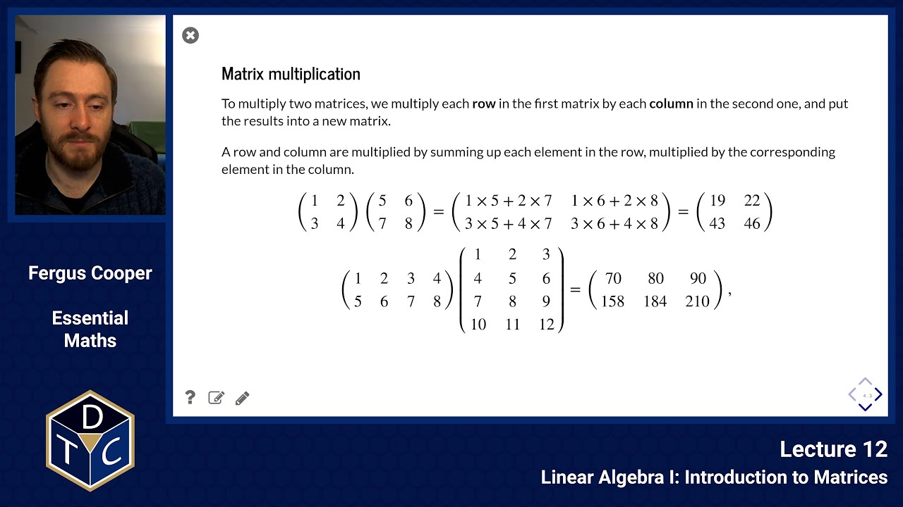
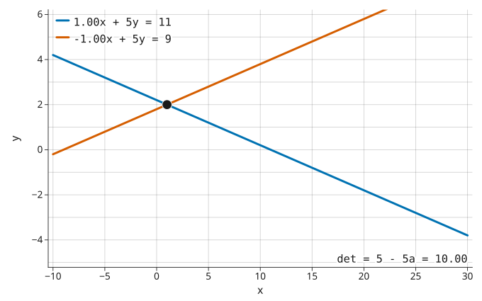
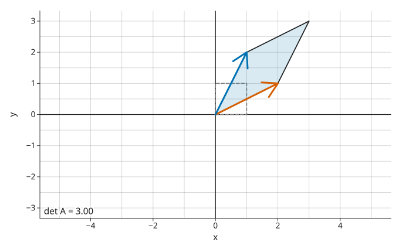

---

## YouTube lecture recording from October 2020

A recording of this lecture from October 2020; the material has changed a little since.

[](https://youtu.be/L2K3dnZ8Mk8)

---

## Why matrices?

Many problems give us several equations that must all hold at once.
For example, the steady state of a model with several interacting chemicals or species is where all of their rates of change are zero at the same time, and the currents in an electrical circuit must balance at every junction at once.

When the equations are linear, matrices let us write any number of them as a single equation, $A\mathbf{x} = \mathbf{b}$, and solve them all in the same way: by hand for small systems, and with Python for large ones.

In this lecture we learn how to add, multiply and invert matrices, and use them to solve simultaneous equations.

## Simultaneous equations

Consider 2 simultaneous equations:

$$
\begin{aligned}
a_1x+b_1y &= c_1, &&\text{(1)}\\
a_2x+b_2y &= c_2, &&\text{(2)}
\end{aligned}
$$

where the values $x$ and $y$ are to be found, and $a_1$, $b_1$, $a_2$, $b_2$, $c_1$ and $c_2$ are given constants.

$$
\begin{aligned}
(1) \times b_2: &\qquad b_2a_1x+b_2b_1y = b_2c_1, &&\text{(3)}\\
(2) \times b_1: &\qquad b_1a_2x+b_1b_2y = b_1c_2, &&\text{(4)}\\
(3) - (4): &\qquad (a_1b_2-a_2b_1)x = b_2c_1-b_1c_2.
\end{aligned}
$$

Thus:

$$
x=\frac{b_2c_1-b_1c_2}{a_1b_2-a_2b_1},
$$

and similarly:

$$
y=\frac{a_1c_2-a_2c_1}{a_1b_2-a_2b_1}.
$$

This works, provided that $a_1b_2-a_2b_1\neq 0.$

While the algebraic manipulation is straightforward when solving two equations, it can get really messy when solving large systems.

What we want is a way to be able to easily manipulate **linear** systems, regardless of how big they are.

### Two equations, two lines

Each of the two equations is a straight line in the $(x, y)$ plane, and the solution is the point where the two lines cross.
For example, take

$$
\begin{aligned}
x + 5y &= 11, \\
ax + 5y &= 9,
\end{aligned}
$$

for which $a_1b_2 - a_2b_1 = 5 - 5a$.
With $a = -1$ the lines cross at $x = 1$, $y = 2$ (we solve this system with matrices later in the lecture):



As $a$ approaches $1$, the second line turns until it is parallel to the first, and the point where they cross moves off to infinity.
At $a = 1$, $a_1b_2 - a_2b_1 = 0$: the lines are parallel and never cross, so there is no solution.
If the two lines had been the same line (e.g. if the second equation were $x + 5y = 11$ too), every point on it would be a solution, so there would be infinitely many.
Either way, there is no single solution when $a_1b_2 - a_2b_1 = 0$.

## The matrix

Matrices are a structure that allow us to more easily manipulate linear systems.

Consider the original system

$$
\begin{aligned}
a_1x+b_1y &= c_1, \\
a_2x+b_2y &= c_2.
\end{aligned}
$$

We collect the coefficients into a matrix, and the unknowns and the right-hand sides into columns, and rewrite the system in the form of a matrix as:

$$
\left(\begin{matrix}a_1&b_1\\ a_2&b_2\end{matrix}\right)
\left(\begin{matrix}x\\y\end{matrix}\right)
=\left(\begin{matrix}c_1\\ c_2 \end{matrix}\right).
$$

We will see why this is the same system once we know how to multiply matrices.

### What is a matrix?

A matrix is a rectangular array of numbers, such as

$$
A = \left(\begin{matrix}1&2&3\\ 4&5&6\end{matrix}\right).
$$

A matrix with $m$ rows and $n$ columns has **size** $m\times n$ (rows first), so $A$ is a $2\times 3$ matrix.

The element in row $i$ and column $j$ of a matrix $A$ is written $a_{ij}$, using the lower-case letter.
Here, for example, $a_{11} = 1$, $a_{23} = 6$ and $a_{21} = 4$.

A matrix with as many rows as columns is **square**, and an $n\times n$ matrix has **order** (dimension) $n$.

A matrix with a single column is a **column vector**, and we write vectors in bold.
For example,

$$
\mathbf{x} = \left(\begin{matrix}x\\y\end{matrix}\right)
$$

is a $2\times 1$ matrix.
Similarly, a matrix with a single row is a **row vector**.

### Addition, subtraction, and scalar multiplication

We can add or subtract two matrices as long as they have the **same** size, by adding or subtracting the elements in the same positions:

$$
\left(\begin{matrix} 2&1 \\ 3&-4 \end{matrix}\right) +\left(\begin{matrix} 6&-5 \\ 1&-7 \end{matrix}\right)= \left(\begin{matrix} 8&-4 \\ 4&-11\end{matrix}\right)
$$

We can multiply a matrix by a scalar, by multiplying every element:

$$
5\times\left(\begin{matrix} 2&1\\ 3&-4 \end{matrix}\right)=\left(\begin{matrix}10&5\\ 15&-20\end{matrix}\right)
$$

### Matrix multiplication

To multiply two matrices, we multiply each **row** in the first matrix by each **column** in the second one, and put the results into a new matrix.

A row and column are multiplied by summing up each element in the row, multiplied by the corresponding element in the column.

$$
\left(\begin{matrix} 1&2 \\ 3&4 \end{matrix}\right) \left(\begin{matrix} 5&6\\7&8\end{matrix}\right) = \left(\begin{matrix} 1 \times 5 + 2 \times 7 & 1 \times 6 + 2 \times 8 \\ 3 \times 5 + 4 \times 7 & 3 \times 6 + 4\times 8\end{matrix}\right) = \left(\begin{matrix} 19&22\\43&50\end{matrix}\right)
$$

For example, the element in row 2 and column 1 of the product is row 2 of the first matrix, $(3, 4)$, multiplied by column 1 of the second, $(5, 7)$: $3\times 5 + 4\times 7 = 43$.

$$
\left(\begin{matrix} 1&2&3&4\\ 5&6&7&8 \end{matrix}\right) \left(\begin{matrix} 1&2&3\\ 4&5&6\\ 7&8&9\\ 10&11&12 \end{matrix}\right) = \left(\begin{matrix} 70&80&90\\ 158&184&210 \end{matrix}\right)
$$

$$
\left(\begin{matrix} a & b & c \end{matrix}\right)
\left(\begin{matrix} p & q \\ r & s \\ v & w \end{matrix}\right)
= \left(\begin{matrix} ap+br+cv & aq+bs+cw \end{matrix}\right).
$$

If the number of **columns** in the first matrix doesn't match the number of **rows** in the second, they **cannot** be multiplied.

$$
\left(\begin{matrix} 2 & 3 & 1 \\ 2 & -1 & 3\end{matrix}\right)\left(\begin{matrix} 1 & 0 \\ -1 & -4\end{matrix}\right) = ???
$$

Here each row of the first matrix has three elements, but each column of the second has only two, so there is nothing to pair the third element with.
In general, an $m\times n$ matrix times an $n\times p$ matrix gives an $m\times p$ matrix: the inner sizes must match, and the outer sizes give the size of the product.

### Back to the matrix form

Now we can multiply out the matrix form of our two simultaneous equations:

$$
\left(\begin{matrix}a_1&b_1\\ a_2&b_2\end{matrix}\right)
\left(\begin{matrix}x\\y\end{matrix}\right)
= \left(\begin{matrix}a_1x+b_1y\\ a_2x+b_2y\end{matrix}\right).
$$

Each row gives back the left-hand side of one of the equations, so $A\mathbf{x} = \mathbf{c}$ is exactly the original system, with

$$
A = \left(\begin{matrix}a_1&b_1\\ a_2&b_2\end{matrix}\right), \qquad
\mathbf{x} = \left(\begin{matrix}x\\y\end{matrix}\right), \qquad
\mathbf{c} = \left(\begin{matrix}c_1\\ c_2 \end{matrix}\right).
$$

The same works for any number of equations and unknowns: $A$ has one row per equation and one column per unknown.

### Matrix multiplication is not commutative

In general $AB$ is not the same as $BA$: the order matters.
This can be easily seen from the fact that multiplying different sized matrices doesn't always work:

$$
\begin{aligned}
(3\times 2 \text{ matrix}) \times (2\times 2 \text{ matrix}) &= (3\times 2 \text{ matrix}) \\
(2\times 2 \text{ matrix}) \times (3\times 2 \text{ matrix}) &= ???
\end{aligned}
$$

However, even when sizes match, the product is usually not the same:

$$
\begin{aligned}
\left(\begin{matrix} 1&2 \\ 3&4 \end{matrix}\right) \left(\begin{matrix} 0&1\\1&0\end{matrix}\right) &= \left(\begin{matrix} 2&1\\4&3\end{matrix}\right), \\
\left(\begin{matrix} 0&1\\1&0\end{matrix}\right) \left(\begin{matrix} 1&2 \\ 3&4 \end{matrix}\right) &= \left(\begin{matrix} 3&4\\1&2\end{matrix}\right).
\end{aligned}
$$

Multiplying by this matrix on the right swaps the columns, while multiplying by it on the left swaps the rows.

### Laws of matrix multiplication

Matrix multiplication is not commutative, but it does obey two laws we know from numbers (whenever the products are defined):

- it is **associative**: $(AB)C = A(BC)$, so we can write $ABC$ without brackets;
- it is **distributive**: $A(B+C) = AB + AC$ and $(A+B)C = AC + BC$.

We need both forms of the distributive law, because $A(B+C)$ and $(B+C)A$ are not the same.
For the same reason, when we multiply both sides of a matrix equation by a matrix, we must multiply both sides on the same side (both on the left, or both on the right).

### The identity matrix

$I$ is the identity matrix, which has the property that:

$$
A I = I A = A
$$

for a square matrix $A$ of the same size.
It is the matrix equivalent of multiplying by 1.

It has 1s on the **leading diagonal** (from top left to bottom right) and 0s everywhere else.
The 2x2 identity matrix is:

$$
I_2 = \left(\begin{matrix} 1 & 0 \\ 0 & 1 \end{matrix}\right).
$$

The 3x3 identity matrix is:

$$
I_3 = \left(\begin{matrix} 1 & 0 & 0 \\ 0 & 1 & 0 \\ 0 & 0 & 1 \end{matrix}\right).
$$

and so on for higher dimensions.

## Inverting matrices

To solve a matrix equation, we need the matrix equivalent of dividing: the inverse.

### The inverse of a matrix

For a number $a \neq 0$, its inverse $a^{-1} = 1/a$ satisfies $a\,a^{-1} = a^{-1}a = 1$.
There is no matrix division, but the inverse of a matrix plays the same role.

If $A$ and $B$ are square matrices with

$$
AB = BA = I,
$$

then $B$ is the **inverse** of $A$, written $B = A^{-1}$, and $A$ is the inverse of $B$, $A = B^{-1}$.

For a 2x2 matrix there is a formula for the inverse: if

$$
A = \left(\begin{matrix} p & q \\ r & s\end{matrix}\right)
$$

then:

$$
A^{-1} = \frac{1}{ps-qr} \left(\begin{matrix} s & -q \\ -r & p\end{matrix}\right).
$$

That is, swap the two elements on the leading diagonal, change the sign of the other two, and divide by $ps - qr$.
We can check that this works by multiplying out:

$$
AA^{-1} = \frac{1}{ps-qr}\left(\begin{matrix} p & q \\ r & s\end{matrix}\right)\left(\begin{matrix} s & -q \\ -r & p\end{matrix}\right) = \frac{1}{ps-qr}\left(\begin{matrix} ps-qr & 0 \\ 0 & ps-qr\end{matrix}\right) = I_2.
$$

### The determinant

The formula for $A^{-1}$ only works if $ps-qr \neq 0$.
This number is the **determinant** of $A$, written $|A|$ or $\det A$:

$$
|A| = ps-qr
$$

That is, (top left $\times$ bottom right) - (top right $\times$ bottom left).

If $|A| = 0$, $A$ is said to be **singular**, and it has no inverse.

For our two simultaneous equations, the determinant of the matrix of coefficients is

$$
\left|\begin{matrix}a_1&b_1\\ a_2&b_2\end{matrix}\right| = a_1b_2 - a_2b_1,
$$

which is the number we had to divide by when we solved them at the start of the lecture.
When it is zero, the two lines are parallel, and there is no single solution.

Larger square matrices have determinants too, and the same holds: a square matrix has an inverse exactly when its determinant is not zero.
We won't need to calculate them by hand in this course.

:::callout{variant="note"}
**The determinant as an area**

Multiplying by a 2x2 matrix $A$ moves every point of the plane: the point $(x, y)$ goes to $A\left(\begin{smallmatrix}x\\y\end{smallmatrix}\right)$.
The corners $(1, 0)$ and $(0, 1)$ of the unit square go to the two columns of $A$, so the unit square goes to the parallelogram with those columns as its sides.

Its area is $\lvert\det A\rvert$, and if $\det A < 0$ the square is also flipped over.
For example, with

$$
A = \left(\begin{matrix} 2 & 1 \\ 1 & 2\end{matrix}\right),
$$

the arrows below show the columns $(2, 1)$ (orange) and $(1, 2)$ (blue), and the parallelogram has area $\det A = 4 - 1 = 3$:



If $\det A = 0$, the square is squashed flat onto a line (or a point), so different points end up in the same place.
Then there is no way to undo the transformation, which is why a singular matrix has no inverse.
:::

### Example of inverting a 2x2 matrix

Let us take a matrix

$$
A=\left(\begin{matrix}2&-3\\ -2&4\end{matrix}\right).
$$

First, calculate its determinant:

$$
|A|=(2\times 4)-(-3\times-2)=8-6=2.
$$

This is not zero, so $A$ has an inverse, and from the formula:

$$
A^{-1}=\frac{1}{2}\left(\begin{matrix}4&3\\ 2&2\end{matrix}\right)
$$

As a check, calculate $A^{-1}A$:

$$
\begin{aligned}
A^{-1}A &= \frac{1}{2}\left(\begin{matrix}4&3\\ 2&2\end{matrix}\right)\left(\begin{matrix}2&-3\\ -2&4\end{matrix}\right) \\
&= \frac{1}{2}\left(\begin{matrix}2&0\\ 0&2\end{matrix}\right) \\
&= \left(\begin{matrix}1&0\\ 0&1\end{matrix}\right) \\
&=I_2.
\end{aligned}
$$

## The transpose of a matrix

$A^T$, the **transpose** of $A$, swaps the rows and columns: row $i$ of $A$ becomes column $i$ of $A^T$, so that $(A^T)_{ij} = a_{ji}$.
For a square matrix, this reflects the elements across the leading diagonal:

$$
\begin{aligned}
A &=\left(\begin{matrix}2&1&2\\ 1&4&6\\ 1&-1&2\end{matrix}\right) \\
A^T &=\left(\begin{matrix}2&1&1\\ 1&4&-1\\ 2&6&2\end{matrix}\right)
\end{aligned}
$$

## Solving a linear system using matrices

To solve the matrix equation $A\mathbf{x} = \mathbf{b}$ for the unknown vector $\mathbf{x}$, we multiply both sides on the left by $A^{-1}$:

$$
\begin{aligned}
A^{-1}A\mathbf{x} &= A^{-1}\mathbf{b} \\
I\mathbf{x} &= A^{-1}\mathbf{b} \\
\mathbf{x} &= A^{-1}\mathbf{b}
\end{aligned}
$$

We must multiply on the left on both sides, because the order of multiplication matters: $\mathbf{b}A^{-1}$ is not even defined when $\mathbf{b}$ is a column vector.

To find $\mathbf{x}$:

- for a 2x2 matrix, use the formula for $A^{-1}$ and calculate $\mathbf{x} = A^{-1}\mathbf{b}$;
- for larger matrices by hand, use Gaussian elimination, which is the elimination we used at the start of the lecture, done systematically one unknown at a time (not in this course);
- in practice, use a linear algebra package such as NumPy or SymPy, which does this for us.

### Example of solving a 2x2 linear system

Let's take an example:

$$
\begin{aligned}
x+5y &= 11, \\
-x+5y &= 9
\end{aligned}
$$

In matrix form, this gives:

$$
\left(\begin{matrix}1 &5\\ -1&5\end{matrix}\right) \left(\begin{matrix}x\\ y\end{matrix}\right) = \left(\begin{matrix}11\\ 9\end{matrix}\right)
$$

The determinant is $|A| = (1\times 5) - (5\times -1) = 10$, so from the formula:

$$
A^{-1}= \frac{1}{10} \left(\begin{matrix}5 &-5\\ 1&1 \end{matrix}\right)
$$

Thus:

$$
\left(\begin{matrix}x\\ y\end{matrix}\right) = \frac{1}{10}\left(\begin{matrix}5 &-5\\ 1&1\end{matrix}\right)\left(\begin{matrix}11\\ 9\end{matrix}\right) =\frac{1}{10} \left(\begin{matrix}10\\ 20\end{matrix}\right) =\left(\begin{matrix}1\\ 2\end{matrix}\right)
$$

And $x=1, y=2$: the point where the two lines cross in the figure above.

This process seems like more effort than it's worth for small systems.
But it allows for a much more systematic approach when dealing with large systems.

As the size of the matrix grows, this process can be easily performed with Python (or other tools).

### Example: solving a 4x4 system in Python

$$
\begin{aligned}
x + 5y + 3z - w &= 5, \\
x - 2y + z + 4w &= 2, \\
-3x + y - z + 2w &= -5, \\
x + y + z &= 0.
\end{aligned}
$$

In matrix form, this gives:

$$
\left(\begin{matrix} 1 & 5 & 3 & -1 \\ 1 & -2 & 1 & 4 \\ -3 & 1 & -1 & 2\\ 1 & 1 & 1 & 0 \end{matrix}\right) \left(\begin{matrix} x \\ y \\ z \\ w\end{matrix}\right) = \left(\begin{matrix} 5 \\ 2 \\ -5 \\ 0\end{matrix}\right).
$$

#### Numerically, using NumPy

In Python, we store matrices and vectors as NumPy arrays, and `np.linalg.solve` solves $A\mathbf{x} = \mathbf{b}$.
We could instead calculate the inverse of $A$ with `np.linalg.inv` and multiply, but solving directly is faster and more accurate.
The `@` operator multiplies matrices, so we can check the answer by calculating $A\mathbf{x}$:

```python
import numpy as np

A = np.array([[1, 5, 3, -1], [1, -2, 1, 4], [-3, 1, -1, 2], [1, 1, 1, 0]])
b = np.array([5, 2, -5, 0])

# Solve A x = b directly: faster and more accurate than finding A^-1
x = np.linalg.solve(A, b)
print(x)

# Check: A x should give back b
print(A @ x)
```

```text
[-5.94444444 -5.11111111 11.05555556 -3.33333333]
[ 5.0000000e+00  2.0000000e+00 -5.0000000e+00 -8.8817842e-16]
```

The last entry of $A\mathbf{x}$ is $-8.9\times 10^{-16}$, not $0$.
Computers store numbers to about 16 significant figures, so tiny rounding errors like this appear in almost every numerical calculation.

#### Symbolically, using SymPy

SymPy works with exact fractions instead, so there are no rounding errors:

```python
import sympy as sp

A = sp.Matrix([[1, 5, 3, -1], [1, -2, 1, 4], [-3, 1, -1, 2], [1, 1, 1, 0]])
b = sp.Matrix([5, 2, -5, 0])

A.solve(b)
```

$$
\def\arraystretch{1.8}\left[\begin{matrix}- \frac{107}{18}\\- \frac{46}{9}\\\frac{199}{18}\\- \frac{10}{3}\end{matrix}\right]
$$

## Introductory problems

:::callout{variant="tip"}
For more practice, an AI tool can write new problems like the ones below.
Ask it for problems of the same type and difficulty, or for problems set in your own field.
For example, you could ask it to "write five engineering problems on matrices and simultaneous equations, at the level of these ones".
Work them on paper first, then ask the tool to check your answers and to explain any step you are unsure of.
:::

::::challenge{id="12_intro_01" title="Introductory problems 1"}
Write the following system of equations:

$$
\begin{aligned}
x + y + z &= 7\\
2x - y + z &= 2\\
x - 2y + 2z &= 5
\end{aligned}
$$

in the form

1. $A\mathbf{x} = \mathbf{b}$
1. $\mathbf{y}B = \mathbf{c}$

Where $A$ and $B$ are $3\times3$ matrices, and $\mathbf{x}$, $\mathbf{y}$, $\mathbf{b}$ and $\mathbf{c}$ are vectors whose size and shape you should carefully indicate.

Check that your answers make sense by expanding your expressions to ensure you get back to the original equations.

:::solution

1. The coefficients of each equation form a row of $A$, and the unknowns form a column vector:

   $$
   \begin{pmatrix} 1 & 1 & 1 \\ 2 & -1 & 1 \\ 1 & -2 & 2 \end{pmatrix}
   \begin{pmatrix} x \\ y \\ z \end{pmatrix} =
   \begin{pmatrix} 7 \\ 2 \\ 5 \end{pmatrix}
   $$

   $A$ is $3\times 3$, and $\mathbf{x}$ and $\mathbf{b}$ are $3\times 1$ column vectors.
   Multiplying out, the first row of $A$ times $\mathbf{x}$ gives $x + y + z$, which must equal the first entry of $\mathbf{b}$, 7, and so on.

1. Now the unknowns form a row vector on the left, so the coefficients of each equation form a _column_ of $B$.
   This means that $B = A^T$:

   $$
   \begin{pmatrix} x & y & z \end{pmatrix}
   \begin{pmatrix} 1 & 2 & 1 \\ 1 & -1 & -2 \\ 1 & 1 & 2 \end{pmatrix} =
   \begin{pmatrix} 7 & 2 & 5 \end{pmatrix}
   $$

   $B$ is $3\times 3$, and $\mathbf{y}$ and $\mathbf{c}$ are $1\times 3$ row vectors.
   Multiplying out, $\mathbf{y}$ times the first column of $B$ gives $x + y + z$, which must equal the first entry of $\mathbf{c}$, 7, and so on.

:::

::::

::::challenge{id="12_intro_02" title="Introductory problems 2"}

Given

$$
\begin{gathered}
A = \begin{pmatrix} 2 & 1 \\ 3 & 4 \end{pmatrix}, \quad
B = \begin{pmatrix} 1 & 4 \\ 7 & 2 \end{pmatrix}, \quad
C = \begin{pmatrix} 3 & -1 \\ -5 & 2 \end{pmatrix}, \\
D = \begin{pmatrix} 1 \\ 3 \end{pmatrix}, \quad
E = \begin{pmatrix} 2 & -1 \end{pmatrix}
\end{gathered}
$$

1. Write down $a_{21}$, $b_{12}$ and $c_{22}$
1. Calculate:
   - $A + A$
   - $A - B$
   - $4C$
1. Calculate, where possible, or explain why the product is not defined:
   - $AB$
   - $CD$
   - $DC$
   - $EE$
1. Do A and B commute? Do A and C commute?
1. Does $(AB)C = A(BC)$? Does this either prove or disprove that matrix multiplication is associative?
1. Does $AC + BC = (A+B)C$? Does this either prove or disprove the distributive property of matrices?

:::solution

1. $a_{21}$ is the entry in row 2, column 1 of $A$, so $a_{21} = 3$.
   Similarly, $b_{12} = 4$ and $c_{22} = 2$.

1. Add, subtract and multiply entry by entry:

   $$
   A + A = \begin{pmatrix} 4 & 2 \\ 6 & 8 \end{pmatrix}, \qquad
   A - B = \begin{pmatrix} 1 & -3 \\ -4 & 2 \end{pmatrix}, \qquad
   4C = \begin{pmatrix} 12 & -4 \\ -20 & 8 \end{pmatrix}
   $$

1. A product is defined only when the number of columns of the first matrix equals the number of rows of the second.

   $$
   \begin{aligned}
   AB &= \begin{pmatrix} 2\times 1 + 1\times 7 & 2\times 4 + 1\times 2 \\ 3\times 1 + 4\times 7 & 3\times 4 + 4\times 2 \end{pmatrix} = \begin{pmatrix} 9 & 10 \\ 31 & 20 \end{pmatrix}, \\
   CD &= \begin{pmatrix} 3 - 3 \\ -5 + 6 \end{pmatrix} = \begin{pmatrix} 0 \\ 1 \end{pmatrix}
   \end{aligned}
   $$

   $DC$ is not defined, because $D$ is $2\times 1$ and $C$ is $2\times 2$ (1 column, but 2 rows).
   $EE$ is not defined, because $E$ is $1\times 2$ (2 columns, but 1 row).

1. No, and no:

   $$
   \begin{aligned}
   AB &= \begin{pmatrix} 9 & 10 \\ 31 & 20 \end{pmatrix} \neq BA = \begin{pmatrix} 14 & 17 \\ 20 & 15 \end{pmatrix}, \\
   AC &= \begin{pmatrix} 1 & 0 \\ -11 & 5 \end{pmatrix} \neq CA = \begin{pmatrix} 3 & -1 \\ -4 & 3 \end{pmatrix}
   \end{aligned}
   $$

1. Yes:

   $$
   \begin{aligned}
   (AB)C &= \begin{pmatrix} 9 & 10 \\ 31 & 20 \end{pmatrix}C = \begin{pmatrix} -23 & 11 \\ -7 & 9 \end{pmatrix}, \\
   A(BC) &= A\begin{pmatrix} -17 & 7 \\ 11 & -3 \end{pmatrix} = \begin{pmatrix} -23 & 11 \\ -7 & 9 \end{pmatrix}
   \end{aligned}
   $$

   But this does not prove that matrix multiplication is associative.
   It is only one example, and a proof has to work for all matrices.
   (Matrix multiplication _is_ associative, but showing it needs a general argument.)
   One example can disprove a rule, though, as part **4.** does for commuting.

1. Yes:

   $$
   \begin{aligned}
   AC + BC &= \begin{pmatrix} 1 & 0 \\ -11 & 5 \end{pmatrix} + \begin{pmatrix} -17 & 7 \\ 11 & -3 \end{pmatrix} = \begin{pmatrix} -16 & 7 \\ 0 & 2 \end{pmatrix}, \\
   (A + B)C &= \begin{pmatrix} 3 & 5 \\ 10 & 6 \end{pmatrix}C = \begin{pmatrix} -16 & 7 \\ 0 & 2 \end{pmatrix}
   \end{aligned}
   $$

   Again, this is one example, so it does not prove the distributive property (which does hold for all matrices).

:::

::::

## Main problems

::::challenge{id="12_main_01" title="Main problems 1"}
If

$$
A = \frac{1}{2}\left(\begin{array}{cc} 1 & 1 \\ 1 & 1 \end{array}\right),
$$

find $A^2$ and $A^3$ and comment on your results.

:::solution

$$
A^2 = \frac{1}{4}\begin{pmatrix} 1 & 1 \\ 1 & 1 \end{pmatrix}\begin{pmatrix} 1 & 1 \\ 1 & 1 \end{pmatrix} = \frac{1}{4}\begin{pmatrix} 2 & 2 \\ 2 & 2 \end{pmatrix} = \frac{1}{2}\begin{pmatrix} 1 & 1 \\ 1 & 1 \end{pmatrix} = A
$$

So, $A^2 = A$, and then $A^3 = A^2A = AA = A$.
In fact $A^n = A$ for every positive whole number $n$.
A matrix with $A^2 = A$ is called _idempotent_.
Multiplying a vector by this $A$ replaces both of its entries by their average, and doing that a second time changes nothing.

:::

::::

::::challenge{id="12_main_02" title="Main problems 2"}
Given

$$
A = \begin{pmatrix} 2 & 1 & 3 \\ 3 & -2 & 1 \\ -1 & 0 & 1 \end{pmatrix}; \qquad B = \begin{pmatrix} 0 & -1 & 1 \\ -5 & 2 & -1 \\ 3 & 0 & 2 \end{pmatrix}
$$

Find:

- $AB$
- $BA$
- ${A}^T {B}^T$
- ${B}^T {A}^T$
- ${(AB)^T}$
- ${(BA)^T}$

Comment on your results.

:::solution

$$
AB = \begin{pmatrix} 4 & 0 & 7 \\ 13 & -7 & 7 \\ 3 & 1 & 1 \end{pmatrix}, \qquad
BA = \begin{pmatrix} -4 & 2 & 0 \\ -3 & -9 & -14 \\ 4 & 3 & 11 \end{pmatrix}
$$

$$
A^TB^T = \begin{pmatrix} -4 & -3 & 4 \\ 2 & -9 & 3 \\ 0 & -14 & 11 \end{pmatrix}, \qquad
B^TA^T = \begin{pmatrix} 4 & 13 & 3 \\ 0 & -7 & 1 \\ 7 & 7 & 1 \end{pmatrix}
$$

$$
(AB)^T = \begin{pmatrix} 4 & 13 & 3 \\ 0 & -7 & 1 \\ 7 & 7 & 1 \end{pmatrix}, \qquad
(BA)^T = \begin{pmatrix} -4 & -3 & 4 \\ 2 & -9 & 3 \\ 0 & -14 & 11 \end{pmatrix}
$$

$AB \neq BA$, so $A$ and $B$ do not commute.
But $(AB)^T = B^TA^T$ and $(BA)^T = A^TB^T$.
In other words, the transpose of a product is the product of the transposes in the _reverse_ order (this is true for all matrices).

:::

::::

::::challenge{id="12_main_03" title="Main problems 3"}
Find the determinant, $|A|$, of the following matrices:

1. $$
   A = \begin{pmatrix} 1 & 2 \\ 1 & 6 \end{pmatrix}
   $$

1. $$
   A = \begin{pmatrix} 1 &-1 \\ 2 &-4 \end{pmatrix}
   $$

:::solution

For a $2\times 2$ matrix, $|A| = a_{11}a_{22} - a_{12}a_{21}$.

1. $|A| = 1\times 6 - 2\times 1 = 4$
1. $|A| = 1\times(-4) - (-1)\times 2 = -4 + 2 = -2$

:::

::::

::::challenge{id="12_main_04" title="Main problems 4"}
Find the inverse, $A^{-1}$, of the following matrices:

1. $$
   A = \begin{pmatrix} 2 & 5 \\-1 & 4 \end{pmatrix}
   $$

1. $$
   A = \begin{pmatrix} -3 & 2 \\-1 & 7 \end{pmatrix}
   $$

:::solution

For a $2\times 2$ matrix, swap the diagonal entries, change the sign of the other two, and divide by the determinant:

$$
\begin{pmatrix} a & b \\ c & d \end{pmatrix}^{-1} = \frac{1}{ad - bc}\begin{pmatrix} d & -b \\ -c & a \end{pmatrix}
$$

1. $|A| = 2\times 4 - 5\times(-1) = 13$, so

   $$
   A^{-1} = \frac{1}{13}\begin{pmatrix} 4 & -5 \\ 1 & 2 \end{pmatrix}
   $$

1. $|A| = (-3)\times 7 - 2\times(-1) = -19$, so

   $$
   A^{-1} = -\frac{1}{19}\begin{pmatrix} 7 & -2 \\ 1 & -3 \end{pmatrix} = \frac{1}{19}\begin{pmatrix} -7 & 2 \\ -1 & 3 \end{pmatrix}
   $$

You can check each answer by multiplying it by $A$, which should give the identity matrix.

:::

::::

::::challenge{id="12_main_05" title="Main problems 5"}

Use Python's `numpy.linalg.solve` to solve the following systems of equations:

1. $$
   \begin{aligned} x + 2y - 3z &= 9,\\ 2x - y + z &= 0,\\ 4x - y + z &= 4. \end{aligned}
   $$

1. $$
   \begin{aligned}x + 5y + 3z &= 17,\\ 5x + y - 2z &= 4,\\ x + 2y + z &= 7. \end{aligned}
   $$

1. $$
   \begin{aligned} 2y + z &= -8,\\ x - 2y - 3z &= 0,\\ -x + y + 2z &= 3. \end{aligned}
   $$

```python
# hint
import numpy as np

A = np.array([[1,2,-3], [2,-1,1], [4,-1,1]])
b = np.array([9,0,4])

x = np.linalg.solve(A, b)

print(x)
```

:::solution

Write each system as $A\mathbf{x} = \mathbf{b}$, with the coefficients of $x$, $y$ and $z$ in the rows of $A$ (using a 0 for a missing term):

```python
import numpy as np

A = np.array([[1, 2, -3], [2, -1, 1], [4, -1, 1]])
b = np.array([9, 0, 4])
print(np.linalg.solve(A, b))

A = np.array([[1, 5, 3], [5, 1, -2], [1, 2, 1]])
b = np.array([17, 4, 7])
print(np.linalg.solve(A, b))

A = np.array([[0, 2, 1], [1, -2, -3], [-1, 1, 2]])
b = np.array([-8, 0, 3])
print(np.linalg.solve(A, b))
```

```text
[2. 5. 1.]
[0.66666667 2.66666667 1.        ]
[-4. -5.  2.]
```

1. $x = 2$, $y = 5$, $z = 1$
1. $x = 2/3$, $y = 8/3$, $z = 1$
1. $x = -4$, $y = -5$, $z = 2$

Substituting each solution back into its equations checks it.
For example, in **1.**, $2 + 2\times 5 - 3\times 1 = 9$.

:::

::::

::::challenge{id="12_main_06" title="Main problems 6"}

$$
X = \begin{pmatrix} 1 & 2 \\ 3 & 4 \end{pmatrix}; \qquad Y = \begin{pmatrix} 5 & 6 \\ 7 & 8 \end{pmatrix}
$$

Calculate:

- $XY$
- $YX$
- $X^{-1}$
- $Y^{-1}$
- $X^{-1}Y^{-1}$
- $Y^{-1}X^{-1}$
- $(XY)^{-1}$
- $(YX)^{-1}$

Comment on your results.

:::solution

$$
XY = \begin{pmatrix} 19 & 22 \\ 43 & 50 \end{pmatrix}, \qquad
YX = \begin{pmatrix} 23 & 34 \\ 31 & 46 \end{pmatrix}
$$

$|X| = 4 - 6 = -2$ and $|Y| = 40 - 42 = -2$, so

$$
\begin{aligned}
X^{-1} &= -\frac{1}{2}\begin{pmatrix} 4 & -2 \\ -3 & 1 \end{pmatrix} = \begin{pmatrix} -2 & 1 \\ 3/2 & -1/2 \end{pmatrix}, \\
Y^{-1} &= -\frac{1}{2}\begin{pmatrix} 8 & -6 \\ -7 & 5 \end{pmatrix} = \begin{pmatrix} -4 & 3 \\ 7/2 & -5/2 \end{pmatrix}
\end{aligned}
$$

Then

$$
X^{-1}Y^{-1} = \frac{1}{4}\begin{pmatrix} 46 & -34 \\ -31 & 23 \end{pmatrix}, \qquad
Y^{-1}X^{-1} = \frac{1}{4}\begin{pmatrix} 50 & -22 \\ -43 & 19 \end{pmatrix}
$$

$|XY| = 950 - 946 = 4$ and $|YX| = 1058 - 1054 = 4$, so

$$
(XY)^{-1} = \frac{1}{4}\begin{pmatrix} 50 & -22 \\ -43 & 19 \end{pmatrix}, \qquad
(YX)^{-1} = \frac{1}{4}\begin{pmatrix} 46 & -34 \\ -31 & 23 \end{pmatrix}
$$

So, $(XY)^{-1} = Y^{-1}X^{-1}$ and $(YX)^{-1} = X^{-1}Y^{-1}$.
Like the transpose, the inverse of a product is the product of the inverses in the _reverse_ order.
This makes sense: to undo "multiply by $Y$, then by $X$", we first undo $X$, then undo $Y$.
Note also that $|XY| = |X|\,|Y| = 4$.

:::

::::

::::challenge{id="12_main_07" title="Main problems 7"}

Write each of the following systems in the form $A\mathbf{x} = \mathbf{b}$, and solve it by hand by finding $A^{-1}$ and calculating $\mathbf{x} = A^{-1}\mathbf{b}$:

1. $$
   \begin{aligned} 3x - 2y &= 4,\\ x + y &= 3. \end{aligned}
   $$

1. $$
   \begin{aligned} 2x + 3y &= 1,\\ 4x - y &= 9. \end{aligned}
   $$

Check your answers using Python's `numpy.linalg.solve`.

:::solution

1. In matrix form:

   $$
   \begin{pmatrix} 3 & -2 \\ 1 & 1 \end{pmatrix} \begin{pmatrix} x \\ y \end{pmatrix} = \begin{pmatrix} 4 \\ 3 \end{pmatrix}
   $$

   $|A| = 3\times 1 - (-2)\times 1 = 5$, so

   $$
   A^{-1} = \frac{1}{5}\begin{pmatrix} 1 & 2 \\ -1 & 3 \end{pmatrix}
   $$

   and

   $$
   \begin{pmatrix} x \\ y \end{pmatrix} = \frac{1}{5}\begin{pmatrix} 1 & 2 \\ -1 & 3 \end{pmatrix}\begin{pmatrix} 4 \\ 3 \end{pmatrix} = \frac{1}{5}\begin{pmatrix} 10 \\ 5 \end{pmatrix} = \begin{pmatrix} 2 \\ 1 \end{pmatrix}
   $$

   So, $x = 2$ and $y = 1$.

1. In matrix form:

   $$
   \begin{pmatrix} 2 & 3 \\ 4 & -1 \end{pmatrix} \begin{pmatrix} x \\ y \end{pmatrix} = \begin{pmatrix} 1 \\ 9 \end{pmatrix}
   $$

   $|A| = 2\times(-1) - 3\times 4 = -14$, so

   $$
   A^{-1} = -\frac{1}{14}\begin{pmatrix} -1 & -3 \\ -4 & 2 \end{pmatrix}
   $$

   and

   $$
   \begin{pmatrix} x \\ y \end{pmatrix} = -\frac{1}{14}\begin{pmatrix} -1 & -3 \\ -4 & 2 \end{pmatrix}\begin{pmatrix} 1 \\ 9 \end{pmatrix} = -\frac{1}{14}\begin{pmatrix} -28 \\ 14 \end{pmatrix} = \begin{pmatrix} 2 \\ -1 \end{pmatrix}
   $$

   So, $x = 2$ and $y = -1$.

In Python:

```python
import numpy as np

A = np.array([[3, -2], [1, 1]])
b = np.array([4, 3])
print(np.linalg.solve(A, b))

A = np.array([[2, 3], [4, -1]])
b = np.array([1, 9])
print(np.linalg.solve(A, b))
```

```text
[2. 1.]
[ 2. -1.]
```

:::

::::

## Extension problems

::::challenge{id="12_ext_01" title="Extension problems 1"}
Show that

$$
\begin{aligned}
\begin{pmatrix} 3 & 1 \\ 1 & 3 \end{pmatrix} \begin{pmatrix} \frac{1}{\sqrt 2} \\ \frac{1}{\sqrt 2} \end{pmatrix} &= \lambda_1 \begin{pmatrix} \frac{1}{\sqrt 2} \\ \frac{1}{\sqrt 2} \end{pmatrix} \\
\begin{pmatrix} 3 & 1 \\ 1 & 3 \end{pmatrix} \begin{pmatrix} \frac{1}{\sqrt 2} \\ \frac{-1}{\sqrt 2} \end{pmatrix} &= \lambda_2 \begin{pmatrix} \frac{1}{\sqrt 2} \\ \frac{-1}{\sqrt 2} \end{pmatrix}
\end{aligned}
$$

where $\lambda_1$ and $\lambda_2$ are constants to be determined.

:::solution

Multiply out the left-hand sides:

$$
\begin{aligned}
\begin{pmatrix} 3 & 1 \\ 1 & 3 \end{pmatrix} \begin{pmatrix} \frac{1}{\sqrt 2} \\ \frac{1}{\sqrt 2} \end{pmatrix} &= \begin{pmatrix} \frac{4}{\sqrt 2} \\ \frac{4}{\sqrt 2} \end{pmatrix} = 4\begin{pmatrix} \frac{1}{\sqrt 2} \\ \frac{1}{\sqrt 2} \end{pmatrix}, \\
\begin{pmatrix} 3 & 1 \\ 1 & 3 \end{pmatrix} \begin{pmatrix} \frac{1}{\sqrt 2} \\ \frac{-1}{\sqrt 2} \end{pmatrix} &= \begin{pmatrix} \frac{2}{\sqrt 2} \\ \frac{-2}{\sqrt 2} \end{pmatrix} = 2\begin{pmatrix} \frac{1}{\sqrt 2} \\ \frac{-1}{\sqrt 2} \end{pmatrix}
\end{aligned}
$$

So, $\lambda_1 = 4$ and $\lambda_2 = 2$.
Multiplying each of these vectors by the matrix just stretches it, without changing its direction.
Vectors like this are called _eigenvectors_, and $\lambda_1$ and $\lambda_2$ are their _eigenvalues_ (more on this in the next lecture).

:::

::::
