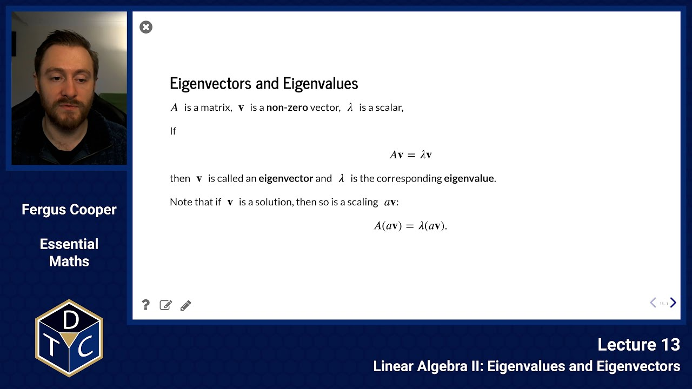
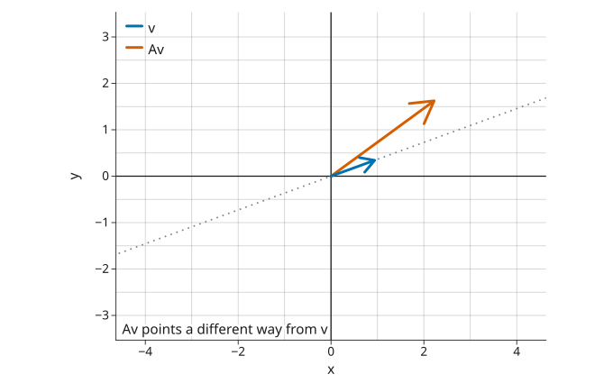
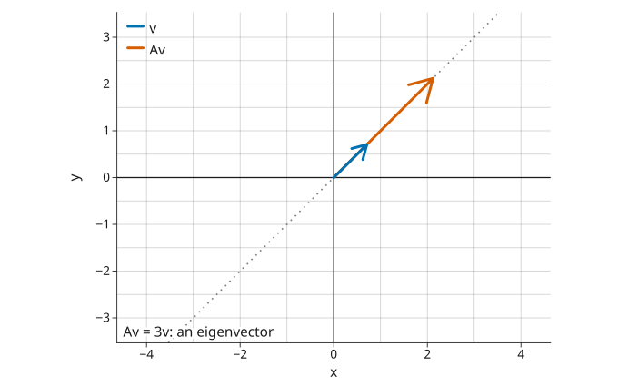

---

## YouTube lecture recording from October 2020

A recording of this lecture from October 2020; the material has changed a little since.

[](https://youtu.be/D_aYtsfmBYo)

---

## Why eigenvalues?

In lecture 12 we wrote systems of linear equations as $A\mathbf{x} = \mathbf{b}$, and solved them by inverting $A$, as long as $A$ is not singular.

In this lecture we look more closely at singular matrices: why they have no inverse, and what that means for the equations.
Then we meet the **eigenvalues** and **eigenvectors** of a matrix.
Multiplying a vector by a matrix usually changes its direction, but the eigenvectors are special directions that the matrix only stretches, and the eigenvalues say by how much.

In lectures 14 to 16, eigenvalues let us solve systems of differential equations, and decide whether their steady states are stable.

## Using Python to calculate the inverse

In lecture 12 we solved $A\mathbf{x} = \mathbf{b}$ directly with `np.linalg.solve`.
We can also calculate the inverse itself.
To find $A^{-1}$ for

$$
A = \begin{pmatrix}3&0&2\\ 3&0&-3\\ 0&1&1\end{pmatrix}
$$

### NumPy

```python
import numpy as np

A = np.array([[3, 0, 2], [3, 0, -3], [0, 1, 1]])
np.linalg.inv(A)
```

```text
array([[ 0.2       ,  0.13333333,  0.        ],
       [-0.2       ,  0.2       ,  1.        ],
       [ 0.2       , -0.2       , -0.        ]])
```

The $-0.$ in the bottom right is a tiny negative rounding error, like the ones we saw in lecture 12: the exact value is $0$, as SymPy shows.

### SymPy

```python
import sympy as sp

A = sp.Matrix([[3, 0, 2], [3, 0, -3], [0, 1, 1]])
A.inv()
```

$$
\def\arraystretch{1.8}\left[\begin{matrix}\frac{1}{5} & \frac{2}{15} & 0\\- \frac{1}{5} & \frac{1}{5} & 1\\\frac{1}{5} & - \frac{1}{5} & 0\end{matrix}\right]
$$

## It doesn't always work

Consider the following system

$$
\begin{array}{cccccccc}
eq1: &  x & + & y & + & z & =  & a \\
eq2: & 2x & + & 5y & + &  2z &  = & b \\
eq3: & 7x & +&  10y  & + & 7z &  = &  c
\end{array}
$$

```python nolint
A = np.array([[1, 1, 1], [2, 5, 2], [7, 10, 7]])
np.linalg.inv(A)
```

```text
numpy.linalg.LinAlgError: Singular matrix
```

The matrix is singular because the equations are not independent: the left-hand side of $eq3$ is $5\times eq1 + eq2$, since $5\times(x + y + z) + (2x + 5y + 2z) = 7x + 10y + 7z$.
So $eq3$ tells us nothing new, and really there are only two equations for three unknowns.

## Singular matrices

The **rank** of an $n\times n$ matrix $A$ is the number of linearly independent rows in $A$ (rows that are not combinations of other rows).
In the example above, the third row is a combination of the first two, so the rank is 2.

When $\text{rank}(A) < n$:

- the system $A\mathbf{x} = \mathbf{b}$ has fewer _independent_ equations than unknowns;
- the matrix is said to be singular;
- $A$ has no inverse;
- the determinant of $A$ is 0;
- the equation $A\mathbf{u} = \mathbf{0}$ has non-trivial solutions (solutions where $\mathbf{u} \neq \mathbf{0}$).

### Singular matrix example

With too few independent equations, there may be **many solutions** or **no solutions**.
An example with many solutions is

$$
\begin{aligned}
x+y &= 1,\\
2x+2y &= 2.
\end{aligned}
$$

The second equation is just twice the first, so in the picture from lecture 12 the two lines are the same line, and every point on it is a solution: for example $x=0$, $y=1$, or $x=2$, $y=-1$, or $x=-89.3$, $y=90.3$.

An example with no solutions is

$$
\begin{aligned}
x+y &= 1,\\
2x+2y &= 0,
\end{aligned}
$$

where the second equation is inconsistent with the first (it says $x + y = 0$): the two lines are parallel, and never cross.

Both examples use the matrix

$$
\begin{pmatrix}1&1\\ 2&2\end{pmatrix},
$$

which has rank 1, and determinant $1\times 2 - 1\times 2 = 0$.
Whether there are many solutions or none depends on the right-hand side, but with a singular matrix there is never exactly one.

## Null space

When a matrix is singular we can find non-trivial solutions to $A\mathbf{u} = \mathbf{0}$.
These vectors form the **null space** of $A$.

Any vector in the null space makes no difference to the effect that $A$ is having:

$$
A(\mathbf{x} + \mathbf{u}) = A\mathbf{x} + A\mathbf{u} = A\mathbf{x} + \mathbf{0} = A\mathbf{x}.
$$

So if $\mathbf{x}$ is a solution of $A\mathbf{x} = \mathbf{b}$, then so is $\mathbf{x} + \mathbf{u}$, which is why a singular system can have many solutions.

Any combination or scaling of vectors in the null space is also in the null space.
That is, if $A\mathbf{u} = \mathbf{0}$ and $A\mathbf{v} = \mathbf{0}$ then

$$
A(\alpha\mathbf{u} + \beta\mathbf{v}) = \alpha A\mathbf{u} + \beta A\mathbf{v} = \mathbf{0}.
$$

The number of linearly independent vectors in the null space is denoted $\text{null}(A)$, and for an $n\times n$ matrix

$$
\text{null}(A) + \text{rank}(A) = n.
$$

### Null space example

Our singular system has the matrix

$$
A = \left(\begin{matrix} 1& 1& 1\\ 2& 5& 2\\ 7& 10&7 \end{matrix}\right).
$$

To find its null space by hand, we solve $A\mathbf{u} = \mathbf{0}$ with $\mathbf{u} = (x, y, z)^T$.
The third row is a combination of the first two, so it adds nothing new, and we only need the first two rows:

$$
\begin{aligned}
x + y + z &= 0, \\
2x + 5y + 2z &= 0.
\end{aligned}
$$

Subtracting twice the first equation from the second gives $3y = 0$, so $y = 0$, and then the first equation gives $x = -z$.
So the null space is all the multiples of $(1, 0, -1)^T$: one independent vector, so $\text{null}(A) = 1$, and $\text{rank}(A) = 3 - 1 = 2$.

In Python, `np.linalg.matrix_rank` gives the rank, and `scipy.linalg.null_space` gives the null space:

```python
A = np.array([[1, 1, 1], [2, 5, 2], [7, 10, 7]])
print(np.linalg.matrix_rank(A))
```

```text
2
```

```python
import scipy.linalg

scipy.linalg.null_space(A)
```

```text
array([[-7.07106781e-01],
       [-1.11022302e-16],
       [ 7.07106781e-01]])
```

This is $(-1, 0, 1)^T/\sqrt{2}$: a multiple of $(1, 0, -1)^T$, scaled to have length 1 (see normalised vectors below).
The $-1.1\times 10^{-16}$ is a rounding error, and should be $0$.

Scaled vectors in the null space are also in the null space, so for example $x=-1000$, $y=0$, $z=1000$ is in it too.
Try it:

$$
\left(\begin{matrix} 1& 1& 1\\ 2& 5& 2\\ 7& 10&7 \end{matrix}\right) \left(\begin{matrix} -1000\\ 0 \\ 1000 \end{matrix}\right) = \quad ?
$$

```python
A @ np.array([-1000, 0, 1000])
```

```text
array([0, 0, 0])
```

## Eigenvectors and eigenvalues

We now turn from singular matrices to the eigenvalues and eigenvectors of a matrix.

### Motivation

Multiplying a vector by a matrix usually changes its direction as well as its length.
For example, take the matrix from lecture 12's note on the determinant,

$$
A = \left(\begin{matrix} 2& 1 \\ 1&2\end{matrix}\right).
$$

Below, $\mathbf{v}$ (blue) is a vector of length 1 at an angle of $\pi/8$ radians to the $x$ axis, and $A\mathbf{v}$ (orange) points in a different direction from it (the dotted line extends $\mathbf{v}$):



As $\mathbf{v}$ turns, $A\mathbf{v}$ mostly points a different way.
But along two special directions, $A\mathbf{v}$ is just a multiple of $\mathbf{v}$.
At an angle of $\pi/4$, $\mathbf{v} = (1, 1)^T/\sqrt{2}$, and $A\mathbf{v} = 3\mathbf{v}$:



At an angle of $3\pi/4$, $\mathbf{v} = (-1, 1)^T/\sqrt{2}$, and $A\mathbf{v} = \mathbf{v}$.
These two directions are the **eigenvectors** of $A$, and the multiples, $3$ and $1$, are its **eigenvalues**.

So eigenvalues and eigenvectors give an indication of how much effect a matrix has, and in what direction.
Two more examples:

$$
B=\left(\begin{matrix} 2& 0 \\ 0&\frac{1}{2}\end{matrix}\right)
$$

doubles in $x$, but halves in $y$.
Its eigenvectors are along the axes, $(1, 0)^T$ and $(0, 1)^T$, with eigenvalues $2$ and $\frac{1}{2}$, and repeated applications of $B$ move points towards $(\pm\infty, 0)$.

$$
R=\left(\begin{matrix} \cos \frac{\pi}{4}&-\sin \frac{\pi}{4}\\ \sin \frac{\pi}{4}&\cos \frac{\pi}{4}\end{matrix}\right)
$$

rotates every vector by $\pi/4$ radians, and leaves its length unchanged.
It leaves no direction unchanged, so it has no real eigenvectors: its eigenvalues are complex numbers, $\frac{1}{\sqrt 2}(1 \pm i)$, and we will meet complex eigenvalues again in lecture 16.

### Where eigenvalues are used

In lectures 14 to 16, eigenvalues and eigenvectors let us solve systems of linear differential equations, and decide whether the steady states of nonlinear ones are stable.

They appear across biology and beyond.
For example, the long-term growth rate of a population with several age classes is the largest eigenvalue of its (Leslie) matrix.
The long-term state of a Markov chain, such as a model of a molecule switching between conformations, is an eigenvector of its matrix of transition probabilities.
Principal component analysis finds the directions of greatest variation in data, such as gene expression measurements, as eigenvectors.

### Definition

If $A$ is a square matrix, $\mathbf{v}$ is a **non-zero** vector, $\lambda$ is a scalar, and

$$
A \mathbf{v} = \lambda \mathbf{v}
$$

then $\mathbf{v}$ is called an **eigenvector** and $\lambda$ is the corresponding **eigenvalue**.

If $\mathbf{v}$ is an eigenvector, then so is any scaling $a\mathbf{v}$ (with $a \neq 0$):

$$
A (a \mathbf{v}) = a A\mathbf{v} = a\lambda\mathbf{v} = \lambda (a \mathbf{v}).
$$

So an eigenvector is really a direction, and we can choose any non-zero vector along it.

## Finding eigenvalues

We can rearrange the equation for an eigenvector, using $I\mathbf{v} = \mathbf{v}$:

$$
\begin{aligned}
A \mathbf{v} &= \lambda \mathbf{v},\\
A \mathbf{v} - \lambda I \mathbf{v} &= \mathbf{0},\\
(A - \lambda I) \mathbf{v} &= \mathbf{0}.
\end{aligned}
$$

If $A - \lambda I$ had an inverse, we could multiply both sides by it to get $\mathbf{v} = (A - \lambda I)^{-1}\mathbf{0} = \mathbf{0}$.
But an eigenvector is non-zero, so $A - \lambda I$ must be singular, and its determinant must be zero:

$$
|A-\lambda I|=0.
$$

This equation gives the eigenvalues.
In the picture from lecture 12, it says that $A - \lambda I$ squashes the plane flat, sending a whole direction of non-zero vectors to $\mathbf{0}$: that direction is the eigenvector.

### Example

What are the eigenvalues of this matrix?

$$
A=\left(\begin{matrix}-2&-2\\ 1&-5\end{matrix}\right)
$$

$$
\begin{aligned}
|A-\lambda I| &=\left\vert\begin{matrix}-2-\lambda&-2\\ 1&-5-\lambda\end{matrix}\right\vert=(-2-\lambda)(-5-\lambda)-(-2) \\
&=10+5\lambda+2\lambda+\lambda^2+2 \\
&=\lambda^2+7\lambda+12=(\lambda+3)(\lambda+4)=0
\end{aligned}
$$

So the eigenvalues are $\lambda_1=-3$ and $\lambda_2=-4$.

### Eigenvalues using Python

NumPy's `np.linalg.eig` finds the eigenvalues and eigenvectors together:

```python
A = np.array([[-2, -2], [1, -5]])
eigenvalues, eigenvectors = np.linalg.eig(A)
eigenvalues
```

```text
array([-3.+0.j, -4.+0.j])
```

The `+0.j` shows that NumPy has stored the eigenvalues as complex numbers, each with imaginary part zero.

In SymPy, `eigenvals` gives each eigenvalue, and how many times it is repeated:

```python
A = sp.Matrix([[-2, -2], [1, -5]])
A.eigenvals()
```

$$
\left\{ -4 : 1, \  -3 : 1\right\}
$$

## Finding eigenvectors

For each eigenvalue, the corresponding eigenvector comes from substituting into $A \mathbf{v} = \lambda \mathbf{v}$.

### Example

What are the eigenvectors of

$$
A=\left(\begin{matrix}-2&-2\\ 1&-5\end{matrix}\right)?
$$

The eigenvalues are $\lambda_1=-3$ and $\lambda_2=-4$, and we write $\mathbf{v} = (x, y)^T$.
For $\lambda_1=-3$:

$$
\left(\begin{matrix}-2&-2\\ 1&-5\end{matrix}\right) \left(\begin{matrix}x\\ y\end{matrix}\right) = \left(\begin{matrix}-3x\\ -3y\end{matrix}\right).
$$

The top row says $-2x - 2y = -3x$, so $x = 2y$.
The bottom row says $x - 5y = -3y$, which also gives $x = 2y$: because $A - \lambda I$ is singular, the two rows always agree.
So any vector with $x = 2y$ is an eigenvector:

$$
\mathbf{v}_1 = \left(\begin{matrix}2 \\ 1\end{matrix}\right), \left(\begin{matrix}1 \\ 0.5\end{matrix}\right), \left(\begin{matrix}-4.4 \\ -2.2\end{matrix}\right), \left(\begin{matrix}2\alpha \\ \alpha\end{matrix}\right)\ldots
$$

For $\lambda_2=-4$, the top row says $-2x - 2y = -4x$, so $x = y$, and

$$
\mathbf{v}_2 = \left(\begin{matrix}1 \\ 1\end{matrix}\right)
$$

or any multiple of it.

### Normalised vectors

The length (or magnitude) of a vector $\mathbf{v} = (x, y, z)^T$ is

$$
\lVert\mathbf{v}\rVert = \sqrt{x^2+y^2+z^2},
$$

and similarly for vectors of any size.
Dividing a vector by its length gives the **normalised** vector, which points the same way and has length 1:

$$
\frac{\mathbf{v}}{\lVert\mathbf{v}\rVert} = \frac{1}{\sqrt{x^2+y^2+z^2}}\left(\begin{matrix}x\\ y\\ z\end{matrix}\right).
$$

For example, $\mathbf{v}_1 = (2, 1)^T$ has length $\sqrt{2^2 + 1^2} = \sqrt{5}$, so normalised it is $(2, 1)^T/\sqrt{5} = (0.894, 0.447)^T$.

### Eigenvectors in Python

NumPy gives the eigenvectors as the columns of a matrix, normalised:

```python
eigenvectors
```

```text
array([[0.89442719+0.j, 0.70710678+0.j],
       [0.4472136 +0.j, 0.70710678+0.j]])
```

These are $(2, 1)^T/\sqrt{5}$ and $(1, 1)^T/\sqrt{2}$, in the same order as the eigenvalues $-3$ and $-4$.

SymPy's `eigenvects` gives each eigenvalue, how many times it is repeated, and a list of its eigenvectors:

```python
A.eigenvects()
```

$$
\left[ \left( -4, \  1, \  \left[ \left[\begin{matrix}1\\1\end{matrix}\right]\right]\right), \  \left( -3, \  1, \  \left[ \left[\begin{matrix}2\\1\end{matrix}\right]\right]\right)\right]
$$

## Diagonalising matrices

Suppose an $n\times n$ matrix $A$ has $n$ linearly independent eigenvectors $\mathbf{v}_1, \ldots, \mathbf{v}_n$, with eigenvalues $\lambda_1, \ldots, \lambda_n$.
Put the eigenvectors in the columns of a matrix $P$, and the eigenvalues on the diagonal of a diagonal matrix $D$:

$$
P = \left(\begin{matrix}\mathbf{v}_1 & \cdots & \mathbf{v}_n\end{matrix}\right), \qquad
D = \left(\begin{matrix}\lambda_1 & & 0\\ & \ddots & \\ 0 & & \lambda_n\end{matrix}\right).
$$

Then $AP = PD$, because column $i$ of each side is $A\mathbf{v}_i = \lambda_i\mathbf{v}_i$.
The eigenvectors are independent, so $P$ has an inverse, and

$$
A = P D P^{-1}.
$$

This separates how much effect the matrix has (the $\lambda_i$) from the directions it acts in (the $\mathbf{v}_i$).

### Example

For our example, with $\mathbf{v}_1 = (2, 1)^T$ and $\mathbf{v}_2 = (1, 1)^T$,

$$
P = \left(\begin{matrix}2&1\\ 1&1\end{matrix}\right), \qquad
D = \left(\begin{matrix}-3&0\\ 0&-4\end{matrix}\right), \qquad
P^{-1} = \left(\begin{matrix}1&-1\\ -1&2\end{matrix}\right),
$$

using the formula for the inverse of a 2x2 matrix ($|P| = 1$).
Multiplying out:

$$
\begin{aligned}
PDP^{-1} &= \left(\begin{matrix}-6&-4\\ -3&-4\end{matrix}\right)\left(\begin{matrix}1&-1\\ -1&2\end{matrix}\right) \\
&= \left(\begin{matrix}-2&-2\\ 1&-5\end{matrix}\right) = A.
\end{aligned}
$$

In Python:

```python
P = eigenvectors
D = np.diag(eigenvalues)
P @ D @ np.linalg.inv(P)
```

```text
array([[-2.+0.j, -2.+0.j],
       [ 1.+0.j, -5.+0.j]])
```

NumPy's $P$ has normalised columns, so it is not the same as ours, but any (non-zero) scaling of the eigenvectors works.

### Why diagonalise?

Powers of $A$ become easy, because each $P^{-1}P$ in the middle cancels:

$$
A^k = (PDP^{-1})(PDP^{-1})\cdots(PDP^{-1}) = PD^kP^{-1},
$$

and the power of a diagonal matrix is just the powers of its diagonal elements:

$$
D^k = \left(\begin{matrix}\lambda_1^k&0\\ 0&\lambda_2^k\end{matrix}\right).
$$

In lecture 14 the same idea uncouples a system of differential equations into separate equations that we can solve one at a time.

Not every matrix can be diagonalised.
For example,

$$
\left(\begin{matrix}1&1\\ 0&1\end{matrix}\right)
$$

has the repeated eigenvalue $1$, but only one eigenvector direction, $(1, 0)^T$, so there are not enough eigenvectors to make $P$.
Whether a matrix can be diagonalised has nothing to do with whether it is singular: this matrix has determinant $1$, while a singular matrix such as $\left(\begin{smallmatrix}1&0\\0&0\end{smallmatrix}\right)$ is already diagonal.

## Symmetric matrices

Symmetric matrices have especially simple eigenvectors, which are at right angles to each other.
To say this precisely we need the dot product.

### Orthogonal vectors

The **dot** (or scalar) product of two vectors multiplies them element by element and adds up the results.
For example,

$$
\mathbf{x}_1\cdot\mathbf{x}_2=\left(\begin{matrix}2\\ -1\\ 3\end{matrix}\right)\cdot\left(\begin{matrix}2\\ 7\\ 1\end{matrix}\right)=2\times 2+(-1\times 7)+(3\times1)=4-7+3=0.
$$

If the dot product of two vectors is zero, they are perpendicular, or **orthogonal**.
So here $\mathbf{x}_1$ and $\mathbf{x}_2$ are orthogonal.

The dot product of a vector with itself is its length squared: $\mathbf{v}\cdot\mathbf{v} = \lVert\mathbf{v}\rVert^2$.
In matrix form, the dot product of two column vectors is $\mathbf{x}_1\cdot\mathbf{x}_2 = \mathbf{x}_1^T\mathbf{x}_2$.

### Symmetric matrices have orthogonal eigenvectors

A matrix is **symmetric** if it is equal to its transpose, $A^T = A$.
Symmetric matrices have real eigenvalues, and their eigenvectors (for different eigenvalues) are orthogonal.
For example,

$$
A=\left(\begin{matrix}19&20&-16\\ 20&13&4 \\ -16&4&31\end{matrix}\right)
$$

is symmetric.
For a symmetric matrix, NumPy has `np.linalg.eigh`, which is faster and more accurate than `eig`, gives real results, and gives the eigenvalues in increasing order:

```python
A = np.array([[19, 20, -16], [20, 13, 4], [-16, 4, 31]])
eigenvalues, P = np.linalg.eigh(A)
print(eigenvalues)
print(P)

# The eigenvectors are orthogonal and normalised, so P^T P = I
print(np.round(P.T @ P, 12))
```

```text
[-9. 27. 45.]
[[ 0.66666667 -0.33333333  0.66666667]
 [-0.66666667 -0.66666667  0.33333333]
 [ 0.33333333 -0.66666667 -0.66666667]]
[[1. 0. 0.]
 [0. 1. 0.]
 [0. 0. 1.]]
```

Element $(i, j)$ of $P^TP$ is the dot product of eigenvectors $i$ and $j$.
So the 1s on the diagonal say that each eigenvector has length 1, and the 0s elsewhere say that each pair is orthogonal.
We round to 12 decimal places, because without rounding the 0s come out as rounding errors of about $10^{-16}$.

### Orthogonal matrices

A matrix is **orthogonal** if its columns are normalised, orthogonal vectors.
As we have just seen, if $M$ is orthogonal then $M^TM=I$, so

$$
M^{-1} = M^T.
$$

For a symmetric matrix, we can choose normalised eigenvectors, so $P$ is orthogonal, and the diagonalising equation is simplified:

$$
A = PDP^{-1} = PDP^T.
$$

## Summary

1. A singular matrix has rank less than its size: some of its equations are combinations of others, and $A\mathbf{x} = \mathbf{b}$ has many solutions or none.
1. The null space of $A$ is the set of solutions of $A\mathbf{u} = \mathbf{0}$.
1. An eigenvector of $A$ is a non-zero vector with $A\mathbf{v} = \lambda\mathbf{v}$: find the eigenvalues from $|A - \lambda I| = 0$, then each eigenvector by substitution.
1. A matrix with a full set of independent eigenvectors can be diagonalised, $A = PDP^{-1}$; we will use this for systems of differential equations.
1. Symmetric matrices have orthogonal eigenvectors, and $A = PDP^T$.
1. In Python: `np.linalg.inv`, `np.linalg.matrix_rank`, `scipy.linalg.null_space`, `np.linalg.eig` and `np.linalg.eigh`, and SymPy's `inv`, `eigenvals` and `eigenvects`.

## Introductory problems

:::callout{variant="tip"}
For more practice, an AI tool can write new problems like the ones below.
Ask it for problems of the same type and difficulty, or for problems set in your own field.
For example, you could ask it to "write five physics problems on eigenvalues and eigenvectors, at the level of these ones".
Work them on paper first, then ask the tool to check your answers and to explain any step you are unsure of.
:::

::::challenge{id="13_intro_01" title="Introductory problems 1"}
Given

$$
A = \left(\begin{array}{cc} 1 & 0 \\ 0 & i \end{array}\right); \qquad
B = \left(\begin{array}{cc} 0 & i \\ i & 0 \end{array}\right); \qquad
C = \left(\begin{array}{cc} \frac{1}{\sqrt{2}} & \frac{1}{2}\left(1-i\right) \\\frac{1}{2}\left(1+i\right) & -\frac{1}{\sqrt{2}} \end{array}\right);
$$

verify by hand, and using the `numpy.linalg` module, that

1. $AA^{-1}=A^{-1}A =I$;
1. $BB^{-1}=B^{-1}B =I$;
1. $CC^{-1}=C^{-1}C =I$;

```python
# hint
import numpy as np

# In Python the imaginary unit is "1j"
A = np.array([[1, 0], [0, 1j]])

print(A @ np.linalg.inv(A))
```

:::solution

By hand, we use the formula for the inverse of a $2\times 2$ matrix:

$$
\left(\begin{array}{cc} a & b \\ c & d \end{array}\right)^{-1} = \frac{1}{ad-bc}\left(\begin{array}{cc} d & -b \\ -c & a \end{array}\right)
$$

1. $|A| = 1\times i - 0 = i$, so

   $$
   A^{-1} = \frac{1}{i}\left(\begin{array}{cc} i & 0 \\ 0 & 1 \end{array}\right) = \left(\begin{array}{cc} 1 & 0 \\ 0 & -i \end{array}\right)
   $$

   since $1/i = -i$.
   Multiplying out, $AA^{-1}$ and $A^{-1}A$ are both diagonal, with diagonal entries $1\times 1 = 1$ and $i\times(-i) = 1$, so they equal $I$.

1. $|B| = 0 - i\times i = 1$, so

   $$
   B^{-1} = \left(\begin{array}{cc} 0 & -i \\ -i & 0 \end{array}\right)
   $$

   Multiplying out,

   $$
   BB^{-1} = \left(\begin{array}{cc} 0 + i\times(-i) & 0 \\ 0 & i\times(-i) + 0 \end{array}\right) = \left(\begin{array}{cc} 1 & 0 \\ 0 & 1 \end{array}\right)
   $$

   and $B^{-1}B = I$ in the same way.

1. $|C| = -\frac{1}{2} - \frac{1}{4}(1-i)(1+i) = -\frac{1}{2} - \frac{2}{4} = -1$, so

   $$
   C^{-1} = -\left(\begin{array}{cc} -\frac{1}{\sqrt{2}} & -\frac{1}{2}(1-i) \\ -\frac{1}{2}(1+i) & \frac{1}{\sqrt{2}} \end{array}\right) = C
   $$

   So, $C$ is its own inverse, and we need to check that $CC = I$.
   The top-left entry is $\frac{1}{2} + \frac{1}{4}(1-i)(1+i) = \frac{1}{2} + \frac{1}{2} = 1$, and the top-right entry is $\frac{1}{\sqrt{2}}\cdot\frac{1}{2}(1-i) - \frac{1}{2}(1-i)\cdot\frac{1}{\sqrt{2}} = 0$.
   The bottom row works in the same way, so $CC = I$.

In Python, note that `*` multiplies matrices element by element, so we use `@` for matrix multiplication:

```python
import numpy as np

A = np.array([[1, 0], [0, 1j]])
B = np.array([[0, 1j], [1j, 0]])
C = np.array([[1 / np.sqrt(2), (1 - 1j) / 2], [(1 + 1j) / 2, -1 / np.sqrt(2)]])

for M in [A, B, C]:
    print(M @ np.linalg.inv(M))
    print(np.linalg.inv(M) @ M)
```

```text
[[1.+0.j 0.+0.j]
 [0.+0.j 1.+0.j]]
[[1.+0.j 0.+0.j]
 [0.+0.j 1.+0.j]]
[[1.+0.j 0.+0.j]
 [0.+0.j 1.+0.j]]
[[1.+0.j 0.+0.j]
 [0.+0.j 1.+0.j]]
[[ 1.00000000e+00+0.00000000e+00j -5.55111512e-17+5.55111512e-17j]
 [-2.29934717e-17+0.00000000e+00j  1.00000000e+00+0.00000000e+00j]]
[[1.00000000e+00+0.00000000e+00j 5.55111512e-17-5.55111512e-17j]
 [0.00000000e+00+0.00000000e+00j 1.00000000e+00+0.00000000e+00j]]
```

For $C$, the off-diagonal entries are about $10^{-17}$ rather than exactly 0.
This is rounding error, because the computer stores numbers such as $1/\sqrt{2}$ to only about 16 significant figures.
`np.allclose(C @ np.linalg.inv(C), np.eye(2))` checks that the result equals $I$ to within this rounding.

:::

::::

::::challenge{id="13_intro_02" title="Introductory problems 2"}
Let A be an $n \times n$ invertible matrix. Let $I$ be the $n\times n$ identity matrix and let $B$ be an $n\times n$ matrix.

Suppose that $ABA^{-1}=I$.
Determine the matrix $B$ in terms of the matrix $A$.

:::solution

Multiply both sides on the right by $A$:

$$
ABA^{-1}A = IA \quad\implies\quad AB = A
$$

Then multiply both sides on the left by $A^{-1}$:

$$
A^{-1}AB = A^{-1}A \quad\implies\quad B = I
$$

So, $B$ is the identity matrix, whatever the matrix $A$.

:::

::::

## Main problems

::::challenge{id="13_main_01" title="Main problems 1"}
Let $A$ be the coefficient matrix of the system of linear equations

$$
\begin{aligned}
-x_1 - 2 x_2 &= 1,\\
2 x_1 + 3 x_2 &= -1.
\end{aligned}
$$

1. Solve the system by finding the inverse matrix $A^{-1}$.
1. Let $\mathbf{x} = (x_1, x_2)^T$ be the solution of the system obtained in part **1.**
   Calculate and simplify $A^{2017} \mathbf{x}$.

:::solution

1. The system is $A\mathbf{x} = \mathbf{b}$, with

   $$
   A = \left(\begin{array}{cc} -1 & -2 \\ 2 & 3 \end{array}\right) \quad\text{and}\quad \mathbf{b} = \left(\begin{array}{c} 1 \\ -1 \end{array}\right)
   $$

   $|A| = -3 + 4 = 1$, so

   $$
   A^{-1} = \left(\begin{array}{cc} 3 & 2 \\ -2 & -1 \end{array}\right) \quad\text{and}\quad \mathbf{x} = A^{-1}\mathbf{b} = \left(\begin{array}{c} 3 - 2 \\ -2 + 1 \end{array}\right) = \left(\begin{array}{c} 1 \\ -1 \end{array}\right)
   $$

1. Multiplying out,

   $$
   A\mathbf{x} = \left(\begin{array}{cc} -1 & -2 \\ 2 & 3 \end{array}\right)\left(\begin{array}{c} 1 \\ -1 \end{array}\right) = \left(\begin{array}{c} 1 \\ -1 \end{array}\right) = \mathbf{x}
   $$

   So, multiplying $\mathbf{x}$ by $A$ leaves it unchanged, and doing this 2017 times still leaves it unchanged:

   $$
   A^{2017}\mathbf{x} = \mathbf{x} = \left(\begin{array}{c} 1 \\ -1 \end{array}\right)
   $$

   In other words, $\mathbf{x}$ is an eigenvector of $A$ with eigenvalue 1.

:::

::::

::::challenge{id="13_main_02" title="Main problems 2"}
For each of the following matrices

$$
\begin{gathered}
A = \left(\begin{array}{cc} 2 & 3 \\ 1 & 4 \end{array}\right); \qquad
B = \left(\begin{array}{cc} 4 & 2 \\ 6 & 8 \end{array}\right); \\
C = \left(\begin{array}{cc} 1 & 4 \\ 1 & 1 \end{array}\right); \qquad
D = \left(\begin{array}{cc} x & 0 \\ 0 & y \end{array}\right),
\end{gathered}
$$

compute the determinant, eigenvalues and eigenvectors by hand.

Check your results by verifying that $Q\mathbf{x} = \lambda_i \mathbf{x}$, where $Q=A$, $B$, $C$ or $D$, and by using the `numpy.linalg` module.

```python
# hint
import numpy as np

A = np.array([[2, 3], [1, 4]])

e_vals, e_vecs = np.linalg.eig(A)

print(e_vals)
print(e_vecs)
```

:::solution

In each case we solve $|Q - \lambda I| = 0$ for the eigenvalues, then substitute each one into $(Q - \lambda I)\mathbf{v} = \mathbf{0}$ to find an eigenvector $\mathbf{v} = (u, v)^T$.
Any multiple of an eigenvector is also an eigenvector.

- **$A$:** $|A| = 8 - 3 = 5$, and

  $$
  |A - \lambda I| = (2-\lambda)(4-\lambda) - 3 = \lambda^2 - 6\lambda + 5 = (\lambda - 1)(\lambda - 5) = 0
  $$

  For $\lambda_1 = 1$, $u + 3v = 0$, so $\mathbf{v}_1 = (-3, 1)^T$.
  For $\lambda_2 = 5$, $-3u + 3v = 0$, so $\mathbf{v}_2 = (1, 1)^T$.
  Check: $A(1, 1)^T = (5, 5)^T = 5(1, 1)^T$.

- **$B$:** $|B| = 32 - 12 = 20$, and

  $$
  \begin{aligned}
  |B - \lambda I| &= (4-\lambda)(8-\lambda) - 12 \\
  &= \lambda^2 - 12\lambda + 20 \\
  &= (\lambda - 2)(\lambda - 10) = 0
  \end{aligned}
  $$

  For $\lambda_1 = 2$, $2u + 2v = 0$, so $\mathbf{v}_1 = (-1, 1)^T$.
  For $\lambda_2 = 10$, $-6u + 2v = 0$, so $\mathbf{v}_2 = (1, 3)^T$.
  Check: $B(1, 3)^T = (10, 30)^T = 10(1, 3)^T$.

- **$C$:** $|C| = 1 - 4 = -3$, and

  $$
  |C - \lambda I| = (1-\lambda)^2 - 4 = \lambda^2 - 2\lambda - 3 = (\lambda - 3)(\lambda + 1) = 0
  $$

  For $\lambda_1 = 3$, $-2u + 4v = 0$, so $\mathbf{v}_1 = (2, 1)^T$.
  For $\lambda_2 = -1$, $2u + 4v = 0$, so $\mathbf{v}_2 = (-2, 1)^T$.
  Check: $C(-2, 1)^T = (2, -1)^T = -1\times(-2, 1)^T$.

- **$D$:** $|D| = xy$.
  $D$ is diagonal, so $|D - \lambda I| = (x - \lambda)(y - \lambda) = 0$, and the eigenvalues are its diagonal entries, $\lambda_1 = x$ and $\lambda_2 = y$.
  The eigenvectors are $\mathbf{v}_1 = (1, 0)^T$ and $\mathbf{v}_2 = (0, 1)^T$, since $D(1, 0)^T = (x, 0)^T$ and $D(0, 1)^T = (0, y)^T$.
  (If $x = y$, every vector is an eigenvector.)

In Python:

```python
import numpy as np

for Q in [np.array([[2, 3], [1, 4]]), np.array([[4, 2], [6, 8]]), np.array([[1, 4], [1, 1]])]:
    e_vals, e_vecs = np.linalg.eig(Q)
    print(np.linalg.det(Q))
    print(e_vals)
    print(e_vecs)
```

```text
5.000000000000001
[1.+0.j 5.+0.j]
[[-0.9486833 +0.j -0.70710678+0.j]
 [ 0.31622777+0.j -0.70710678+0.j]]
19.999999999999996
[ 2.+0.j 10.+0.j]
[[-0.70710678+0.j -0.31622777+0.j]
 [ 0.70710678+0.j -0.9486833 +0.j]]
-3.0000000000000004
[ 3.+0.j -1.+0.j]
[[ 0.89442719+0.j -0.89442719+0.j]
 [ 0.4472136 +0.j  0.4472136 +0.j]]
```

The eigenvalues agree with ours (the `+0.j` shows that their imaginary parts are zero).
The eigenvectors are the _columns_ of `e_vecs`, and NumPy scales each one to have length 1, so they are multiples of ours.
For example, the first column for $A$ is $(-0.949, 0.316)^T = (-3, 1)^T/\sqrt{10}$, and the second is $(-0.707, -0.707)^T = -(1, 1)^T/\sqrt{2}$.
The determinants are not exact whole numbers because of rounding error.

:::

::::

::::challenge{id="13_main_03" title="Main problems 3"}
Orthogonal vectors.

Two vectors $\mathbf{x_1}$ and $\mathbf{x_2}$ are said to be perpendicular or _orthogonal_ if their dot/scalar product is zero:

$$
\mathbf{x_1}.\mathbf{x_2}=\left(\begin{array}{c} 2 \\ -1 \\ 3 \end{array} \right).\left(\begin{array}{c} 2 \\ 7 \\ 1 \end{array} \right)=(2{\times}2)+(-1{\times}7)+(3{\times}1)=4-7+3=0,
$$

thus $\mathbf{x_1}$ and $\mathbf{x_2}$ are orthogonal.

Find vectors that are orthogonal to

$$
\left(\begin{array}{c} 1 \\ 2 \end{array} \right) \quad\text{and}\quad \left(\begin{array}{c} 1 \\ 2 \\ -1 \end{array} \right).
$$

How many such vectors are there?

:::solution

A vector $(a, b)^T$ is orthogonal to $(1, 2)^T$ when

$$
a + 2b = 0, \quad\text{so}\quad a = -2b
$$

So, any vector of the form $t(-2, 1)^T$ is orthogonal to $(1, 2)^T$, for any number $t \neq 0$.
There are infinitely many such vectors, but they all lie along one line.

A vector $(a, b, c)^T$ is orthogonal to $(1, 2, -1)^T$ when

$$
a + 2b - c = 0, \quad\text{so}\quad c = a + 2b
$$

Here we can choose both $a$ and $b$, so the vectors are

$$
\left(\begin{array}{c} a \\ b \\ a + 2b \end{array}\right) = a\left(\begin{array}{c} 1 \\ 0 \\ 1 \end{array}\right) + b\left(\begin{array}{c} 0 \\ 1 \\ 2 \end{array}\right)
$$

for example $(1, 0, 1)^T$, $(0, 1, 2)^T$ or $(-2, 1, 0)^T$.
Again there are infinitely many, but this time they fill a whole plane (the plane through the origin perpendicular to $(1, 2, -1)^T$).

:::

::::

::::challenge{id="13_main_04" title="Main problems 4"}
Diagonalise the $2 \times 2$ matrix

$$
A=\left(\begin{array}{cc} 2 & -1 \\ -1 & 2 \end{array} \right)
$$

by finding a non-singular matrix $S$ and a diagonal matrix $D$ such that $A = SDS^{-1}$.

:::solution

First we find the eigenvalues:

$$
|A - \lambda I| = (2-\lambda)^2 - 1 = \lambda^2 - 4\lambda + 3 = (\lambda - 1)(\lambda - 3) = 0
$$

For $\lambda_1 = 1$, $(A - I)\mathbf{v} = \mathbf{0}$ gives $u - v = 0$, so $\mathbf{v}_1 = (1, 1)^T$.
For $\lambda_2 = 3$, $(A - 3I)\mathbf{v} = \mathbf{0}$ gives $-u - v = 0$, so $\mathbf{v}_2 = (1, -1)^T$.

$S$ has the eigenvectors as its columns, and $D$ has the eigenvalues on its diagonal, in the same order:

$$
S = \left(\begin{array}{cc} 1 & 1 \\ 1 & -1 \end{array}\right), \qquad
D = \left(\begin{array}{cc} 1 & 0 \\ 0 & 3 \end{array}\right), \qquad
S^{-1} = \frac{1}{2}\left(\begin{array}{cc} 1 & 1 \\ 1 & -1 \end{array}\right)
$$

We can check this by multiplying out:

$$
SDS^{-1} = \left(\begin{array}{cc} 1 & 3 \\ 1 & -3 \end{array}\right)\frac{1}{2}\left(\begin{array}{cc} 1 & 1 \\ 1 & -1 \end{array}\right) = \frac{1}{2}\left(\begin{array}{cc} 4 & -2 \\ -2 & 4 \end{array}\right) = A
$$

(Other answers are possible: the eigenvectors can be scaled, or listed in the other order, as long as $D$ matches.)

:::

::::

::::challenge{id="13_main_05" title="Main problems 5"}
Find a $2{\times}2$ matrix $A$ such that

$$
A\left(\begin{array}{c} 2 \\ 1 \end{array} \right) = \left(\begin{array}{c} -1 \\ 4 \end{array} \right)\quad\text{and}\quad A \left(\begin{array}{c} 5 \\ 3\end{array} \right)=\left(\begin{array}{c} 0 \\ 2\end{array} \right).
$$

:::solution

Put the two vectors side by side as the columns of one matrix, and the two results as the columns of another.
Then both conditions together say that

$$
A\left(\begin{array}{cc} 2 & 5 \\ 1 & 3 \end{array}\right) = \left(\begin{array}{cc} -1 & 0 \\ 4 & 2 \end{array}\right)
$$

The determinant of the left-hand matrix is $6 - 5 = 1$, so its inverse is

$$
\left(\begin{array}{cc} 2 & 5 \\ 1 & 3 \end{array}\right)^{-1} = \left(\begin{array}{cc} 3 & -5 \\ -1 & 2 \end{array}\right)
$$

Multiplying both sides on the right by this inverse,

$$
A = \left(\begin{array}{cc} -1 & 0 \\ 4 & 2 \end{array}\right)\left(\begin{array}{cc} 3 & -5 \\ -1 & 2 \end{array}\right) = \left(\begin{array}{cc} -3 & 5 \\ 10 & -16 \end{array}\right)
$$

Check: $A(2, 1)^T = (-6 + 5, 20 - 16)^T = (-1, 4)^T$ and $A(5, 3)^T = (-15 + 15, 50 - 48)^T = (0, 2)^T$.

:::

::::

::::challenge{id="13_main_06" title="Main problems 6"}

Consider the matrices

$$
A = \left(\begin{array}{cc} 2 & 4 \\ 1 & 2 \end{array}\right); \qquad
B = \left(\begin{array}{cc} 1 & 2 \\ 3 & 4 \end{array}\right); \qquad
C = \left(\begin{array}{ccc} 1 & 2 & 3 \\ 2 & 4 & 6 \\ 1 & 1 & 1 \end{array}\right).
$$

1. Calculate the determinant of $A$ and of $B$.
   Which of $A$, $B$ and $C$ are singular?
1. Find the rank of each matrix.
1. For each singular matrix, find a non-zero vector $\mathbf{u}$ in its null space, so that $A\mathbf{u} = \mathbf{0}$ or $C\mathbf{u} = \mathbf{0}$.
1. Without solving them, say whether each of these systems has many solutions or no solutions, and explain why:
   $$
   \begin{aligned} 2x + 4y &= 6,\\ x + 2y &= 3; \end{aligned}
   \qquad\qquad
   \begin{aligned} 2x + 4y &= 6,\\ x + 2y &= 1. \end{aligned}
   $$
1. Check your answers to parts **2.** and **3.** using `numpy.linalg.matrix_rank` and `scipy.linalg.null_space`.

:::solution

1. $|A| = 2\times 2 - 4\times 1 = 0$ and $|B| = 1\times 4 - 2\times 3 = -2$.
   So, $A$ is singular and $B$ is not.
   The second row of $C$ is twice its first row, so $C$ is singular too (and $|C| = 0$).

1. The rows of $A$ are multiples of each other, so $A$ has rank 1.
   $B$ is not singular, so it has rank 2.
   In $C$, the second row is a multiple of the first, but the third row is not a combination of the others, so $C$ has rank 2.

1. For $A$, we need $2u_1 + 4u_2 = 0$ and $u_1 + 2u_2 = 0$, which are the same equation.
   So, $u_1 = -2u_2$, and taking $u_2 = 1$ gives $\mathbf{u} = (-2, 1)^T$.
   Any multiple of this vector is also in the null space.

   For $C$, the first two rows give the same equation, so we need

   $$
   \begin{aligned}
   u_1 + 2u_2 + 3u_3 &= 0,\\
   u_1 + u_2 + u_3 &= 0.
   \end{aligned}
   $$

   Subtracting the second equation from the first gives $u_2 + 2u_3 = 0$, so $u_2 = -2u_3$.
   Then $u_1 = -u_2 - u_3 = u_3$.
   Taking $u_3 = 1$ gives $\mathbf{u} = (1, -2, 1)^T$.

   Check: $C(1, -2, 1)^T = (1 - 4 + 3, 2 - 8 + 6, 1 - 2 + 1)^T = (0, 0, 0)^T$.

1. Both systems use the singular matrix $A$.
   In the first, the first equation is exactly twice the second, so there is really only one equation, $x + 2y = 3$, and it has infinitely many solutions (for example $x = 3$, $y = 0$, or $x = 1$, $y = 1$).
   In the second, twice the second equation gives $2x + 4y = 2$, which contradicts the first equation, so there are no solutions.

1. In Python:

   ```python
   import numpy as np
   import scipy.linalg

   A = np.array([[2, 4], [1, 2]])
   B = np.array([[1, 2], [3, 4]])
   C = np.array([[1, 2, 3], [2, 4, 6], [1, 1, 1]])

   for M in [A, B, C]:
       print(np.linalg.matrix_rank(M))
       print(scipy.linalg.null_space(M))
   ```

   ```text
   1
   [[-0.89442719]
    [ 0.4472136 ]]
   2
   []
   2
   [[ 0.40824829]
    [-0.81649658]
    [ 0.40824829]]
   ```

   The null space of $B$ is empty, as it should be for a matrix that is not singular.
   SciPy returns vectors of unit length, so they are scaled versions of ours: $(-2, 1)^T/\sqrt{5}$ and $(1, -2, 1)^T/\sqrt{6}$.

:::

::::

## Extension problems

::::challenge{id="13_ext_01" title="Extension problems 1"}
If there exists a matrix $M$ whose columns are those of normalised (unit length) and orthogonal vectors, prove that $M^TM=I$ which implies that $M^T=M^{-1}$.

:::solution

Let $M$ be an $n\times n$ matrix with columns $\mathbf{c}_1, \mathbf{c}_2, \ldots, \mathbf{c}_n$.
The rows of $M^T$ are then $\mathbf{c}_1^T, \mathbf{c}_2^T, \ldots, \mathbf{c}_n^T$.
The entry in row $i$ and column $j$ of $M^TM$ is row $i$ of $M^T$ times column $j$ of $M$, which is the dot product $\mathbf{c}_i\cdot\mathbf{c}_j$:

$$
M^TM = \left(\begin{array}{cccc}
\mathbf{c}_1\cdot\mathbf{c}_1 & \mathbf{c}_1\cdot\mathbf{c}_2 & \cdots & \mathbf{c}_1\cdot\mathbf{c}_n \\
\mathbf{c}_2\cdot\mathbf{c}_1 & \mathbf{c}_2\cdot\mathbf{c}_2 & \cdots & \mathbf{c}_2\cdot\mathbf{c}_n \\
\vdots & \vdots & \ddots & \vdots \\
\mathbf{c}_n\cdot\mathbf{c}_1 & \mathbf{c}_n\cdot\mathbf{c}_2 & \cdots & \mathbf{c}_n\cdot\mathbf{c}_n
\end{array}\right)
$$

The columns have unit length, so $\mathbf{c}_i\cdot\mathbf{c}_i = 1$, and each pair is orthogonal, so $\mathbf{c}_i\cdot\mathbf{c}_j = 0$ for $i\neq j$.
So, every diagonal entry is 1 and every other entry is 0, which means that $M^TM = I$.

By definition, $M^{-1}$ is the matrix that multiplies $M$ to give $I$, so $M^T = M^{-1}$.
(For a square matrix, if $M^TM = I$ then $MM^T = I$ too.)

:::

::::
