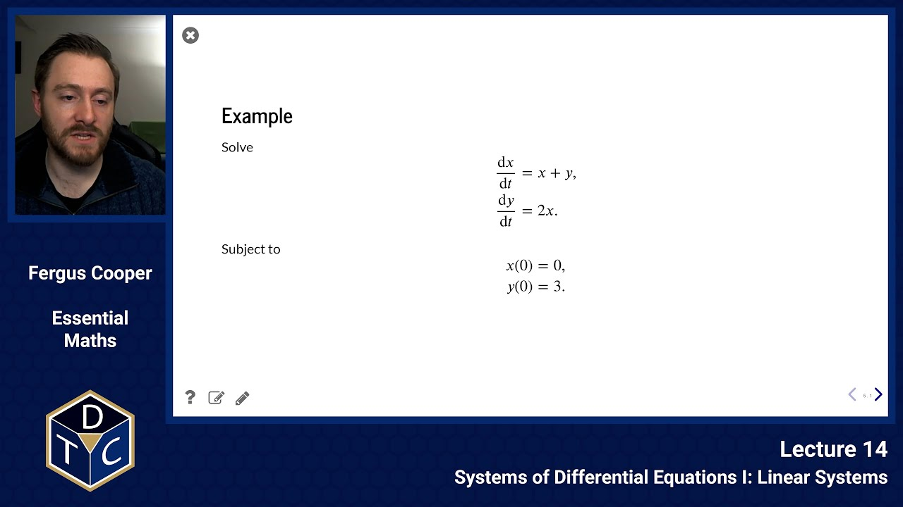
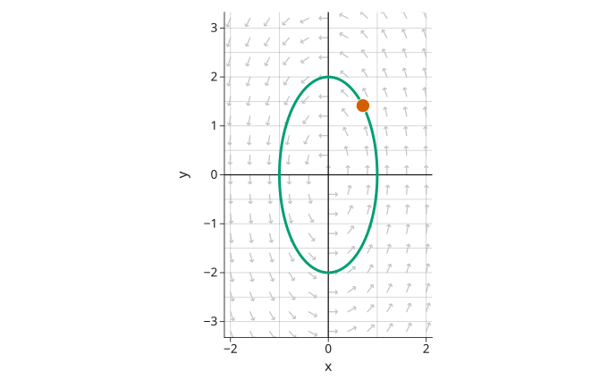
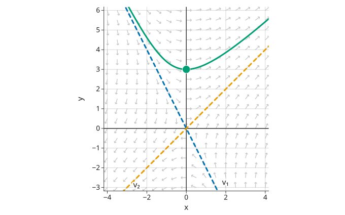

---

## YouTube lecture recording from October 2020

A recording of this lecture from October 2020; the material has changed a little since.

[](https://youtu.be/B9DWIGrRkLE)

---

## Why systems of differential equations?

In lectures 9 to 11 we solved differential equations for a single quantity, such as a population or a concentration.
Most biological systems have several quantities that change together, each affecting the others.
For example:

- predators and prey, in the [Lotka-Volterra](https://en.wikipedia.org/wiki/Lotka%E2%80%93Volterra_equations) model
- the susceptible, infected and recovered in an epidemic, in the [SIR model](https://en.wikipedia.org/wiki/Compartmental_models_in_epidemiology)
- the species in a [chemical reaction network](https://en.wikipedia.org/wiki/Chemical_reaction_network_theory)
- the ion channels in a [heart cell](http://www.scholarpedia.org/article/Models_of_cardiac_cell)

These give **systems** of differential equations, of the form

$$
\frac{dy_i}{dt} = f_i(y_1,\ldots,y_n,t),
$$

for $i=1,\ldots,n$, where the rate of change of each quantity can depend on all of the others.

In order to understand these systems, we must first understand coupled linear systems.
In this lecture we solve them using the eigenvalues and eigenvectors from lecture 13, and in lectures 15 and 16 we use them to understand nonlinear systems.

## Recap: eigenvalues and eigenvectors

We will use the matrix

$$
A = \left(\begin{matrix} 1 & 1\\2 & 0 \end{matrix}\right)
$$

throughout this lecture.
SymPy gives its eigenvalues (each with its multiplicity):

```python
import sympy as sp
A = sp.Matrix([[1, 1], [2, 0]])
A.eigenvals()
```

$$
\left\{ -1 : 1, \  2 : 1\right\}
$$

and its eigenvectors (each with its eigenvalue and multiplicity):

```python
A.eigenvects()
```

$$
\def\arraystretch{1.8}\left[ \left( -1, \  1, \  \left[ \left[\begin{matrix}- \frac{1}{2}\\1\end{matrix}\right]\right]\right), \  \left( 2, \  1, \  \left[ \left[\begin{matrix}1\\1\end{matrix}\right]\right]\right)\right]
$$

So $\lambda_1 = -1$, with eigenvector $\mathbf{v}_1 = (-1/2, 1)^T$, and $\lambda_2 = 2$, with eigenvector $\mathbf{v}_2 = (1, 1)^T$.

## Recap: diagonalisation

Recall that if a matrix $A$ has **eigenvectors** $\mathbf{v}_1$ and $\mathbf{v}_2$, with **eigenvalues** $\lambda_1$ and $\lambda_2$, then with the eigenvectors in the columns of $P$ and the eigenvalues on the diagonal of $D$,

$$
A = PDP^{-1}, \qquad P = \left(\begin{matrix} \mathbf{v}_1 & \mathbf{v}_2 \end{matrix}\right), \qquad D = \left(\begin{matrix} \lambda_1 & 0 \\ 0 & \lambda_2 \end{matrix}\right).
$$

(This is also true for general $n \times n$ matrices with a full set of eigenvectors.)

In our example,

$$
P = \left(\begin{matrix} -\frac{1}{2} & 1 \\ 1 & 1 \end{matrix}\right),\qquad D = \left(\begin{matrix} -1 & 0 \\ 0 & 2 \end{matrix}\right).
$$

## Coupled ODEs

The simplest system is a $2\times2$ **linear** system, of the form

$$
\begin{aligned}
\frac{dx}{dt} &= ax+by,\\
\frac{dy}{dt} &= cx+dy,
\end{aligned}
$$

where $a$, $b$, $c$ and $d$ are constants.
The two equations are **coupled**: the rate of change of $x$ depends on $y$, and the rate of change of $y$ depends on $x$, so we cannot solve either equation on its own.

We have three methods of analysing them mathematically:

1. Turn them into one second order equation
2. Divide one by the other, to get one equation independent of $t$
3. Perform matrix diagonalisation (extends to $n \times n$ problems)

We will use each of them on the same example.

## Example

Solve

$$
\frac{dx}{dt} = x+y, \qquad \frac{dy}{dt} = 2x,
$$

subject to $x(0) = 0$ and $y(0) = 3$.

## Method 1: second order

We start with

$$
\begin{aligned}
\frac{dx}{dt} &= x+y,\\
\frac{dy}{dt} &= 2x.
\end{aligned}
$$

Differentiate the first equation, and use the second to replace $dy/dt$:

$$
\frac{d^2x}{dt^2} = \frac{dx}{dt} + \frac{dy}{dt} = \frac{dx}{dt} + 2x.
$$

This is one second order equation for $x$ alone.
Once we have found $x$, the first equation gives $y = dx/dt - x$.

:::callout{variant="note"}
**Solving the second order equation**

We have not covered equations like this one elsewhere in the course, but they can be solved directly.
In this equation, $x$ and its derivatives are only multiplied by constants, so we can try a solution of the form $x = e^{\lambda t}$.
Substitute it in, and divide by $e^{\lambda t}$ (which is never zero):

$$
\begin{aligned}
\lambda^2 e^{\lambda t} &= \lambda e^{\lambda t} + 2e^{\lambda t} \\
\lambda^2 - \lambda - 2 &= 0 \\
(\lambda + 1)(\lambda - 2) &= 0
\end{aligned}
$$

So $\lambda = -1$ or $\lambda = 2$.
These are the eigenvalues of $A$, because $|A - \lambda I| = 0$ is the same equation:

$$
|A - \lambda I| = \left|\begin{matrix} 1-\lambda & 1 \\ 2 & -\lambda \end{matrix}\right| = (1 - \lambda)(-\lambda) - 2 = \lambda^2 - \lambda - 2.
$$

Any sum of the two solutions is also a solution, so the general solution is

$$
x = K_1 e^{-t} + K_2 e^{2t},
$$

where $K_1$ and $K_2$ are constants.
Two constants need two conditions.
We have $x(0) = 0$, and from the first equation $dx/dt = x + y = 3$ at $t = 0$:

$$
K_1 + K_2 = 0, \qquad -K_1 + 2K_2 = 3,
$$

so $K_1 = -1$ and $K_2 = 1$.
So $x = e^{2t} - e^{-t}$, and

$$
y = \frac{dx}{dt} - x = \left(2e^{2t} + e^{-t}\right) - \left(e^{2t} - e^{-t}\right) = e^{2t} + 2e^{-t}.
$$

:::

## Method 2: eliminate $t$

We start with

$$
\begin{aligned}
\frac{dx}{dt} &= x+y,\\
\frac{dy}{dt} &= 2x.
\end{aligned}
$$

Then, dividing one by the other:

$$
\frac{dy}{dx} = \frac{dy/dt}{dx/dt}
\qquad\implies\qquad
\frac{dy}{dx} = \frac{2x}{x+y}.
$$

This one equation describes the paths that the solutions follow in the $(x, y)$ plane, but not how fast they move along them, because $t$ no longer appears.

This method is most useful when the new equation is separable.
Here it is not, but it can be solved with the substitution $y = vx$, as the note below shows.

:::callout{variant="note"}
**Solving $dy/dx = 2x/(x+y)$**

With $y = vx$, the product rule gives $dy/dx = v + x\,dv/dx$, so

$$
v + x\frac{dv}{dx} = \frac{2}{1+v}
\qquad\implies\qquad
x\frac{dv}{dx} = \frac{2 - v - v^2}{1+v} = -\frac{(v+2)(v-1)}{1+v}.
$$

This is separable.
Using partial fractions, as in lecture 10,

$$
\begin{aligned}
\int \left(\frac{1}{3(v+2)} + \frac{2}{3(v-1)}\right) dv &= -\int \frac{dx}{x} \\
\frac{1}{3}\ln|v+2| + \frac{2}{3}\ln|v-1| &= -\ln|x| + c
\end{aligned}
$$

Multiplying by 3, taking exponentials, and putting back $v = y/x$, the paths are the curves

$$
(y + 2x)(y - x)^2 = K,
$$

where $K$ is a constant.
With $K = 0$ they include the straight lines $y = -2x$ and $y = x$, which are the directions of the two eigenvectors.
For our example, $x = 0$ and $y = 3$ give $K = 27$.

:::

As an example where eliminating $t$ works well, take the system

$$
\frac{dx}{dt} = -y, \qquad \frac{dy}{dt} = 4x.
$$

Dividing, $dy/dx = -4x/y$, which is separable:

$$
\begin{aligned}
\int y\,dy &= -\int 4x\,dx \\
\frac{1}{2}y^2 &= -2x^2 + c \\
4x^2 + y^2 &= C
\end{aligned}
$$

where $C = 2c$.
These are ellipses, one for each value of $C$.
At $(1, 0)$, $dy/dt = 4 > 0$, so the solutions go round anticlockwise.
The solution that starts at $(1, 0)$ is $x = \cos 2t$, $y = 2\sin 2t$, which goes once round the ellipse with $C = 4$ every $\pi$ units of time.
Below, it is shown at $t = \pi/8$, and the grey arrows show the direction of $(dx/dt, dy/dt)$ at each point:



## Method 3: diagonalisation

Let

$$
\mathbf{x}=\left(\begin{matrix}x\\y\end{matrix}\right).
$$

Then

$$
\frac{dx}{dt} = x+y,\quad
\frac{dy}{dt} = 2x \qquad\implies\qquad \frac{d\mathbf{x}}{dt} = A\mathbf{x},
$$

where $A$ is the matrix from the recap:

$$
A = \left(\begin{matrix} 1 & 1\\2 & 0 \end{matrix}\right).
$$

Substitute $A = PDP^{-1}$:

$$
\begin{aligned}
\frac{d\mathbf{x}}{dt} &= PDP^{-1}\mathbf{x} \\
P^{-1}\frac{d\mathbf{x}}{dt} &= DP^{-1}\mathbf{x} \\
\frac{d}{dt}\left(P^{-1}\mathbf{x}\right) &= D\left(P^{-1}\mathbf{x}\right)
\end{aligned}
$$

To get the second line we multiply both sides on the left by $P^{-1}$.
For the third, $P^{-1}$ is a matrix of constants, so it can move inside the derivative.

We can now introduce a new variable $\mathbf{z} = P^{-1}\mathbf{x}$, so that

$$
\frac{d\mathbf{z}}{dt} = D\mathbf{z}, \qquad\text{or}\qquad
\frac{d}{dt}\left(\begin{matrix} z_1 \\ z_2\end{matrix}\right) = \left(\begin{matrix} \lambda_1 & 0 \\ 0 & \lambda_2 \end{matrix}\right) \left(\begin{matrix} z_1 \\ z_2\end{matrix}\right).
$$

But now, because the matrix is diagonal, the system is no longer coupled.
The first equation **only** involves $z_1$ and the second **only** involves $z_2$, so we can solve each one individually:

$$
\begin{aligned}
\frac{dz_1}{dt} &= \lambda_1 z_1 &&\implies\qquad z_1 = c_1 e^{\lambda_1 t},\\
\frac{dz_2}{dt} &= \lambda_2 z_2 &&\implies\qquad z_2 = c_2 e^{\lambda_2 t},
\end{aligned}
$$

where $c_1$ and $c_2$ are constants.

Finally, we can substitute back to find the solution of the original coupled system.
Since $\mathbf{z} = P^{-1}\mathbf{x}$, we have $\mathbf{x} = P\mathbf{z}$, and the columns of $P$ are the eigenvectors:

$$
\begin{aligned}
\mathbf{x} = P\mathbf{z} &= \left(\begin{matrix} \mathbf{v}_1 & \mathbf{v}_2 \end{matrix}\right) \left(\begin{matrix} z_1 \\ z_2\end{matrix}\right) = z_1\mathbf{v}_1 + z_2\mathbf{v}_2 \\
&= c_1\mathbf{v}_1 e^{\lambda_1 t} + c_2\mathbf{v}_2 e^{\lambda_2 t}
\end{aligned}
$$

So the solution is a sum of the eigenvectors, each growing or shrinking at a rate set by its eigenvalue.
This works in the same way for an $n\times n$ system, with $n$ eigenvectors.
In our example,

$$
\left(\begin{matrix} x \\ y \end{matrix}\right) = c_1\left(\begin{matrix} -\frac{1}{2} \\ 1 \end{matrix}\right) e^{-t} + c_2\left(\begin{matrix} 1 \\ 1 \end{matrix}\right) e^{2t}.
$$

Using our initial conditions, $x(0)=0$ and $y(0)=3$, at $t = 0$:

$$
\left(\begin{matrix} 0 \\ 3 \end{matrix}\right) = c_1\left(\begin{matrix} -\frac{1}{2} \\ 1 \end{matrix}\right) + c_2\left(\begin{matrix} 1 \\ 1 \end{matrix}\right).
$$

So $-c_1/2 + c_2 = 0$ and $c_1 + c_2 = 3$, which gives $c_1 = 2$ and $c_2 = 1$.
Finally, we have a solution:

$$
\begin{aligned}
x(t) &= -e^{-t} + e^{2t},\\
y(t) &= 2e^{-t} + e^{2t}.
\end{aligned}
$$

This is the same solution that method 1 gave.

## The solution in the $(x, y)$ plane

Below, the green curve is the path of this solution, with the dot at $t = 0$.
The grey arrows show the direction of $(dx/dt, dy/dt)$ at each point, and the dashed lines are the directions of the two eigenvectors.



Going back in time, the $e^{-t}$ term is the largest, so the solution comes in along $\mathbf{v}_1$.
As $t$ grows, the $e^{2t}$ term takes over, and the solution heads out along $\mathbf{v}_2$.
In lecture 16 we will see that the eigenvectors and eigenvalues tell us about the paths near a steady state in the same way.

## Checking with SymPy

SymPy can solve the system, initial conditions included:

```python
t = sp.symbols('t')
x, y = sp.symbols('x y', cls=sp.Function)
eqs = [sp.Eq(x(t).diff(t), x(t) + y(t)), sp.Eq(y(t).diff(t), 2 * x(t))]
sp.dsolve(eqs, ics={x(0): 0, y(0): 3})
```

$$
\left[ x{\left(t \right)} = e^{2 t} - e^{- t}, \  y{\left(t \right)} = e^{2 t} + 2 e^{- t}\right]
$$

which agrees with our solution.
Without `ics`, `dsolve` gives the general solution, with constants `C1` and `C2`.

## Summary

1. A coupled system of linear first order differential equations can be solved by turning it into one second order equation, by eliminating $t$ (which gives the paths of the solutions, but not their timing), or by diagonalisation.
1. Diagonalisation extends to $n \times n$ systems, and gives the solution as a sum of the eigenvectors, $\mathbf{x} = c_1\mathbf{v}_1 e^{\lambda_1 t} + c_2\mathbf{v}_2 e^{\lambda_2 t}$, so the eigenvalues set how fast each part grows or shrinks.
1. The best method depends on the system and on what we need to ask about it.
1. In Python, SymPy's `dsolve` solves a system, and can check our answers.

## Introductory problems

:::callout{variant="tip"}
For more practice, an AI tool can write new problems like the ones below.
Ask it for problems of the same type and difficulty, or for problems set in your own field.
For example, you could ask it to "write five ecology problems on systems of linear differential equations, at the level of these ones".
Work them on paper first, then ask the tool to check your answers and to explain any step you are unsure of.
:::

::::challenge{id="14_intro_01" title="Introductory problems 1"}
Find the general solution to the following system of ODEs:

$$
\frac{dx}{dt} = x, \quad\text{and}\quad \frac{dy}{dt}=y.
$$

Sketch the form of the solution in the $x,\,y$ plane, using arrows to indicate where the solution moves over time.

:::solution

The two equations are not coupled, so we can solve each one separately:

$$
\begin{aligned}
\int\frac{dx}{x} = \int dt &\quad\implies\quad x = Ae^{t}, \\
\int\frac{dy}{y} = \int dt &\quad\implies\quad y = Be^{t}
\end{aligned}
$$

where $A$ and $B$ are constants.

Dividing, $y/x = B/A$ is constant, so each solution moves along a straight line through the origin.
Both $x$ and $y$ grow exponentially, so every solution moves directly away from the origin, which is a steady state.

```python
import numpy as np
from matplotlib import pyplot as plt

x, y = np.meshgrid(np.linspace(-2, 2, 21), np.linspace(-2, 2, 21))
plt.streamplot(x, y, x, y)
plt.xlabel('x')
plt.ylabel('y')
```

:::

::::

::::challenge{id="14_intro_02" title="Introductory problems 2"}
Take the general decoupled linear system

$$
\frac{dx}{dt} = ax, \quad\text{and}\quad \frac{dy}{dt} = by.
$$

1. Integrate the two equations separately to solve for $x$ and $y$ in terms of $t$.
1. If you start at $t=0$, $x(0)=0$, $y(0)=0$ what happens to the solution over time?
1. If you start at a general position $x(0)=x_0$, $y(0)=y_0$ what happens to the solution as $t\rightarrow\infty$?
   - What if $a$ and $b$ are both negative?
   - What if only one of $a$ or $b$ is negative? What if either $x_0$ or $y_0$ is negative?
1. Either by eliminating $t$ from the original equations or by eliminating $t$ from your solutions to part **1.**, find a general solution of the system. (Why not try both methods?)
1. Sketch this solution for
   - $a>0$, $b>0$, $a=b$
   - $a>0$, $b<0$, $a=-b$.

:::solution

1. Separating variables in each equation,

   $$
   x = x_0 e^{at} \quad\text{and}\quad y = y_0 e^{bt}
   $$

   where $x_0$ and $y_0$ are the values at $t = 0$.

1. With $x_0 = y_0 = 0$, $x = 0$ and $y = 0$ for all time.
   The origin is a steady state, so the solution stays there.

1. As $t\to\infty$:
   - If $a$ and $b$ are both positive, $x$ and $y$ both grow exponentially, and the solution moves away from the origin.
   - If $a$ and $b$ are both negative, $x$ and $y$ both decay to zero, and the solution approaches the origin.
   - If only $b$ is negative, $y\to 0$ while $x$ grows, so the solution approaches the $x$ axis and moves off towards $x\to\pm\infty$ (and if only $a$ is negative, the same happens with $x$ and $y$ swapped).

   The signs of $x$ and $y$ never change, because $e^{at}$ and $e^{bt}$ are always positive.
   So, if $x_0$ or $y_0$ is negative, the solution behaves in the same way, but stays in the quadrant where it started (for example, it moves towards $x\to -\infty$ if $x_0 < 0$ and $a > 0$).

1. Eliminating $t$ from the original equations,

   $$
   \begin{aligned}
   \frac{dy}{dx} &= \frac{dy/dt}{dx/dt} = \frac{by}{ax} \\
   &\implies \int\frac{dy}{by} = \int\frac{dx}{ax} \\
   &\implies \frac{1}{b}\ln|y| = \frac{1}{a}\ln|x| + C
   \end{aligned}
   $$

   so that $y = Kx^{b/a}$, where $K$ is a constant.

   Alternatively, from part **1.**, $e^{t} = (x/x_0)^{1/a}$, so

   $$
   y = y_0\left(e^{t}\right)^{b} = y_0\left(\frac{x}{x_0}\right)^{b/a}
   $$

   which is the same, with $K = y_0/x_0^{b/a}$.

1. For $a = b > 0$, $y = Kx$, which gives straight lines through the origin, with every solution moving away from it (as in Introductory problems 1).
   For $a = -b > 0$, $y = K/x$, which gives hyperbolas with the axes as asymptotes.
   Here $x$ grows while $y$ decays, so each solution moves along its hyperbola away from the $y$ axis and towards the $x$ axis.

   ```python
   import numpy as np
   from matplotlib import pyplot as plt

   x, y = np.meshgrid(np.linspace(-2, 2, 21), np.linspace(-2, 2, 21))
   fig, (left, right) = plt.subplots(1, 2, figsize=(10, 4))
   left.streamplot(x, y, x, y)      # a = b = 1
   left.set_title('a = b')
   right.streamplot(x, y, x, -y)    # a = 1, b = -1
   right.set_title('a = -b')
   ```

:::

::::

## Main problems

::::challenge{id="14_main_01" title="Main problems 1"}
By reformulating the following system as one first order equation (i.e eliminating $t$), find the general solution to:

$$
\frac{dx}{dt} = -y, \quad\text{and}\quad \frac{dy}{dt} = x.
$$

Sketch the form of the solutions in the $x,\,y$ plane.

:::solution

Dividing the two equations,

$$
\begin{aligned}
\frac{dy}{dx} &= \frac{dy/dt}{dx/dt} = -\frac{x}{y} \\
&\implies \int y\,dy = -\int x\,dx \\
&\implies \frac{1}{2}y^2 = -\frac{1}{2}x^2 + C
\end{aligned}
$$

So, the general solution is

$$
x^2 + y^2 = r^2
$$

where $r^2 = 2C$ is a constant.
The solutions are circles centred on the origin.
At $(1, 0)$, $dx/dt = 0$ and $dy/dt = 1$, so the solutions go round anticlockwise.

```python
import numpy as np
from matplotlib import pyplot as plt

x, y = np.meshgrid(np.linspace(-2, 2, 21), np.linspace(-2, 2, 21))
plt.streamplot(x, y, -y, x)
plt.gca().set_aspect('equal')
plt.xlabel('x')
plt.ylabel('y')
```

:::

::::

::::challenge{id="14_main_02" title="Main problems 2"}
Again by eliminating $t$ and reformulating the system as one first order equation, find the general solution to the following system of ODEs:

$$
\frac{dx}{dt} = y, \quad\text{and}\quad \frac{dy}{dt} = x.
$$

Sketch the form of the solutions in the $x,\,y$ plane.

:::solution

Dividing the two equations,

$$
\frac{dy}{dx} = \frac{x}{y} \quad\implies\quad \int y\,dy = \int x\,dx \quad\implies\quad y^2 = x^2 + C
$$

So, the general solution is $y^2 - x^2 = C$, where $C$ is a constant.
The solutions are hyperbolas, with the lines $y = x$ and $y = -x$ as asymptotes (these lines are themselves solutions, with $C = 0$).
On the line $y = x$, $dx/dt = x$, so solutions move away from the origin.
On the line $y = -x$, $dx/dt = -x$, so solutions move towards it.
Every other solution comes in towards the origin along $y = -x$, then turns and leaves along $y = x$.

```python
import numpy as np
from matplotlib import pyplot as plt

x, y = np.meshgrid(np.linspace(-2, 2, 21), np.linspace(-2, 2, 21))
plt.streamplot(x, y, y, x)
plt.gca().set_aspect('equal')
plt.xlabel('x')
plt.ylabel('y')
```

:::

::::

::::challenge{id="14_main_03" title="Main problems 3"}

Find the eigenvalues and two independent eigenvectors $\mathbf{v}_{1}$ and $\mathbf{v}_{2}$ of the matrix

$$
A = \left(\begin{array}{cc} 1 & 4 \\ 1 & 1 \end{array} \right).
$$

1. Put the vectors $\mathbf{v}_{1}$ and $\mathbf{v}_{2}$ as the columns of a $2\times 2$ matrix $P$. Find $P^{-1}$ and show (by calculation) that $P^{-1}AP$ is diagonal. What are the entries of this matrix? What do they correspond to?
1. Find the general solution of the system

   $$
   \frac{dx}{dt} = x+4y, \quad\text{and}\quad \frac{dy}{dt} = x + y.
   $$

1. Find the particular solution subject to $x(0)=0$ and $y(0)=2$.
1. Sketch the trajectory (the $x(t),\,y(t)$ coordinates over time) in the $x,\,y$ plane.
   - Draw the eigenvectors $\mathbf{v}_{1}$ and $\mathbf{v}_{2}$ on the same figure.
   - What happens as $t\rightarrow \infty$?
   - What about $t\rightarrow -\infty$?
   - What is $dy/dx$ at a general point on the $y$-axis?

:::solution

The eigenvalues come from

$$
|A - \lambda I| = (1-\lambda)^2 - 4 = \lambda^2 - 2\lambda - 3 = (\lambda - 3)(\lambda + 1) = 0
$$

so $\lambda_1 = 3$ and $\lambda_2 = -1$.
For $\lambda_1 = 3$, $(A - 3I)\mathbf{v} = \mathbf{0}$ gives $-2u + 4v = 0$, so $u = 2v$ and $\mathbf{v}_1 = (2, 1)^T$.
For $\lambda_2 = -1$, $(A + I)\mathbf{v} = \mathbf{0}$ gives $2u + 4v = 0$, so $u = -2v$ and $\mathbf{v}_2 = (-2, 1)^T$.

1. With the eigenvectors as columns,

   $$
   P = \left(\begin{matrix} 2 & -2 \\ 1 & 1 \end{matrix}\right), \qquad
   P^{-1} = \frac{1}{4}\left(\begin{matrix} 1 & 2 \\ -1 & 2 \end{matrix}\right)
   $$

   Then

   $$
   AP = \left(\begin{matrix} 1 & 4 \\ 1 & 1 \end{matrix}\right)\left(\begin{matrix} 2 & -2 \\ 1 & 1 \end{matrix}\right) = \left(\begin{matrix} 6 & 2 \\ 3 & -1 \end{matrix}\right)
   $$

   and

   $$
   P^{-1}AP = \frac{1}{4}\left(\begin{matrix} 1 & 2 \\ -1 & 2 \end{matrix}\right)\left(\begin{matrix} 6 & 2 \\ 3 & -1 \end{matrix}\right) = \frac{1}{4}\left(\begin{matrix} 12 & 0 \\ 0 & -4 \end{matrix}\right) = \left(\begin{matrix} 3 & 0 \\ 0 & -1 \end{matrix}\right)
   $$

   This is diagonal, and its entries are the eigenvalues $\lambda_1$ and $\lambda_2$, in the same order as the eigenvectors in $P$.

1. The system is $d\mathbf{v}/dt = A\mathbf{v}$, with $\mathbf{v} = (x, y)^T$.
   As in the lecture, let $\mathbf{z} = P^{-1}\mathbf{v}$.
   Then $d\mathbf{z}/dt = P^{-1}AP\,\mathbf{z}$, so

   $$
   \begin{aligned}
   \frac{dz_1}{dt} = 3z_1 &\quad\implies\quad z_1 = c_1e^{3t}, \\
   \frac{dz_2}{dt} = -z_2 &\quad\implies\quad z_2 = c_2e^{-t}
   \end{aligned}
   $$

   Since $\mathbf{v} = P\mathbf{z}$, the general solution is

   $$
   \left(\begin{matrix} x \\ y \end{matrix}\right) = c_1\left(\begin{matrix} 2 \\ 1 \end{matrix}\right)e^{3t} + c_2\left(\begin{matrix} -2 \\ 1 \end{matrix}\right)e^{-t}
   $$

   where $c_1$ and $c_2$ are constants.

1. At $t = 0$, $x = 2c_1 - 2c_2 = 0$ and $y = c_1 + c_2 = 2$, so $c_1 = c_2 = 1$, and

   $$
   x(t) = 2e^{3t} - 2e^{-t}, \qquad y(t) = e^{3t} + e^{-t}
   $$

1. The trajectory passes through $(0, 2)$ at $t = 0$.
   - As $t\to\infty$, the $e^{3t}$ terms dominate, so $(x, y)\approx e^{3t}(2, 1)$.
     The trajectory heads off to infinity in the direction of $\mathbf{v}_1$, with $x$ and $y$ both growing.
   - As $t\to -\infty$, the $e^{-t}$ terms dominate, so $(x, y)\approx e^{-t}(-2, 1)$.
     Going back in time, the trajectory came in from infinity in the direction of $\mathbf{v}_2$, with $x\to -\infty$ and $y\to\infty$.
   - On the $y$ axis, $x = 0$, so

     $$
     \frac{dy}{dx} = \frac{dy/dt}{dx/dt} = \frac{x + y}{x + 4y} = \frac{y}{4y} = \frac{1}{4}
     $$

     So, every trajectory crosses the $y$ axis with gradient $1/4$.

   ```python
   import numpy as np
   from matplotlib import pyplot as plt

   x, y = np.meshgrid(np.linspace(-4, 4, 21), np.linspace(-4, 4, 21))
   plt.streamplot(x, y, x + 4 * y, x + y, color='lightgray')

   t = np.linspace(-1.5, 0.5, 200)
   plt.plot(2 * np.exp(3 * t) - 2 * np.exp(-t), np.exp(3 * t) + np.exp(-t), label='trajectory')
   plt.plot([-4, 4], [-2, 2], '--', label='direction of v1')
   plt.plot([4, -4], [-2, 2], '--', label='direction of v2')
   plt.xlim(-4, 4)
   plt.ylim(-4, 4)
   plt.xlabel('x')
   plt.ylabel('y')
   plt.legend()
   ```

:::

::::

## Extension problems

::::challenge{id="14_ext_01" title="Extension problems 1"}
The force on a damped harmonic oscillator is

$$
f = -k x - m \nu \frac{dx}{dt},
$$

where $x$ is a displacement, $k>0$ is a spring force constant, $m>0$ is the mass and $\nu>0$ is the strength of the damping.

1. Use Newton's 2nd law of motion to write down an equation for the acceleration $d^2x/dt^2$.
1. Make the substitution

   $$
   y=\frac{dx}{dt}\quad\left(\text{and hence }\frac{dy}{dt} = \frac{d^2x}{dt^2}\right)
   $$

   to obtain a system of two first-order linear ODEs.

:::solution

1. Newton's second law says that force equals mass times acceleration, so

   $$
   m\frac{d^2x}{dt^2} = -kx - m\nu\frac{dx}{dt} \quad\implies\quad \frac{d^2x}{dt^2} = -\frac{k}{m}x - \nu\frac{dx}{dt}
   $$

1. With $y = dx/dt$, the second derivative becomes $dy/dt$, and $dx/dt$ becomes $y$:

   $$
   \frac{dx}{dt} = y, \qquad \frac{dy}{dt} = -\frac{k}{m}x - \nu y
   $$

   In matrix form, this is

   $$
   \frac{d}{dt}\left(\begin{matrix} x \\ y \end{matrix}\right) = \left(\begin{matrix} 0 & 1 \\ -k/m & -\nu \end{matrix}\right)\left(\begin{matrix} x \\ y \end{matrix}\right)
   $$

   which we can solve with the methods from the lecture.

:::

::::
