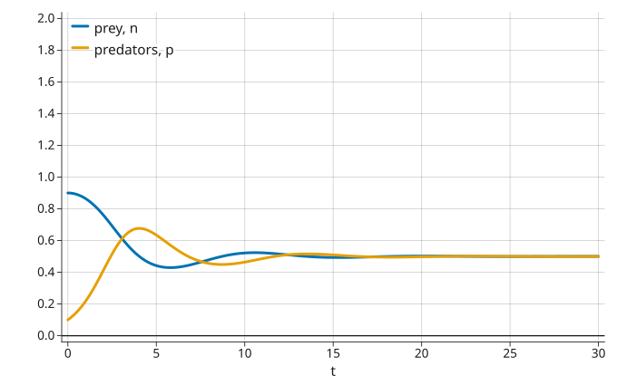

---

## YouTube lecture recording from October 2020

A recording of this lecture from October 2020; the material has changed a little since.

[](https://youtu.be/Mi5gTeTYM30)

---

## Why simplify systems?

In lecture 14 we solved systems of **first order**, **linear** differential equations in **two dimensions** exactly, with three methods, and diagonalisation extends to systems of any size.

Most models in biology are **nonlinear**, often with many variables and many parameters, and we usually can't solve them by hand.
In this lecture we look at two things we can still do:

1. **Simplify** a system, so that it has fewer parameters (by rescaling) or fewer equations (by conservation, or the quasi-steady state approximation).
1. Draw its **phase plane**, which shows how its solutions behave without solving it, using **nullclines** to find its fixed points.

In lecture 16 we use eigenvalues to decide whether those fixed points are stable.

## System simplification: rescaling

Rescaling tells us which combinations of the parameters really matter.
This predator-prey model is in dimensional terms and contains 5 parameters:

$$
\begin{aligned}
\frac{dN}{dT} &= rN\left(1-\frac{N}{K}\right) - bNP,\\
\frac{dP}{dT} &= ebNP - mP.
\end{aligned}
$$

- $r$: prey intrinsic growth rate
- $K$: prey carrying capacity (bound to logistic growth)
- $b$: predation rate
- $e$: conversion efficiency
- $m$: per capita predator mortality rate

We substitute

$$
N=\theta n, \qquad P=\phi p, \qquad T=\tau t,
$$

where $n$, $p$ and $t$ are nondimensional, and $\theta$, $\phi$ and $\tau$ are constants: typical values of $N$, $P$ and $T$, which we are free to choose.
Note that, when we are rescaling time, by the chain rule

$$
\frac{d}{dT} = \frac{d}{dt}\frac{dt}{dT} = \frac{1}{\tau} \frac{d}{dt}.
$$

Substituting into the original system gives

$$
\begin{aligned}
\frac{\theta}{\tau}\frac{dn}{dt} &= \theta rn\left(1-\frac{\theta n}{K}\right) - b\theta\phi np,\\
\frac{\phi}{\tau}\frac{dp}{dt} &= eb\theta\phi np - m\phi p.
\end{aligned}
$$

Then we divide the first equation by $\theta/\tau$ and the second by $\phi/\tau$:

$$
\begin{aligned}
\frac{dn}{dt} &= \tau\left( rn\left(1-\frac{\theta n}{K}\right) - b\phi np\right),\\
\frac{dp}{dt} &= \tau\left( eb\theta np - mp\right).
\end{aligned}
$$

Now we choose the scales.
Choosing $\theta=K$ will remove the parameter $K$ from the equations:

$$
\begin{aligned}
\frac{dn}{dt} &= \tau\left( rn(1-n) - b\phi np\right),\\
\frac{dp}{dt} &= \tau\left( ebK np - mp\right).
\end{aligned}
$$

Choosing $\tau = 1/m$ (or $\tau = 1/r$) will remove a further parameter:

$$
\begin{aligned}
\frac{dn}{dt} &= \frac{r}{m}n(1-n) - \frac{b\phi}{m}np,\\
\frac{dp}{dt} &= \frac{ebK}{m}np - p.
\end{aligned}
$$

Finally, $\phi=m/b$ gives the two parameter system

$$
\begin{aligned}
\dot{n} &= \frac{r}{m}n(1-n) - np,\\
\dot{p} &= \frac{ebK}{m}np - p,
\end{aligned}
$$

where $\dot{n}$ is short for $dn/dt$, and $\dot{p}$ for $dp/dt$.
We have shifted the groups of parameters to only two places.
We could make it more obvious that there are only two "tuning dials", $v_1 = r/m$ and $v_2 = ebK/m$, by writing it as

$$
\begin{aligned}
\dot{n} &= v_1 n(1-n) - np,\\
\dot{p} &= p(v_2 n - 1).
\end{aligned}
$$

Any choice of the five original parameters behaves like one of these: only $v_1$ and $v_2$ change the shape of the solutions.
For example, with $v_1 = 1$ and $v_2 = 2$, starting from $n = 0.9$ and $p = 0.1$, the prey and predators oscillate as they settle to the fixed point $n = 1/v_2$, $p = v_1(1 - 1/v_2)$:



If $v_2 < 1$ instead, the predators die out, and the prey settle at $n = 1$.

## System simplification: conservation

Consider a chemical system where a product is formed from a substrate via an intermediate complex involving an enzyme.

$$
S + E \overset{k_1}{\underset{k_{-1}}\rightleftharpoons} C \overset{k_2}\rightarrow P + E
$$

By mass action (lecture 11), this system can be written as a system of 4 ODEs for $s, e, c, p$, which describe the concentrations of $S, E, C$ and $P$:

$$
\begin{aligned}
\dot{s} &= -k_1 se + k_{-1}c, \\
\dot{e} &= -k_1 se + k_{-1}c + k_{2}c,\\
\dot{c} &= k_1 se - k_{-1}c - k_{2}c, \\
\dot{p} &= k_{2}c.
\end{aligned}
$$

However, the enzyme is recycled: it is used in the complex and then released.
Adding the equations for $e$ and $c$, every term cancels:

$$
\dot{e} + \dot{c} = 0.
$$

This means that $e + c = e_{\text{tot}}$, where $e_{\text{tot}}$ is constant (the total amount of enzyme, free or in the complex).

Making the substitution $e = e_{\text{tot}} - c$ to eliminate $e$, we arrive at the 3 ODE system:

$$
\begin{aligned}
\dot{s} &= -k_1 s(e_{\text{tot}} - c) + k_{-1}c, \\
\dot{c} &= k_1 s(e_{\text{tot}} - c) - k_{-1}c - k_{2}c,\\
\dot{p} &= k_{2}c.
\end{aligned}
$$

## System simplification: quasi-steady state

In the previous example it may be known that the rate of conversion to complex (from $k_1$ and $k_{-1}$) is much faster than the degradation of complex into product (rate $k_2$).

If this is the case, then we can assume that the concentration of $C$ quickly arrives at some level $c^*$ (a quasi-steady state), and then moves very slowly.

Solving for $\dot{c}=0$:

$$
\begin{aligned}
\dot{c} &= k_1 s(e_{\text{tot}} - c) - k_{-1}c - k_{2}c = 0, \\
\implies
c^*&=\frac{k_1 e_{\text{tot}} s}{k_{-1} + k_2 + k_1 s},
\end{aligned}
$$

which is **not a steady state**: it moves slowly with $s$.

Substituting this quasi-steady state into the remaining equations gives an **approximate** system of 2 ODEs:

$$
\begin{aligned}
\dot{s} &= -\frac{k_1 k_2 e_{\text{tot}} s}{ k_{-1} + k_2 + k_1 s}, \\
\dot{p} &= \frac{k_1 k_2 e_{\text{tot}} s}{ k_{-1} + k_2 + k_1 s}.
\end{aligned}
$$

Dividing the top and bottom by $k_1$, the rate of the reaction is

$$
\dot{p} = \frac{V_{\max}\, s}{K_m + s}, \qquad\text{where}\qquad V_{\max} = k_2 e_{\text{tot}} \quad\text{and}\quad K_m = \frac{k_{-1} + k_2}{k_1}.
$$

This is the Michaelis-Menten equation from lectures 1 and 9.
So, the quasi-steady state approximation explains where it comes from, and what its two constants mean: $V_{\max}$ is the rate when every enzyme is in a complex, and $K_m$ is the concentration of substrate at which the rate is half of $V_{\max}$.

This means that we have used conservation and quasi-steady state to go from a 4-dimensional system $(s,e,c,p)$ to a two-dimensional approximation which captures some of the behaviour.

## Phase planes and nullclines

With two variables $x$ and $y$, we can draw the **phase plane**: the $(x, y)$ plane, with an arrow at each point showing the direction of $(\dot{x}, \dot{y})$.
Each solution follows a path through it, as in the figures in lecture 14.

A system of **nonlinear** ODEs may have more than one fixed point (or may have none).
Finding fixed points in two-dimensional systems is aided by **nullclines**.
An $x$-nullcline is a line where $\dot{x}=0$, and a $y$-nullcline is a line where $\dot{y}=0$.
(These are straight lines in the linear case.)
At a fixed point $\dot{x} = \dot{y} = 0$, so the fixed points are where an $x$-nullcline crosses a $y$-nullcline.

For example, take the system

$$
\begin{aligned}
\dot{x} &= x(1-x) -xy,\\
\dot{y} &= 2y\left(1-\frac{y}{2}\right) - 3xy.
\end{aligned}
$$

Factorising,

$$
\begin{aligned}
\dot{x} &= x(1-x-y),\\
\dot{y} &= y(2-y-3x).
\end{aligned}
$$

So the $x$-nullclines are $x=0$ and $y = 1-x$, and the $y$-nullclines are $y=0$ and $y = 2-3x$.
The fixed points are where one of each kind cross:

- $x = 0$ and $y = 0$ cross at $(0, 0)$
- $x = 0$ and $y = 2 - 3x$ cross at $(0, 2)$
- $y = 1 - x$ and $y = 0$ cross at $(1, 0)$
- $y = 1 - x$ and $y = 2 - 3x$ cross at $(1/2, 1/2)$

Note that $(0, 1)$, where the two $x$-nullclines meet, is not a fixed point: there $\dot{x} = 0$, but $\dot{y} = 1 \neq 0$.


On an $x$-nullcline $\dot{x} = 0$, so the arrows there point straight up or down: they can only cross the $x$-nullclines vertically, and in the same way the $y$-nullclines horizontally.
Between the nullclines, the signs of $\dot{x}$ and $\dot{y}$ do not change, so the arrows point in roughly the same direction throughout each region.
By following the arrows we can sketch the behaviour of solutions (green lines, from the stars):


Almost every solution that starts with $x$ and $y$ both positive ends up at $(1, 0)$ or $(0, 2)$.
In lecture 16 we will see why, from the eigenvalues at each fixed point.

### Python code to plot the phase plane

The function `streamplot` draws the paths of the solutions through a grid of arrows.
We add the nullclines on top, and solutions from chosen starting points, found with `solve_ivp`:

```python
import numpy as np
from matplotlib import pyplot as plt
from scipy.integrate import solve_ivp


def f(t, X):
    x, y = X
    return [x * (1 - x) - x * y, 2 * y * (1 - y / 2) - 3 * x * y]


# the direction field, as streamlines
x, y = np.meshgrid(np.linspace(0, 1.1, 23), np.linspace(0, 2.1, 22))
dx, dy = f(0, [x, y])
plt.streamplot(x, y, dx, dy, color='lightgray')

# the nullclines
xs = np.linspace(0, 1.1, 100)
plt.plot(xs, 1 - xs, color='C0', label='x-nullclines')
plt.axvline(0, color='C0')
plt.plot(xs, 2 - 3 * xs, color='C1', label='y-nullclines')
plt.axhline(0, color='C1')

# solutions from a few starting points
starts = [(1.05, 1.0), (0.9, 1.3), (0.7, 1.6), (0.5, 1.8),
          (0.5, 0.2), (0.32, 0.2), (0.1, 0.2)]
for start in starts:
    sol = solve_ivp(f, (0, 10), start, t_eval=np.linspace(0, 10, 100))
    plt.plot(sol.y[0], sol.y[1], color='green')
    plt.plot(*start, 'g*', markersize=12)

plt.xlim(0, 1.1)
plt.ylim(0, 2.1)
plt.xlabel('x')
plt.ylabel('y')
plt.legend()
```

## Summary

1. Rescaling to dimensionless quantities shows which combinations of parameters matter, and can reduce their number.
1. Conservation (e.g. a total amount of enzyme) can remove an equation.
1. The quasi-steady state approximation removes an equation that relaxes quickly, e.g. giving the Michaelis-Menten equation.
1. Nullclines are a powerful way of finding fixed points, and of sketching the phase plane.

## Introductory problems

:::callout{variant="tip"}
For more practice, an AI tool can write new problems like the ones below.
Ask it for problems of the same type and difficulty, or for problems set in your own field.
For example, you could ask it to "write five chemistry problems on fixed points and rescaling, at the level of these ones".
Work them on paper first, then ask the tool to check your answers and to explain any step you are unsure of.
:::

::::challenge{id="15_intro_01" title="Introductory problems 1"}
Find the fixed points of the following linear systems:

1. $\dot{x} = x+3y, \qquad \dot{y}=-6x+5y;$
1. $\dot{x} = x+3y+4, \qquad \dot{y}=-6x+5y-1;$
1. $\dot{x} = x+3y+1, \qquad \dot{y}=-6x+5y.$

:::solution

At a fixed point $\dot{x} = 0$ and $\dot{y} = 0$, so in each case we solve a pair of simultaneous equations.

1. $x + 3y = 0$ gives $x = -3y$.
   Substituting into $-6x + 5y = 0$ gives $18y + 5y = 0$, so $y = 0$ and $x = 0$.
   The fixed point is $(0, 0)$.

1. Multiply the first equation by 6 and add it to the second:

   $$
   (6x + 18y + 24) + (-6x + 5y - 1) = 23y + 23 = 0
   $$

   So, $y = -1$, and then $x = -4 - 3y = -1$.
   The fixed point is $(-1, -1)$.

1. In the same way, $(6x + 18y + 6) + (-6x + 5y) = 23y + 6 = 0$, so $y = -6/23$, and then $x = -1 - 3y = -5/23$.
   The fixed point is $(-5/23, -6/23)$.

:::

::::

::::challenge{id="15_intro_02" title="Introductory problems 2"}
Find the fixed points of the following nonlinear systems:

1. $\dot{x} = -4y+2xy-8 \qquad \dot{y}=4y^2-x^2;$
1. $\dot{x} = y-x^2+2, \qquad \dot{y}=2(x^2-y^2).$

:::solution

1. $\dot{y} = 0$ gives $x^2 = 4y^2$, so $x = 2y$ or $x = -2y$.
   Substitute each into $\dot{x} = 0$.

   - $x = 2y$: $-4y + 4y^2 - 8 = 0$, so $y^2 - y - 2 = (y - 2)(y + 1) = 0$.
     This gives $y = 2$, $x = 4$ and $y = -1$, $x = -2$.
   - $x = -2y$: $-4y - 4y^2 - 8 = 0$, so $y^2 + y + 2 = 0$.
     This has no real solutions, because $1^2 - 4\times 2 < 0$.

   The fixed points are $(4, 2)$ and $(-2, -1)$.

1. $\dot{x} = 0$ gives $y = x^2 - 2$, and $\dot{y} = 0$ gives $y = x$ or $y = -x$.

   - $y = x$: $x^2 - x - 2 = (x - 2)(x + 1) = 0$, which gives $(2, 2)$ and $(-1, -1)$.
   - $y = -x$: $x^2 + x - 2 = (x + 2)(x - 1) = 0$, which gives $(-2, 2)$ and $(1, -1)$.

   There are four fixed points: $(2, 2)$, $(-1, -1)$, $(-2, 2)$ and $(1, -1)$.

:::

::::

## Main problems

::::challenge{id="15_main_01" title="Main problems 1"}
Consider the chemical reaction network:

$$
\overset{k_0}\longrightarrow A \overset{k_1}{\underset{k_{-1}}\rightleftharpoons} B \overset{k_2}\longrightarrow
$$

1. Write down the system of two linear ODEs which describe the evolution of the concentrations of A and B in this system under the law of mass action.
1. Find the ratio of concentrations of A and B for which this system is in steady state: that is the concentrations do not change over time.

:::solution

Let $a = [A]$ and $b = [B]$.

1. A is produced at the constant rate $k_0$, turns into B at rate $k_1 a$, and is made from B at rate $k_{-1}b$.
   B is removed at rate $k_2 b$.
   So,

   $$
   \begin{aligned}
   \frac{da}{dt} &= k_0 - k_1 a + k_{-1} b \\
   \frac{db}{dt} &= k_1 a - k_{-1} b - k_2 b
   \end{aligned}
   $$

1. In steady state $db/dt = 0$, so $k_1 a = (k_{-1} + k_2) b$, and

   $$
   \frac{a}{b} = \frac{k_{-1} + k_2}{k_1}
   $$

   We can also find the concentrations themselves.
   Adding the two equations gives $k_0 - k_2 b = 0$, so $b^* = k_0/k_2$, and then $a^* = k_0(k_{-1} + k_2)/(k_1 k_2)$.

:::

::::

::::challenge{id="15_main_02" title="Main problems 2"}
Consider the reversible enzyme reaction:

$$
S + E \overset{k_1}{\underset{k_{-1}}\rightleftharpoons} C \overset{k_2}{\underset{k_{-2}}\rightleftharpoons} P + E
$$

Verify the Haldane relation, which states that when the reaction is in equilibrium,

$$
\frac{p}{s} = \frac{k_1 k_2}{k_{-1}k_{-2}},
$$

where $p$ and $s$ are the concentrations of $P$ and $S$, respectively.

:::solution

Let $s$, $e$, $c$ and $p$ be the concentrations of $S$, $E$, $C$ and $P$.
By mass action,

$$
\begin{aligned}
\frac{ds}{dt} &= -k_1 s e + k_{-1} c \\
\frac{dp}{dt} &= k_2 c - k_{-2} p e
\end{aligned}
$$

In equilibrium the concentrations do not change, so both are zero:

$$
k_1 s e = k_{-1} c \qquad\text{and}\qquad k_2 c = k_{-2} p e
$$

The first gives $c = k_1 s e/k_{-1}$.
Substituting this into the second,

$$
\frac{k_1 k_2 s e}{k_{-1}} = k_{-2} p e
$$

The enzyme concentration $e$ cancels, so

$$
\frac{p}{s} = \frac{k_1 k_2}{k_{-1}k_{-2}}
$$

(We can check that $dc/dt = k_1 s e - k_{-1}c - k_2 c + k_{-2} p e$ is then zero too.)

:::

::::

::::challenge{id="15_main_03" title="Main problems 3"}
The population of a host, $H(t)$, and a parasite, $P(t)$, are described approximately by the equations:

$$
\frac{dH}{dT}=(a-bP)H,\qquad \frac{dP}{dT}=\left(c-\frac{kP}{H}\right)P, \qquad H>0,
$$

where $a,b,c,k$ are positive constants.

By a suitable change of scales show that these equations may be put in the simpler form

$$
\dot{y} = (1-x)y, \qquad \dot{x}=\alpha x\left(1-\frac{x}{y}\right),
$$

where $\alpha=c/a$.

Sketch the phase flow across the following lines:

1. $y=x$;
1. $x=0$;
1. $y=0$;
1. $x=1$;
1. $y=\beta x$, for $\beta$ greater than and less than 1.

:::solution

As in the lecture, let $T = \tau t$, $P = \theta x$ and $H = \phi y$, where $\tau$, $\theta$ and $\phi$ are scales still to be chosen, so that $d/dT = (1/\tau)\,d/dt$.
Then

$$
\frac{\phi}{\tau}\dot{y} = (a - b\theta x)\phi y \qquad\text{and}\qquad \frac{\theta}{\tau}\dot{x} = \left(c - \frac{k\theta x}{\phi y}\right)\theta x
$$

so

$$
\dot{y} = \tau(a - b\theta x)y \qquad\text{and}\qquad \dot{x} = \tau\left(c - \frac{k\theta x}{\phi y}\right)x
$$

Choosing $\tau = 1/a$ and $\theta = a/b$ gives $\dot{y} = (1-x)y$, and

$$
\dot{x} = \left(\frac{c}{a} - \frac{kx}{b\phi y}\right)x = \frac{c}{a}\,x\left(1 - \frac{ka}{bc\phi}\,\frac{x}{y}\right)
$$

Finally, choosing $\phi = ka/(bc)$ gives $\dot{x} = \alpha x(1 - x/y)$, with $\alpha = c/a$.

Now the flow across each line.
$x$ and $y$ are populations, so we only need $x \geq 0$ and $y > 0$.

1. On $y = x$, $\dot{x} = 0$ (this is an $x$-nullcline), so the flow crosses it vertically.
   $\dot{y} = (1-x)x$, so the flow is upwards for $x < 1$ and downwards for $x > 1$.
1. On $x = 0$, $\dot{x} = 0$ and $\dot{y} = y > 0$, so the flow is up the $y$ axis.
   With no parasites, the hosts grow exponentially.
1. On $y = 0$, $\dot{y} = 0$ (a $y$-nullcline).
   The equations are not defined on the line itself, because of $x/y$, but just above it $x/y$ is very large, so $\dot{x}$ is large and negative and the flow moves sharply to the left.
   With almost no hosts, the parasites die out.
1. On $x = 1$, $\dot{y} = 0$ (a $y$-nullcline), so the flow crosses it horizontally.
   $\dot{x} = \alpha(1 - 1/y)$, so the flow is to the right for $y > 1$ and to the left for $y < 1$.
1. On $y = \beta x$, $\dot{x} = \alpha x(1 - 1/\beta)$ and $\dot{y} = \beta x(1 - x)$.
   For $\beta > 1$ (above the line $y = x$) the flow is to the right, and for $\beta < 1$ (below it) the flow is to the left.
   In both cases it is upwards for $x < 1$ and downwards for $x > 1$.

Putting these together, the flow goes clockwise around the point $(1, 1)$, where the nullclines $y = x$ and $x = 1$ cross (we find out what happens there in the next lecture).
For example, with $\alpha = 1$:

```python
import numpy as np
from matplotlib import pyplot as plt

alpha = 1
x, y = np.meshgrid(np.linspace(0.01, 2.5, 30), np.linspace(0.01, 2.5, 30))
xdot = alpha * x * (1 - x / y)
ydot = (1 - x) * y

plt.streamplot(x, y, xdot, ydot, color='grey')
plt.plot([0, 2.5], [0, 2.5], color='#0072bd', label='x-nullcline y = x')
plt.axvline(0, color='#0072bd', label='x-nullcline x = 0')
plt.axvline(1, color='#F39200', label='y-nullcline x = 1')
plt.axhline(0, color='#F39200', label='y-nullcline y = 0')
plt.xlabel('x (parasites)')
plt.ylabel('y (hosts)')
plt.legend()
```

:::

::::

::::challenge{id="15_main_04" title="Main problems 4"}
Consider a lake with some fish attractive to anglers.
We wish to model the fish-angler interaction under the following assumptions:

- the fish population grows logistically in the absence of fishing;
- the presence of anglers depresses the fish growth rate at a rate jointly proportional to the size of the fish and angler populations;
- anglers are attracted to the lake at a rate directly proportional to the number of fish in the lake;
- anglers are discouraged from the lake at a rate directly proportional to the number of anglers already there.

1. Write down a mathematical model for this situation, clearly defining your terms.
1. Use a suitable scaling to show that a non-dimensionalised version of the model is

   $$
   \dot{x} = rx(1 - x) - xy,\qquad \dot{y} = \beta x - y
   $$

:::solution

1. Let $F(T)$ be the number of fish and $A(T)$ the number of anglers at time $T$.
   Then

   $$
   \begin{aligned}
   \frac{dF}{dT} &= aF\left(1 - \frac{F}{K}\right) - bFA \\
   \frac{dA}{dT} &= cF - eA
   \end{aligned}
   $$

   where all the constants are positive:
   - $a$ is the growth rate of the fish, and $K$ is the largest number of fish the lake can support (its carrying capacity);
   - $b$ measures how quickly anglers catch fish;
   - $c$ measures how strongly the fish attract anglers;
   - $e$ is the rate at which anglers are discouraged and leave.

1. As in the lecture, let $F = \theta x$, $A = \phi y$ and $T = \tau t$, so that $d/dT = (1/\tau)\,d/dt$.
   Then

   $$
   \begin{aligned}
   \dot{x} &= \tau a x\left(1 - \frac{\theta x}{K}\right) - \tau b\phi xy \\
   \dot{y} &= \frac{\tau c\theta}{\phi}x - \tau e y
   \end{aligned}
   $$

   Choosing $\theta = K$, $\tau = 1/e$ and $\phi = e/b$ gives

   $$
   \dot{x} = \frac{a}{e}x(1 - x) - xy \qquad\text{and}\qquad \dot{y} = \frac{bcK}{e^2}x - y
   $$

   which is the model given, with $r = a/e$ and $\beta = bcK/e^2$.

:::

::::

::::challenge{id="15_main_05" title="Main problems 5"}
Consider the reaction chain

$$
S \overset{k_1}{\longrightarrow} I \overset{k_2}{\longrightarrow} P
$$

in which a substrate is converted to a product through a short-lived intermediate.

1. Write down the system of three ODEs for $s$, $i$ and $p$ under the law of mass action.
1. Show that $s + i + p$ is constant, and use this to eliminate $p$.
1. Suppose the second step is much faster than the first ($k_2 \gg k_1$).
   Use a quasi-steady state for $i$ to find $i^*$ in terms of $s$, and hence an approximate equation for $dp/dt$.
1. Explain why the rate at which $P$ is made depends only on $k_1$ in this approximation.

:::solution

1. Each step uses up one species and makes the next, so

   $$
   \begin{aligned}
   \frac{ds}{dt} &= -k_1 s, \\
   \frac{di}{dt} &= k_1 s - k_2 i, \\
   \frac{dp}{dt} &= k_2 i.
   \end{aligned}
   $$

1. Adding the three equations,

   $$
   \frac{d}{dt}(s + i + p) = -k_1 s + k_1 s - k_2 i + k_2 i = 0
   $$

   so $s + i + p = T$, where $T$ is a constant: the total amount of material.
   Then $p = T - s - i$, and the system reduces to the two ODEs for $s$ and $i$.

1. If $k_2 \gg k_1$, the intermediate is used up almost as soon as it is made, so $i$ quickly reaches a quasi-steady state.
   Solving $di/dt = 0$:

   $$
   k_1 s - k_2 i^* = 0 \qquad\Rightarrow\qquad i^* = \frac{k_1 s}{k_2}
   $$

   This is small, because $k_1/k_2$ is small, and it moves slowly with $s$.
   Substituting it into the equation for $p$,

   $$
   \frac{dp}{dt} = k_2 i^* \approx k_1 s
   $$

1. In this approximation, every molecule of $I$ is turned into $P$ almost straight away, so $P$ is made as fast as $I$ is made, which is $k_1 s$.
   The first step is the slow one, so it limits the rate of the whole chain.
   This is often called the _rate-limiting step_.

:::

::::
