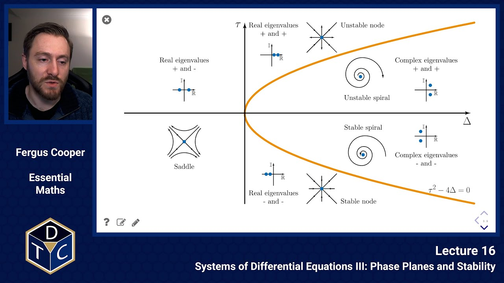
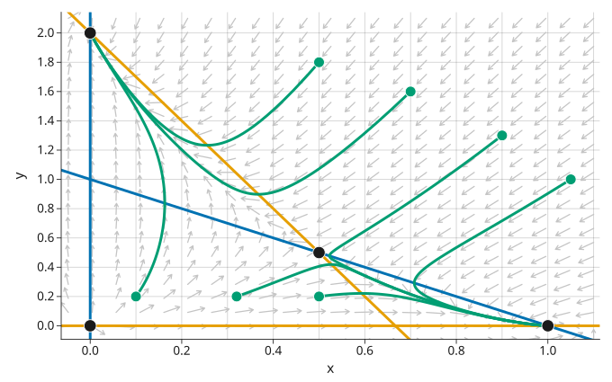
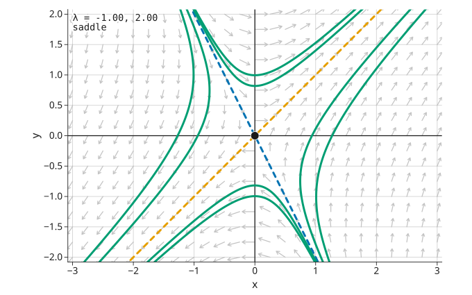
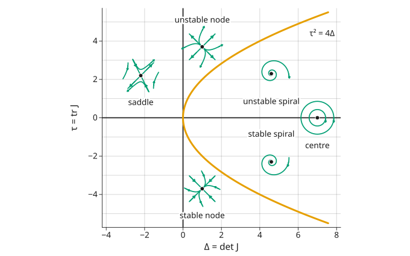
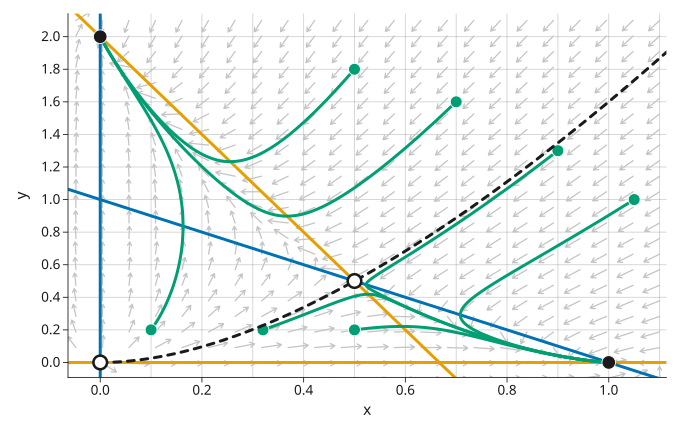

---

## YouTube lecture recording from October 2020

A recording of this lecture from October 2020; the material has changed a little since.

[](https://youtu.be/SO6TmCadkf4)

---

## Why stability?

In lecture 11 we decided whether a steady state $s^*$ of $ds/dt = f(s)$ is stable from the slope $f'(s^*)$.
In lecture 14 we saw that the solution of a linear system is a sum of eigenvectors, each growing or shrinking at a rate set by its eigenvalue.
In lecture 15 we found the fixed points of a nonlinear system from its nullclines.

In this lecture we put these together.
Close to a fixed point, a nonlinear system behaves like a linear one, so eigenvalues tell us whether each fixed point is stable, and so where the system ends up.

## The example from lecture 15

We will come back to the system

$$
\begin{aligned}
\dot{x} &= x(1-x) -xy,\\
\dot{y} &= y(2-y) - 3xy,
\end{aligned}
$$

where $y(2-y)$ is the same as lecture 15's $2y(1-y/2)$.
Its nullclines cross at four fixed points: $(0, 0)$, $(1, 0)$, $(0, 2)$ and $(1/2, 1/2)$.



Which of them do solutions settle at, and why?

## Linear systems

The decoupled ODE system

$$
\begin{aligned}
\dot{x} &= \lambda_1 x,\\
\dot{y} &= \lambda_2 y,
\end{aligned}
$$

has a **fixed point** or **steady state** where $\dot{x}=\dot{y}=0$, at the origin.

Solutions look like $x=Ae^{\lambda_1 t}$ and $y=Be^{\lambda_2 t}$, and thus grow exponentially or shrink exponentially depending on the signs of $\lambda_1$ and $\lambda_2$.
If $\lambda_1 < 0$ and $\lambda_2 < 0$, then all the flow is towards the fixed point.
If $\lambda_1$ or $\lambda_2$ is positive, then some flow will be driven away (towards infinity).

Adding in a constant (inhomogeneous) component shifts the fixed point away from the origin.
For example, the system

$$
\begin{aligned}
\dot{x} &= \lambda_1 x + 10,\\
\dot{y} &= \lambda_2 y + 10
\end{aligned}
$$

has $\dot{x} = \dot{y} = 0$ at $x = -10/\lambda_1$, $y = -10/\lambda_2$.
Its solutions behave in the same way as before, but around this point instead of the origin.

Coupling the system has the effect of altering the principal directions over which the exponential terms apply (**changing the basis**).
This means that the **homogeneous** linear system

$$
\begin{aligned}
\dot{x} &= a x + b y,\\
\dot{y} &= c x + d y,
\end{aligned}
$$

has a fixed point at the origin.
As in lecture 14, its solution is

$$
\mathbf{x} = c_1\mathbf{v}_1 e^{\lambda_1 t} + c_2\mathbf{v}_2 e^{\lambda_2 t},
$$

where $\lambda_1$, $\lambda_2$ and $\mathbf{v}_1$, $\mathbf{v}_2$ are the eigenvalues and eigenvectors of the matrix

$$
A = \left(\begin{matrix} a & b \\ c & d \end{matrix}\right).
$$

So the long-term growth or shrinkage of solutions over time is determined by the eigenvalues, along the eigenvectors.
For example, with lecture 14's matrix $A = \left(\begin{matrix} 1 & 1 \\ 2 & 0 \end{matrix}\right)$, the eigenvalues are $-1$ and $2$: solutions come in along the first eigenvector (dashed blue) and go out along the second (dashed orange), which makes the origin a saddle:



When the eigenvalues are complex, the solutions turn around the fixed point instead: they spiral in if the real part is negative, and out if it is positive.

More generally, the **inhomogeneous** linear system

$$
\begin{aligned}
\dot{x} &= a x + b y + p,\\
\dot{y} &= c x + d y + q,
\end{aligned}
$$

can be written

$$
\left(\begin{array}{c} \dot{x} \\ \dot{y} \end{array}\right)
=
\left(\begin{array}{cc} a & b \\ c & d \end{array}\right)
\left(\begin{array}{c} x \\ y \end{array}\right)
+
\left(\begin{array}{c} p \\ q \end{array}\right).
$$

It has a fixed point at

$$
\left(\begin{array}{c} x \\ y \end{array}\right)
=
-\left(\begin{array}{cc} a & b \\ c & d \end{array}\right)^{-1}
\left(\begin{array}{c} p \\ q \end{array}\right).
$$

The long-term growth or shrinkage of solutions over time is again determined by the eigenvalues of the matrix.

## Nonlinear systems: linearisation

A more general two-dimensional nonlinear system is

$$
\begin{aligned}
\dot{x} &= f(x,y),\\
\dot{y} &= g(x,y),
\end{aligned}
$$

where $f$ and $g$ can be any functions whatever.

We can write a polynomial (Taylor) expansion for the system when it is close to a fixed point $(x^*, y^*)$, with the partial derivatives evaluated at $(x^*, y^*)$:

$$
\begin{aligned}
\dot{x} &= f(x^*,y^*) + \frac{\partial f}{\partial x}(x-x^*) + \frac{\partial f}{\partial y}(y-y^*) + \ldots,\\
\dot{y} &= g(x^*,y^*) + \frac{\partial g}{\partial x}(x-x^*) + \frac{\partial g}{\partial y}(y-y^*) + \ldots
\end{aligned}
$$

At a fixed point $f(x^*,y^*)=g(x^*,y^*)=0$, so the first terms drop out.
The terms we have left out (the "$\ldots$") involve $(x-x^*)^2$, $(x-x^*)(y-y^*)$ and so on, which are much smaller still when we are close to the fixed point.
So, close to the fixed point:

$$
\def\arraystretch{1.8}\left(\begin{array}{c} \dot{x} \\ \dot{y} \end{array}\right)
\approx
\left(\begin{array}{cc} \frac{\partial f}{\partial x} & \frac{\partial f}{\partial y} \\ \frac{\partial g}{\partial x} & \frac{\partial g}{\partial y} \end{array}\right)
\left(\begin{array}{c} x-x^* \\ y-y^* \end{array}\right).
$$

This means that (really close to the fixed point) we can approximate with a linear system.
The eigenvalues $\lambda_1$, $\lambda_2$ of the **Jacobian** matrix

$$
\def\arraystretch{1.8}J = \left(\begin{array}{cc} \frac{\partial f}{\partial x} & \frac{\partial f}{\partial y} \\ \frac{\partial g}{\partial x} & \frac{\partial g}{\partial y} \end{array}\right)
$$

will determine if a small perturbation away from $(x^*, y^*)$ will decay or grow.
$J$ plays the part that the slope $f'(s^*)$ played in lecture 11: there, a steady state was stable if $f'(s^*) < 0$.

## Steady state classification

A fixed point is **stable** if every eigenvalue of $J$ has a negative real part, and **unstable** if any has a positive real part.
More precisely, its type depends on the eigenvalues as follows:

- $\lambda_1<\lambda_2<0$: stable node
- $\lambda_1=\lambda_2<0$: stable star if $J$ is a multiple of $I$ (every direction is an eigenvector), otherwise a stable degenerate node (only one eigenvector direction)
- $\lambda_1>\lambda_2>0$: unstable node
- $\lambda_1=\lambda_2>0$: unstable star or unstable degenerate node, in the same way
- $\lambda_1<0<\lambda_2$: saddle (or hyperbolic) point, unstable
- Complex $\lambda$: spiral (with the real part determining stability)
- Imaginary $\lambda$: centre (solutions cycle round the fixed point)

If an eigenvalue has a real part of exactly zero (a centre, for example), the linear approximation cannot decide the stability of a nonlinear system: the terms we left out decide it.

### Eigenvalues of $J$

$$
\def\arraystretch{1.8}|J-\lambda I| = \left|
\begin{array}{cc} \frac{\partial f}{\partial x}-\lambda & \frac{\partial f}{\partial y} \\ \frac{\partial g}{\partial x} & \frac{\partial g}{\partial y}-\lambda \end{array}\right|
= \left(\frac{\partial f}{\partial x}-\lambda\right)\left(\frac{\partial g}{\partial y}-\lambda\right)-\frac{\partial f}{\partial y}\frac{\partial g}{\partial x}
$$

So eigenvalues $\lambda$ satisfy

$$
\lambda^2 - \lambda\left(\frac{\partial f}{\partial x} + \frac{\partial g}{\partial y}\right) + \frac{\partial f}{\partial x}\frac{\partial g}{\partial y} - \frac{\partial f}{\partial y}\frac{\partial g}{\partial x} = 0,
$$

or

$$
\lambda^2 - \tau\lambda + \Delta = 0, \quad \text{where} \quad \tau=\text{tr}(J) \quad \text{and} \quad \Delta = \det(J)
$$

(this $\tau$ is the trace, not the time scale from lecture 15).
Solving the quadratic,

$$
\lambda = \frac{\tau \pm \sqrt{\tau^2 - 4\Delta}}{2}.
$$

So, from the trace and determinant alone:

- $\Delta < 0$: the square root is larger than $|\tau|$, so the eigenvalues have opposite signs, and the fixed point is a saddle
- $\Delta > 0$ and $\tau < 0$: stable
- $\Delta > 0$ and $\tau > 0$: unstable
- $\tau^2 < 4\Delta$: the eigenvalues are complex, and the fixed point is a spiral

The diagram below shows each type in the $(\Delta, \tau)$ plane, with a small phase portrait of an example in each region.
Stars and degenerate nodes lie on the parabola $\tau^2 = 4\Delta$, and centres on the positive $\Delta$ axis:



## Example: stability of the fixed points

For our example,

$$
\begin{aligned}
\dot{x} &= x(1-x) -xy &&= f(x, y),\\
\dot{y} &= y(2-y) - 3xy &&= g(x, y).
\end{aligned}
$$

Differentiating each with respect to $x$ and $y$,

$$
\def\arraystretch{1.8}J = \left(\begin{matrix} \frac{\partial f}{\partial x} & \frac{\partial f}{\partial y} \\ \frac{\partial g}{\partial x} & \frac{\partial g}{\partial y} \end{matrix}\right) = \left(\begin{matrix} 1-2x-y & -x \\ -3y & 2-3x-2y \end{matrix}\right).
$$

Now we evaluate $J$ at each fixed point in turn.

At $(0,0)$:

$$
J_{(0,0)} = \left(\begin{matrix} 1 & 0 \\ 0 & 2 \end{matrix}\right), \qquad \tau = 3, \quad \Delta = 2
\quad\implies\quad \lambda_1 = 1, \quad \lambda_2 = 2.
$$

Both eigenvalues are positive, so this is an unstable node.

At $(1/2,1/2)$:

$$
\def\arraystretch{1.8}J_{(1/2,1/2)} = \left(\begin{matrix} -\frac{1}{2} & -\frac{1}{2} \\ -\frac{3}{2} & -\frac{1}{2} \end{matrix}\right), \qquad \tau = -1, \quad \Delta = -\frac{1}{2}.
$$

$\Delta < 0$, so this is a saddle.
Solving $\lambda^2 + \lambda - 1/2 = 0$,

$$
\lambda_\pm = -\frac{1}{2} \pm \frac{\sqrt{3}}{2},
$$

one positive and one negative.

At $(1,0)$:

$$
J_{(1,0)} = \left(\begin{matrix} -1 & -1 \\ 0 & -1 \end{matrix}\right), \qquad \tau = -2, \quad \Delta = 1
\quad\implies\quad \lambda_1 = \lambda_2 = -1.
$$

This is stable.
$J$ is not a multiple of $I$ (it has only one eigenvector direction, $(1, 0)^T$), so it is a stable degenerate node.

At $(0,2)$:

$$
J_{(0,2)} = \left(\begin{matrix} -1 & 0 \\ -6 & -2 \end{matrix}\right), \qquad \tau = -3, \quad \Delta = 2
\quad\implies\quad \lambda_1 = -1, \quad \lambda_2 = -2.
$$

Both eigenvalues are negative, so this is a stable node.

If we now look again at the phase plane, after having calculated the stability of the fixed points, we can see that the arrows move towards the stable fixed points, and away from the unstable ones.
Below, the stable fixed points are filled and the unstable ones are open:



The dashed line is the **separatrix**: the solutions that come into the saddle along its stable eigenvector, $(1, \sqrt{3})^T$ (for $\lambda_- = -1/2 - \sqrt{3}/2$).
Solutions that start on one side of it go to $(1, 0)$, and on the other side to $(0, 2)$.
So, almost every solution with $x$ and $y$ both positive ends up at one of the two stable fixed points: which one depends on which side of the separatrix it starts.

## Summary

1. Linear systems: the eigenvalues of $A$ decide whether solutions grow or shrink, along its eigenvectors.
1. Nonlinear systems: close to a fixed point, the system behaves like a linear one with matrix $J$, the Jacobian, evaluated at the fixed point.
1. A fixed point is stable if every eigenvalue of $J$ has a negative real part, and the trace and determinant of $J$ give its type quickly.
1. The stable fixed points, and the separatrices between them, tell us where a system ends up.

## Introductory problems

:::callout{variant="tip"}
For more practice, an AI tool can write new problems like the ones below.
Ask it for problems of the same type and difficulty, or for problems set in your own field.
For example, you could ask it to "write five epidemiology problems on classifying steady states, at the level of these ones".
Work them on paper first, then ask the tool to check your answers and to explain any step you are unsure of.
:::

::::challenge{id="16_intro_01" title="Introductory problems 1"}
Each matrix below is the Jacobian at a fixed point.
Find its trace, determinant and eigenvalues, and classify the fixed point.

$$
\begin{gathered}
\text{(a)}\ \left(\begin{array}{cc} -3 & 0 \\ 0 & -1 \end{array}\right); \qquad
\text{(b)}\ \left(\begin{array}{cc} 3 & 1 \\ 1 & 3 \end{array}\right); \qquad
\text{(c)}\ \left(\begin{array}{cc} 1 & 2 \\ 2 & 1 \end{array}\right); \\
\text{(d)}\ \left(\begin{array}{cc} -1 & -2 \\ 2 & -1 \end{array}\right); \qquad
\text{(e)}\ \left(\begin{array}{cc} 0 & 1 \\ -4 & 0 \end{array}\right)
\end{gathered}
$$

:::solution

As in the lecture, the eigenvalues satisfy $\lambda^2 - \tau\lambda + \Delta = 0$, where $\tau$ is the trace and $\Delta$ is the determinant.

- (a) $\tau = -4$ and $\Delta = 3$, so $\lambda^2 + 4\lambda + 3 = (\lambda + 1)(\lambda + 3) = 0$.
  The eigenvalues $\lambda = -1$ and $-3$ are both negative, so this is a stable node.
- (b) $\tau = 6$ and $\Delta = 9 - 1 = 8$, so $\lambda^2 - 6\lambda + 8 = (\lambda - 2)(\lambda - 4) = 0$.
  The eigenvalues $\lambda = 2$ and $4$ are both positive, so this is an unstable node.
- (c) $\tau = 2$ and $\Delta = 1 - 4 = -3$, so $\lambda^2 - 2\lambda - 3 = (\lambda - 3)(\lambda + 1) = 0$.
  The eigenvalues $\lambda = 3$ and $-1$ have opposite signs, so this is a saddle (unstable).
- (d) $\tau = -2$ and $\Delta = 1 + 4 = 5$, so $\lambda^2 + 2\lambda + 5 = 0$ and

  $$
  \lambda = \frac{-2 \pm \sqrt{4 - 20}}{2} = -1 \pm 2i
  $$

  The eigenvalues are complex with a negative real part, so this is a stable spiral.
- (e) $\tau = 0$ and $\Delta = 4$, so $\lambda^2 + 4 = 0$ and $\lambda = \pm 2i$.
  The eigenvalues are purely imaginary, so this is neutral: solutions cycle round the fixed point.

Notice that a negative determinant always gives a saddle, because then the two eigenvalues multiply to give a negative number.

:::

::::

::::challenge{id="16_intro_02" title="Introductory problems 2"}
The system

$$
\dot{x} = x - xy, \qquad \dot{y} = x^2 - y
$$

has fixed points at $(0, 0)$, $(1, 1)$ and $(-1, 1)$.
Find the Jacobian, evaluate it at each fixed point, and classify each one.

:::solution

With $f = x - xy$ and $g = x^2 - y$,

$$
J = \left(\begin{array}{cc} \frac{\partial f}{\partial x} & \frac{\partial f}{\partial y} \\ \frac{\partial g}{\partial x} & \frac{\partial g}{\partial y} \end{array}\right) = \left(\begin{array}{cc} 1 - y & -x \\ 2x & -1 \end{array}\right)
$$

- At $(0, 0)$, $J = \left(\begin{array}{cc} 1 & 0 \\ 0 & -1 \end{array}\right)$.
  The eigenvalues are the diagonal entries, $\lambda = 1$ and $-1$, so $(0, 0)$ is a saddle (unstable).
- At $(1, 1)$, $J = \left(\begin{array}{cc} 0 & -1 \\ 2 & -1 \end{array}\right)$, with $\tau = -1$ and $\Delta = 0 + 2 = 2$.
  So, $\lambda^2 + \lambda + 2 = 0$ and

  $$
  \lambda = \frac{-1 \pm \sqrt{1 - 8}}{2} = \frac{-1 \pm i\sqrt{7}}{2}
  $$

  These are complex with a negative real part, so $(1, 1)$ is a stable spiral.
- At $(-1, 1)$, $J = \left(\begin{array}{cc} 0 & 1 \\ -2 & -1 \end{array}\right)$, with $\tau = -1$ and $\Delta = 0 + 2 = 2$.
  These are the same trace and determinant as at $(1, 1)$, so $(-1, 1)$ is also a stable spiral.

:::

::::

## Main problems

:::callout{variant="note"}
These questions are extensions of questions on the previous page.
:::

::::challenge{id="16_main_01" title="Main problems 1"}
Classify the fixed points and discuss stability of the following linear systems:

1. $\dot{x} = x+3y, \qquad \dot{y}=-6x+5y;$
1. $\dot{x} = x+3y+4, \qquad \dot{y}=-6x+5y-1;$
1. $\dot{x} = x+3y+1, \qquad \dot{y}=-6x+5y.$

:::solution

The constants disappear when we differentiate, so all three systems have the same Jacobian:

$$
J = \left(\begin{array}{cc} 1 & 3 \\ -6 & 5 \end{array}\right)
$$

Its trace is $\tau = 6$ and its determinant is $\Delta = 5 + 18 = 23$, so the eigenvalues satisfy

$$
\lambda^2 - 6\lambda + 23 = 0 \qquad\implies\qquad \lambda = 3 \pm i\sqrt{14}
$$

The eigenvalues are complex with a positive real part, so each fixed point is an unstable spiral.
The fixed points, found on the previous page, are $(0, 0)$, $(-1, -1)$ and $(-5/23, -6/23)$.
Adding the constants moves the fixed point, but does not change the flow around it.

:::

::::

::::challenge{id="16_main_02" title="Main problems 2"}
Classify the fixed points and discuss stability of the following nonlinear systems:

1. $\dot{x} = -4y+2xy-8 \qquad \dot{y}=4y^2-x^2;$
1. $\dot{x} = y-x^2+2, \qquad \dot{y}=2(x^2-y^2).$

:::solution

We found the fixed points on the previous page.
At each one, we calculate the Jacobian, and its eigenvalues from $\lambda^2 - \tau\lambda + \Delta = 0$, where $\tau$ is the trace and $\Delta$ the determinant.

1. $$
   J = \left(\begin{array}{cc} 2y & 2x - 4 \\ -2x & 8y \end{array}\right)
   $$

   - At $(4, 2)$, $J = \left(\begin{array}{cc} 4 & 4 \\ -8 & 16 \end{array}\right)$, with $\tau = 20$ and $\Delta = 96$.
     So, $\lambda = 8$ or $12$, both positive, and $(4, 2)$ is an unstable node.
   - At $(-2, -1)$, $J = \left(\begin{array}{cc} -2 & -8 \\ 4 & -8 \end{array}\right)$, with $\tau = -10$ and $\Delta = 48$.
     So, $\lambda = -5 \pm i\sqrt{23}$, complex with a negative real part, and $(-2, -1)$ is a stable spiral.

1. $$
   J = \left(\begin{array}{cc} -2x & 1 \\ 4x & -4y \end{array}\right)
   $$

   - At $(2, 2)$, $J = \left(\begin{array}{cc} -4 & 1 \\ 8 & -8 \end{array}\right)$, with $\tau = -12$ and $\Delta = 24$.
     So, $\lambda = -6 \pm 2\sqrt{3}$, both negative (as $2\sqrt{3} \approx 3.5$), and $(2, 2)$ is a stable node.
   - At $(-1, -1)$, $J = \left(\begin{array}{cc} 2 & 1 \\ -4 & 4 \end{array}\right)$, with $\tau = 6$ and $\Delta = 12$.
     So, $\lambda = 3 \pm i\sqrt{3}$, complex with a positive real part, and $(-1, -1)$ is an unstable spiral.
   - At $(-2, 2)$, $J = \left(\begin{array}{cc} 4 & 1 \\ -8 & -8 \end{array}\right)$, with $\tau = -4$ and $\Delta = -24$.
     So, $\lambda = -2 \pm 2\sqrt{7}$, one positive and one negative, and $(-2, 2)$ is a saddle (unstable).
   - At $(1, -1)$, $J = \left(\begin{array}{cc} -2 & 1 \\ 4 & 4 \end{array}\right)$, with $\tau = 2$ and $\Delta = -12$.
     So, $\lambda = 1 \pm \sqrt{13}$, one positive and one negative, and $(1, -1)$ is a saddle (unstable).

   Note, whenever $\Delta < 0$ the eigenvalues have opposite signs, so the fixed point is a saddle.

:::

::::

::::challenge{id="16_main_03" title="Main problems 3"}
The population of a host, $H(t)$, and a parasite, $P(t)$, are described approximately by the equations

$$
\frac{dH}{dT}=(a-bP)H,\qquad \frac{dP}{dT}=\left(c-\frac{kP}{H}\right)P, \qquad H>0,
$$

where $a,b,c,k$ are positive constants.
Previously, by a change of scales, these equations were put in the simpler form

$$
\dot{y} = (1-x)y, \qquad \dot{x}=\alpha x\left(1-\frac{x}{y}\right),
$$

where $\alpha=c/a$.

Find and classify the fixed points of these simplified equations.
Sketch the phase flow diagram including these fixed points and the information from the previous sketch.
That is, include the flow across:

1. $y=x$;
1. $x=0$;
1. $y=0$;
1. $x=1$;
1. $y=\beta x$, for $\beta$ greater than and less than 1.

:::solution

**Fixed points.**
$\dot{y} = 0$ when $y = 0$ or $x = 1$, and $\dot{x} = 0$ when $x = 0$ or $x = y$.
The equations are only defined for $y > 0$ (because $H > 0$), so $\dot{y} = 0$ needs $x = 1$, and then $\dot{x} = 0$ needs $y = x = 1$.
So, the only fixed point is $(1, 1)$.

**Classification.**
With $f = \alpha x(1 - x/y)$ and $g = (1 - x)y$,

$$
J = \left(\begin{array}{cc} \alpha\left(1 - \frac{2x}{y}\right) & \frac{\alpha x^2}{y^2} \\ -y & 1 - x \end{array}\right)
\qquad\text{so}\qquad
J_{(1,1)} = \left(\begin{array}{cc} -\alpha & \alpha \\ -1 & 0 \end{array}\right)
$$

The trace is $\tau = -\alpha$ and the determinant is $\Delta = \alpha$, so

$$
\lambda = \frac{-\alpha \pm \sqrt{\alpha^2 - 4\alpha}}{2}
$$

- If $\alpha < 4$, the eigenvalues are complex with a negative real part, so $(1, 1)$ is a stable spiral.
- If $\alpha > 4$, the eigenvalues are real, and both are negative (because $\sqrt{\alpha^2 - 4\alpha} < \alpha$), so $(1, 1)$ is a stable node.
- If $\alpha = 4$, there is a repeated eigenvalue $\lambda = -2$, and $(1, 1)$ is still stable.

Either way, the host and parasite populations settle to steady values, which in the original variables are $H = ka/(bc)$ and $P = a/b$.

**Phase flow.**
The flow across the lines is as on the previous page.
It goes clockwise around $(1, 1)$, upwards along $x = 0$, and sharply to the left just above $y = 0$.
Now we know that $(1, 1)$ is stable, so trajectories wind in towards it (for $\alpha < 4$), or approach it without winding round (for $\alpha > 4$).
For example, with $\alpha = 1$:

```python
import numpy as np
from matplotlib import pyplot as plt

alpha = 1
x, y = np.meshgrid(np.linspace(0.01, 2.5, 30), np.linspace(0.01, 2.5, 30))
xdot = alpha * x * (1 - x / y)
ydot = (1 - x) * y

plt.streamplot(x, y, xdot, ydot, color='grey')
plt.plot([0, 2.5], [0, 2.5], color='#0072bd', label='x-nullcline y = x')
plt.axvline(0, color='#0072bd', label='x-nullcline x = 0')
plt.axvline(1, color='#F39200', label='y-nullcline x = 1')
plt.axhline(0, color='#F39200', label='y-nullcline y = 0')
plt.plot(1, 1, 'ko', label='stable fixed point (1, 1)')
plt.xlabel('x (parasites)')
plt.ylabel('y (hosts)')
plt.legend()
```

:::

::::

::::challenge{id="16_main_04" title="Main problems 4"}
In the previous parts of this question a model of fish and anglers was developed and simplified.
This question analyses the simplified model.

The simplified version of the model is

$$
\dot{x} = rx(1 - x) - xy,\qquad \dot{y} = \beta x - y
$$

where $x$ and $y$ represent fish and angler populations, respectively.
The $\dot{x}$ notation represents the derivative with respect to non-dimensional time.

1. Calculate the steady states of the system.
1. Determine the stability of the fixed points in the case $\beta = r = 4$.
1. Draw the phase plane, including the nullclines and phase trajectories.
   You can sketch it by hand, or plot it in Python by adapting the phase plane code from the previous lecture.

:::solution

1. $\dot{x} = x\left(r(1 - x) - y\right) = 0$ when $x = 0$ or $y = r(1 - x)$, and $\dot{y} = 0$ when $y = \beta x$.

   - If $x = 0$, then $y = 0$, which gives the steady state $(0, 0)$.
   - If $y = r(1 - x)$ and $y = \beta x$, then $\beta x = r - rx$, so $x = r/(r + \beta)$ and $y = r\beta/(r + \beta)$.

   So, the steady states are $(0, 0)$ and $\left(\frac{r}{r+\beta}, \frac{r\beta}{r+\beta}\right)$.

1. With $\beta = r = 4$, the steady states are $(0, 0)$ and $(1/2, 2)$.
   The Jacobian is

   $$
   J = \left(\begin{array}{cc} r - 2rx - y & -x \\ \beta & -1 \end{array}\right) = \left(\begin{array}{cc} 4 - 8x - y & -x \\ 4 & -1 \end{array}\right)
   $$

   - At $(0, 0)$, $J = \left(\begin{array}{cc} 4 & 0 \\ 4 & -1 \end{array}\right)$.
     The top right entry is zero, so the eigenvalues are the diagonal entries, $\lambda = 4$ and $-1$.
     One is positive and one negative, so $(0, 0)$ is a saddle (unstable).
   - At $(1/2, 2)$, $J = \left(\begin{array}{cc} -2 & -1/2 \\ 4 & -1 \end{array}\right)$, with $\tau = -3$ and $\Delta = 2 + 2 = 4$.
     So, $\lambda = \left(-3 \pm i\sqrt{7}\right)/2$, complex with a negative real part, and $(1/2, 2)$ is a stable spiral.

   In other words, as long as there are some fish, the fish and angler populations settle down to $x = 1/2$ and $y = 2$, overshooting and coming back a few times on the way.

1. The $x$-nullclines are $x = 0$ and the line $y = 4(1 - x)$, and the $y$-nullcline is the line $y = 4x$.
   They cross at the two steady states.
   Along $x = 0$ (no fish) the anglers leave, and the flow runs down the $y$ axis towards $(0, 0)$.
   From near $(0, 0)$, the flow moves away into the region with fish, and trajectories spiral anticlockwise into $(1/2, 2)$:

   ```python
   import numpy as np
   from matplotlib import pyplot as plt

   r = 4
   beta = 4
   x, y = np.meshgrid(np.linspace(0, 1.2, 30), np.linspace(0, 4.5, 30))
   xdot = r * x * (1 - x) - x * y
   ydot = beta * x - y

   plt.streamplot(x, y, xdot, ydot, color='grey')
   s = np.linspace(0, 1.2, 2)
   plt.plot(s, r * (1 - s), color='#0072bd', label='x-nullcline y = r(1 - x)')
   plt.axvline(0, color='#0072bd', label='x-nullcline x = 0')
   plt.plot(s, beta * s, color='#F39200', label='y-nullcline y = beta x')
   plt.plot([0, 0.5], [0, 2], 'ko', label='steady states')
   plt.xlabel('x (fish)')
   plt.ylabel('y (anglers)')
   plt.legend()
   ```

:::

::::

## Extension problems

::::challenge{id="16_ext_01" title="Extension problems 1"}

A population $F$ of foxes feeds on a population $H$ of hares.
A model for the changes in the population is given by

$$
\begin{aligned}
\frac{dH}{dT} &= aH-bHF &&(H>0),\\
\frac{dF}{dT} &= cHF-dF &&(F>0).
\end{aligned}
$$

1. Define the four parameters $a,b,c,d$.
1. Find the fixed point of the system and describe the motion in its neighbourhood.
1. What does this mean in terms of the population of hares and foxes?

:::solution

1. All four are positive constants:
   - $a$ is the rate at which the hares grow when there are no foxes;
   - $b$ measures how quickly the foxes eat the hares;
   - $c$ measures how quickly the foxes increase from eating hares (the rate of eating, times how efficiently the food becomes new foxes);
   - $d$ is the rate at which the foxes die when there are no hares.

1. $dH/dT = H(a - bF) = 0$ when $H = 0$ or $F = a/b$, and $dF/dT = F(cH - d) = 0$ when $F = 0$ or $H = d/c$.
   Both populations are positive, so the fixed point is $(H, F) = (d/c, a/b)$.
   The Jacobian there is

   $$
   J = \left(\begin{array}{cc} a - bF & -bH \\ cF & cH - d \end{array}\right) = \left(\begin{array}{cc} 0 & -bd/c \\ ac/b & 0 \end{array}\right)
   $$

   with $\tau = 0$ and $\Delta = ad$.
   So, $\lambda^2 + ad = 0$, and $\lambda = \pm i\sqrt{ad}$.
   The eigenvalues are imaginary, so the fixed point is neutral, and nearby solutions cycle round it.

   The eigenvalues only describe the linear approximation, and small nonlinear terms could turn the cycles into spirals.
   Here they do not, because the quantity

   $$
   V = cH - d\ln H + bF - a\ln F
   $$

   does not change over time.
   Differentiating with respect to $T$, using the chain rule on each term,

   $$
   \begin{aligned}
   \frac{dV}{dT} &= \left(c - \frac{d}{H}\right)\frac{dH}{dT} + \left(b - \frac{a}{F}\right)\frac{dF}{dT} \\
   &= (cH - d)(a - bF) + (bF - a)(cH - d) \\
   &= 0
   \end{aligned}
   $$

   So, each solution stays on a curve of constant $V$.
   These curves are closed loops around the fixed point, so the solutions really do go round and round.

1. The populations of hares and foxes oscillate forever.
   When there are many hares the foxes increase, then the hares fall because they are being eaten, then the foxes fall because there is less food, and then the hares recover, and so on.
   The size of the oscillations depends on the starting populations.

:::

::::
