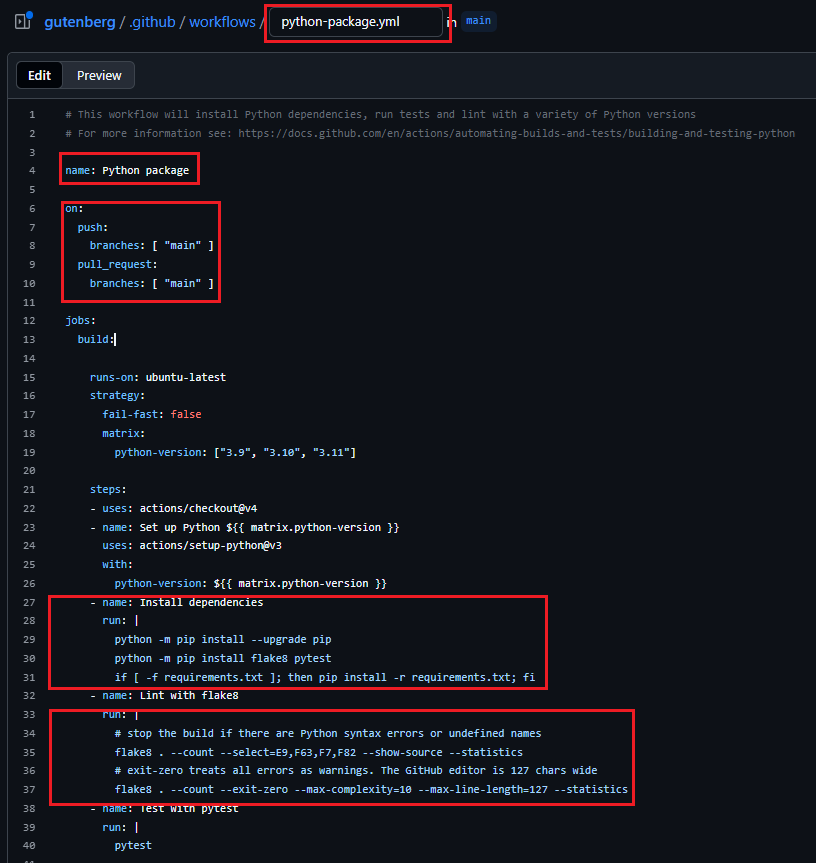

## Overview

With a GitHub repository there's a very easy way to set up CI that runs when your repository changes: add a [.yml file](https://learnxinyminutes.com/docs/yaml/) to your repository in the directory

```text
.github/workflows
```

Each file in this directory represents a _workflow_ and will, when triggered, spin up a virtual machine and run the sequence of commands in the file.

The machines are called _runners_, and GitHub hosts them for you.
[The specifications are documented here](https://docs.github.com/en/actions/reference/runners/github-hosted-runners) and are increased from time to time, so it is worth looking rather than memorising.
A single workflow run can last up to six hours.

Runners are free for public repositories.
For private repositories you have a monthly quota of runner-minutes before any payment is required, which is one reason your repository for this course should be public.

## Creating a basic workflow

We will start with a minimal example to demonstrate various features of a GitHub Actions workflow.
Create a file in your repository called:

```text
.github/workflows/basic.yml
```

Copy the following code, then commit and push the changes to GitHub.

```yml
name: Basic GitHub Actions Workflow

on:
  push:
  pull_request:
  workflow_dispatch:

jobs:
  basic-job:
    runs-on: ubuntu-latest

    steps:
      - name: Run a one-line script
        run: echo "Hello, world!"
```

Here's a brief breakdown of this basic workflow:

1. The `name` field gives your workflow a name. This name will be displayed in the Actions tab of your GitHub repository.

2. The `on` field specifies when your workflow should run. In this case, it's configured to run on `push` events, `pull_request` events, and `workflow_dispatch` events.

3. The `jobs` field describes the jobs that make up your workflow. This workflow includes a single job called `basic-job`.

4. The `runs-on` field inside the `basic-job` job specifies the type of machine to run the job on. Here it is set to run on the latest available version of Ubuntu.

5. The `steps` field is a list of tasks to perform in the job. Each item in the list is a separate task. Here, we have one task that runs a basic shell command (`echo "Hello, world!"`). The `name` field gives the step a name that will be displayed in the GitHub Actions UI.

6. The `run` field specifies the command to run. Here, it's just echoing "Hello, world!" to the console.

If you now navigate to the _Actions_ tab on your GitHub repository, you should see that this workflow has run and succeeded.

In this case it was run because we just pushed a change.
We can also trigger this workflow by opening a pull request, or by navigating to the workflow via the _Actions_ tab and then selecting the _Run Workflow_ dropdown (this is the `workflow_dispatch` trigger).

## Creating a Python-specific workflow

Now let's do something more useful: install the project, lint it, and run its tests, on several versions of Python at once.

Go to the _Actions_ tab and click _New workflow_ near the top left.

GitHub offers a set of starter workflows here, and it is worth a moment to see what is on offer.
Do not use the Python one.
At the time of writing it pins Python 3.9 to 3.11, two of which are past end of life, uses old versions of the actions, installs `flake8` and `pytest` by hand rather than installing your project, and runs the linter twice.
That is a useful lesson in itself: a starter template is a snapshot of what was sensible when somebody wrote it, and nobody is obliged to keep it current for you.

Instead, choose _set up a workflow yourself_.
This opens GitHub's in-browser editor, which is a convenient way to add a workflow without leaving the site.



Name the file `python_versions.yml` and give it this content:

```yml
name: Python versions

on:
  push:
    branches: ["main"]
  pull_request:
    branches: ["main"]
  workflow_dispatch:

jobs:
  python-tests:
    runs-on: ubuntu-latest
    strategy:
      fail-fast: false
      matrix:
        python-version: ["3.12", "3.13", "3.14"]

    steps:
      - uses: actions/checkout@v7

      - name: Set up Python ${{ matrix.python-version }}
        uses: actions/setup-python@v7
        with:
          python-version: ${{ matrix.python-version }}

      - name: Install dependencies
        run: |
          python -m pip install .[dev]

      - name: Lint with ruff
        run: |
          ruff check .

      - name: Test with pytest
        run: |
          pytest
```

Commit it, then go to the _Actions_ tab and watch it run.

Let's go through what is happening.

This workflow runs whenever there's a push to `main`, a pull request targeting `main`, or a `workflow_dispatch` trigger.

It has one job, `python-tests`, which runs on the latest version of Ubuntu.

That job uses a **matrix**, which runs the same job several times with different settings.
Here it runs three times, once for each Python version.
`fail-fast: false` means that if one version fails the others keep going, which is what you want: you would rather learn that the failure happens on every version than only hear about the first one.

Then the steps:

1. **Check out the code.** `actions/checkout@v7` is an _action_, a prewritten piece of work that somebody else maintains. `uses:` pulls one in, where `run:` runs your own command. This one copies your repository onto the runner.

2. **Set up Python.** `actions/setup-python@v7` installs the version named by the matrix. Note how `${{ matrix.python-version }}` reads the current value out of the matrix.

3. **Install dependencies.** `pip install .[dev]` installs your project along with its development dependencies, which are declared in `pyproject.toml`. Have a look at that file: the `dev` extra is where `pytest` and `ruff` come from.

4. **Lint with ruff.** [Ruff](https://docs.astral.sh/ruff/) is a static analysis tool: it reads your code without running it and reports things that look wrong. Its configuration for this project is also in `pyproject.toml`.

5. **Test with pytest.** Runs the test suite.

Note the order. The linter runs before the tests, and a failing step stops the job, so if the linter is unhappy you will never see the test results. That matters in a moment.

## Your first failure: the linter

If all has gone to plan, the workflow has failed.

Click into the failed run and open the _Lint with ruff_ step.
Ruff reports three problems, and none of them is a matter of taste.

::::challenge{id="fix-lint-failures" title="Fix the lint failures"}

Read what ruff says, work out why each one is a real problem rather than a style preference, and fix all three.

You can run the same check locally, which is much quicker than pushing and waiting:

```bash
ruff check .
```

Push your fixes and confirm the step passes.

:::solution

Ruff reports:

- `F401` in `src/ci_course/cli.py`: `import sys` is never used. Harmless in itself, but dead code accumulates and hides real dependencies. Delete the line.

- `B006` in `src/ci_course/io.py`: `errors=[]` is a mutable default argument. The list is created once when the function is defined, not once per call, so errors accumulate across calls for the lifetime of the program. This is a genuine bug that the tests never trigger, because the sample data contains nothing unparseable. The fix is:

  ```python
  def load_measurements(path=None, errors=None):
      if errors is None:
          errors = []
  ```

- `E722` in `src/ci_course/io.py`: a bare `except` catches everything, including `KeyboardInterrupt`, so you cannot interrupt the program while it runs. Catch what you actually expect:

  ```python nolint
  except ValueError:
  ```

The middle one is worth dwelling on: the linter found a bug that a passing test suite had hidden.

:::
::::

## Your second failure: it works on my machine

Fix the linter, push, and the job gets further and then fails again, this time on _Test with pytest_.

Five tests fail with `FileNotFoundError`.
Before reading on, run `pytest` on your own machine.
It passes.

::::challenge{id="fix-missing-package-data" title="Work out why CI disagrees with your laptop"}

Read the error in the CI log carefully, particularly the path it is complaining about.
Work out why the same tests pass locally and fail on the runner, and fix it.

:::solution

The failing path is inside `site-packages`, not inside your repository.

The reason is how the package gets installed in each place.
The README told you to install with `pip install -e ".[dev,docs]"`, where `-e` means _editable_: the installed package points back at your source tree, so `src/ci_course/data/sample_measurements.csv` is right there.
The workflow runs `pip install .[dev]`, with no `-e`, which builds the package and copies it into `site-packages`.
Data files are not Python files, so setuptools does not include them unless you say so, and the copy has no CSV in it.

Declare the data file in `pyproject.toml`:

```toml
[tool.setuptools.package-data]
ci_course = ["data/*.csv"]
```

This is the single most useful thing CI does for you.
Your own machine has your history on it: things you installed once, files you created and forgot about, environment variables you set last year.
A runner starts from nothing every time, so it tests what you actually committed rather than what happens to be lying around.

:::
::::

## Testing on multiple operating systems

The matrix varied one thing, the Python version. It can vary anything.

::::challenge{id="workflow-on-multiple-os" title="Workflow on multiple operating systems"}

Create a second workflow, `os_versions.yml`, that fixes the Python version at 3.13 and instead runs across `ubuntu-latest`, `macos-latest` and `windows-latest`.

Push it and see what happens.

:::solution

```yml
name: Operating systems

on:
  push:
    branches: ["main"]
  pull_request:
    branches: ["main"]
  workflow_dispatch:

jobs:
  os-tests:
    runs-on: ${{ matrix.os }}
    strategy:
      fail-fast: false
      matrix:
        os: [ubuntu-latest, macos-latest, windows-latest]

    steps:
      - uses: actions/checkout@v7

      - name: Set up Python 3.13
        uses: actions/setup-python@v7
        with:
          python-version: "3.13"

      - name: Install dependencies
        run: |
          python -m pip install .[dev]

      - name: Lint with ruff
        run: |
          ruff check .

      - name: Test with pytest
        run: |
          pytest
```

Note `runs-on: ${{ matrix.os }}`: the matrix value is choosing the machine itself.

:::
::::

Ubuntu and macOS pass. Windows fails.

::::challenge{id="fix-windows-failure" title="Fix the Windows failure"}

One test, `test_replaces_an_existing_report`, fails only on Windows.
Find out why and fix it so that all three pass.

:::solution

The test writes a report twice, and `write_report` in `src/ci_course/report.py` writes to a temporary file and then moves it into place with `os.rename`.

On Linux and macOS, renaming onto a file that already exists silently replaces it.
On Windows it raises `FileExistsError`.
Python documents this difference, and it has been true for decades.

The fix is one word:

```python
os.replace(tmp, path)
```

`os.replace` has the overwriting behaviour on every platform.

This is what the operating system matrix is for.
There is nothing wrong with the code in a way that reading it would reveal, the tests are correct, and it passes perfectly on the machine it was written on.
If everyone who works on the project uses Linux or macOS, and nobody runs it anywhere else, the bug sits there until the first Windows user finds it.

:::
::::

## Optional: when the matrix and the project disagree

::::challenge{id="requires-python-mismatch" title="Add a Python version the project does not support"}

Look in `pyproject.toml` for `requires-python`.
It declares the oldest version of Python this project claims to work on.

Add a version below that floor to the matrix in `python_versions.yml`, push, and see what happens.

Then decide what the right fix is. There is more than one defensible answer.

:::solution

`pip` refuses to install the project and the job fails with a message along the lines of:

```text
ERROR: Package 'ci-course' requires a different Python: 3.11.x not in '>=3.12'
```

Two things to notice.

First, the failure is clear and immediate, which is the system working. The alternative is a project that quietly claims support it has never tested.

Second, there is no single correct fix. Either you support that version, in which case lower `requires-python` and make the tests pass on it, or you do not, in which case take it out of the matrix. What you must not do is leave them disagreeing.

Your test matrix is the evidence for whatever your packaging metadata claims. Keeping the two in step is a maintenance job that nobody does for you.

:::
::::

## Next steps

1. \[optional\] read more about [GitHub-hosted runners](https://docs.github.com/en/actions/reference/runners/github-hosted-runners).

1. \[optional\] read more about the [workflow syntax for GitHub Actions](https://docs.github.com/en/actions/reference/workflows-and-actions/workflow-syntax).
